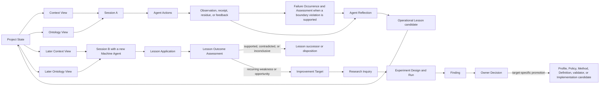

# Agent operational learning model review

## Conclusion

Operational lessons learned from Agent work belong in durable, governed Project State. They are not retained inside a Machine Agent, copied from Session Memory, or treated as self-authenticating knowledge.

A Machine Agent expires with its Session. Before expiry, attributable Agent Actions may persist observations, evidence, reflections, and lesson candidates through the Project's ordinary validation and governance path. A later Session creates a new Machine Agent and may receive an eligible lesson only through an exact Context View or Ontology View.

No Definition, Artifact Type, Relation Kind, lesson, or implementation is admitted by this review.

## Existing concepts to reuse

The repository already supplies several parts of the cycle:

1. **Observation** records something measured, perceived, or recorded with method, conditions, provenance, and uncertainty. Its admitted meaning is scoped to Research or Experiment Runs, so general Agent and runtime work requires an explicit Operational Observation specialization or successor rather than silent reuse.
2. **Finding** is an evidence-bounded conclusion whose wording cannot exceed its support. It is not a decision or policy.
3. **Residue** records an attributable remainder that a local operation could not preserve, name, reconstruct, justify, or validate. It is not automatically a lesson.
4. **Experience Evidence Formation Method** already describes the broad progression from observation and evidence through lesson formation, later exercise, challenge, and owner promotion.
5. The Agent Reasoning Engine migration evidence proposes **Improvement Signal**, **Scoped Lesson**, **Lesson Application**, and **Application Assessment**, but those meanings remain local migration evidence and have no Lab authority effect.
6. The admitted **Classification Axis** and **Classification Orthogonality Invariant** Definitions require every classification axis to answer a distinct question and prohibit silent inference between axes.

The Lab should generalize the useful semantics without creating a second memory service, a second evidence system, or a self-modifying Agent runtime.

## Operational learning cycle



The minimum sequence is:

```text
attributable work
  -> operational observation
  -> bounded reflection
  -> scoped lesson candidate
  -> owner-controlled retention in Project State
  -> selection through a later View
  -> separately recorded application
  -> separately measured outcome
  -> retain, revise, suspend, retire, or route to Research
  -> explicit owner decision for any promotion
```

## Proposed Definitions

### Agent Reflection

**Candidate identity:** `cal.definition.agent-reflection`

An Agent Reflection is an attributable, revisable interpretation of exact Agent Sessions, Actions, outputs, observations, feedback, evidence, and residue. It identifies a possible mismatch, cause, repair, or reusable lesson while preserving alternatives and uncertainty. Reflection is diagnostic Project State; it is not an Observation, Finding, Decision, Definition, Policy, proof of improvement, or hidden chain of thought.

Minimum content:

- exact Session and Agent Action references;
- triggering Observation, feedback, receipt, Finding, Failure Occurrence, Failure Assessment, or Residue references;
- prior interpretation or behavior;
- observed mismatch and attribution basis;
- proposed revised interpretation or repair;
- unresolved alternatives and counterevidence;
- authoring Agent Action and accountable owner route;
- authority effect `none`.

### Operational Lesson

**Candidate identity:** `cal.definition.operational-lesson`

An Operational Lesson is a versioned, evidence-bounded, scope-limited candidate for how future Project work may be interpreted or performed. It is derived from attributable operational evidence and reflection, states when it applies and when it does not, predicts an observable benefit, and declares how the prediction can fail. It remains revisable Project State and grants no authority.

Required lesson contract:

```text
lesson identity and revision
project, product, workflow, or task scope
applicable actor/profile/capability and action kinds
source Sessions, Actions, Reflections, Observations, Findings, and Evidence Sets
the proposed interpretation or behavior
applicability conditions
explicit exclusions and counterexamples
expected observable benefit
falsifier and evaluation method
supporting evidence and counterevidence
confidence and claim ceiling
retention, visibility, and application policy
owner, challenge route, review date, and expiry
predecessor and successor references
```

An Operational Lesson is not an instruction merely because it was persisted. An Agent may apply it only when the current instruction, Context, Policy, and Authority envelope allow it.

### Lesson Application

**Candidate identity:** `cal.definition.lesson-application`

A Lesson Application is an immutable record that one exact Operational Lesson revision was selected, presented, and actually used or deliberately not used for one later Agent Session or Action. It records the applicable condition, current instruction, View projection, decision to apply, intended influence, conflicts, overrides, and attributable Action. Selection, presentation, application, compliance, and success remain separate facts.

### Lesson Outcome Assessment

**Candidate identity:** `cal.definition.lesson-outcome-assessment`

A Lesson Outcome Assessment is an evidence-bounded comparison between one Lesson Application's predicted benefit or falsifier and its observed outcome. Its disposition is `supported`, `contradicted`, or `inconclusive` under a named method and evidence set. Absence of correction, repeated wording, Agent self-report, successful dispatch, or task completion alone does not establish that the lesson helped.

### Improvement Target

**Candidate identity:** `cal.definition.improvement-target`

An Improvement Target is an owner-reviewed, deduplicated statement of a recurring weakness or opportunity that warrants Research, Experiment, Profile revision, Policy revision, validator work, or Implementation change. It binds the affected surface, supporting Operational Lessons and Outcome Assessments, baseline, desired change, protected constraints, measure, budget, and stop condition. It authorizes no self-upgrade.

### Operational Learning Cycle

**Candidate identity:** `cal.definition.operational-learning-cycle`

The Operational Learning Cycle is the governed method that converts attributable Agent work into scoped lesson candidates, later applications, outcome assessments, and owner-routed improvement work while preserving evidence, scope, counterevidence, reversibility, and authority boundaries across ephemeral Machine Agent Sessions.

## Proposed Artifact Types

| Artifact Type | Responsibility |
| --- | --- |
| Agent Reflection | Bounded diagnostic interpretation of exact Sessions, Actions, observations, feedback, failure assessments, evidence, and residue |
| Operational Lesson | Versioned, scoped, evidence-bearing candidate behavior or interpretation for later work |
| Lesson Application | Immutable record of selection, projection, applicability decision, and actual use or non-use of one lesson revision |
| Lesson Outcome Assessment | Evidence-bound supported, contradicted, or inconclusive assessment of one application |
| Improvement Target | Owner-reviewed entry into Research, Experiment, Profile, Policy, validation, or Implementation improvement work |
| Operational Observation | Attributable operational signal outside the Research/Experiment-only Observation boundary |
| Work Outcome Assessment | Supported, contradicted, or inconclusive comparison between declared expected and observed work result |
| Feedback Record | Exact correction, rejection, edit, preference expression, or requirement-change signal bound to its source and target |
| Communication Preference | Scoped expression preference distinct from User Decision Preference, current instruction, Policy, and Lesson |
| Preference Application Assessment | Request-bound applicability, conflict, override, and evidence assessment for one preference revision |
| Drift Assessment | Expected-versus-observed comparison for versions, conditions, bindings, meanings, or currentness |
| Improvement Signal | Provenance-bound possible weakness or opportunity without causal, benefit, or permission claims |

Observation, Finding, Evidence Set, Residue, Research Inquiry, Research Run, Experiment Design, Experiment Run, Measurement Result, Decision, Policy, Definition, Agent Profile, and Implementation should be reused. They must not be duplicated inside these new carriers.

Classification Scheme and Classification Assignment are cross-cutting carriers rather than operational-learning-specific duplicates. Their complete model is reviewed in `2026-10-05-classification-model-review.md`.

## Operational lesson classifications

Operational Lessons require independent classification axes for routing and retrieval:

| Axis | Question |
| --- | --- |
| `lesson-kind` | What kind of future guidance is proposed? |
| `trigger-kind` | What kind of event initiated the Reflection? |
| `target-work-kind` | Which governed class of later work may it guide? |
| `evidence-posture` | What aggregate outcome evidence currently bears on it? |
| `generalization-level` | How broadly may the current evidence support candidate reuse? |

Lifecycle, confidence, authority, exact scope, and applicability remain separate. A `supported` evidence classification does not make a lesson admitted or mandatory. A `project-local` generalization value still requires an exact Project reference and current Context match.

Classifications with provenance or challenge requirements use Classification Assignment records. Small local enums may remain closed schema fields. A semantic class assignment may project through `relation.instance-of`; generic labels must not be forced into that relation.

## State and authority model

### Operational Lesson lifecycle

```text
candidate
  -> reviewed
  -> eligible-for-trial
  -> supported | contradicted | inconclusive
  -> retained | revised | suspended | retired | promoted-through-separate-decision
```

- `candidate`: persisted by an attributable Agent Action; no authority effect.
- `reviewed`: owner or delegated reviewer has checked provenance, scope, exclusions, policy, and challenge route.
- `eligible-for-trial`: a later Context or Ontology View may select the exact revision for an allowed consumer and purpose.
- `supported`, `contradicted`, or `inconclusive`: derived from one or more Lesson Outcome Assessments; these are evidence postures, not authority states.
- `retained`: remains selectable inside its exact scope.
- `revised`: replaced by a successor revision; old evidence and applications remain immutable.
- `suspended`: excluded from new Views because of contradiction, revocation, expiry, scope violation, or policy conflict.
- `retired`: kept for history and excluded from future application.
- `promoted-through-separate-decision`: an owner creates and decides a target-specific Profile, Policy, Method, Definition, validator, or Implementation candidate. The lesson itself never silently changes type.

### View selection rule

```text
selectable(lesson_revision, session)
  requires retained_or_trial_eligible(lesson_revision)
  and scope_matches(lesson_revision, session.assignment)
  and consumer_allowed(lesson_revision, session.agent_profile)
  and current_instruction_allows(lesson_revision)
  and policy_allows(lesson_revision)
  and not_expired_or_suspended(lesson_revision)
  and context_view_binds_exact_revision(lesson_revision)
```

An Ontology View may expose the lesson and its semantic connections. A Context View decides whether its content is relevant to the current purpose. Neither View turns the lesson into authority or proves it was applied.

## Relation model

These are exact candidate connections. Each must pass the Typed Connection Extension Rule before addition to the closed Relation Kind grammar.

| Source | Axis or carrier | Target | Meaning |
| --- | --- | --- | --- |
| Agent Action | `produces` | Observation, Agent Reflection, Operational Lesson, or Lesson Application | Attributable production only; no acceptance inference |
| Agent Reflection | `derives-from` | Agent Session, Agent Action, Observation, Finding, Evidence Set, feedback record, or Residue | Exact basis of the diagnostic interpretation |
| Operational Lesson | `derives-from` | Agent Reflection, Failure Assessment, Finding, Evidence Set, or Lesson Outcome Assessment | Evidence and reasoning basis of the revision |
| Operational Lesson | `governed-by` | Policy | Retention, visibility, selection, challenge, and expiry rules |
| Context View | projection item | Operational Lesson revision | Exact lesson content selected for one consumer and purpose |
| Ontology View | projection item | Operational Lesson revision and relations | Exact semantic graph projection |
| Lesson Application | `applies-lesson` | Operational Lesson revision | Actual later use or deliberate non-use; a new independent semantic axis |
| Lesson Outcome Assessment | `evaluates` | Lesson Application | Compares predicted and observed outcome |
| Improvement Target | `derives-from` | Operational Lesson or Lesson Outcome Assessment | Recurring evidence basis for improvement work |
| Research Inquiry | `addresses` | Improvement Target | Research question created for the governed target |
| Experiment Design | `tests` | hypothesis derived from Improvement Target | Controlled evaluation rather than operational anecdote |
| Owner Decision | `declares-effect-on` | Operational Lesson or target-specific promotion candidate | Retain, revise, suspend, retire, admit, or adopt under a closed effect value |

`applies-lesson` is required because `uses-method`, `tests`, `executes`, `member-of`, and `contributes-to` answer different questions. It should contain only the exact endpoint pairs needed for lesson use, with qualifiers for applicability result, current instruction precedence, conflict, override, and intended influence.

## Non-collapse rules

```text
Session Memory != Agent Reflection != Operational Lesson != Project State

Observation != Agent Reflection
Agent Reflection != Finding
Finding != Operational Lesson
Operational Lesson != Definition != Policy != Agent Profile
Operational Lesson != user instruction != preference

correction != changed requirement != preference != failure != drift
successful outcome != lesson != proof of causality
near miss != Failure Occurrence

lesson selection != lesson projection != lesson application
lesson application != compliance != successful outcome
successful task != evidence that the lesson caused success
absence of correction != support
Agent self-report != independent evidence

Residue != lesson
recurrence != diagnosis
Improvement Target != Research Finding != permission to change an Implementation

Failure Mode != Failure Occurrence != Operational Lesson
repeated symptom != verified recurring failure class

retained lesson != hidden machine memory
later Machine Agent != predecessor Machine Agent
```

Specific safeguards:

1. A lesson from one Person, Product, Project, workflow, or task class cannot expand to another scope without new evidence and owner review.
2. A current explicit instruction overrides an older optional lesson in the same authority scope.
3. A lesson cannot authorize an Agent Action, external effect, admission, deployment, or access.
4. A Machine Agent cannot edit its own Profile, Implementation, Policy, or serving configuration from a lesson.
5. Contradictory and negative outcomes remain visible. They cannot be removed by revising the lesson.
6. Missing outcome evidence remains inconclusive.
7. General improvement claims require comparable baselines, measures, evaluators, cohorts, and protected checks through Research or Experiment.

## Real-like example from this model review

### Candidate lessons from the three-agent audit

These are review candidates extracted from the actual audit work. They have no authority effect and require owner review before they become eligible for later application.

| Candidate lesson | Evidence from Agent work | Exact scope | Expected benefit | Exclusion or falsifier |
| --- | --- | --- | --- | --- |
| `lesson:resolve-effective-state-before-status@1` | Definition and Artifact Type review found that immutable descriptors, admissions, duplicate resolutions, successor decisions, registries, and activation records can disagree | Repository status and admission audits in CyberAlchemy-lab | Fewer false claims that an artifact is current, admitted, or active | A surface with one declared canonical state source does not require the full overlay resolver |
| `lesson:verify-semantic-closure-not-pair-count@1` | Relation and Ontology review found 147 declared pairs but only 32 with two admitted endpoint carriers, open qualifiers, and no admitted Relation Kind carrier | Claims that a relation grammar or ontology connection model is closed | Prevent “closed” claims based only on listed identifiers | A pair count alone cannot support the lesson; the audit must check carrier resolution, qualifier closure, extension rules, and forbidden inferences |
| `lesson:separate-schema-admission-from-operational-realization@1` | Runtime, Product, and Context review found admitted Product and Research types with no admitted instances or consumers, while Experiment and Context remained candidate-only | Readiness and completeness claims for Lab model surfaces | Fewer claims that admitted schemas prove a working workflow | An Artifact Type admission can establish only its admitted schema posture; it cannot establish instances, consumers, runtime behavior, or value delivery |
| `lesson:trace-complete-model-through-operation@1` | Owner corrections identified missing Intent realization, Implementation, Agent, Session lifetime, and memory ownership | End-to-end or complete Lab model reviews | Fewer omitted lifecycle layers | A narrow review of one Definition or carrier does not require the complete chain |

These candidates demonstrate the separation between evidence and operational guidance:

```text
audit result or owner correction
  -> Observation or Finding
  -> Agent Reflection about a recurring work practice
  -> Operational Lesson candidate with scope and falsifier
  -> owner review
```

The audit Finding remains the evidence-bounded conclusion about this repository state. The lesson is the proposed future review behavior derived from it. They must remain independently versioned and challengeable.

### Session A: evidence and lesson formation

```yaml
agent_session: session:lab-model-review-2026-10-05-a
machine_agent_instance: agent-instance:lab-model-review-a
agent_action: action:explain-complete-lab-model

feedback_observations:
  - "Implementation was missing from the Intent realization chain."
  - "Agent was missing as an Actor."
  - "Machine Agent must be ephemeral."
  - "Long-term memory is Project State accessed through Context and Ontology Views."

agent_reflection:
  identity: reflection:lab-model-completeness-a
  interpretation: >
    The earlier model omitted operational realization and actor continuity
    boundaries, so its claim of completeness exceeded the represented chain.
  alternatives:
    - "The omissions may be specific to this Lab model and do not establish a universal explanation preference."
  authority_effect: none

operational_lesson:
  identity: lesson:complete-model-coverage@1
  scope:
    project: CyberAlchemy-lab
    task_class: complete-system-model-review
    profile: repository-model-review
  proposed_behavior: >
    Before presenting a complete Lab model, trace Intent through actor,
    assignment, product/project selection, capability realization,
    implementation, runtime action, evidence, decision, and durable state.
  applicability:
    - "The requested output claims to be a complete or end-to-end Lab model."
  exclusions:
    - "A narrow request for one Definition does not require the entire chain."
    - "This evidence does not support a general claim that the user prefers process-first explanations."
  expected_benefit: "Fewer owner corrections for omitted lifecycle layers."
  falsifier: >
    A later comparable complete-model review applies the checklist and still
    omits a required layer or creates a semantic collapse.
  evidence_posture: candidate
  authority_effect: none
  classification_assignment_refs:
    - classification:complete-model-coverage/lesson-kind/procedural
    - classification:complete-model-coverage/trigger-kind/explicit-correction
    - classification:complete-model-coverage/target-work-kind/complete-system-model-review
    - classification:complete-model-coverage/evidence-posture/unassessed
    - classification:complete-model-coverage/generalization-level/project-local
  owner_review: required
```

Session A then terminates. Its Machine Agent and Session Memory expire. The Reflection and Operational Lesson survive only if their producing Agent Action persists them as Project artifacts with provenance.

### Session B: later use and assessment

```yaml
agent_session: session:lab-model-review-2026-10-12-b
machine_agent_instance: agent-instance:lab-model-review-b
context_view:
  selected_lesson: lesson:complete-model-coverage@1
  selection_reason: "Same Project, task class, and Profile; lesson is reviewed and unexpired."

lesson_application:
  identity: lesson-application:complete-model-coverage-b
  lesson_revision: lesson:complete-model-coverage@1
  posture: applied
  intended_influence: "Run the declared chain completeness check before presenting the model."

lesson_outcome_assessment:
  identity: lesson-assessment:complete-model-coverage-b
  disposition: inconclusive
  reason: >
    The checklist was applied, but no comparable evaluation or explicit owner
    confirmation yet establishes that it prevented omissions.
```

The assessment remains inconclusive until evidence addresses the declared benefit. Silence is not converted into support.

## Integration with Agent memory

```text
Session A
  ephemeral Session Memory
  -> governed Agent Action persists a lesson candidate
  -> Project State owns the durable record
  -> Session A and Machine Agent A terminate

Between Sessions
  owner review, challenge, expiry, revision, or suspension
  -> all recorded in Project State

Session B
  new Machine Agent B
  -> exact Context View selects lesson revision
  -> exact Ontology View exposes its meaning and relations
  -> Lesson Application records actual use
  -> Outcome Assessment returns evidence to Project State
  -> Session B and Machine Agent B terminate
```

This preserves learning without inventing cross-session machine identity. The durable continuity is the governed record and its evidence history.

## Required admission order

1. Admit the Agent and ephemeral Session model, Project State, Context View, Ontology View, and Agent Action foundations.
2. Decide whether Agent Reflection specializes an existing Intent Reflection carrier or receives a general standalone carrier. Do not maintain two writable reflections for the same event.
3. Admit Classification Scheme and Classification Assignment before relying on task-class, failure-class, lesson-kind, or evidence-posture labels.
4. Admit Operational Lesson, Lesson Application, Lesson Outcome Assessment, Improvement Target, and Operational Learning Cycle Definitions.
5. Materialize the five operational-learning Artifact Types and their closed lifecycle/status vocabularies.
6. Define the exact operational-learning Classification Scheme and its axes, values, cardinalities, and mappings.
7. Add endpoint kinds and exact relation pairs through the Typed Connection Extension Rule, including the independent `applies-lesson` axis.
8. Add View selection, expiry, revocation, challenge, classification, predecessor/successor, and immutable application/outcome rules.
9. Admit or explicitly sequence the Failure Mode, Failure Occurrence, and Failure Assessment carriers before using recurrence thresholds.
10. Connect assessed recurring failures to Research and Experiment without granting self-upgrade authority.
11. Admit one representative lesson cycle only after replay, scope, classification, failure deduplication, contradiction, expiry, challenge, and no-collapse evidence passes.

## Gap register

1. No admitted Agent Reflection or general Operational Lesson Definition.
2. No Lab Artifact Type carries a lesson revision, its application, or its outcome assessment.
3. The useful Agent Reasoning Engine lesson concepts remain local migration evidence with no Lab authority effect.
4. No explicit rule connects lesson persistence to Project State and later selection through Context and Ontology Views.
5. No closed lifecycle separates lesson review, trial eligibility, evidence posture, retention, suspension, retirement, and target-specific promotion.
6. No exact relation distinguishes applying a lesson from using a method, executing work, testing a hypothesis, or belonging to a Project.
7. No rule prevents silence, selection, dispatch, Agent self-report, or task completion from being counted as learning success.
8. No admitted bridge routes recurring operational evidence into Research or Experiment while prohibiting autonomous self-upgrade.
9. Task class, failure class, lesson kind, trigger kind, evidence posture, and generalization scope currently lack governed Classification Schemes and attributable Assignments.
10. No admitted Failure Occurrence or Failure Assessment carrier establishes which distinct episodes may count toward a recurring-failure lesson or Improvement Target.
11. The admitted Observation boundary is Research/Experiment-specific, and no general Operational Observation, Work Outcome Assessment, Feedback, Preference, Drift Assessment, or Improvement Signal carrier covers the other learning inputs.

## Decision posture

The recommended model is to admit operational learning as a governed Project State workflow. The smallest coherent new carrier family is Agent Reflection, Operational Lesson, Lesson Application, Lesson Outcome Assessment, and Improvement Target. Existing Observation, Finding, Evidence, Residue, Research, Experiment, Decision, Policy, Definition, Agent Profile, and Implementation carriers retain their own responsibilities.

Operational lessons may guide later ephemeral Agents only when exact revisions are selected through Context and Ontology Views under current instructions, Policy, scope, expiry, and owner control. Every actual use and outcome remains separately attributable. Promotion to a Profile, Policy, Method, Definition, validator, or Implementation requires a new target-specific candidate and explicit owner decision.
