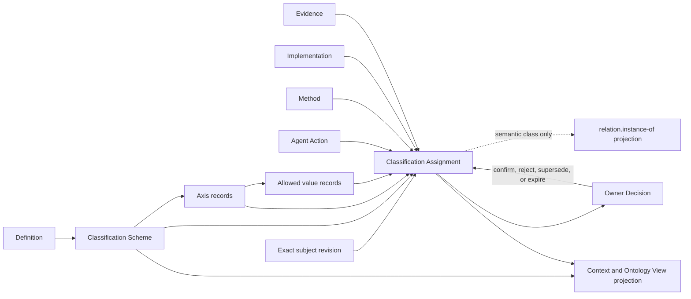

# Classification model review

## Conclusion

Classification is a first-class semantic layer in the Lab, but the current repository contains only part of its model.

The Lab already admits Definitions for Classification Axis, Classification Orthogonality Invariant, and Artifact Surface Classification. The candidate relation grammar also contains `relation.instance-of` under `axis.classification`. What is missing is a general carrier that states which versioned scheme supplied the axes and values, and which exact subject revision received which value, from whom, by what method, and with what evidence.

The smallest coherent addition is:

1. **Classification Scheme** — owns a versioned set of independent axes, allowed values, cardinality, rules, and mappings.
2. **Classification Assignment** — binds one exact subject revision to one exact scheme, axis, and value with provenance, evidence, method, and lifecycle.

Axes and values may remain governed records inside a Classification Scheme until they need independent lifecycle or reuse. Classifier identity is represented through Agent Action, Method, and Implementation references instead of a new durable Classifier actor.

No Definition, Artifact Type, Relation Kind, scheme, value, or assignment is admitted by this review.

## Existing authoritative semantics

### Classification Axis

An admitted Classification Axis Definition says that every axis asks one independently useful decision or validation question.

```text
axis = one distinct question
value = one allowed answer under that question
```

Examples of distinct axes include semantic kind, authority kind, lifecycle posture, evidence posture, task kind, and surface role.

### Classification Orthogonality Invariant

The admitted invariant requires:

- every canonical axis to have a distinct purpose;
- one axis not to be silently inferred from another;
- redundant canonical labels to be rejected;
- dependencies between axes to be explicit typed couplings, schema rules, or residue;
- convenience labels to remain derived projections.

### Artifact Surface Classification

This admitted Definition classifies governed files as canonical instance, declared component, generated projection, evidence, fixture, or transient state. This is a specialized file-role scheme. It does not supply the general carrier needed for Agent, lesson, task, failure, evidence, or domain classification.

### Candidate classification relation

The current relation model proposes `relation.instance-of` for classification under an exact parent model. It explicitly forbids inference of conformance, realization, or ownership transfer. Its current endpoint set is narrow and has no admitted general Classification Assignment carrier.

## Core model



## Proposed Definitions

### Classification

**Candidate identity:** `cal.definition.classification`

Classification is the governed act and result of assigning an exact subject revision to one or more declared values under independently named axes in one exact Classification Scheme. A classification states answers to declared questions. It does not establish identity, Definition meaning, schema conformance, admission, authority, ownership, realization, causality, success, or ontology truth unless a separate governed record establishes that fact.

### Classification Scheme

**Candidate identity:** `cal.definition.classification-scheme`

A Classification Scheme is a versioned governed contract containing one or more Classification Axes, their allowed values, definitions, cardinality, applicability, exclusions, assignment rules, evidence requirements, hierarchy rules, mappings, owner, challenge route, and compatibility policy.

Minimum scheme content:

```text
scheme identity and version
semantic owner and authority scope
purpose and declared consumers
axis identities and unique questions
allowed values with Definition references
single-value or multi-value cardinality per axis
required, optional, conditional, or prohibited axes
assignment and evidence rules
hierarchy and cross-scheme mapping rules
unknown, other, disputed, and not-applicable handling
compatibility, predecessor, successor, and migration rules
owner decision and challenge route
```

A new scheme version does not retroactively reclassify subjects assigned under an older version.

### Classification Value

**Candidate identity:** `cal.definition.classification-value`

A Classification Value is one governed allowed answer under one exact Classification Axis in one exact Scheme version. It carries a stable identity, Definition reference, applicability, exclusions, examples, counterexamples, hierarchy position when applicable, and compatibility mappings. Its display label is a projection and cannot serve as its identity.

Values that represent semantic classes may participate in `relation.instance-of`. Lifecycle states, authority kinds, evidence postures, and file roles remain their own independent axes even when their values use similar words.

### Classification Assignment

**Candidate identity:** `cal.definition.classification-assignment`

A Classification Assignment is a versioned attributable record binding one exact subject revision to one exact Scheme version, Axis, and Value. It records whether the value was explicit, measured, inferred, imported, or owner-declared; the assigning Agent Action, Method, and Implementation; evidence and counterevidence; confidence when applicable; effective period; lifecycle; owner decision; predecessor; and challenge route.

Minimum assignment content:

```text
assignment identity and revision
subject_ref and subject_version_or_digest
scheme_ref and scheme_version
axis_ref and value_ref
assignment_basis: explicit | measured | inferred | imported | owner-declared
agent_action_ref
method_ref and implementation_ref when used
evidence_refs and counterevidence_refs
confidence_measure_ref when applicable
effective_from and effective_until
lifecycle: proposed | confirmed | disputed | rejected | superseded | expired
decision_ref
predecessor_ref
owner_ref and challenge_route
authority_effect
```

An assignment is immutable after recording. Correction or reclassification creates a successor assignment and preserves the earlier evidence and decision history.

### Classifier

**Candidate semantic treatment:** role, not standalone durable actor.

A Classifier is the role played by an Agent Action, Method, or Implementation when it proposes or computes a Classification Assignment. Human, Team, Machine, and Service Agents remain the attributable actors. The classifier role grants no authority to confirm an assignment.

### Taxonomy

**Candidate semantic treatment:** specialization of Classification Scheme.

A Taxonomy is a Classification Scheme whose values have an explicit broader/narrower or subclass structure. A flat controlled vocabulary is a Scheme without that hierarchy. An Ontology may represent taxonomy values and their relations, but the Ontology nodes do not replace the Scheme or Assignment records.

## Proposed Artifact Types

| Artifact Type | Responsibility |
| --- | --- |
| Classification Scheme | Versioned axes, values, rules, hierarchy, mappings, owner, compatibility, and challenge contract |
| Classification Assignment | Attributable subject-to-axis/value binding with exact versions, method, evidence, lifecycle, and decision |

Classification Axis and Classification Value begin as governed internal Scheme records. Promote either to a standalone Artifact Type only when it needs independent ownership, lifecycle, relations, reuse across schemes, or direct challenge.

## Classification surfaces in the Lab

The same mechanism serves several different surfaces without merging their axes.

| Surface | Candidate axes | Why it remains separate |
| --- | --- | --- |
| Artifact registration | semantic kind, authority kind, lifecycle posture | Meaning, authority, and lifecycle answer different questions |
| Canonical package | surface role | File responsibility does not establish Artifact Type or authority |
| Actor and Agent | actor kind, agent kind, profile kind | Classification does not establish identity, capability, Role, Assignment, or Delegation |
| Agent Action | action kind, effect class, result posture | What was attempted, what effect class was involved, and what happened are independent |
| Operational learning | lesson kind, trigger kind, target work kind, evidence posture | Guidance content, cause of reflection, applicability, and support are independent |
| Failure management | failure surface, manifestation kind, detection stage, impact scope kind, evidence posture | Where a deviation manifests, how it manifests, when it is detected, what may be affected, and what evidence supports it are independent |
| Research and Experiment | inquiry kind, method class, observation kind, measurement kind | Research question, method, observed datum, and measure remain distinct |
| Ontology | node kind, edge projection kind, local/global posture | Graph representation does not replace the represented subject or relation |
| Governance | authority kind, challenge posture, decision effect, lifecycle posture | Permission, contestability, declared effect, and state cannot be inferred from each other |

## Actor and Agent classifications

Actor and Agent remain abstract semantic classes. Their classifications require exact values rather than durable Machine Agent identities.

### Candidate actor-kind values

```text
human-agent
team-agent
machine-agent
service-agent
hybrid-agent
```

For a Machine Agent Instance:

```text
subject: agent-instance:session-42
scheme: scheme:agent-classification@1
axis: axis:actor-kind
value: class:machine-agent
```

This assignment says what kind of actor the ephemeral instance is. It does not grant a Role, Capability, Assignment, Delegation, authority, memory, or identity continuity. The Machine Agent Instance still expires with its Session.

Agent Profile, Agent Capability, Role, Agent Assignment, Principal, and Delegation remain referenced artifacts or relations rather than values inferred from actor kind.

## Operational lesson classifications

An Operational Lesson should carry independent classifications for routing and retrieval while retaining exact scope references and evidence.

| Axis | Unique question | Example values | Must not imply |
| --- | --- | --- | --- |
| `lesson-kind` | What kind of future guidance does the lesson propose? | interpretive, procedural, coordination, tool-use, evidence, governance, communication | applicability, truth, authority |
| `trigger-kind` | What kind of event initiated the reflection? | explicit correction, failed action, unexpected outcome, contradiction, residue, recurring observation, explicit reflection request | diagnosis or causal explanation |
| `target-work-kind` | Which governed class of later work may the lesson guide? | repository audit, definition review, relation review, implementation task, experiment, communication | exact scope match or permission |
| `evidence-posture` | What aggregate outcome evidence currently bears on the lesson? | unassessed, supported, contradicted, inconclusive, mixed | lifecycle, confidence, adoption |
| `generalization-level` | How broadly may the current evidence support reuse? | action-local, session-local, project-local, product-local, workflow-class, cross-project candidate | automatic expansion to the named level |

Lifecycle remains a separate governed state:

```text
candidate -> reviewed -> eligible-for-trial
  -> retained | revised | suspended | retired
```

Authority remains `none` until a separate Decision acts on a separate target-specific artifact. A lesson classified as `governance` or `supported` still grants no permission.

Exact applicability is not established by `target-work-kind` alone. It also requires typed Project, Product, workflow, Profile, Capability, task, and policy references plus a current Context match.

## Failure Mode classifications

Failure Mode and Failure Occurrence reuse Classification Scheme and Classification Assignment. Their initial independent axes are failure surface, manifestation kind, detection stage, impact scope kind, and evidence posture. Severity, likelihood, confidence, recoverability, lifecycle, authority, exact violated boundary, and actual affected subjects remain separate.

A Failure Occurrence may be assigned to one exact Failure Mode revision through a canonical Classification Assignment and a semantic `relation.instance-of` projection. Similar symptoms, error messages, exception classes, or reason codes cannot establish a shared mode. The complete failure vocabulary, controls, relations, and recovery model are in `2026-10-05-failure-mode-model-review.md`.

## Classification Assignment versus fields and relations

Use three representation levels deliberately:

1. **Closed local field** — use when the value is internal to one Artifact Type, has no independent lifecycle, and is validated by that schema.
2. **Classification Assignment** — use when the classification needs provenance, evidence, review, history, cross-artifact reuse, or challenge.
3. **Typed Relation projection** — use `relation.instance-of` only when the assigned value is a genuine semantic class or parent model and the exact endpoint pair is admitted.

Do not turn every enum field into a graph edge. Do not hide a consequential inferred classification inside an unversioned string field.

## Relation model

### `relation.instance-of`

Retain `relation.instance-of` as the global semantic classification relation. Revise its question to:

> Under which exact governed semantic class or parent model is this subject classified?

Required qualifiers:

```text
classification_assignment_ref
scheme_version_ref
axis_ref
class_or_parent_version_ref
```

The specialized Classification Assignment is canonical and projects the global Typed Relation when its value represents a semantic class. The projection cannot outlive or contradict the Assignment.

Forbidden inferences remain:

```text
identity equivalence
schema conformance
realization
membership
ownership
authority
successful behavior
```

### Taxonomy hierarchy

If hierarchical schemes are admitted, add a separate `relation.subclass-of` axis through the Typed Connection Extension Rule:

```text
classification-value -> classification-value
```

Unique question: which broader value semantically subsumes this narrower value inside one exact Scheme version?

This relation cannot be reused for artifact membership, ownership, lineage, lifecycle succession, or instance classification.

### Classification provenance

- Agent Action `produces` Classification Assignment.
- Classification Assignment `derives-from` Evidence, Observation, Finding, Measurement Result, imported source, or owner declaration.
- Classification Assignment `governed-by` Classification Scheme and Policy.
- Decision `declares-effect-on` Classification Assignment with a closed effect such as `confirms`, `rejects`, `supersedes`, or `expires`.
- Context View and Ontology View may project exact Scheme and Assignment revisions.

## Real-like example: classifying an audit lesson

```yaml
classification_scheme:
  identity: scheme:operational-lesson@1
  axes:
    - axis:lesson-kind
    - axis:trigger-kind
    - axis:target-work-kind
    - axis:evidence-posture
    - axis:generalization-level

subject:
  ref: lesson:verify-semantic-closure-not-pair-count@1
  digest: sha256:example

assignments:
  - axis: axis:lesson-kind
    value: class:procedural
    basis: owner-declared

  - axis: axis:trigger-kind
    value: class:audit-finding
    basis: explicit
    evidence_refs:
      - finding:relation-model-has-unresolved-endpoints

  - axis: axis:target-work-kind
    value: class:relation-model-review
    basis: explicit

  - axis: axis:evidence-posture
    value: class:unassessed
    basis: measured
    evidence_refs: []

  - axis: axis:generalization-level
    value: class:project-local
    basis: owner-declared

authority_effect: none
```

The assignment supports retrieval of the lesson for a later relation-model review. It does not prove that the lesson applies to the current task. The Context View must still match the exact Project, task purpose, Profile, current instruction, Policy, expiry, and exclusions. If the lesson is later applied, a separate Lesson Application and Lesson Outcome Assessment record what happened.

## Non-collapse rules

```text
Definition != Classification Scheme
Classification Axis != Classification Value
Classification Value identity != display label
Classification Scheme != Ontology
Classification Assignment != Typed Relation

classification != identity
classification != Artifact Type resolution
classification != schema conformance
classification != lifecycle transition
classification != admission or activation
classification != authority or permission
classification != ownership or membership
classification != realization or implementation
classification != evidence acceptance or truth

actor kind != Role != Agent Profile != Agent Capability
machine-agent classification != durable Machine Agent identity

lesson kind != trigger kind != target work kind
evidence posture != confidence != lifecycle != authority
target work classification != exact applicability

taxonomy hierarchy != instance-of != member-of != successor-of
```

## Required admission order

1. Keep the admitted Classification Axis, Classification Orthogonality Invariant, and Artifact Surface Classification meanings as prerequisites.
2. Admit Classification, Classification Scheme, Classification Value, and Classification Assignment Definitions.
3. Materialize Classification Scheme and Classification Assignment Artifact Types.
4. Define the first exact Schemes for Agent classification, Operational Lesson classification, and Failure Mode classification, including all axis questions, values, cardinality, definitions, and unknown/disputed handling.
5. Extend endpoint kinds and `relation.instance-of` only through the Typed Connection Extension Rule.
6. Add `relation.subclass-of` only if a reviewed Scheme requires hierarchy.
7. Add Agent Action, Method, Implementation, Evidence, Decision, Context View, and Ontology View adapters.
8. Validate reclassification, predecessor/successor history, scheme-version migration, ambiguity, disagreement, expiry, challenge, and no-collapse cases.
9. Admit representative Agent Instance and Operational Lesson assignments only after owner review.

## Gap register

1. No admitted base Classification, Classification Scheme, Classification Value, or Classification Assignment Definition.
2. No general Artifact Type carries Scheme or Assignment lifecycle and provenance.
3. The candidate `relation.instance-of` endpoint set is narrow and its parent-model wording does not cover all semantic-class use without revision.
4. No governed Agent actor-kind Scheme exists.
5. No governed lesson-kind, trigger-kind, target-work-kind, evidence-posture, or generalization-level Scheme exists.
6. Current task-class and failure-class strings in Agent Reasoning migration evidence have no governed classification identities.
7. No rule decides when a local schema field must become a challengeable Classification Assignment.
8. No scheme-version migration or reclassification history contract exists.
9. No cross-scheme mapping rule prevents two similar labels from being treated as equivalent.
10. No general classifier provenance rule binds Assignment to Agent Action, Method, Implementation, and Evidence.
11. Failure strings, exception classes, reason codes, and repeated symptoms have no governed mapping to exact Failure Mode revisions or occurrence evidence.

## Decision posture

The recommended model is to add two Artifact Types: Classification Scheme and Classification Assignment. Scheme owns axes and values until independent lifecycle justifies promoting them. Assignment owns attributable classification history. Existing Definitions supply the orthogonality rule, and `relation.instance-of` remains the semantic-class projection rather than becoming a generic label relation.

For operational learning, classifications improve routing and retrieval. They never replace exact scope references, current Context matching, lesson application records, outcome evidence, or owner authority.
