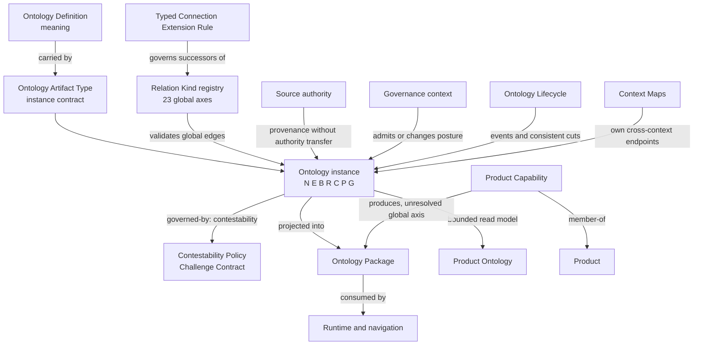
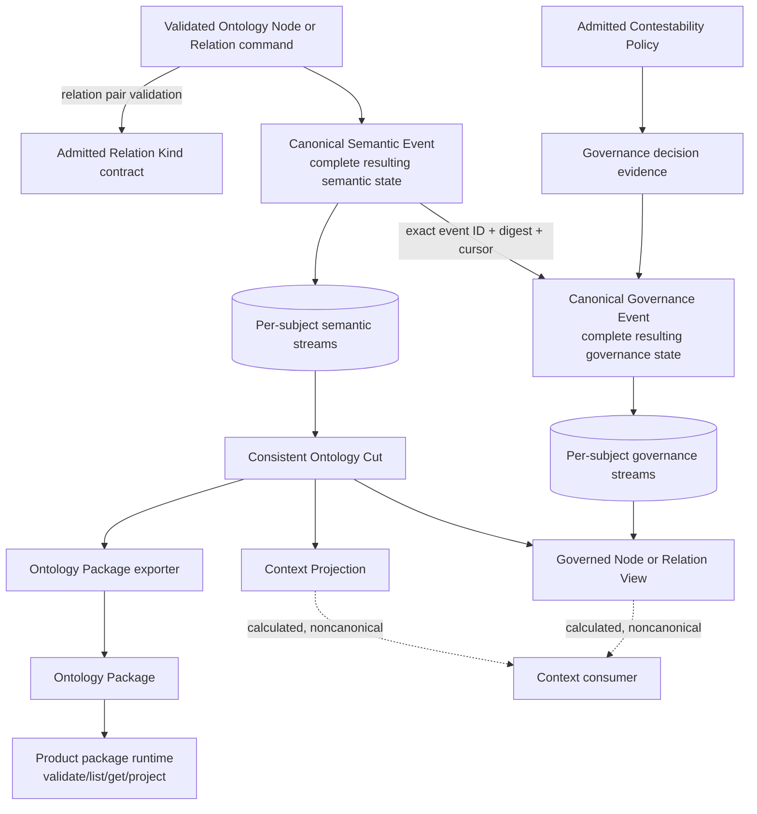

# Ontology interaction review

- Review date: `2026-10-05`
- Status: `review-candidate`
- Authority effect: `none`
- Scope: the admitted Definition queue, materialized Artifact Types, the axis-orthogonal Relation Kind candidate, the Typed Connection Extension Rule candidate, the Ontology Product, and the project-local DomainSpec Product Ontology

## Conclusion

The repository has the parts of a coherent ontology system, but they are not yet joined by one enforceable contract.

The admitted Ontology Definition requires a governed structure `O_U = (N, E, B, R, C, P, G)`. The materialized general Ontology Artifact Type claims to implement that structure, but its schema currently stores `node_refs` and `relation_refs` as untyped strings. The Ontology Package and DomainSpec Product Ontology have structured node and relation records, but their relation vocabularies are local and are not explicitly mapped to the 23 global Relation Kinds.

The next Ontology Artifact Type revision should make that boundary explicit:

1. an Ontology owns local node and edge records plus branch, provenance, confidence, lifecycle, and governance metadata;
2. a node represents a governed subject without replacing the subject's own authority;
3. an edge declares whether its Relation Kind is global or ontology-local;
4. a global edge must satisfy the exact ordered endpoint pair in the admitted Relation Kind contract;
5. a local edge remains inside its Ontology and has no global coupling effect;
6. every load-bearing node or edge has an explicit Contestability Policy binding and closed Challenge Contract;
7. an Ontology Package is a source-bound distributable projection of an Ontology, not the Ontology identity;
8. Ontology Lifecycle owns event history and consistent reconstruction, Governance owns authority decisions, and Context Maps own cross-context membership and direction.

## The seven layers

| Layer | Repository carrier | Current posture | Owns |
| --- | --- | --- | --- |
| Meaning | `cal.definition.ontology` | admitted through the full-definition-queue decision overlay | The semantic test for what counts as an Ontology |
| Instance shape | `cal.artifact-type.ontology/v1` | candidate, unadmitted | The schema for one governed Ontology instance |
| Coupling vocabulary | 23 axis-orthogonal Relation Kinds | candidate, unadmitted | Global relation meanings, qualifiers, and exact ordered endpoint pairs |
| Coupling extension | `cal.definition.typed-connection-extension-rule` | candidate, unadmitted | How a new exact endpoint pair may enter a Relation Kind successor |
| Contestability | `cal.definition.contestability-policy`, `profile.challenge`, and `cal.artifact-type.policy/v1` | Definition admitted; migration profile admitted but inactive; Policy Artifact Type candidate, unadmitted | How a subject may be challenged and where unresolved challenge residue is routed |
| Distributable output | `cal.artifact-type.ontology-package/v1` | candidate, unadmitted | A source-bound package of nodes, relations, residue, and bounded retrieval |
| Runtime and views | Ontology Lifecycle, runtime, navigation, project-local Product Ontology | mixed candidate and project-local canonical postures | Events, reconstruction, projections, navigation, and bounded read models |

These layers must not inherit authority from one another. Validating a package does not admit its Ontology, admitting an Ontology Definition does not admit the Ontology Artifact Type, and a project-local canonical read model does not become shared Lab authority.

## Interaction model



## Mapping the admitted Ontology definition

| Definition component | Required repository representation | Present state |
| --- | --- | --- |
| `N` typed knowledge objects or nodes | Structured node records with node identity, represented subject, subject kind, branch or role, provenance, confidence, state, and obligations | Structured in Ontology Package and project ontology; missing from the general Ontology schema |
| `E` typed relations over `N` | Structured edge records with source and target node IDs, Relation Kind scope, kind reference, endpoint kinds, qualifiers, evidence, state, and forbidden inferences | Partially structured in packages; no global/local scope and no exact-pair validation |
| `B` branch, role, ownership | Explicit branch references and role assignments on the relevant records | General Ontology has string reference lists; DomainSpec has business/system/bridge polarity |
| `R` source and inventory evidence | Source records or references with selectors and digests | Present in packages; general Ontology has only string provenance references |
| `C` confidence, scope, validity, expiry | Per-node or per-claim confidence and validity envelope | Missing from the current general Ontology schema and package edge records |
| `P` promotion state | Candidate, reviewed, promoted, demoted, deferred, superseded, or retired state with decision evidence | General Ontology has one aggregate `promotion_state`; per-node and per-edge state is absent |
| `G` gates, contradiction, drift, use obligations | Structured gates, residue, challenge route, forbidden inference, and use obligations | Split across fields and package residue; not yet one validated contract |

## Contestability and Challenge Contract

The CyberAlchemy v2 term `Challenge Contract` was deliberately normalized into `cal.definition.contestability-policy`, with an executable migration profile named `profile.challenge`. It was not discarded.

The semantic contract is:

```text
ChallengeContract =
  (challenge_response,
   valid_challenge_modes,
   contradiction_edges,
   validation_edges,
   owner_route,
   resolution_gate,
   blocking_questions,
   challenge_residue_route)
```

It is the governed answer to “how may this subject be challenged, who reviews the challenge, what blocks movement, and where does unresolved material go?” It is not a verdict, confidence score, admission decision, or authority override.

### Correct location in the Ontology model

The Challenge Contract belongs inside the governance state of each load-bearing Ontology Node or Ontology Relation. An Ontology-level default policy may be declared, but a node or edge must resolve the exact policy version that governs it. Ontology Lifecycle may preserve the complete contract in an event snapshot; Governance remains the owner of the Policy and any decision made through its gate.

```text
Ontology Node or Ontology Relation
  -> governance state
     -> evidence confidence
     -> commitment confidence
     -> contestability policy binding
        -> closed Challenge Contract
     -> residue
```

Confidence, residue, and Challenge Contract are siblings. The contract may point to a residue route, but it does not contain the subject's residue. It may point to contradiction or validation edges, but it does not decide their evidential effect.

### Relation Kind consequences

The existing `ontology -> policy` pair under `relation.governed-by` can express an Ontology-wide default. It cannot express a node-specific or edge-specific policy. If those bindings must be visible globally, two exact connection extensions are required:

```text
ontology-node -> policy       under relation.governed-by
typed-relation -> policy      under relation.governed-by
```

Both would use `governance_role: contestability`. They remain proposals until an exact Relation Kind successor is admitted. When the binding is only internal to one Ontology, it may remain a structured local governance binding instead.

`contradiction_edges` and `validation_edges` reference exact edge identities. Each referenced edge must independently validate under its own Relation Kind. A contradiction may map to `relation.evidence-bears-on` with `polarity: contradicts` only when its endpoints match an exact allowed pair. A validation edge must not automatically collapse into support, conformance, evaluation, or admission.

### Current vocabulary drift

Three existing contracts use different challenge-mode names:

| Carrier | Current modes |
| --- | --- |
| `profile.challenge` parameters | `contradict` |
| Policy example | `contradict`, `request-validation` |
| Ontology Lifecycle state schema | `evidence`, `contradiction`, `owner_review` |

This must be normalized before the Policy Artifact Type and revised Ontology Artifact Type are admitted. Similar labels must not be assumed equivalent.

### Revised realistic example

```json
{
  "node_id": "node:definition.ontology",
  "subject_ref": "cal.definition.ontology@1.0.0-candidate.1",
  "subject_kind_ref": "definition",
  "governance_state": {
    "evidence_confidence": "high",
    "commitment_confidence": "admitted",
    "contestability": {
      "policy_ref": "EXAMPLE-CANDIDATE-CHALLENGE-001",
      "policy_artifact_type_ref": "cal.artifact-type.policy/v1",
      "policy_sha256": "048626a8089c5e5fdbab12859eb65c2d52d6c49e98eedfe0b841ac3f0578b48e",
      "challenge_contract": {
        "challenge_response": "Preserve the challenged record and submit challenge evidence to its owner.",
        "valid_challenge_modes": ["contradict", "request-validation"],
        "contradiction_edge_refs": [],
        "validation_edge_refs": [],
        "owner_route": "route:artifact-owner-review",
        "resolution_gate_ref": "gate:owner-challenge-resolution",
        "blocking_questions": [
          "Has evidence for the challenge been attached?",
          "Has the exact challenged subject been confirmed?"
        ],
        "challenge_residue_route": "route:unresolved-challenge"
      }
    },
    "residue": []
  }
}
```

This example binds the actual candidate Policy fixture and its current digest. Because `cal.artifact-type.policy/v1` is still candidate-unadmitted, this remains a candidate Ontology governance binding. The mode names also remain subject to the vocabulary reconciliation above.

## Ontology Lifecycle runtime integration

The Ontology Lifecycle runtime is the temporal and persistence realization of the Ontology model. It does not define Ontology meaning and does not own Governance decisions.

### Canonicality conflict and resolution

The current Ontology Artifact Type names `record.json` as its canonical instance, while the adopted Lifecycle runtime declares canonical per-subject event histories as the only replay source and treats snapshots and views as calculated outputs. Those claims cannot both apply to the same runtime-bound Ontology state.

The revised model should split identity from calculated state:

| Record | Role | Canonical posture |
| --- | --- | --- |
| Ontology manifest | Stable Ontology identity, definition binding, Relation Kind registry binding, default Policy bindings, state model, runtime binding, owner, and challenge route | Canonical identity/configuration artifact |
| Semantic Event history | Complete resulting node and relation semantic states | Canonical state history for an event-sourced Ontology |
| Governance Event history | Complete resulting governance states joined to exact semantic events | Canonical governance observation history; Governance remains upstream authority |
| Consistent Ontology Cut | Calculated `N,E` state at one exact cursor and event-set digest | Derived, rebuildable, never a replay source |
| Ontology Package | Transportable projection of one exact cut under a package contract | Immutable derived output, not Ontology identity |

The structured node-and-relation example in this review is therefore the logical state contract for a cut or package projection. It must not become a second mutable canonical store beside the event histories.

A runtime-bound Ontology manifest should look conceptually like this:

```json
{
  "ontology_id": "cal.ontology.artifact-governance",
  "ontology_version": "2.0.0-candidate.1",
  "definition_ref": "cal.definition.ontology@1.0.0-candidate.1",
  "state_model": "event-sourced",
  "relation_kind_registry_ref": "CAL-AXIS-ORTHOGONAL-RELATION-MODEL-0002",
  "default_contestability_policy_ref": "EXAMPLE-CANDIDATE-CHALLENGE-001",
  "runtime_binding_ref": "cal.binding.ontology-product-event-runtime/successor",
  "canonical_replay_source": "per-subject-semantic-and-governance-event-histories",
  "projection_contract_refs": [
    "cal-consistent-ontology-cut/v2-candidate",
    "cyberalchemy-lab-ontology-package/v1"
  ],
  "authority_effect": "none"
}
```

| Component | Responsibility |
| --- | --- |
| Ontology Definition | Defines what an Ontology must mean: `O_U = (N,E,B,R,C,P,G)` |
| Ontology Artifact Type | Defines the logical shape of one Ontology state and its node, relation, and governance records |
| Ontology Lifecycle runtime | Stores canonical per-subject event histories and calculates state at an exact cut |
| Governance Context | Owns Policy, challenge, admission, promotion, and other authority decisions |
| Context Map | Owns the exact directional relationship between Governance and Ontology Lifecycle contexts |
| Ontology Package | Carries one selected, source-bound projection of an exact Ontology cut |
| Ontology Product runtime | Validates and reads a package through bounded `list`, `get`, and projection commands |

### Canonical runtime flow



### Runtime invariants already implemented

The adopted Rust library already provides these mechanics:

1. every Ontology Node and Ontology Relation is an independently identified `OntologySubject`;
2. every subject has a semantic event stream and a governance event stream;
3. each semantic event contains the complete resulting semantic state;
4. each governance event contains the complete resulting governance state, including confidence, Challenge Contract, conflicts, residue, drift owner, and invalidation route;
5. governance joins semantic history through exact semantic event ID, digest, and cursor;
6. replay selects the latest subject state at one global semantic cursor;
7. active relations fail when either endpoint is absent or inactive in the same cut;
8. snapshots, checkpoints, governed views, and Context projections are calculated outputs and never replay sources;
9. append operations use expected stream versions and validate the proposed complete history before persistence;
10. every runtime authority effect remains `none`.

### Semantic and governance events stay separate

An Ontology meaning change and a challenge are different histories:

```text
Meaning change
  -> owner-approved semantic command
  -> new Semantic Event
  -> new semantic state

Challenge or governance change
  -> Governance-owned evidence or decision
  -> Governance Event bound to one exact Semantic Event
  -> new governance state
```

A challenge cannot edit an earlier Semantic Event. When a challenge results in an approved meaning change, the owner appends a new Semantic Event; the challenge and its decision remain in governance history.

### Realistic paired-event example

```json
{
  "semantic_event": {
    "event_family": "semantic",
    "event_id": "ontology-semantic-0030",
    "semantic_cursor": 30,
    "subject_identity": {
      "ontology_id": "cal.ontology.artifact-governance",
      "subject_kind": "node",
      "subject_id": "node:definition.ontology",
      "type_ref": "definition"
    },
    "complete_resulting_semantic_state": {
      "lifecycle": "active",
      "definition_or_claim": "Ontology is a governed typed meaning layer."
    }
  },
  "governance_event": {
    "event_family": "governance",
    "event_id": "ontology-governance-0030",
    "semantic_ref": {
      "semantic_event_id": "ontology-semantic-0030",
      "semantic_event_digest": "<exact digest of the sealed semantic event>",
      "semantic_cursor": 30
    },
    "complete_resulting_governance_state": {
      "authority_effect": "none",
      "evidence_confidence": {
        "scheme_ref": "cal.confidence/v1",
        "level": "high"
      },
      "commitment_confidence": {
        "scheme_ref": "cal.confidence/v1",
        "level": "admitted"
      },
      "challenge_contract": {
        "challenge_response": "Preserve the record and route evidence to the Definition owner.",
        "valid_challenge_modes": ["evidence", "contradiction", "owner_review"],
        "contradiction_edges": [],
        "validation_edges": [],
        "owner_route": "role:definition-owner",
        "resolution_gate": "gate:definition-challenge-resolution",
        "blocking_questions": [],
        "challenge_residue_route": "route:definition-challenge-residue"
      }
    }
  }
}
```

The runtime seals the semantic event before the governance event can cite its digest. A governed view is returned only when that exact join succeeds.

### Runtime status in this repository

| Runtime surface | Current state |
| --- | --- |
| `cal.runtime.ontology-lifecycle-rust/v1` source | Adopted behind implementation binding v2; current source digest still matches the adoption decision |
| Binding `cal.binding.ontology-product-event-runtime/v2` | Admitted for the frozen 14-node, 15-relation navigation graph |
| Product candidate 0006 | Product-approved |
| Local CLI activation 0049 | Authorized and execution receipt recorded PASS for a one-shot local CLI instance in the former `/home/vrondelli/...` workspace |
| Runtime state in this `/home/vlad_/...` workspace | No `.local/ontology-event-runtime-0049` event store is present, so a currently running or locally materialized instance is not established here |
| Epoch-002 v2 Context adapters | Product-approved and admitted as an inactive implementation; later cutover authorization remains conditional and unexecuted |
| Source importer v3 | Test candidate; imports 16 selected packages, with five specialized packages unsupported |
| Migration/update runtime v4 | Test candidate; broader manifest and transactional updates, but no Product approval or cutover |
| Ontology Product package runtime | Separate bounded package builder and `validate/list/get/project` reader; not the Lifecycle event store |

### Integration gaps with the revised model

1. **No global Relation Kind enforcement.** The adopted runtime validates relation endpoint existence and lifecycle, but it does not resolve `relation_kind_ref`, exact endpoint kinds, required qualifiers, or `Conn(r)` from the new closed Relation Kind model.
2. **Generated Challenge Contracts are placeholders.** Binding v2 emits all three runtime modes, empty contradiction and validation edges, empty blocking questions, and owner-derived routes. It does not resolve an admitted Policy instance or execute a challenge workflow.
3. **Challenge mode drift remains.** Runtime modes are `evidence`, `contradiction`, and `owner_review`; Policy and migration-profile modes differ.
4. **The general Ontology Artifact Type does not match the runtime payload.** Its refs-only schema cannot carry the structured semantic and governance state already present in Rust.
5. **No admitted cut-to-package exporter.** The Product package runtime consumes its own Ontology Package schema, while the Lifecycle runtime produces `ConsistentOntologyCut`, governed views, and Context projections. An exact adapter between those contracts is still required.
6. **Relation scope is missing.** Runtime relation state does not distinguish global Relation Kinds from ontology-local relation types.
7. **Relation governance views are incomplete.** The runtime has governance streams for relation subjects, but its public `governed_node_view` is node-only.
8. **The root README is stale about Challenge Contract implementation.** It says the Challenge Contract is not implemented by the Rust reducer, while the adopted source contains `ChallengeContract`, includes it in `OntologyGovernanceState`, validates governance histories, and calculates governed node views.

### Required integration contract

Before a revised Ontology record enters the runtime:

```text
validate Ontology Artifact Type record
  -> resolve node subject kinds
  -> resolve global or local relation scope
  -> for every global edge, validate exact Conn(r) pair and qualifiers
  -> resolve exact Contestability Policy binding
  -> translate semantic facet into a Semantic Event
  -> translate Governance-owned evidence into a Governance Event
  -> seal and append with expected stream versions
  -> replay one consistent cut
  -> export a digest-bound Ontology Package when requested
```

This adapter should be the implementation behind `relation.binds-implementation: implementation -> ontology`. That relation records the binding only; conformance still requires separate evidence under `relation.conforms-to`.

## Artifact-instance relations versus Ontology edges

The model has four distinct connection levels:

| Level | Example | What it declares |
| --- | --- | --- |
| Artifact Type schema | `cal.artifact-type.product-capability/v1` | The structure and validation rules for Product Capability instances |
| Relation Kind contract | `Conn(relation.member-of)` contains `product-capability -> product` | That this ordered kind pair is permitted for this semantic axis |
| Typed Relation instance | `capability:typed-meaning -> product:ontology` | The actual governed connection between two artifact instances |
| Ontology edge | `node:typed-meaning -> node:ontology-product` | A representation of the canonical relation, or an explicitly ontology-local interpretation |

An Artifact Type schema may declare relation fields, required relation roles, or allowed Relation Kind references. That declaration does not connect any instances. The connection exists only when a separately identified Typed Relation instance names the exact endpoints, direction, Relation Kind, qualifiers, owner, evidence, lifecycle posture, and authority effect.

### Canonical global connection

```json
{
  "relation_id": "relation-instance:typed-meaning-member-of-ontology-product",
  "artifact_type_ref": "cal.artifact-type.typed-relation/v1",
  "relation_kind_ref": "relation.member-of@<admitted-version>",
  "source": {
    "object_ref": "product-capability:ontology-typed-meaning",
    "object_kind": "product-capability"
  },
  "target": {
    "object_ref": "product:ontology",
    "object_kind": "product"
  },
  "direction": "source-to-target",
  "qualifiers": {
    "membership_role": "product-capability"
  },
  "owner_route": "role:product-owner",
  "evidence_refs": ["decision:product-capability-admission"],
  "authority_effect": "none"
}
```

This relation exists independently of every Ontology. Its validity depends on the Artifact Type schemas of both endpoints, the Typed Relation carrier, and the exact Relation Kind contract.

### Ontology projection of that connection

```json
{
  "edge_id": "ontology-edge:typed-meaning-member-of-ontology-product",
  "edge_scope": "projects-global-relation",
  "source_node_id": "node:product-capability.ontology-typed-meaning",
  "target_node_id": "node:product.ontology",
  "projected_relation_ref": "relation-instance:typed-meaning-member-of-ontology-product",
  "projected_relation_digest": "<exact canonical Typed Relation digest>",
  "authority_effect": "none"
}
```

The Ontology edge makes the relation navigable and places it in branch, provenance, confidence, and use context. It neither recreates nor overrides the global relation. If the canonical Typed Relation changes, the projection becomes stale and must be rebuilt or challenged.

### Ontology-local connection

```json
{
  "edge_id": "ontology-edge:research-view-depends-on-evidence-view",
  "edge_scope": "ontology-local",
  "local_relation_type_ref": "local:depends_on/v1",
  "source_node_id": "node:research-view",
  "target_node_id": "node:evidence-view",
  "authority_effect": "none",
  "forbidden_inferences": [
    "global-dependency",
    "source-authority-transfer",
    "relation-kind-admission"
  ]
}
```

This edge is an interpretation owned by that Ontology. It has no corresponding global Typed Relation and cannot be exported as one.

### Non-collapse rule

```text
Artifact Type schema
  != Relation Kind contract
  != Typed Relation instance
  != Ontology edge projection
```

The same IDs may be referenced across these levels, but their identities, owners, lifecycles, and authority effects remain separate. The Ontology Node represents an artifact instance through `subject_ref`; it is not the artifact instance itself.

## Global Relation Kind interaction

The current closed Relation Kind candidate declares only these Ontology-related ordered pairs:

| Relation Kind | Exact pair | Meaning |
| --- | --- | --- |
| `relation.member-of` | `ontology-node -> ontology` | The node record is part of the Ontology |
| `relation.member-of` | `typed-relation -> ontology` | The edge record is part of the Ontology |
| `relation.governed-by` | `ontology -> policy` | A Policy applies to the Ontology; this does not prove compliance |
| `relation.binds-implementation` | `implementation -> ontology` | An implementation binds the Ontology; this does not prove conformance or runtime behavior |
| `relation.successor-of` | `ontology -> ontology` | One Ontology version continues or supersedes another according to its qualifier |

No other Ontology connection is authorized by that candidate. In particular, endpoint registration does not create a connection, and the source-kind and target-kind indexes cannot be multiplied into implied pairs.

### Required structural interpretation

`ontology-node` and `typed-relation` should be governed record types inside the Ontology contract. They do not need independent top-level Artifact Types unless they later require independent identity, admission, storage, or lifecycle. Their `member-of` relations make membership explicit while the records remain locally owned by the Ontology.

A node's `subject_ref` points to a Definition, Artifact Type, Product, Product Capability, Project, or other governed object. That reference does not make the upstream object itself a member of the Ontology and does not transfer its authority.

## Global versus local relations

An Ontology can contain two relation scopes:

| Scope | Contract | Effect |
| --- | --- | --- |
| `global` | References an admitted global Relation Kind and an exact allowed ordered endpoint pair | May be consumed across ontology boundaries under that Relation Kind contract |
| `ontology-local` | References a relation type declared by the Ontology itself | Has meaning only inside that Ontology; creates no global connection |

This preserves the existing DomainSpec vocabulary without silently treating it as the Lab's global relation vocabulary.

| DomainSpec local type | Global mapping posture | Reason |
| --- | --- | --- |
| `realized_by` | Possible inverse mapping to `relation.realizes`, only with explicit direction and endpoint proof | The names are directionally opposite and the current global endpoint pairs are narrower |
| `tested_by` | Possible inverse mapping to `relation.evaluates`, only when the test subject and evaluation qualifiers match | Testing and evaluation overlap, but are not automatically identical |
| `traced_to` | No automatic mapping | Origin, derivation, evidence, and traceability are distinct axes |
| `depends_on` | Remain local until a global dependency axis is proposed | No current global Relation Kind asks the same question |
| `constrained_by` | Remain local until a fitting global axis is proposed | Governance applicability is not general constraint dependency |
| `observed_by` | Remain local until a fitting global axis is proposed | Observation ownership and evaluation are not equivalent |
| `drifts_from` | Remain local until a fitting global axis is proposed | Drift is not lineage, contradiction, or succession |

The Product Ontology has the same rule:

- `includes_capability` can project to the existing global pair `product-capability -> product` under `relation.member-of` with a product-capability membership role.
- `produces` or `produces-through-capability` has no matching global semantic axis. It remains local until a separate output-production Relation Kind is proposed and admitted.
- `represents` has no matching global Relation Kind and must not be collapsed into identity assertion.

## Interaction with the Typed Connection Extension Rule

The extension rule governs changes to the global Relation Kind registry. It does not govern ordinary creation of node or edge instances inside an Ontology.

For a global edge, validation proceeds as follows:

```text
resolve source node -> source subject kind
resolve target node -> target subject kind
resolve admitted Relation Kind version
require exact (source kind, target kind) in Conn(relation kind)
require direction and qualifiers
require owner, evidence, lifecycle, and authority-effect fields
accept the edge instance without changing Conn(relation kind)
```

If the exact pair is absent, the Ontology cannot add it. The Relation Kind owner must create and admit a successor containing that one pair, or propose a new Relation Kind when the semantic question differs.

For an ontology-local edge, the Ontology's own local relation declaration validates the edge. The edge cannot be exported as a global coupling until an explicit mapping passes the global extension rule.

## Revised logical Ontology cut model

The general Ontology contract needs a structured calculated-cut representation that replaces untyped `node_refs` and `relation_refs` with records similar to this shape. For an event-sourced Ontology this is a derived cut, not a second canonical replay source; the canonical Ontology artifact is the identity/state-model manifest described in the runtime integration section.

```json
{
  "ontology_id": "cal.ontology.artifact-governance",
  "ontology_version": "2.0.0-candidate.1",
  "status": "candidate-unadmitted",
  "authority_effect": "none",
  "scope_ref": "scope:cyberalchemy-lab-model-review",
  "nodes": [
    {
      "node_id": "node:artifact-type.ontology-v1",
      "subject_ref": "cal.artifact-type.ontology/v1",
      "subject_kind_ref": "artifact-type",
      "branch_ref": "branch:authority",
      "role_refs": ["role:semantic-carrier"],
      "source_refs": ["authority/artifact-types/ontology/v1/artifact.json"],
      "confidence": {"evidence": "high", "commitment": "candidate"},
      "lifecycle_state": "candidate",
      "use_obligations": ["Do not treat this candidate Artifact Type as admitted."]
    },
    {
      "node_id": "node:definition.ontology",
      "subject_ref": "cal.definition.ontology@1.0.0-candidate.1",
      "subject_kind_ref": "definition",
      "branch_ref": "branch:authority",
      "role_refs": ["role:governed-meaning"],
      "source_refs": ["authority/definitions/registry.json#cal.definition.ontology"],
      "confidence": {"evidence": "high", "commitment": "admitted"},
      "lifecycle_state": "reviewed",
      "use_obligations": ["Resolve the admitted definition before relying on this node."]
    }
  ],
  "relations": [
    {
      "relation_id": "edge:ontology-type-carries-ontology-definition",
      "relation_scope": "global",
      "relation_kind_ref": "relation.carries-definition@CAL-AXIS-ORTHOGONAL-RELATION-MODEL-0002",
      "source_node_id": "node:artifact-type.ontology-v1",
      "target_node_id": "node:definition.ontology",
      "source_kind": "artifact-type",
      "target_kind": "definition",
      "qualifiers": {
        "definition_version_ref": "cal.definition.ontology@1.0.0-candidate.1",
        "definition_sha256": "2f14c4861b7d5b9b22768fdd6d56df8dfce08f6557594046c7842dee46f884b8"
      },
      "evidence_refs": ["authority/artifact-types/ontology/v1/artifact.json"],
      "lifecycle_state": "candidate",
      "authority_effect": "none",
      "forbidden_inferences": ["admission", "conformance", "runtime-effect"]
    }
  ],
  "governance": {
    "policy_refs": ["policy:ontology-confidence/v1"],
    "promotion_state": "draft",
    "owner_route": "role:ontology-owner",
    "challenge_route": "route:ontology-challenge"
  },
  "residue": []
}
```

The example is intentionally candidate-only. Its source and target nodes refer to real repository carriers and its Definition digest is the current file digest. The edge cannot become effective while `CAL-AXIS-ORTHOGONAL-RELATION-MODEL-0002` remains candidate-only; it is conformant only after the exact `artifact-type -> definition` pair exists in an admitted Relation Kind contract version.

## Ontology Package interaction

The Ontology Package should be modeled as an immutable or content-addressed projection of a selected Ontology cut:

```text
Ontology identity and governed state
    -> consistent selected cut
    -> Ontology Package
    -> runtime list/get and generated navigation views
```

The package does not own source meaning, lifecycle decisions, or admission. It carries the selected nodes, edges, residue, source bindings, and query contract needed for transport and retrieval.

The global model currently lacks both the `ontology-package` endpoint kind and an exact `ontology-package -> ontology` connection. If this cross-layer link is needed globally, the clean extension is:

```json
{
  "relation_kind_ref": "relation.derives-from",
  "source_kind": "ontology-package",
  "target_kind": "ontology",
  "qualifiers": {"derivation_role": "ontology-projection"}
}
```

This is only a proposal. It requires an Ontology Package endpoint carrier and an exact admitted Relation Kind successor under the Typed Connection Extension Rule.

## Lifecycle, Governance, and Context Map boundaries

- **Ontology** owns typed meaning and the graph-shaped governed state.
- **Ontology Lifecycle** owns semantic events, governance-event observations, graph commit order, consistent cuts, replay failure, and endpoint integrity through time.
- **Governance** owns policies, decisions, constitutions, authority scopes, and admission or promotion effects.
- **Context Map** owns exact Bounded Context membership and directional cross-context relationships.
- **Runtime** implements bounded behavior and may bind an Ontology; the binding alone proves neither conformance nor runtime success.
- **Navigation and views** are rebuildable projections and never become canonical Ontology truth.

## Material gaps before Ontology Artifact Type admission

1. **Replace the refs-only graph.** The general Ontology schema cannot currently prove typed nodes, typed edges, endpoint closure, qualifiers, or per-record lifecycle and evidence.
2. **Resolve canonicality.** Replace the single canonical `record.json` claim with a canonical Ontology manifest plus a declared state model; for runtime-bound Ontologies, canonical state comes only from event histories.
3. **Remove the legacy relation name.** Its fixture uses `relation.admits`; the revised model normalizes this to `relation.declares-effect-on` with `effect_kind: admits`.
4. **Restore the complete Challenge Contract.** Replace the lone `challenge_route` field with an exact Policy binding and the eight-field closed contract in node and edge governance state.
5. **Reconcile challenge modes.** Normalize `contradict`, `contradiction`, `request-validation`, `evidence`, and `owner_review` without assuming equivalence.
6. **Define the internal record carriers.** Add governed `$defs` for Ontology Node, Ontology Relation, local Relation Type, confidence, provenance, lifecycle, contestability, and governance residue.
7. **Bind global edges to exact contracts.** A global edge must name an exact Relation Kind version and exact endpoint kinds, then validate against `Conn(r)`.
8. **Declare local relation vocabularies.** Local edge types need a unique question, direction, endpoint constraints, qualifiers, and forbidden inferences even when they never become global.
9. **Separate Ontology from Ontology Package.** Add a projection/cut binding and decide whether it needs the proposed global `ontology-package -> ontology` derivation pair.
10. **Reconcile the Product Ontology.** Map `includes_capability`; retain `produces` and `represents` locally until exact global axes are proposed.
11. **Do not overwrite Context Map authority.** Global relation contracts may type a connection, while the canonical Context Map remains the carrier of an actual cross-context relationship.
12. **Add provenance at the correct level.** Decide whether Ontology-to-source provenance is only carried by node and edge source bindings or also requires a global `ontology -> source` connection.
13. **Resolve missing endpoint carriers.** `policy` and `implementation` are referenced by current Ontology pairs but have no admitted Artifact Type carriers in this model.
14. **Add a successor runtime input adapter.** Preserve the adopted runtime bytes and validate revised Ontology records, Relation Kind pairs, qualifiers, and Policy bindings before producing events.
15. **Add governed relation views.** Join semantic and governance histories for relation subjects as well as node subjects.
16. **Add an exact cut-to-package exporter.** Bind Ontology identity, semantic cursor, event-set digest, selected governance cut, package schema version, and projection rules.
17. **Correct runtime documentation drift.** Regenerate the root README so its Challenge Contract implementation claim matches the adopted source.

## Recommended admission sequence

1. Admit the Typed Connection Extension Rule Definition.
2. Reconcile the Challenge Contract mode vocabulary and revise the Policy Artifact Type carrier.
3. Revise and approve the Ontology Artifact Type as a canonical identity/state-model manifest, with separate structured cut contracts for nodes, relations, Challenge Contract bindings, and global/local relation scope.
4. Review the exact Ontology-related Relation Kind pairs against that revised contract, including the proposed node/edge contestability bindings.
5. Decide the two other open global extensions: `ontology-package -> ontology` and `ontology -> source`.
6. Create an isolated successor adapter from the revised Ontology contract into the adopted Lifecycle runtime; do not rewrite the adopted runtime source.
7. Add exact global Relation Kind validation before semantic relation events are appended.
8. Revise the Ontology Package and add an exact cut-to-package exporter.
9. Create explicit mapping records for the Product Ontology and DomainSpec local vocabularies.
10. Add governed relation views and a Policy-backed challenge workflow candidate.
11. Validate examples, hostile no-collapse cases, replay, recovery, exact governance joins, and lifecycle/context boundaries.
12. Admit each exact artifact, adapter, and relation successor through its owner decision.

## Decision posture

No admission is requested by this review. The recommended next review target is the revised general Ontology Artifact Type because it is the junction where the admitted definition, global Relation Kinds, local ontology vocabularies, provenance, lifecycle, Governance, and Ontology Package must meet.
