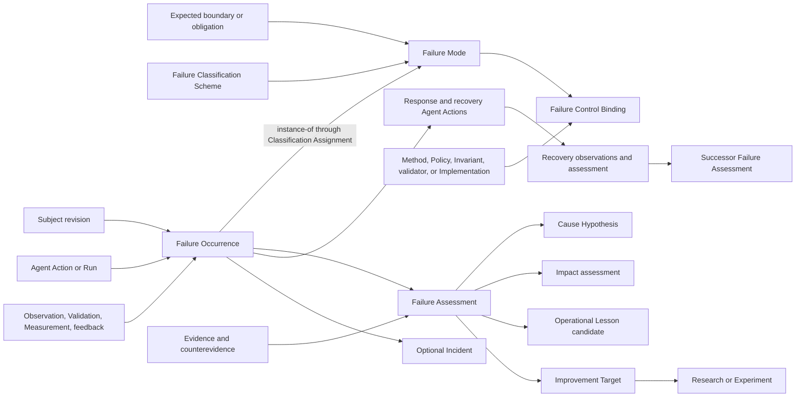

# Failure mode model review

## Conclusion

Failure modes require a model distinct from operational lessons and general classifications.

The Lab currently has admitted Observation, Finding, Residue, Measurement, Validation, Invariant, Method, and Workflow meanings, plus local runtime failure records and recovery rules in Agent Reasoning migration evidence. It has no admitted Failure, Failure Mode, Failure Occurrence, Failure Assessment, Failure Control, or Incident Definition, and no general Artifact Type carries their lifecycle.

The smallest coherent operational carrier family is:

1. **Failure Mode** — a reusable design-time contract describing one way an exact subject may fail an exact expected boundary.
2. **Failure Occurrence** — one attributable observed episode.
3. **Failure Assessment** — an evidence-bounded interpretation of mode, impact, causal hypotheses, and recovery posture.
4. **Failure Control Binding** — one exact preventive, detective, containment, recovery, or compensation control bound to a Failure Mode.

Incident remains an optional escalation carrier for failures that require coordinated response, impact accounting, communications, or closure. Not every Failure Occurrence becomes an Incident.

No Definition, Artifact Type, Relation Kind, failure record, control, or Incident is admitted by this review.

## Existing concepts and boundaries

### Observation

An Observation records what was measured, perceived, or recorded, with method, conditions, provenance, and uncertainty. A failure signal begins as an Observation until an assessment establishes that an expected boundary was violated.

### Finding

A Finding is an evidence-bounded conclusion. A Finding may support a conclusion about a Failure Occurrence, recurring Failure Mode, cause, control effectiveness, or recovery result. It is not itself the failure episode or an owner decision.

### Residue

Residue is the meaningful remainder that an operation could not preserve, name, reconstruct, justify, validate, or carry. It may expose a failure, result from a failure, or remain after recovery. It is not synonymous with Failure Mode or Failure Occurrence.

### Validation and Measurement

Validation and Measurement can detect deviation from an exact contract or threshold. A failed validator, threshold breach, or nonzero process exit is evidence. Whether it constitutes a Failure Occurrence depends on the declared boundary, conditions, expected outcomes, and handling contract.

### Recovery

Agent Reasoning migration evidence contains recovery assessments, checkpoint requirements, canary rollback, and fail-closed rules. These are local operational meanings and useful source evidence. They do not provide a general Lab Failure Mode carrier.

## Failure vocabulary

### Fault

A Fault is a defect or adverse condition capable of producing an Error State or Failure under stated conditions. Its presence does not prove that a failure occurred.

### Error State

An Error State is an internal state that deviates from the expected internal state. It may be detected and contained before an externally relevant obligation is violated.

### Failure

A Failure is an evidenced inability of a subject to satisfy one exact required boundary, obligation, or expected condition under declared operating conditions.

### Failure Mode

A Failure Mode describes how that failure may manifest. It does not state that the mode occurred, why it occurred, how severe it was, or whether a control worked.

### Failure Occurrence

A Failure Occurrence records one bounded episode in which evidence indicates that an exact subject revision violated or could not satisfy an exact expected boundary.

### Incident

An Incident is a coordinated operational envelope that groups one or more Failure Occurrences, impacts, response Actions, decisions, communications, and closure evidence under an accountable owner. Incident declaration is a governance decision, not an automatic consequence of any failure.

### Hazard and Risk

A Hazard is a condition with potential for harm. Risk assesses uncertainty about likelihood and consequence. Failure Modes may inform Hazard and Risk work, but failure history does not by itself establish future probability, and a Risk record is not a Failure Occurrence.

## Core model



## Proposed Definitions

### Failure

**Candidate identity:** `cal.definition.failure`

A Failure is an attributable, evidence-bounded inability of one exact subject revision to satisfy one exact required boundary, obligation, or expected condition under declared operating conditions. Failure requires a named boundary and evidence of deviation. It does not by itself establish cause, blame, severity, recurrence, Incident status, or permission to retry or change the system.

### Failure Mode

**Candidate identity:** `cal.definition.failure-mode`

A Failure Mode is a versioned reusable contract describing one distinct way a declared subject kind can fail one exact boundary under stated conditions. It defines the manifestation, applicability, excluded lookalikes, detection signals and methods, possible impacts, known causal hypotheses, control bindings, recovery expectations, evidence requirements, owner, and challenge route.

Minimum content:

```text
mode identity and version
subject kinds and exact applicability conditions
expected boundary or obligation kinds
manifestation statement
excluded lookalikes and counterexamples
detection signals, methods, thresholds, and uncertainty
possible impact classes and affected-boundary kinds
known causal hypotheses and counterevidence
preventive, detective, containment, recovery, and compensation controls
recovery and degraded-operation expectations
classification assignments
owner, lifecycle, challenge route, predecessor, and successor
claim ceiling
```

Failure Mode is design-time Project State. It may predate any occurrence and cannot establish that an occurrence happened.

### Failure Occurrence

**Candidate identity:** `cal.definition.failure-occurrence`

A Failure Occurrence is an immutable attributable record of one bounded episode in which evidence indicates that an exact subject revision violated or could not satisfy an exact expected boundary under declared conditions. It binds the subject, time interval, Agent Session and Actions or other Run, conditions, observed manifestation, boundary reference, detection evidence, initial impact, delivery/effect uncertainty, immediate containment, residue, and owner route.

Minimum content:

```text
occurrence identity
subject_ref and exact version or digest
expected_boundary_ref and version
session, action, operation, workflow, research-run, experiment-run, or runtime refs
start and detection time; end when known
conditions and environment
observed manifestation
observation, validation, measurement, receipt, and feedback refs
candidate Failure Mode Assignment refs
affected subject refs and initial impact observations
containment and response Action refs
delivery or effect uncertainty
residue refs
owner and challenge route
authority_effect: none
```

An occurrence can remain `suspected` or `indeterminate` when evidence cannot establish the boundary violation. Unknown external delivery or effect must remain explicit.

### Failure Assessment

**Candidate identity:** `cal.definition.failure-assessment`

A Failure Assessment is a versioned evidence-bounded evaluation of one Failure Occurrence or a declared occurrence cohort. It determines only what the cited evidence supports about occurrence posture, Failure Mode classification, scope, impact, severity, causal hypotheses, recurrence, containment, recoverability, recovery outcome, and residual uncertainty.

Required dispositions remain independent:

```text
occurrence: supported | contradicted | indeterminate
mode_assignment: proposed | confirmed | disputed | rejected
cause_posture: unassessed | hypothesized | supported | contradicted | unresolved
impact_posture: unassessed | bounded | continuing | unknown
containment_posture: not-attempted | active | contained | failed | unknown
recovery_posture: not-attempted | recovering | recovered | degraded | unrecovered | unknown
```

One disposition cannot be inferred from another. A recovered service can retain unresolved cause and residue. A known cause does not prove impact. A repeated symptom does not prove one shared cause.

### Failure Control Binding

**Candidate identity:** `cal.definition.failure-control-binding`

A Failure Control Binding is a lifecycle-bearing relationship between one exact Failure Mode revision and one exact Method, Policy, Invariant, validator, Agent Capability, Implementation, or response procedure. It declares exactly one primary control role from `prevent`, `detect`, `contain`, `recover`, or `compensate`, plus activation conditions, scope, evidence requirements, owner, limitations, effectiveness claim, and challenge route.

The binding records intended control. It does not prove that the control is installed, active, applicable, executed, effective, safe, or authorized.

### Incident

**Candidate identity:** `cal.definition.incident`

An Incident is a governed response and accountability envelope for one or more related Failure Occurrences whose impact or uncertainty requires coordinated ownership, timeline, containment, recovery, communications, decisions, evidence preservation, and closure. Incident closure does not erase Failure Occurrences, residue, unknown delivery, causal uncertainty, or follow-up obligations.

## Proposed Artifact Types

| Artifact Type | Responsibility |
| --- | --- |
| Failure Mode | Reusable anticipated manifestation contract for one subject kind and expected boundary |
| Failure Occurrence | Immutable observed or suspected episode with exact subject, boundary, conditions, evidence, impact, response, and residue |
| Failure Assessment | Versioned evidence interpretation of occurrence, mode, cause, impact, containment, recovery, and uncertainty |
| Failure Control Binding | Exact failure-mode-to-control relationship with one primary control role and effectiveness claim ceiling |
| Incident | Optional coordinated response envelope for related occurrences, impact, Actions, decisions, communications, and closure evidence |

Fault and Error State can initially remain defined concepts and classification values. Promote either to a standalone Artifact Type when it needs independent lifecycle, ownership, evidence, or relations.

## Failure Mode classifications

Failure Mode and Failure Occurrence classification reuses the general Classification Scheme and Classification Assignment model.

| Axis | Unique question | Example values |
| --- | --- | --- |
| `failure-surface` | At which operational surface does the deviation manifest? | interpretation, context, planning, action-selection, tool-use, implementation-runtime, persistence-replay, evidence-measurement, relation-ontology, governance-authority, recovery |
| `manifestation-kind` | How does the required behavior deviate? | omission, commission, incorrect, incomplete, stale, untimely, duplicate, out-of-order, inconsistent, unavailable, unauthorized-effect, unattributed-effect, indeterminate-effect |
| `detection-stage` | At what stage was the deviation detected? | precondition, during-action, postcondition, validation, replay, later-feedback |
| `impact-scope-kind` | Which class of boundary may be affected? | action, session, artifact, project, product, external-system, person |
| `evidence-posture` | What does current evidence say about the occurrence or mode assignment? | unassessed, supported, contradicted, indeterminate, mixed |

Severity, likelihood, confidence, recoverability, lifecycle, and authority remain separate axes or assessment fields. Exact affected subjects and violated boundaries remain typed references rather than classification labels.

Domain-specific Schemes may add values, but every new axis must pass Classification Orthogonality review. Similar error messages, filenames, exception classes, or free-text reason codes cannot silently establish that two episodes share one Failure Mode.

## Lifecycle models

### Failure Mode lifecycle

```text
candidate -> reviewed -> active -> deprecated -> retired
                         \-> superseded
```

### Failure Occurrence handling lifecycle

```text
detected
  -> triaged
  -> contained | containment-failed | containment-unknown
  -> recovering | degraded | unresolved
  -> recovered | degraded | unrecovered | recovery-unknown
  -> closed, reopened, or continued by owner Decision
```

Occurrence evidence posture and recovery posture remain independent of workflow state. Closing an Incident or work item does not rewrite the occurrence as recovered.

## Relation model

These candidate connections require the Typed Connection Extension Rule and closed qualifier schemas.

| Source | Relation or carrier | Target | Meaning |
| --- | --- | --- | --- |
| Failure Occurrence | `instance-of` projection | Failure Mode | Semantic classification backed by an exact Classification Assignment |
| Failure Assessment | `evaluates` | Failure Occurrence or occurrence cohort | Names the assessed subject; carries no support polarity by itself |
| Evidence Set, Observation, Measurement Result, Validation Receipt, or Finding | `evidence-bears-on` | occurrence, mode assignment, cause hypothesis, impact claim, or recovery claim | Supports, contradicts, or remains neutral toward the exact claim |
| Failure Occurrence | `occurs-during` | Agent Action, Session, Operation, Workflow, Research Run, Experiment Run, or runtime invocation | Exact execution envelope in which the episode occurred |
| Failure Occurrence | `violates` | Contract, Invariant, Policy, Schema, precondition, postcondition, or other expected-boundary carrier | Exact required boundary that evidence indicates was not satisfied |
| Failure Occurrence or Incident | `affects` | Artifact, Agent Session, Project, Product, Capability, Implementation, external system, or Person Reference | Scoped observed or assessed impact; no causal or severity inference |
| Response or recovery Agent Action | `responds-to` | Failure Occurrence or Incident | Intended operational response; no recovery-success inference |
| Failure Control Binding | `controls` | Failure Mode | Intended prevent, detect, contain, recover, or compensate relationship |
| Failure Occurrence | `member-of` specialized membership | Incident | Use membership role `incident-occurrence` |
| Decision | `declares-effect-on` | Failure Mode, Failure Occurrence, Failure Assessment, Failure Control Binding, or Incident | Activate, suspend, accept residue, close, reopen, or supersede under closed effect values |

Direct `caused-by` edges are withheld from the initial model. Cause begins as a Hypothesis. Evidence bears on that hypothesis, and an evidence-bounded Finding may support a causal conclusion at its exact claim ceiling. If a causal relation is later admitted, it requires its own axis, causal method, qualifiers, counterevidence, and forbidden-inference rules.

## Failure controls

Control roles answer different questions and must remain independent:

```text
prevent     -> reduce the conditions under which the mode can occur
detect      -> produce evidence that the mode or occurrence may be present
contain     -> limit propagation or impact
recover     -> restore the declared boundary or an explicit degraded boundary
compensate  -> address effects when direct restoration is impossible or inappropriate
```

Retry is one possible response Action. It is not automatically recovery and may duplicate external effects. Rollback restores a declared predecessor only when exact state, version, and effect boundaries permit it. Compensation creates a separately attributable effect; it does not erase the original occurrence.

## Agent failure modes

A Machine Agent remains ephemeral. Failure evidence survives only through governed Project State records.

Agent-specific Failure Modes can cover:

- incorrect Intent interpretation;
- missing or stale Context View material;
- invalid Ontology View cut or misunderstood relation;
- action outside Assignment, Policy, Delegation, or authority scope;
- omitted required artifact or lifecycle layer;
- tool invocation failure;
- unverified or indeterminate external effect;
- unsupported Finding or overclaimed evidence;
- failure to persist required Project State before Session termination;
- recovery or replay from incomplete state;
- lesson applied outside its scope;
- repeated contradicted lesson reuse.

An Agent self-report may propose a Failure Occurrence or Assessment. It cannot confirm its own causal explanation, erase contradictory evidence, close an Incident, grant retry authority, or modify its Profile or Implementation.

## Interaction with operational learning

```text
failure signal
  -> Observation
  -> Failure Occurrence candidate
  -> Failure Assessment
  -> confirmed or disputed Failure Mode Assignment
  -> optional Agent Reflection
  -> Operational Lesson candidate
  -> later Lesson Application and Outcome Assessment
```

Repeated failures may open an Improvement Target only when:

1. occurrence identities are distinct;
2. each occurrence has evidence;
3. the same exact Failure Mode revision is confirmed or the grouping rule is explicit;
4. duplicates, retries, and replayed notifications are excluded;
5. scope and time window are declared;
6. counterevidence and unknown outcomes remain visible;
7. an owner-controlled threshold or explicit request authorizes the transition.

An error string, user correction, absence of success, or repeated symptom alone cannot establish a recurring failure class.

## Real-like example from the Lab review

### Failure Mode

```yaml
failure_mode:
  identity: failure-mode:complete-model-required-layer-omission@1
  subject_kind: complete-system-model-review
  expected_boundary: contract:complete-lab-model-coverage@1
  manifestation: >
    A review presented as complete omits one required lifecycle layer or
    connection needed to explain how the Lab operates end to end.
  exclusions:
    - "A deliberately narrow Definition review."
    - "A layer explicitly marked out of scope."
  detection:
    - method: checklist:complete-lab-model-layers@1
    - signal: explicit-owner-correction
  authority_effect: none
```

### Failure Occurrence

```yaml
failure_occurrence:
  identity: failure-occurrence:lab-model-omission-2026-10-05-a
  subject_ref: review:lab-complete-model@initial
  expected_boundary_ref: contract:complete-lab-model-coverage@1
  observed_manifestation:
    - "Intent realization omitted Implementation."
    - "Actor and Agent were omitted."
    - "Machine Agent lifetime and memory ownership were omitted."
  detection_evidence:
    - feedback:owner-correction/implementation
    - feedback:owner-correction/agent
    - feedback:owner-correction/memory
  occurrence_posture: supported
  cause_posture: unresolved
  recovery_posture: recovered
  residue_refs:
    - residue:classification-and-failure-models-not-yet-integrated
  authority_effect: none
```

### Failure Assessment

```yaml
failure_assessment:
  identity: failure-assessment:lab-model-omission-2026-10-05-a@1
  occurrence_ref: failure-occurrence:lab-model-omission-2026-10-05-a
  mode_assignment_ref: classification:lab-model-omission/mode@1
  occurrence: supported
  mode_assignment: proposed
  cause_posture: unresolved
  impact_posture: bounded
  containment_posture: contained
  recovery_posture: recovered
  claim_ceiling: >
    Owner corrections establish omitted required layers in this review.
    They do not establish a universal agent weakness or prove why the
    omissions occurred.
```

The corresponding Operational Lesson proposes a future completeness checklist. The Failure Mode describes how a review can fail; the Occurrence records that it happened; the Assessment limits what can be concluded; the Lesson proposes future behavior. None can replace the others.

## Non-collapse rules

```text
Fault != Error State != Failure != Failure Mode != Failure Occurrence
Failure Occurrence != Incident
Failure signal != confirmed Failure Occurrence
Failure Assessment != Finding != Decision

Failure Mode classification != causal explanation
same symptom != same Failure Mode
same Failure Mode != same cause
recurrence != systemic cause

negative result != failure unless an expected boundary was violated
blocked unsafe action != Agent failure when blocking is required behavior
exception or nonzero exit != failure without its handling contract
indeterminate delivery != success != confirmed failure

Failure != Residue
recovery != absence of Residue
closed Incident != erased Failure Occurrence
retry != recovery
rollback != compensation

severity != likelihood != confidence != evidence posture
impact != cause != blame

Failure Mode != Operational Lesson
Failure Occurrence != Agent Reflection
repeated correction != verified recurring failure class
```

## Required admission order

1. Admit Failure, Failure Mode, Failure Occurrence, Failure Assessment, Failure Control Binding, and Incident Definitions.
2. Admit Classification Scheme and Classification Assignment, then define the exact Failure Mode Classification Scheme.
3. Materialize Failure Mode, Failure Occurrence, Failure Assessment, Failure Control Binding, and Incident Artifact Types.
4. Decide whether Contract, expected boundary, effect, Hypothesis, and Incident require additional endpoint carriers before relation extension.
5. Add `occurs-during`, `violates`, `affects`, `responds-to`, and `controls` only through the Typed Connection Extension Rule; reuse `instance-of`, `evaluates`, `evidence-bears-on`, `member-of`, and `declares-effect-on` within their existing semantics.
6. Bind prevention, detection, containment, recovery, and compensation Methods without treating intended controls as effective controls.
7. Add Agent Session, Action, runtime, Research, Experiment, Validation, Measurement, Evidence, Residue, Context, Ontology, Decision, and operational-learning adapters.
8. Validate suspected, contradicted, indeterminate, duplicated, replayed, contained, recovered-with-residue, degraded, unknown-delivery, and multi-cause cases.
9. Admit one representative Agent failure cycle only after classification, evidence, causal uncertainty, control, recovery, challenge, and no-collapse review.

## Gap register

1. No admitted general Failure or Failure Mode Definition.
2. No Failure Mode, Failure Occurrence, Failure Assessment, Failure Control Binding, or Incident Artifact Type.
3. No governed Failure Mode Classification Scheme; current failure strings and reason codes are local implementation labels.
4. No exact expected-boundary carrier rule distinguishes a failed obligation from any negative observation.
5. No relation axis connects an occurrence to its execution envelope, violated boundary, affected subjects, response Actions, or controls.
6. No general control-role model separates prevention, detection, containment, recovery, and compensation.
7. No causal-claim rule prevents repeated symptoms or Agent self-explanation from becoming unsupported `caused-by` assertions.
8. No occurrence deduplication rule prevents retries, replay, or duplicate notifications from inflating recurrence counts.
9. No general recovery assessment preserves degraded state, residue, and unknown effects after apparent restoration.
10. No explicit bridge converts assessed failure evidence into Operational Lessons and Improvement Targets without treating failure as proof of the lesson.

## Decision posture

The recommended model is to add four core Artifact Types: Failure Mode, Failure Occurrence, Failure Assessment, and Failure Control Binding. Add Incident as an optional escalation carrier in the same admission package because its non-collapse and relation rules affect occurrence modeling.

Use the general Classification Scheme and Assignment carriers for Failure Mode classification. Use existing Observation, Finding, Evidence, Validation, Measurement, Residue, Method, Policy, Invariant, Decision, Research, Experiment, Agent Action, and operational-learning carriers for their existing responsibilities.

Cause remains a Hypothesis until evidence supports a bounded Finding. Recovery remains an assessed outcome with possible residue. No failure record authorizes retry, external effect, Profile mutation, self-upgrade, admission, deployment, or Incident closure.
