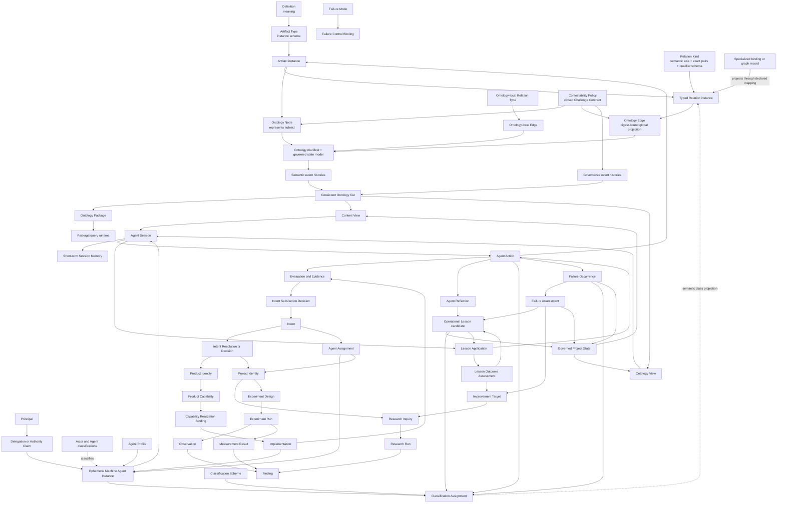
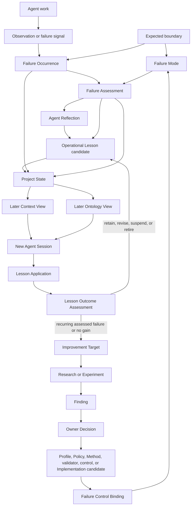

# CyberAlchemy Lab complete model audit

## Scope and claim ceiling

This review joins the live Definition registry, all visible Artifact Type descriptors, the 26-item migration cohort, the remaining-18 review model, Product and Project resolutions, the axis-orthogonal Relation Kind candidate, ontology carriers, contestability contracts, Context contracts, and ontology runtimes.

It records repository state and proposes a coherent target model. It admits no Definition, Artifact Type, Relation Kind, instance, runtime, or consumer.

## Executive conclusion

The Lab has enough material to define a complete model, but the current repository does not yet expose one enforceable model.

The single integrated target model is preserved in `.arcanum/ontology-vault/2026-10-05-lab-integrated-model.md`. This audit remains its evidence, repository-state inventory, and gap register.

The strongest parts are the Definition registry, the admitted Product type sequence, the admitted Project and Research identity carriers, the remaining-18 review package, and the closed Relation Kind pair matrix. The missing junctions are:

1. one effective-state registry that resolves immutable candidate bytes through later decisions;
2. canonical carriers for Relation Kind and general Typed Relation instances;
3. qualifier schemas and pair-specific qualifier rules for all Relation Kinds;
4. a rule for how specialized binding artifacts project into global relations;
5. an Ontology contract that actually carries typed nodes, typed edges, governance, and global/local scope;
6. adapters between Artifact Type records, Context resolution, ontology event histories, and packages;
7. a normalized Contestability Policy and Challenge Contract vocabulary;
8. one declared successor path across ontology runtime generations;
9. admitted Product, Project, Research, Experiment, and Context instances that use the type system.

The proposed admission should be one coordinated release envelope containing ordered, digest-bound subdecisions. The repository is not ready for that release because its relation grammar depends on an unadmitted Definition and 22 of its 50 endpoint kinds have no canonical carrier.

## Current state inventory

### Definitions

| Measure | Current state |
| --- | ---: |
| Definition versions in the admitted registry | 118 |
| Current Definition identities selected by the registry | 112 |
| Visible non-fixture Definition versions outside the registry | 1 |
| Total visible non-fixture Definition versions | 119 |
| Total visible Definition identities | 113 |

All 118 versions in `authority/definitions/registry.json` are admitted through decision 0053. The only later real Definition is `cal.definition.typed-connection-extension-rule@1.0.0-candidate.1`; it is validated and still candidate-unadmitted.

The generic `Ledger` primitive remains intentionally unresolved. `Append-Only Event Ledger` is admitted as an architecture pattern, while decision 0053 explicitly excludes promotion of a generic ledger primitive.

### Artifact Type descriptors

Static inventory under `authority/artifact-types/**/artifact.json` finds 46 Artifact Type identities and 55 descriptor versions. These counts include successor and candidate copies. They do not include every migration-only carrier under `evidence/migrations/**/artifact-types`.

The 26 Artifact Types previously reviewed are one migration cohort, not the complete repository denominator.

### Effective state of the 26-item migration cohort

| # | Artifact Type | Definition binding | Effective state |
| ---: | --- | --- | --- |
| 1 | Intent | `cal.definition.intent` | admitted-current |
| 2 | Product | `cal.definition.product` | resolved to Product Identity; duplicate carrier not admitted |
| 3 | Product Thesis | `cal.definition.product-thesis` | admitted-current |
| 4 | Product Capability | `cal.definition.product-capability` | admitted-current |
| 5 | Capability Realization Binding | shared Product Capability Definition | admitted-current |
| 6 | Project | `CAV2-D60` | resolved to Project Identity/v1; recorded field loss remains |
| 7 | Research Inquiry | `cal.definition.research-inquiry` | admitted-current |
| 8 | Research Run | `cal.definition.research-run` | admitted-current |
| 9 | Finding | `cal.definition.finding` | candidate-unadmitted |
| 10 | Experiment Design | `cal.definition.experiment-design` | candidate-unadmitted |
| 11 | Experiment Run | `cal.definition.experiment-run` | candidate-unadmitted |
| 12 | Observation | `cal.definition.observation` | candidate-unadmitted |
| 13 | Measurement Method | shared Residue Measurement Definition | candidate-unadmitted |
| 14 | Measurement Result | shared Residue Measurement Definition | candidate-unadmitted |
| 15 | Ontology | `cal.definition.ontology` | candidate-unadmitted |
| 16 | Context | `cal.definition.context` | candidate-unadmitted |
| 17 | Context Profile | shared Context Definition | candidate-unadmitted |
| 18 | Context Request | `cal.definition.context-request` | candidate-unadmitted |
| 19 | Context View | `cal.definition.context-view` | candidate-unadmitted |
| 20 | Model Instance Binding | Parent-Instance Authority Separation Invariant | candidate-unadmitted |
| 21 | Person Reference | `cal.definition.person-reference` | candidate-unadmitted |
| 22 | Identity Claim | `cal.definition.identity-claim` | candidate-unadmitted |
| 23 | Team | `cal.definition.team` | candidate-unadmitted |
| 24 | Team Membership | `cal.definition.team-membership` | candidate-unadmitted |
| 25 | Role | `cal.definition.role` | candidate-unadmitted |
| 26 | Role Assignment | `cal.definition.role-assignment` | candidate-unadmitted |

Queue summary: 6 direct admissions, 2 duplicate resolutions, and 18 candidate packages awaiting one batch decision.

### Relation model

| Measure | Current state |
| --- | ---: |
| Relation Kind axes | 23 |
| Normalized predecessor names | 42 |
| Collapsed duplicate names | 19 |
| Exact ordered endpoint pairs | 147 |
| Named endpoint kinds | 50 |
| Endpoint kinds with admitted-current carriers | 13 |
| Endpoint kinds with candidate carriers | 15 |
| Endpoint kinds with no canonical carrier | 22 |

The 23 axes are a candidate closed grammar. They are not admitted Relation Kinds. Of 147 pairs, 57 contain at least one carrierless endpoint and only 32 join two admitted endpoints.

The 22 carrierless endpoint kinds are:

`authority-claim`, `constitution`, `contract`, `decision`, `decision-scope`, `effect`, `evaluation`, `evidence-set`, `generated-output`, `governed-model`, `hypothesis`, `implementation`, `ontology-node`, `person`, `policy`, `relation-kind`, `responsibility`, `review`, `schema`, `source`, `typed-relation`, and `work`.

The current matrix also omits admitted relationship-owning surfaces such as Identity Graph and Context Map from its endpoint inventory. Its no-collapse receipt proves identifier separation and selected hostile examples; it does not prove semantic orthogonality across open qualifier values.

## Complete Lab model



### Layer responsibilities

| Layer | Canonical responsibility |
| --- | --- |
| Definition | Semantic identity and decision test for a concept |
| Artifact Type | Closed structural contract for instances; references exact current Definitions |
| Artifact instance | One governed occurrence with its own lifecycle and owner |
| Relation Kind | One semantic question, direction, exact endpoint pairs, qualifier schema, forbidden inferences, and extension rule |
| Typed Relation | One actual global connection between exact instances |
| Specialized relation carrier | Lifecycle-bearing domain contract such as Team Membership, Role Assignment, Method Binding, Capability Realization Binding, Identity Graph edge, or Context Map relationship |
| Ontology Node | Governed representation of a subject; never replaces the subject |
| Ontology Edge | Either a digest-bound projection of a global Typed Relation or an explicitly local edge |
| Contestability Policy | Exact versioned Challenge Contract bound to a challengeable subject |
| Ontology manifest | Stable identity, owner, state model, Definition/Relation/Policy/runtime bindings, and projection contracts |
| Event histories | Canonical mutable semantic and governance state for an event-sourced Ontology |
| Consistent cut | Derived state at one cursor and event-set digest |
| Ontology Package | Immutable transport projection of one exact cut |
| Context | Purpose-specific relevance and interpretation boundary |
| Context Request/View | Request for resolution and the derived, expiring, lineage-bound response |
| Actor | Abstract governed participant classification; does not imply agency or authority |
| Agent | Abstract operational Actor classification for bounded attributable action |
| Principal | Identity recognized by an accountability, authentication, authorization, or ownership boundary |
| Agent Profile/Capability | Durable reusable behavior contract and bounded action class independently from Product Capability or authority |
| Agent Instance/Session/Action | Time-bounded operational realization, execution context, and immutable attributable operation record; Machine Agent Instance expires with its Session |
| Project State and Views | Durable external state presented to an Agent Session through exact Context and Ontology Views |
| Session Memory | Ephemeral working state owned only by one Agent Session |
| Agent Assignment/Delegation | Participation scope and separately governed authority envelope |
| Agent Reflection | Bounded diagnostic interpretation of exact Agent work, observations, feedback, evidence, and residue |
| Operational Lesson | Scoped, versioned, evidence-bearing candidate for later Project work; never hidden Agent memory or direct authority |
| Lesson Application/Outcome Assessment | Separate records of actual later use and its supported, contradicted, or inconclusive evidence posture |
| Improvement Target | Owner-reviewed route from recurring operational evidence into Research, Experiment, Profile, Policy, validation, or Implementation work |
| Classification Scheme | Versioned independent axes, values, cardinality, rules, hierarchy, mappings, compatibility, owner, and challenge route |
| Classification Assignment | Attributable binding of one exact subject revision to one exact Scheme, Axis, and Value with evidence and lifecycle |
| Failure Mode | Reusable design-time contract for one way a subject may violate an exact required boundary |
| Failure Occurrence | Immutable bounded episode with exact subject, conditions, boundary, evidence, impact, response, uncertainty, and residue |
| Failure Assessment | Evidence-bounded interpretation of occurrence, mode, causal hypotheses, impact, containment, recovery, and uncertainty |
| Failure Control Binding | Exact prevent, detect, contain, recover, or compensate control relationship for one Failure Mode |
| Incident | Optional coordinated response envelope for related occurrences, impacts, Actions, decisions, communications, and closure evidence |
| Operational Observation/Work Outcome Assessment | General operational signal and evidence-bounded comparison with an Action's declared expected result |
| Feedback Record | Attributable correction, rejection, edit, preference expression, or requirement-change signal bound to an exact target |
| Communication Preference/Application Assessment | Scoped expression preference and request-bound decision about whether it applies |
| Drift Assessment | Evidence-bounded expected-versus-observed version, condition, binding, meaning, or currentness comparison |
| Improvement Signal | Provenance-bound possible weakness or opportunity that may be deduplicated and routed to an Improvement Target |
| Intent | Attributable desired direction, constraints, output hypothesis, lifecycle, and satisfaction trace |
| Intent Resolution | Decision selecting which Product, Project, Capability, Research, or other governed outputs will address an Intent |
| Product | Durable value identity and thesis/capability structure |
| Project | Coordinated work identity that advances Product or Goal outcomes |
| Research | Inquiry and bounded run that develop evidence and Findings |
| Experiment | Controlled design and execution that may serve Research, Product evaluation, Project goals, or any declared combination |
| Implementation | Governed technical realization with identity, version, owner, lifecycle, source, deployment posture, and evidence bindings |

## Intent-to-implementation realization chain

The admitted Intent carrier is currently disconnected. It records `current_output_hypothesis` and free-string `satisfaction_refs`, but the Relation Kind inventory gives `intent` no declared connection. The model therefore needs this explicit chain:

```text
Intent
  -> Intent Resolution or Decision
  -> selected Product, Project, Goal, Research Inquiry, or Product Capability
  -> Capability Realization Binding
  -> Implementation
  -> Evaluation, Observation, and Evidence
  -> Intent Satisfaction Decision
  -> Intent lifecycle transition to satisfied, rejected, or superseded
```

Implementation is not embedded in Intent because the desired direction must remain stable while candidate solutions change. The trace is still mandatory and typed.

The relation foundation needs two additions:

1. a distinct `addresses-intent` axis whose question is “Which declared Intent is this governed subject intended to address?” Candidate pairs include `product -> intent`, `project -> intent`, `product-capability -> intent`, and `research-inquiry -> intent`;
2. an exact `decision -> intent` pair under `declares-effect-on`, with effects such as `accepts`, `rejects`, `satisfies`, or `supersedes`, after those values receive a closed qualifier schema.

The existing `implementation -> product-capability` pair under `relation.realizes` remains the correct realization connection. `Capability Realization Binding` preserves the lifecycle-bearing contract between the Capability and one or more exact Implementation versions. Evidence bears on the Capability, implementation conformance, or satisfaction proposition; only an owner decision changes the Intent lifecycle.

The current `satisfaction_refs` field should become typed references to the exact satisfaction decision and its supporting evidence. `current_output_hypothesis` should bind selected Artifact Type versions without treating the hypothesis as an implemented output.

## Required non-collapse rules

```text
Definition
  != Artifact Type
  != Artifact instance
  != Ontology Node representing that instance

Relation Kind
  != Typed Relation instance
  != specialized binding artifact
  != Ontology Edge projecting that relation

Product
  != Product Capability
  != Capability Realization Binding
  != implementation or runtime

Project
  != Product
  != Research Inquiry
  != Research Run
  != Experiment Design or Run

Ontology manifest
  != event histories
  != consistent cut
  != Ontology Package
  != Context View
```

## Actor and Agent layer

The Lab needs Agent as the governed operational Actor classification connecting Intent, Context, capability, work, implementation, evidence, and governance. A Machine Agent is concrete only as an ephemeral Agent Instance inside one Session.

```text
Actor
  -> abstract participant classification

Agent
  -> abstract operational actor classification

Agent Profile
  -> durable behavior and capability contract

Machine Agent Instance
  -> ephemeral concrete actor
  -> lifetime exactly equals one Agent Session
  -> Profile and Agent Capabilities
  -> Role and Assignment
  -> Principal and Delegation

Agent Session
  -> exact Assignment, Context View, Ontology View, Policies, authority envelope, inputs, budgets, and stop state
  -> owns short-term Session Memory

Agent Action
  -> immutable proposal, attempt, or execution
  -> exact inputs, tools, outputs, effects, receipts, evidence, and residue
```

The core non-collapse rules are:

```text
Person != Person Reference != Principal != Actor != Agent
Agent != Role != Role Assignment != Team
Agent classification != Agent Profile != Agent Instance != Agent Session != Agent Action
Agent Capability != Product Capability != Authority Claim
Agent != model != Implementation != Tool
Agent output != admitted artifact or accepted evidence
Machine Agent Instance lifetime = Agent Session lifetime
Session Memory != Project State != Context View != Ontology View
```

An Agent may propose an Intent, perform assigned Project work, conduct Research or Experiments, construct Artifact instances, propose Typed Relations, request Context, and produce evidence. Each operation is attributed through Agent Instance, Session, and Action records. Definitions, Findings, Decisions, admission, Product value, and external effects remain separately governed.

For a Machine Agent, long-term memory is the Project State selected through exact Context and Ontology Views. It is external to the Agent. Short-term memory belongs to the Session, has no authority effect, and expires with the Machine Agent. Only artifacts, events, receipts, or evidence explicitly persisted through governed Agent Actions become durable Project State. A later Session creates a new Machine Agent Instance and reconstructs memory from new Views; hidden cross-session machine memory is forbidden.

The complete candidate Definitions, Artifact Types, relation axes, interaction rules, and end-to-end example are in `.arcanum/ontology-vault/2026-10-05-actor-agent-model-review.md`.

## Operational learning from Agent work

Useful learning may survive an Agent Session only through a governed extraction path:

```text
Agent Action
  -> Observation, feedback, receipt, Evidence, Finding, or Residue
  -> Agent Reflection
  -> scoped Operational Lesson candidate
  -> owner-controlled Project State
  -> later selection through exact Context and Ontology Views
  -> separate Lesson Application
  -> separate Lesson Outcome Assessment
  -> retain, revise, suspend, retire, or route to Improvement Target
  -> Research or Experiment
  -> separate owner Decision for any Profile, Policy, Method, Definition,
     validator, or Implementation change
```

An Operational Lesson records exact scope, applicability, exclusions, expected observable benefit, falsifier, evidence, counterevidence, retention policy, expiry, owner, challenge route, and predecessor/successor lineage. Persistence gives it durable identity and provenance; it does not make it true, authoritative, or mandatory.

The later Machine Agent is a new instance. It sees an eligible exact lesson revision only when the current Context View selects it and the Ontology View supplies its semantic connections. Selection, projection, actual application, compliance, observed outcome, and causal benefit remain separate facts. Silence, dispatch, task completion, or Agent self-report cannot establish improvement.

The smallest coherent new carrier family is Agent Reflection, Operational Lesson, Lesson Application, Lesson Outcome Assessment, and Improvement Target. Existing Observation, Finding, Evidence Set, Residue, Research, Experiment, Decision, Policy, Definition, Agent Profile, and Implementation carriers retain their current responsibilities. The detailed review and real-like two-Session example are in `.arcanum/ontology-vault/2026-10-05-agent-operational-learning-model-review.md`.

## Classification layer

The complete model also requires an operational carrier for the already admitted Classification Axis and Classification Orthogonality Invariant semantics.

```text
Classification Scheme
  -> owns versioned axes, values, definitions, cardinality, assignment rules,
     hierarchy, compatibility, mappings, owner, and challenge route

Classification Assignment
  -> binds exact subject revision + Scheme version + Axis + Value
  -> records basis, Agent Action, Method, Implementation, evidence,
     counterevidence, effective period, lifecycle, owner decision, and lineage
```

Classification answers declared questions. It does not establish identity, schema conformance, admission, lifecycle transition, authority, ownership, membership, realization, causality, or success. Each of those facts remains governed by its own carrier or relation.

For Agent work, initial schemes cover actor kind and operational lesson routing. Machine Agent is an actor-kind value applied to an ephemeral Agent Instance; the value does not create a durable Machine Agent identity or imply Profile, Capability, Role, Assignment, Delegation, memory, or authority.

Operational Lesson axes include lesson kind, trigger kind, target work kind, evidence posture, and generalization level. These remain orthogonal to lifecycle, confidence, authority, exact scope, and current applicability. A Context View uses classifications for retrieval, then independently evaluates exact scope, current instruction, Policy, expiry, and exclusions.

Small closed values may remain local schema fields. Consequential, inferred, reusable, or challengeable classifications require Classification Assignments. Only genuine semantic-class assignments project through `relation.instance-of`; generic labels do not become graph relations. A separate `relation.subclass-of` is added only when an admitted hierarchical Scheme requires it.

The complete candidate model and classified lesson example are in `.arcanum/ontology-vault/2026-10-05-classification-model-review.md`.

## Failure mode layer

Failure management requires a declared boundary before it can call an outcome a failure:

```text
expected boundary or obligation
  -> Failure Mode describes one possible manifestation
  -> Observation, Validation, Measurement, receipt, or feedback supplies a signal
  -> Failure Occurrence records one attributable episode
  -> Failure Assessment evaluates occurrence, mode, impact, cause hypotheses,
     containment, recovery, and uncertainty
  -> response and recovery Agent Actions
  -> successor Assessment with possible degraded state and Residue
  -> optional Incident, Agent Reflection, Operational Lesson, or Improvement Target
```

Failure Mode is a reusable design-time contract. Failure Occurrence is one episode. Failure Assessment states only what evidence supports. Failure Control Binding associates one Method, Policy, Invariant, validator, Agent Capability, Implementation, or procedure with exactly one primary control role: prevent, detect, contain, recover, or compensate.

Fault, Error State, Failure, Failure Mode, Occurrence, Incident, Hazard, Risk, Residue, and Operational Lesson remain distinct. A negative result, required safety block, expected rejection, exception, nonzero exit, indeterminate delivery, or user correction is not automatically a confirmed Failure Occurrence.

Failure classification uses the general Scheme and Assignment carriers. Initial independent axes cover failure surface, manifestation kind, detection stage, impact scope kind, and evidence posture. Exact violated boundaries, affected subjects, severity, likelihood, confidence, cause posture, recovery posture, lifecycle, and authority remain separately represented.

Direct causal edges are deferred. Cause begins as a Hypothesis; evidence bears on it; a Finding may support a bounded causal conclusion. Similar symptoms, error strings, retries, replayed notifications, or Agent self-explanations cannot establish one shared mode or cause.

The complete candidate vocabulary, four core Artifact Types, optional Incident carrier, relation extensions, control roles, and real-like Lab-review example are in `.arcanum/ontology-vault/2026-10-05-failure-mode-model-review.md`.

## Failure-to-operational-learning integration

Failure handling and operational learning form one governed feedback loop while retaining separate records:



### Record ownership and decision meaning

| Record | Question it answers | What it cannot establish |
| --- | --- | --- |
| Expected boundary | What exact obligation or condition must hold? | That a violation occurred |
| Failure Mode | How could this subject kind violate that boundary? | Occurrence, cause, severity, or control effectiveness |
| Observation or signal | What was perceived, measured, returned, or reported? | Confirmed failure |
| Failure Occurrence | Which exact subject episode may have violated which boundary? | Cause, recurrence, lesson, or blame |
| Failure Assessment | What does current evidence support about occurrence, mode, impact, cause hypotheses, containment, and recovery? | Owner Decision or general improvement |
| Agent Reflection | What interpretation or repair hypothesis follows from the assessed episode? | Finding, Policy, or mandatory behavior |
| Operational Lesson | What scoped future behavior may reduce recurrence or improve handling? | That it was applied or effective |
| Lesson Application | Was one exact lesson revision actually used in one later Session? | Compliance or benefit |
| Lesson Outcome Assessment | Did evidence support, contradict, or leave the predicted benefit inconclusive? | General causal improvement without comparable evidence |
| Improvement Target | Which recurring weakness or opportunity should enter governed improvement work? | Permission to modify or activate a system |
| Failure Control Binding | Which exact control is intended to prevent, detect, contain, recover, or compensate for one mode? | Installation, execution, effectiveness, safety, or authority |

### Session and memory boundary

```text
Session A
  ephemeral Machine Agent A
  -> performs work
  -> records signal, Failure Occurrence, Assessment, Reflection, and lesson candidate
  -> explicitly persists governed records to Project State
  -> Machine Agent A and Session Memory expire

Between Sessions
  owner review, classification, challenge, expiry, revision, or suspension
  -> Project State remains canonical

Session B
  new ephemeral Machine Agent B
  -> receives exact eligible records through Context and Ontology Views
  -> creates a Lesson Application if it uses the lesson
  -> creates an Outcome Assessment from later evidence
  -> persists successors and expires
```

Failure evidence and lessons therefore survive across Sessions without creating durable Machine Agent identity or hidden memory.

### Promotion boundary

An Operational Lesson is candidate guidance. It becomes an installed failure control only through a target-specific governed chain:

```text
Operational Lesson
  -> owner-reviewed Improvement Target when needed
  -> Research or Experiment
  -> evidence-bounded Finding
  -> owner Decision
  -> separate Profile, Policy, Method, validator, Agent Capability,
     or Implementation candidate
  -> validation and adoption
  -> Failure Control Binding to one exact Failure Mode revision
```

Lesson application during a trial does not establish an installed control. A Failure Control Binding states intended control and still requires evidence of installation, execution, and effectiveness.

### Integrated Lab-review example

```text
Boundary
  complete Lab model covers Intent through operation, evidence, decision, and state

Failure Mode
  required lifecycle layer omitted from a review presented as complete

Occurrence A
  Implementation, Agent, and machine-memory ownership were omitted

Assessment A
  occurrence supported; impact bounded; recovery recorded; cause unresolved;
  classification and failure-model residue remained

Reflection A
  complete-model reviews may require an explicit lifecycle coverage check

Lesson v1
  trace Intent, Actor, Assignment, Product/Project, Capability, Implementation,
  runtime Action, Evidence, Decision, and Project State before claiming completeness

Session B
  new Machine Agent receives lesson v1 through its Views and records application

Outcome
  remains inconclusive until comparable evidence shows that the check prevented
  an omission; silence or absence of correction receives no success credit
```

If distinct assessed occurrences later confirm the same exact Failure Mode, the owner may open an Improvement Target. Duplicate notifications, retries, replayed events, similar text, and unassessed corrections cannot count as recurrence.

## Other operational experience routes

Failure is one input to operational learning. Normal success, user feedback, changed requirements, preferences, challenges, drift, residue, near misses, Research Findings, Experiment results, and efficiency opportunities follow their own owning records before any shared Reflection or Lesson route.

No universal `other-event` or generic experience record should absorb these meanings. The router first identifies the event's semantic owner:

| Input | Canonical first record | Required route | Lesson eligibility |
| --- | --- | --- | --- |
| Expected result with observable evidence | Agent Action plus Work Outcome Assessment, Validation Receipt, Measurement Result, or Evidence Set | Compare with the declared expected result; preserve `supported`, `contradicted`, or `inconclusive` | May support a scoped lesson after repeat or explicit Reflection; task completion alone is insufficient |
| User correction, rejection, or edit | Feedback Record bound to exact prior Action, artifact, statement, and source | Repair current work when supported; determine whether it is misunderstanding, execution failure, preference, requirement change, or drift | Eligible only after attribution and scope are resolved |
| Changed requirement or changed mind | Feedback Record plus Intent successor or owner Decision | Preserve predecessor and successor requirements | Does not imply prior failure; may produce a lesson about change handling |
| Communication preference | Communication Preference plus Preference Application Assessment | Bind subject, audience, output target, conditions, source, strength, scope, expiry, and current-instruction precedence | Preference remains distinct from lesson and Policy |
| Decision-process preference | Existing User Decision Preference semantics and the appropriate decision/workflow carrier | Apply only to the declared decision scope | Does not generalize to communication or product behavior |
| Research or Experiment result | Observation, Measurement Result, Evidence Set, and Finding | Preserve method, conditions, uncertainty, counterevidence, and claim ceiling | A Finding may support a lesson, Improvement Target, Definition candidate, or Decision |
| Challenge or contradiction | Challenge event under the subject's Contestability Policy | Preserve challenger, target, mode, evidence, owner route, resolution gate, and residue | May revise or suspend a lesson; challenge alone is not a lesson |
| Source, environment, dependency, or Context drift | Drift Assessment bound to expected and observed versions or conditions | Refresh Context, Ontology View, binding, Implementation, or source selection as appropriate | Does not imply Agent failure; may support a lesson about currentness checks |
| Residue | Residue record | Repair, type, gate, escalate, accept, or defer with owner route | May motivate Reflection; unresolved material alone is not a lesson |
| Near miss or prevented failure | Operational Observation plus control/outcome evidence | Record that a control intervened before the expected boundary was violated | Does not create a Failure Occurrence; may bear on control effectiveness |
| Efficiency, cost, latency, quality, or usability opportunity | Improvement Signal | Bind exact baseline, measure, scope, observation, uncertainty, and deduplication key | May become an Improvement Target; no causal or value claim yet |
| Successful repeated practice | Comparable Work Outcome Assessments | Preserve cohort, method, expected benefit, counterexamples, cost, and protected checks | May produce a lesson; success does not establish causality or universal applicability |
| Unknown external delivery or effect | Agent Action receipt plus indeterminate Work Outcome Assessment | Preserve `delivery-unknown` or `effect-unknown`; do not retry automatically | Ineligible for success or failure claims until reconciled |

### Additional candidate carriers

The general routing model requires these candidates because current admitted carriers do not cover them at Lab scope:

| Candidate | Responsibility |
| --- | --- |
| Operational Observation | Attributable observation from Agent, workflow, runtime, or operational work outside the Research/Experiment-only Observation boundary |
| Work Outcome Assessment | Evidence-bounded comparison of one Action or work result with its declared expected result |
| Feedback Record | Exact attributable feedback bound to its source, target Action/artifact/statement, time, and interpretation posture |
| Communication Preference | Scoped expression preference distinct from User Decision Preference, current instruction, Policy, and Operational Lesson |
| Preference Application Assessment | Request-bound applicability, conflict, override, and evidence assessment for one preference revision |
| Drift Assessment | Evidence-bounded comparison of expected and observed versions, conditions, bindings, meanings, or currentness |
| Improvement Signal | Provenance-bound indication of a possible recurring weakness or opportunity without asserting cause, benefit, or permission to change |

These carriers may specialize existing broader Definitions when an explicit specialization contract preserves the narrower meaning. They must not be created as aliases for Observation, Finding, Failure Occurrence, Intent, Policy, Operational Lesson, or Improvement Target.

### General learning decision rule

```text
operational input
  -> owning canonical record
  -> evidence and attribution assessment
  -> immediate domain action when required
  -> optional Agent Reflection
  -> optional scoped Operational Lesson
  -> later Application and Outcome Assessment
```

Immediate correction, Intent revision, Context refresh, challenge handling, recovery, and safety containment do not wait for lesson formation. Learning is an optional governed continuation after the primary domain obligation is handled.

An input bypasses Operational Lesson when the durable change belongs directly to another authority surface:

```text
changed requirement -> Intent successor
new canonical meaning -> Definition candidate
new permission or constraint -> Policy or Authority decision
new product direction -> Product Thesis or Capability candidate
implementation defect -> Work or Improvement Target
source drift -> binding or Context refresh
validated empirical conclusion -> Finding
accepted governance effect -> Decision
```

This routing prevents the lesson system from becoming a duplicate store for every Project change.

## Canonical relation-instance rule

Each global connection needs one canonical relation identity. A specialized relation carrier remains canonical for its domain contract and must declare one of two mappings:

1. `projects-as`: it emits a digest-bound Typed Relation projection containing the exact Relation Kind, endpoint pair, qualifiers, and specialized record reference; or
2. `represented-by`: a generic Typed Relation names the specialized record as required evidence and cannot outlive or contradict it.

The mapping is selected per specialized carrier. Dual writable copies are forbidden. Embedded references such as `product_ref` may serve as local denormalized indexes only when a validator proves parity with the canonical relation record.

## Relation Kind contract revision

Every Relation Kind successor must add:

- a canonical Relation Kind carrier and version;
- a JSON Schema for qualifiers;
- allowed qualifier values per exact endpoint pair;
- cross-qualifier constraints;
- an explicit rule for whether qualifier changes require a successor;
- canonical relation-instance carrier selection;
- specialized-carrier projection mappings;
- lifecycle and effective-state resolution through decision overlays;
- mappings for Identity Graph and Context Map relationships;
- evidence-backed scope decisions for representation, production, dependency, constraint, observation, drift, and coordination axes.

The pair `product-capability -> product` must be reviewed because it currently appears under both `member-of` and `instance-of`. Membership is supported by the Product model; classification requires a separate, justified parent-model meaning.

## Ontology revision

The Ontology Artifact Type must become a manifest plus governed record contracts:

```text
OntologyManifest =
  identity
  + definition binding
  + state model
  + Relation Kind registry binding
  + default Policy bindings
  + runtime binding
  + projection contracts
  + owner and challenge routes

OntologyCut =
  typed nodes
  + typed global edge projections
  + typed local edges
  + provenance
  + confidence
  + lifecycle
  + contestability
  + governance residue
  + exact cursor and event-set digest
```

For event-sourced Ontologies, semantic and governance histories are the canonical mutable state. The manifest is canonical identity/configuration. Cuts, packages, navigation, and Context Views are derived.

`Ontology Package` must bind an exact Ontology identity, cut cursor, event-set digest, governance cut, package schema, and projection rule. Its free-string relation `type_ref` is insufficient for global edges.

## Contestability revision

Normalize one Challenge Contract vocabulary across Policy, `profile.challenge`, and the lifecycle runtime. The closed contract remains:

`challenge_response`, `valid_challenge_modes`, `contradiction_edges`, `validation_edges`, `owner_route`, `resolution_gate`, `blocking_questions`, and `challenge_residue_route`.

`challenge_route` alone is routing metadata. It does not substitute for a Policy binding. The integrated model needs explicit binding decisions for Ontology, Ontology Node, Typed Relation, Definition, Constitution, Authority Claim, and other challengeable subjects.

## Context and runtime integration

Add two explicit adapters:

1. `Context Request -> ContextSelector`, preserving purpose, sources, exclusions, freshness, and consumer obligations;
2. `ContextProjection -> Context View`, preserving cursor, digest, lineage, expiry, allowed readings, forbidden moves, and claim ceiling.

Resolve the overlap among Context, Coordination Context, and Bounded Context through explicit specialization or conversion rules. Their current shared fields do not establish identity equivalence.

Declare one ontology runtime successor path. Current state is:

- v2: admitted and adopted event runtime with partial navigation-only migration;
- v3: unapproved importer candidate;
- v4: Product-approved source runtime, without binding admission, runtime adoption, cutover, or source retirement.

The selected successor must import source records into the event contract, validate revised Relation Kinds and Policies, export exact cuts into packages, and define retirement conditions for prior generations.

## Definition-to-carrier review queue

Five current specialized carriers rely on broader or invariant Definitions:

- Context Profile;
- Capability Realization Binding;
- Measurement Method;
- Measurement Result;
- Model Instance Binding.

Before the remaining-18 batch is admitted, the Definition owner must decide whether each carrier receives a same-granularity positive Definition or is formally defined as a specialization of its broader Definition with explicit invariants.

Additional Definition work:

- admit the Typed Connection Extension Rule;
- decide the generic Ledger primitive;
- add a Definition for Withdrawal Record or declare it a specialization;
- record specialization/successor relations for the three near-duplicate `cal.*` and `craft.*` workflow Definition pairs;
- classify the 45 current Definition identities that are not referenced by inspected Artifact Type descriptors as intentionally non-instantiable or carrier-required.

## Effective-state model

Consumers must resolve state in this order:

1. exact descriptor bytes and digest;
2. admission or resolution decision overlay;
3. successor/historical transition;
4. current-selection index;
5. activation/adoption decision for consumers and runtimes.

Create one generated Artifact Type effective-state registry. It must preserve immutable descriptors while exposing the effective status, current version, superseded versions, duplicate resolutions, Definition bindings, relation endpoint kinds, admission decision, and activation state.

This registry must correct current drift, including Product Identity/v1 still appearing current in the older registry after decision 0057 moved it to historical, and Ontology Package still claiming no admitted local Ontology Definition after decision 0053 admitted one.

## Gap register

| Priority | Gap | Blocking effect |
| ---: | --- | --- |
| P0 | Typed Connection Extension Rule unadmitted | Relation Kind admission has an unmet semantic prerequisite |
| P0 | No canonical Relation Kind Artifact Type | The 23 axes have no admitted carrier |
| P0 | General Typed Relation carrier is partial and candidate-only | Global relation instances cannot be represented consistently |
| P0 | 22 endpoint kinds have no canonical carrier | 57 declared pairs cannot resolve both endpoints |
| P0 | Qualifier values are open | Closed endpoint pairs still permit semantic drift |
| P0 | Intent is admitted but has no declared relation pair | Desired direction cannot be traced through selected outputs to satisfaction |
| P0 | Implementation has no canonical carrier | Capability realization cannot resolve a governed implementation identity |
| P0 | No Actor or Agent Definition and operational carrier family | Work, requests, outputs, and effects cannot be uniformly attributed to a governed actor |
| P0 | No Principal, Delegation, Session, Action, or memory-boundary model | Capability, assignment, authority, execution, accountability, and memory collapse into loose owner or context strings |
| P0 | No Agent relation axes or endpoints | Agents cannot connect to Roles, Context, work, tools, outputs, evidence, or governance through closed relations |
| P0 | No explicit ephemeral Machine Agent invariant | Machine identity or hidden memory could be incorrectly treated as durable across Sessions |
| P0 | No governed operational learning carrier family | Session evidence cannot become scoped, challengeable, reusable Project State without collapsing Reflection, Lesson, Application, Outcome, and authority |
| P0 | No rule separates lesson selection, application, outcome, and promotion | Persisted Agent output could be mistaken for successful learning or autonomous permission to change Profiles, Policies, Definitions, validators, or Implementations |
| P0 | No general Classification Scheme or Classification Assignment carrier | Actor, task, failure, lesson, and evidence labels cannot be versioned, attributed, challenged, migrated, or kept orthogonal |
| P0 | Classification fields, semantic `instance-of`, and taxonomy hierarchy lack a representation rule | Local enums may become graph noise while consequential inferred labels remain ungoverned |
| P0 | No Failure Mode, Occurrence, Assessment, or Control carrier | Signals, boundary violations, causes, impacts, controls, recovery, residue, and lessons can collapse into one generic failure label |
| P0 | No governed failure classification or occurrence deduplication | Error strings, retries, replay, and repeated notifications can falsely establish recurrence or trigger improvement work |
| P0 | No causal-claim or recovery-assessment rule | Agent self-explanation or apparent restoration can hide causal uncertainty, degraded state, unknown effects, and residue |
| P0 | No general Operational Observation or Work Outcome Assessment carrier | Successful, contradicted, inconclusive, near-miss, and unknown-effect outcomes outside Research/Experiment lack one governed comparison path |
| P0 | No Feedback, Communication Preference, Preference Application, Drift Assessment, or Improvement Signal carrier | Corrections, changed requirements, preferences, drift, and opportunities can be misrouted as failures or lessons |
| P0 | No effective Artifact Type state registry | Consumers cannot reliably resolve current status |
| P0 | Ontology schema is refs-only | It cannot enforce the admitted Ontology Definition |
| P1 | Specialized/global relation precedence undefined | Duplicate writable relation truths can diverge |
| P1 | Identity Graph and Context Map mapping missing | Admitted closed relation vocabularies coexist without bridges |
| P1 | Challenge vocabulary differs across three contracts | Governance events and Policies cannot interoperate safely |
| P1 | Context adapters absent | Context Request/View cannot use the adopted runtime projections |
| P1 | Runtime generations lack one successor path | Repository-wide ontology import and cutover are incomplete |
| P1 | Product model has zero admitted instances/consumers | Type completeness has no operational realization |
| P1 | Project resolution preserves known field loss | Project Identity/v1 may be insufficient as the permanent carrier |
| P2 | Specialized carrier Definitions unresolved | Definition layer does not fully explain type distinctions |
| P2 | Ontology Package stale blocker and external binding | Current semantic authority is misreported |

## Coordinated admission sequence

### Stage 1: semantic prerequisites

1. Admit the Typed Connection Extension Rule.
2. Resolve specialized Definition policy, Workflow namespace overlaps, Ledger, Withdrawal Record, Intent Resolution, Implementation, Actor, Agent, Principal, Agent operational records, Project State, Ontology View, Session Memory, Delegation, Classification, Classification Scheme, Classification Value, Classification Assignment, Failure, Failure Mode, Failure Occurrence, Failure Assessment, Failure Control Binding, Incident, Operational Observation, Work Outcome Assessment, Feedback Record, Communication Preference, Preference Application Assessment, Drift Assessment, Improvement Signal, Agent Reflection, Operational Lesson, Lesson Application, Lesson Outcome Assessment, Improvement Target, Operational Learning Cycle, and Project Identity/v2 need.
3. Generate and review the effective Artifact Type state registry.

### Stage 2: relation foundation

4. Create and admit the Relation Kind Artifact Type.
5. Revise the 23 Relation Kinds with qualifier schemas, exact pair rules, Identity Graph/Context Map mappings, and lifecycle resolution.
6. Add the `addresses-intent` axis, the exact `decision -> intent` effect pair, and the Implementation realization endpoints through the closed extension procedure.
7. Add the concrete Agent operational endpoint family and review `acts-for`, `has-capability`, `performs`, `uses-tool`, and `produces` as independent axes; do not create a durable Machine Agent endpoint.
8. Add operational-learning endpoints and review `applies-lesson` as an independent axis, with exact derivation, evaluation, and owner-effect pairs.
9. Revise `relation.instance-of` for exact semantic-class projections from canonical Classification Assignments; add `relation.subclass-of` only for an admitted hierarchical Scheme.
10. Add failure endpoints and review `occurs-during`, `violates`, `affects`, `responds-to`, and `controls`; reuse `instance-of`, `evaluates`, `evidence-bears-on`, `member-of`, and `declares-effect-on` without changing their semantic questions.
11. Create and admit the general Typed Relation carrier and specialized-carrier projection rules.
12. Resolve all endpoint kinds required by the admitted pair set; remove or defer pairs whose endpoints remain undefined.

### Stage 3: governance and ontology

13. Normalize Contestability Policy and Challenge Contract modes.
14. Revise Ontology as manifest plus typed governed record contracts.
15. Revise Ontology Package as an exact cut projection.
16. Add Agent attribution, Context, classification, failure, control, recovery, feedback, preference, drift, opportunity, runtime, evidence, lesson selection/application/outcome, and challenge adapters and select the ontology runtime successor.

### Stage 4: domain carriers and activation

17. Rebuild the remaining-18 package against the admitted relation foundation and revised Definitions.
18. Admit the exact remaining carriers in one digest-bound batch decision.
19. Admit representative Agent, Operational Lesson, and Failure Mode Classification Schemes and Assignments, Human Agent participation, an ephemeral Machine Agent Session with failure, success, correction, preference, drift, near-miss, and opportunity routes, and a complete lesson formation/application/outcome example, plus Intent Resolution, Product, Project, Research, Experiment, Implementation, Context, Policy, Ontology, and relation instances.
20. Adopt consumers and runtimes only after attribution, input routing, classification migration, occurrence deduplication, causal uncertainty, recovery residue, preference precedence, drift currentness, ambiguity, authority, reference resolution, replay, export, challenge, lesson expiry/revocation, satisfaction, and no-collapse evidence is attached.

## Human gate

The next decision should select the semantic foundation for specialized carriers and global relations. The recommended answer is:

- specialized carriers may use a broader Definition only through an explicit specialization contract;
- every global relation uses one canonical Typed Relation identity;
- specialized relation carriers remain canonical for their domain lifecycle and project into the global relation through a digest-bound mapping;
- Actor and Agent are abstract semantic classifications; concrete Machine Agent Instances are ephemeral, terminate with their Sessions, and keep only Session-owned short-term memory;
- long-term machine-agent memory is external Project State accessed through exact Context and Ontology Views, while only governed writes survive into later Sessions;
- operational lessons survive only as scoped, evidence-bearing Project State; later selection, actual application, outcome assessment, and target-specific promotion remain separate and owner-governed;
- classifications use versioned Schemes and attributable Assignments; every axis answers one independent question, and classification never silently supplies identity, conformance, lifecycle, authority, membership, realization, or applicability;
- failure handling separates design-time Failure Mode, observed Occurrence, evidence-bounded Assessment, control intent, recovery outcome, Residue, Incident response, and Operational Lesson; no Agent self-report establishes cause, recurrence, recovery, or retry authority;
- every operational input first enters its owning carrier: failures, successes, corrections, changed requirements, preferences, challenges, drift, residue, near misses, empirical findings, and opportunities may inform learning, but none is silently converted into an Operational Lesson;
- Ontology nodes and edges are governed internal record types unless independent admission or lifecycle requirements later justify standalone Artifact Types;
- one generated effective-state registry resolves all immutable descriptor and decision overlays.

After that decision is recorded, the admission package can be rebuilt as one coordinated release envelope.
