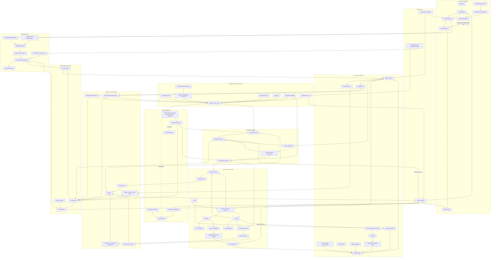

# CyberAlchemy Lab integrated model

## Status and claim ceiling

This document is the consolidated target model for the Lab. It joins semantic governance, Product and Project work, Research and Experiment, Agent execution, Project State and memory, classifications, outcomes, failures, operational learning, ontology lifecycle, relations, evidence, and owner governance.

It describes how the pieces should compose. It does not admit a Definition, Artifact Type, Relation Kind, instance, runtime, control, or consumer. Current repository status remains governed by exact descriptors and decisions, not by this review.

## The Lab in one sentence

The Lab converts attributable Intent into governed Product, Project, Research, Experiment, and Implementation work performed by bounded ephemeral Agents; records artifacts, relations, evidence, outcomes, failures, decisions, and lessons in durable Project State; and presents exact purpose-bound Context and Ontology Views to each new Session.

## Master model



## Four coordinated loops

### 1. Work loop

```text
Intent
  -> Intent Resolution or Decision
  -> Product, Project, Goal, Research, Experiment, or Capability
  -> Capability Realization Binding
  -> Implementation
  -> Agent Assignment and Session
  -> Agent Actions
  -> outputs, evidence, outcomes, and Decisions
  -> Intent satisfaction, rejection, revision, or supersession
```

Intent remains stable while candidate realizations change. Implementation is an independently governed realization. Evidence cannot satisfy Intent by itself; an owner Decision declares the effect.

### 2. State and execution loop

```text
Project State
  -> Context Request
  -> Context View + Ontology View
  -> new ephemeral Machine Agent Session
  -> Agent Actions
  -> explicit governed writes
  -> successor Project State
  -> Session and Machine Agent expire
```

Long-term machine-agent memory is Project State presented through exact Views. Session Memory is short-term, owned by one Session, has no authority effect, and expires with the Machine Agent.

### 3. Evidence and learning loop

```text
operational input
  -> owning canonical record
  -> evidence and attribution assessment
  -> immediate domain action
  -> optional Reflection
  -> optional Operational Lesson
  -> later Lesson Application
  -> Lesson Outcome Assessment
  -> retain, revise, suspend, retire, or open Improvement Target
```

Failure is one input. Success, correction, changed requirements, preferences, Findings, challenges, drift, residue, near misses, opportunity signals, and unknown effects follow their own routes.

### 4. Governance and ontology loop

```text
artifact and relation proposals
  -> validation and evidence
  -> challenge under exact Policy
  -> owner Decision
  -> semantic or governance event
  -> consistent Ontology cut
  -> Package, Context View, and Ontology View
  -> later consumers
```

Ontology integrates governed subjects. It does not replace their canonical artifacts, relations, Decisions, or event histories.

## Canonical responsibility by layer

| Layer | Owns |
| --- | --- |
| Definition | Meaning, boundaries, decision test, examples, counterexamples, and claim ceiling |
| Artifact Type | Closed schema and validation purpose for one kind of instance |
| Artifact instance | One governed occurrence with identity, owner, lifecycle, and evidence |
| Classification Scheme | Independent axes, values, cardinality, definitions, mappings, and compatibility |
| Classification Assignment | Attributable subject-to-axis/value binding with exact versions and evidence |
| Relation Kind | One semantic question, direction, endpoint pairs, qualifiers, and forbidden inferences |
| Typed Relation | One actual global connection between exact subject instances |
| Specialized binding | Lifecycle-bearing domain connection that maps to the global relation model |
| Ontology Node | Representation of one governed subject |
| Ontology Edge | Projection of a global Typed Relation or an explicitly local ontology edge |
| Project State | Durable artifacts, relations, events, evidence, Decisions, lessons, and lineage |
| Context View | Purpose-bound relevant Project State selection |
| Ontology View | Purpose-bound graph projection of one consistent ontology cut |
| Policy and Authority | Constraints, scope, permissions, delegation, and challenge requirements |
| Decision | Exact owner-declared governance or lifecycle effect |

## Intent, Product, Project, Research, Experiment, and Implementation

| Concept | Responsibility |
| --- | --- |
| Intent | Desired direction, constraints, output hypothesis, and satisfaction trace |
| Intent Resolution | Selects which governed subjects will address the Intent |
| Product | Durable identity of offered value |
| Product Thesis | Why the Product should exist and which value propositions it claims |
| Product Capability | Stable outcome the Product offers |
| Project | Coordinated work, goals, owners, evidence, Decisions, and delivery scope |
| Goal and Work | Bounded desired condition and coordinated work unit |
| Research Inquiry | One evidence-seeking question |
| Research Run | Bounded investigation producing Evidence Sets and Findings |
| Experiment Design | Controlled question, hypothesis, protocol, variables, measures, and stop rules |
| Experiment Run | One execution of an exact Experiment Design |
| Observation | Research/Experiment-specific attributable datum |
| Measurement Result | Method-bound result with uncertainty and interpretation boundary |
| Finding | Evidence-bounded conclusion with limitations and challenge route |
| Capability Realization Binding | Lifecycle-bearing Product Capability-to-Implementation contract |
| Implementation | Exact technical realization, version, source, owner, deployment posture, and evidence |

Product describes durable value. Project coordinates change. Research develops evidence. Experiment performs a controlled test. Implementation realizes a selected capability. Their identities and lifecycles remain independent.

## Actor and Agent model

```text
Person or Team
  != Person Reference
  != Principal
  != Actor
  != Agent
  != Agent Profile
  != Agent Instance
  != Agent Session
  != Agent Action
```

| Concept | Responsibility |
| --- | --- |
| Actor | Abstract attributable participant classification |
| Agent | Abstract operational Actor classification |
| Principal | Identity recognized by accountability or authorization boundary |
| Agent Profile | Reusable behavior, input/output, policy, tool, evidence, escalation, and stop contract |
| Agent Capability | Bounded action or interpretation ability; distinct from Product Capability and authority |
| Agent Instance | Concrete time-bounded Agent realization |
| Agent Session | Assignment, Views, Policies, authority, inputs, budgets, event cursor, Session Memory, and stop state |
| Agent Action | Immutable proposed, attempted, completed, rejected, failed, or indeterminate operation record |
| Agent Assignment | Bounded expected participation in Intent, Project, Work, Role, Research, or Experiment |
| Delegation | Explicit scope- and time-bounded authorization from a Principal |

Every Machine Agent Instance is ephemeral and belongs to exactly one Session. It cannot outlive the Session, inherit hidden state, or claim continuity with a later Machine Agent.

## Operational experience router

| Input | Owning record and immediate route |
| --- | --- |
| Expected result | Work Outcome Assessment, Validation Receipt, Measurement Result, or Evidence Set |
| Correction, rejection, or edit | Feedback Record bound to the exact prior Action, artifact, or statement; repair immediately when supported |
| Changed requirement | Feedback Record plus Intent successor or owner Decision |
| Communication preference | Communication Preference plus Preference Application Assessment |
| Decision preference | User Decision Preference and decision/workflow carrier |
| Research or Experiment result | Observation, Measurement Result, Evidence Set, and Finding |
| Challenge or contradiction | Challenge event under the subject's Contestability Policy |
| Source, dependency, environment, or Context drift | Drift Assessment and the relevant refresh or successor |
| Residue | Residue treatment: repair, type, gate, escalate, accept, or defer |
| Near miss | Operational Observation plus control/outcome evidence; no Failure Occurrence if the boundary held |
| Efficiency, latency, cost, quality, or usability opportunity | Improvement Signal, then optional Improvement Target |
| Repeated successful practice | Comparable Work Outcome Assessments before any lesson claim |
| Unknown external effect | Indeterminate Work Outcome Assessment; no automatic retry |

Immediate correction, safety containment, recovery, Intent revision, Context refresh, and challenge handling do not wait for lesson formation.

## Classification model

The Lab uses two general carriers:

```text
Classification Scheme
  -> versioned axes, values, definitions, cardinality, rules, hierarchy,
     mappings, compatibility, owner, and challenge route

Classification Assignment
  -> exact subject revision + Scheme version + Axis + Value
  -> basis, Agent Action, Method, Implementation, evidence, lifecycle, and Decision
```

Use a local closed field for a small type-internal enum. Use Classification Assignment when provenance, evidence, history, cross-artifact reuse, inference, or challenge matters. Project only genuine semantic-class assignments through `relation.instance-of`.

Initial Schemes cover:

- Agent actor kind;
- Agent Action kind and effect class;
- Operational Lesson kind, trigger, target work, evidence posture, and generalization level;
- Failure surface, manifestation, detection stage, impact scope, and evidence posture.

Classification does not establish identity, conformance, lifecycle transition, authority, ownership, membership, realization, causality, applicability, or success.

## Failure model

```text
Expected boundary
  -> Failure Mode
  -> signal or Observation
  -> Failure Occurrence
  -> Failure Assessment
  -> response and recovery Actions
  -> successor Assessment with possible degraded state and Residue
  -> optional Incident, Reflection, Lesson, or Improvement Target
```

| Record | Responsibility |
| --- | --- |
| Failure Mode | Reusable design-time manifestation contract |
| Failure Occurrence | One exact observed or suspected boundary-violation episode |
| Failure Assessment | Evidence posture for occurrence, mode, impact, cause hypotheses, containment, and recovery |
| Failure Control Binding | Intended prevent, detect, contain, recover, or compensate control |
| Incident | Optional coordinated response, impact, communications, Decisions, and closure envelope |

Fault, Error State, Failure, Failure Mode, Failure Occurrence, Incident, Hazard, Risk, Residue, and Operational Lesson remain distinct. Cause begins as a Hypothesis. Similar symptoms, reason codes, retries, replay, or Agent explanation do not prove one mode or cause.

## Operational learning model

```text
Observation, feedback, Finding, Failure Assessment, Residue, or Outcome Assessment
  -> Agent Reflection
  -> scoped Operational Lesson candidate
  -> Project State
  -> later View selection
  -> Lesson Application
  -> Lesson Outcome Assessment
  -> retain, revise, suspend, retire, or Improvement Target
```

An Operational Lesson contains exact scope, applicability, exclusions, predicted benefit, falsifier, evidence, counterevidence, retention policy, expiry, owner, challenge route, and lineage.

An Operational Lesson becomes an installed control only through:

```text
Lesson
  -> Improvement Target when needed
  -> Research or Experiment
  -> Finding
  -> owner Decision
  -> separate Profile, Policy, Method, validator, Agent Capability,
     or Implementation candidate
  -> validation and adoption
  -> Failure Control Binding
```

Selection is not application. Application is not compliance. Completion is not benefit. Silence is not support. Missing outcome evidence remains inconclusive.

## Governance and contestability

Every consequential subject identifies:

- semantic owner;
- lifecycle owner;
- accountable Principal;
- applicable Policy or Constitution;
- Authority Claim or Delegation when action requires it;
- valid challenge modes;
- evidence and contradiction edges;
- resolution gate;
- blocking questions;
- owner route;
- residue route;
- claim ceiling.

Roles state expected functions. Assignments bind participation. Delegation or Authority Claim bounds permission. Policy constrains behavior. Decision declares an exact effect. None can be inferred from capability, membership, classification, or successful execution.

## Ontology lifecycle runtime

```text
Ontology Manifest
  + semantic event history
  + governance event history
  -> consistent cut at one cursor and event-set digest
  -> Ontology Package
  -> Ontology View
  -> Context View
  -> query and consumer runtime
```

The manifest owns identity and configuration. Event histories own mutable semantic and governance state. Cuts, packages, navigation, Context Views, and Ontology Views are derived. A View is never a replay source or competing canonical store.

An Ontology Node represents a governed subject. A global Ontology Edge projects one exact Typed Relation. An ontology-local edge must declare its local Relation Type and cannot masquerade as a global connection.

## Relation model

### Existing candidate axes

| Group | Relation Kinds |
| --- | --- |
| Structure and work | `member-of`, `contributes-to`, `uses-method`, `realizes`, `engages-inquiry` |
| Lineage and evidence | `originates-from`, `derives-from`, `evidence-bears-on`, `evaluates` |
| Governance and semantics | `governed-by`, `declares-effect-on`, `carries-definition`, `scopes-authority-over` |
| Classification and conformance | `instance-of`, `conforms-to`, `inherits-contract`, `binds-implementation` |
| Context | `frames`, `requests-resolution-of`, `fulfills-request` |
| Identity and lifecycle | `successor-of`, `assigned-to`, `asserts-identity-of` |

### Required extensions

| Relation Kind | Unique question |
| --- | --- |
| `addresses-intent` | Which Intent is this governed subject intended to address? |
| `acts-for` | Which Principal is this Agent Instance acting for under exact delegation? |
| `has-capability` | Which Agent Capability is declared for this Profile or Instance? |
| `performs` | Which activity is performed or attempted by this Agent Instance? |
| `uses-tool` | Which Tool or Implementation does this Session or Action use? |
| `produces` | Which attributable output was produced by this Agent Action? |
| `applies-lesson` | Which exact Operational Lesson revision was actually used or deliberately not used? |
| `subclass-of` | Which broader value subsumes this classification value within one Scheme version? |
| `occurs-during` | In which Action, Session, Operation, Workflow, Run, or invocation did this episode occur? |
| `violates` | Which exact expected boundary does evidence indicate was not satisfied? |
| `affects` | Which exact subject was affected, under what scope? |
| `responds-to` | Which Failure Occurrence or Incident is this Action intended to address? |
| `controls` | Which Failure Mode is this control intended to prevent, detect, contain, recover, or compensate? |

Every extension requires the Typed Connection Extension Rule, exact ordered endpoint pairs, qualifier schema, lifecycle rules, forbidden inferences, and a carrier-resolution check.

### Canonical relation-instance rule

Every global connection has one canonical identity. A specialized binding declares exactly one mapping:

1. `projects-as`: the specialized carrier remains canonical and emits a digest-bound Typed Relation projection; or
2. `represented-by`: the generic Typed Relation is canonical and references the specialized carrier as required evidence.

Dual writable copies are forbidden.

## End-to-end example: complete repository understanding

### A. Intent and resolution

```text
Person Reference: person:vlad
  -> Principal: principal:lab-owner
  -> Intent: understand and complete the CyberAlchemy Lab model
  -> Decision selects Project: project:lab-model-integration
```

### B. State preparation

```text
Project State at cursor 120
  -> Context Request for repository definitions, types, relations, and runtimes
  -> Context View bound to cursor 120, source digests, exclusions, and expiry
  -> Ontology View bound to the same consistent cut
```

### C. Ephemeral execution

```text
Machine Agent Instance A
  -> Profile: repository-model-review
  -> Assignment: review complete Lab model
  -> Delegation: read repository and author review candidates
  -> Session A with short-term Session Memory
  -> Actions: inventory, compare, model, author, and report
```

### D. Outputs and feedback routing

```text
Actions produce audit artifacts, receipts, and evidence
Owner feedback identifies omitted Implementation, Agent, memory, classification,
failure, and general experience routes
  -> Feedback Records
  -> immediate model corrections
  -> assessed Failure Occurrence for required-layer omission
  -> Agent Reflection
  -> Operational Lesson: run complete lifecycle coverage check
```

### E. Session boundary

```text
Session A ends
  -> Machine Agent A expires
  -> Session Memory expires
  -> review artifacts, failure records, classifications, evidence, and lesson
     candidates survive only as governed Project State
```

### F. Later use

```text
New Session B creates Machine Agent B
  -> new Context and Ontology Views select exact eligible lesson revision
  -> Lesson Application records actual use
  -> Work Outcome Assessment and Lesson Outcome Assessment record evidence
  -> supported, contradicted, or inconclusive
```

### G. Improvement and control

```text
distinct assessed recurrences or explicit owner request
  -> Improvement Target
  -> Research or Experiment
  -> Finding
  -> owner Decision
  -> validator or Profile candidate
  -> validation and adoption
  -> Failure Control Binding to required-layer-omission mode
```

### H. Governance effect

The review documents remain candidates until exact owner Decisions admit Definitions, Artifact Types, Relation Kinds, instances, and runtime bindings. Validation of document structure alone creates no authority effect.

## Core non-collapse rules

```text
Definition != Artifact Type != Artifact instance != Ontology Node
Relation Kind != Typed Relation != specialized binding != Ontology Edge

Intent != Product != Project != Goal != Work
Product Capability != Agent Capability != Implementation != Authority
Research != Experiment != Observation != Finding != Decision

Person != Person Reference != Principal != Actor != Agent
Agent Profile != Agent Instance != Agent Session != Agent Action
Machine Agent lifetime = one Agent Session
Session Memory != Project State != Context View != Ontology View

Classification != identity != conformance != authority != lifecycle
Failure signal != Failure Occurrence != Failure Assessment != Incident
Failure Mode != Operational Lesson != Failure Control Binding
Feedback != preference != changed requirement != failure != drift
successful outcome != lesson != causal proof

selection != application != compliance != benefit
evidence != Finding != Decision != admission
admission != activation != deployment != runtime success
```

## Current repository state versus target model

| Surface | Current state | Target consequence |
| --- | --- | --- |
| Definitions | 118 admitted versions; Typed Connection Extension Rule still candidate | Admit extension rule and new positive Definitions before dependent carriers |
| 26 migration cohort | 6 direct admissions, 2 duplicate resolutions, 18 candidates | Rebuild remaining candidates against the integrated relation and carrier foundation |
| Artifact Types | 46 visible identities and 55 descriptor versions; effective state spread across overlays | Generate one effective-state registry |
| Relations | 23 candidate axes, 147 pairs, 50 endpoint kinds; 22 kinds lack carriers | Admit Relation Kind and Typed Relation carriers, qualifiers, extensions, and endpoint closures |
| Product/Project/Research | Type model partly admitted; representative operational instances absent | Admit instances and consumers only after relation and governance foundations |
| Experiment/Context/Ontology | Candidate carriers or incomplete schema/runtime integration | Revise and admit coherent carriers and adapters |
| Agent model | Review candidate only | Admit ephemeral Agent operational family and authority/memory boundaries |
| Classification | Definitions exist; general Scheme and Assignment carriers absent | Admit carriers and exact Schemes |
| Failure handling | Concepts and local runtime records exist; no general carrier family | Admit Mode, Occurrence, Assessment, Control Binding, and optional Incident |
| Operational learning | Local migration concepts and review candidates | Admit Reflection, Lesson, Application, Outcome, and Improvement Target |
| General experience routing | No general operational Observation, outcome, feedback, preference, drift, or signal carriers | Admit or specialize the required carriers without duplicating domain authority |
| Ontology runtime | Multiple generations with partial migration and no one successor cutover | Select one successor and bind import, replay, packages, Views, and retirement |

## Coordinated admission order

1. Admit the Typed Connection Extension Rule and resolve all new Definition identities and specializations.
2. Generate the effective Artifact Type state registry.
3. Admit Classification Scheme and Classification Assignment.
4. Admit Relation Kind and general Typed Relation carriers with qualifier schemas and specialized-carrier mappings.
5. Resolve every admitted endpoint kind and exact pair.
6. Admit Agent, Principal, Profile, Capability, Instance, Session, Action, Assignment, Delegation, Project State, Session Memory, and Ontology View foundations.
7. Admit operational observation, outcome, feedback, preference, drift, failure, control, and learning carriers.
8. Normalize Contestability Policy and Challenge Contract semantics.
9. Revise Ontology, Ontology Package, Context adapters, and select the runtime successor.
10. Rebuild and admit the remaining domain carriers against that foundation.
11. Admit representative end-to-end instances and relations.
12. Activate consumers only after replay, attribution, authority, input routing, classification, evidence, challenge, recovery, lesson, satisfaction, and no-collapse validation.

## Recommended decision

Approve this document as the single integrated review model and use the complete audit as its evidence and gap register. Preserve every new concept as `review-candidate` with `authority_effect: none` until the coordinated admission envelope supplies exact Definitions, carriers, schemas, relations, examples, validation receipts, owner Decisions, and activation choices.
