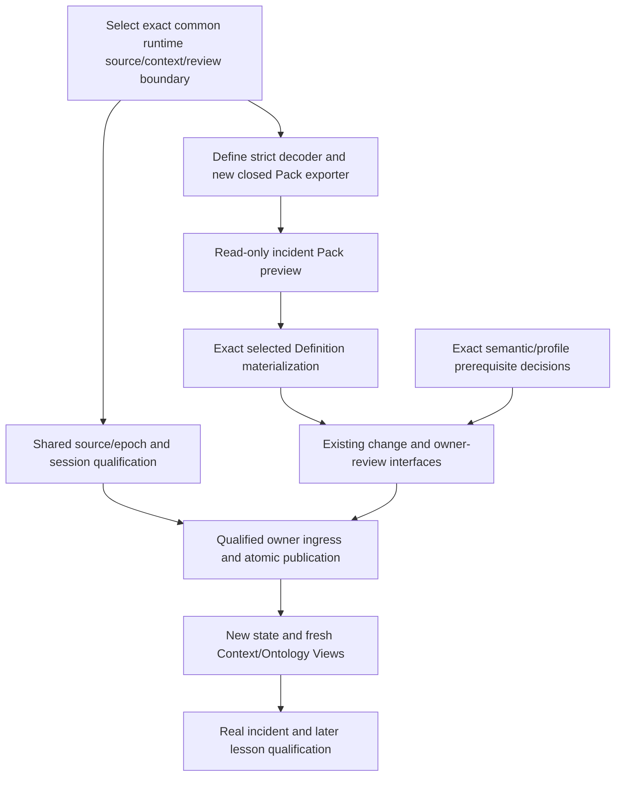

# Define: next runtime vertical slice

Authority effect: none. Recommended work after the whole-Lab audit; no implementation/admission/application performed here.

## Objective

An investigator can obtain a fresh Lab context, use an exact reusable meaning or a task-local proposal, save one complete Pack with task values/applications/evidence/optional assessments, and prepare a selected reusable Definition for the existing owner-review route. A later, separately authorized application becomes visible through the selected Lab state and a fresh session.

The definition/evidence package is prepared. The new executable exporter and runtime adapter are not delivered by that package. Retain the existing79-item plan and its M1/M2/M3 boundaries; update the crosswalk rather than restart semantic review.

## Two streams, one integration target

This is implementation dependency order. Arrows are not new admitted Relation Kinds. A candidate preparation prototype can progress before semantic admission; candidate standing remains explicit. Governing publication cannot bypass owner/prerequisite effects.

## Recommended bounded work

| Slice | Reuse | Add or finish | Acceptance evidence to obtain when implementing |
| --- | --- | --- | --- |
| D0 Target/compatibility contract | Current API17 common services, selected source/capture lineage, old v1/v2 support | Pin intended adapter target and its exact operation/identity/scope/epoch contract | No implicit latest-directory selection, old source/store behavior preserved, no fallback to incompatible epochs |
| D1 Strict input/reference provider | Current source/context contracts, amended same-byte policy | Hash+decode+parse one bounded buffer; per-entry carrier and binding revision resolution | Duplicate/number/Unicode/size/depth/interleaving controls; exact source standing and freshness |
| D2 New Pack preparation | Existing CLI/session/legacy protocols and reviewed six-meaning model | Closed new Pack schema/exporter, four dispositions, complete field lineage and use-specific readiness | Required concepts/dispositions total+unique; exact reusable meaning or working-proposal selection; no invented authority |
| D3 Applications and assessments | Pack-local model and incident bridge | Parameter contract, value provenance, revision, exact evidence/producer/result binding | INC-1042 FAIL retains12,000/11,800/200; retry new application produces12,000/12,000/0; missing evidence stays unevaluable; malformed/reversed ranges rejected |
| D4 Selected materialization/review | change.prepare, change.validate, proposal.review, checkpoint/core bindings | Map only explicitly selected reusable proposals to complete three-voice Definition/v2; independent owner requests | Task values and assessments stay in Pack; no task-per-Definition explosion, forged owner/key rejected, partial selections dependency-closed |
| D5 Application/visibility | Owner ingress, native materializer, mixed publisher, current-State/epoch design | Complete exact prerequisite effects, one coherent publication and required consumer compatibility | Crash/retry/uncertain-outcome/cold read-back; old epoch retained; no future or self-referential receipt hashes |
| D6 Qualification and realization | Existing manifests, legacy tests and Product contracts | Exact realization binding, full changed-path regression, real bounded Work and final docs | Legacy run/chat/compile/resume and numeric Calculation preservation; new Pack compilation explicitly unsupported unless selected; actual outcomes separate from semantic admission |

## What the API needs

Define can be a producer calling existing metadata/context/change/review operations. The34-operation catalog does not need a new operation merely to give Define a product name. Extend the protocol only if a concrete missing input/effect cannot be expressed by the admitted or explicitly selected candidate contracts.

The current Define bridge imports runtime/v2 directly, while the integrated candidate selects family5/API17. Avoid integrating the new exporter into the old hardpinned provider and then having to rebuild it for the common runtime. Define-owned language preparation remains distinct from the host's context, owner identity, policy and effect authority.

## Incident acceptance path

1. An authorized reader selects snapshot `S-1042`, Northstar, `{status:active}` and extraction `E-1042` for investigation. The agent receives only the selected Context/Ontology Views and session memory.
2. Define selects an exact reusable criterion if available; otherwise it records a task-local working proposal. The specimen remains a proposal, not an admitted shared criterion.
3. The Pack binds the criterion parameters. The first saved evidence shows200 required identifiers missing: FAIL.
4. A retry selects new extraction evidence and a new application revision. PASS preserves the original failure. Extra records, field correctness, root cause, incident closure and action permission are separate claims.
5. Saving the Pack changes no shared Definition. If the human selects the criterion for reusable materialization, the adapter prepares the complete Lab Definition carrier and exact owner review.
6. Only separately selected qualified owner effects can admit it. A subsequent session reconstructs the committed result through the selected state/epoch; no long-term machine memory is introduced.

## Scope of this first delivery

Start with preparation and review. Keep chat/session/compile compatibility, candidate output safety, source provenance and explicit blockers. Reuse existing context, ontology, review, workflow and publication interfaces; do not build a second store, owner system, memory service or global ontology.

Permanent installation, governing publication, network deployment and stable release require the selected effects and their own evidence. Prototype fixtures and owner-review preparation are not those outcomes.
