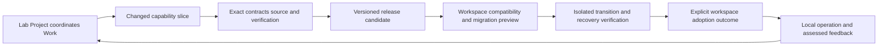

# Whole-Lab adoption and evolution

Status: proposed composition of existing mechanisms. This document does not invent an admitted workspace Artifact Type or replace an existing runtime manifest.

## Existing building blocks

The [prerequisite audit](MODEL-GAPS.md) identifies existing Governed Model, Canonical Package Home/Manifest, Model Instance Binding and Capability Instance contracts. Model Instance Binding already owns inheritance, extensions, adoption and succession semantics. The remaining gap is their Lab-specific composition and actual instance/transition records, not the absence of generic adoption machinery.

[Craft bindings](../../craft/implementation/bindings.json) already separate local source from shared runtimes. [Runtime source profiles](../../implementation/lab-runtime/v2/README.md) bind exact authority/state selections and refuse silent rebases. [Bootstrap](../../implementation/lab-bootstrap/candidates/v1/README.md) and [provisioning](../../implementation/lab-provisioning/candidates/v1/README.md) prepare bounded branches. [Installation operations](../../product/lab/release-candidates/v1/packaging/R02/OPERATIONS.md) describe upgrade/export/restore and retained-reader rollback. These are implementation precedents, not proof that a general cross-area adoption protocol is established.

The existing [API workspace schema](../../product/lab/release-candidates/v1/interface/api-integration-v17/workspace.schema.json) represents an owned candidate operation workspace with principal, scope and materials. Preserve that meaning and identity. The proposed Lab Workspace adoption record needs a distinct contract unless a reviewed semantic change explicitly establishes compatibility.

Shared execution is the default. A workspace adopts compatible capability/model references and scoped configuration without requiring another runtime installation. Behavior specialization and dedicated placement are separate choices; a shared host upgrade must assess all affected workspace selections and retain or explicitly transition compatibility. See the [Define-prepared runtime policy](../../docs/proposals/0012-lab-workspace-model/SHARED-RUNTIME.md).

Current scope classification uses [Product Workspaces and Project Workspaces](WORKSPACES.md). Product-wide and Project-specific context require distinct subject/cardinality rules. The [model revision](MODEL-REVISION.md) specifies that change; the earlier Project-only schema and pure resolver are retained, not reinterpreted as already implementing it.

## Proposed adoption contents

| Part | Required information | Separation to preserve |
| --- | --- | --- |
| Workspace identity | Workspace kind/identity/location plus the kind-specific Product or Project subject and separately linked scopes | Location does not create or merge semantic identities |
| Shared selections | Exact Lab release/component, contract and source-profile revisions | A package version is not the authority epoch or ontology cursor |
| Local ownership | Applicable governing bindings, owners and extension ownership | Parent Lab membership does not grant local effect authority |
| Environment/configuration | Runtime/dependency/environment bindings and public configuration | Secrets and private operational stores are referenced, not copied into templates |
| Local extensions | Exact override/extension contracts, applicability and compatibility expectations | Local changes do not silently mutate shared definitions |
| Transition | Before/after adoption selections, active preimage, carry/adapt/exclude disposition and migration steps | History stays exact; changed carrier shape is not automatically changed meaning |
| Outcome | Actual verification, migration journal, selected current generation and unresolved effects | Prepared, tested, applied, admitted, activated and valuable are distinct claims |

This is a proposed content checklist, not a JSON schema or a requirement to flatten every part into one file. Existing exact manifests and records should be referenced rather than copied into a competing canonical store.

## Release and adoption sequence

Arrows show proposed workflow order, not newly admitted Typed Relations. Creating the release does not upgrade every workspace. A workspace can retain an earlier compatible selection and still own its current records. Shared dependency paths must resolve exact selected revisions rather than exposing unreviewed mutable bytes to an old selection.

For each release, distinguish navigation-only changes, compatible behavior changes, carrier/schema changes, semantic revisions, state/profile migrations and authority/effect changes. Select validation and required decisions according to the actual change; do not require semantic re-admission for every documentation edit or infer permission from an installer result.

An upgrade should inspect current selections and dirty local extensions, verify the exact preimage, prepare a new generation/branch where supported, apply selected migrations, check identities/history/consumer behavior, and record the actual result. Reconcile an uncertain effect before redispatch. A retained old reader is one rollback mechanism; irreversible data or external effects need their own recovery contract and cannot be undone by merely restoring code.

## Scope of discovery

The mapper examined bootstrap/provisioning/runtime documentation and selected source, installation/transfer/publication candidates, Craft bindings and Define integration. No common eight-area release/adoption contract was established from that selection. This is a bounded integration gap, not an assertion that all packaging, workspace, release or migration functionality is absent from the repository.

The [one Product home revision](PRODUCT-COLOCATION.md) keeps Project/Work record evolution inside the owning Product workspace. A new Project or Goal record does not create a new installation or workspace. Only a separately selected independent operating boundary justifies a standalone Project Workspace.
