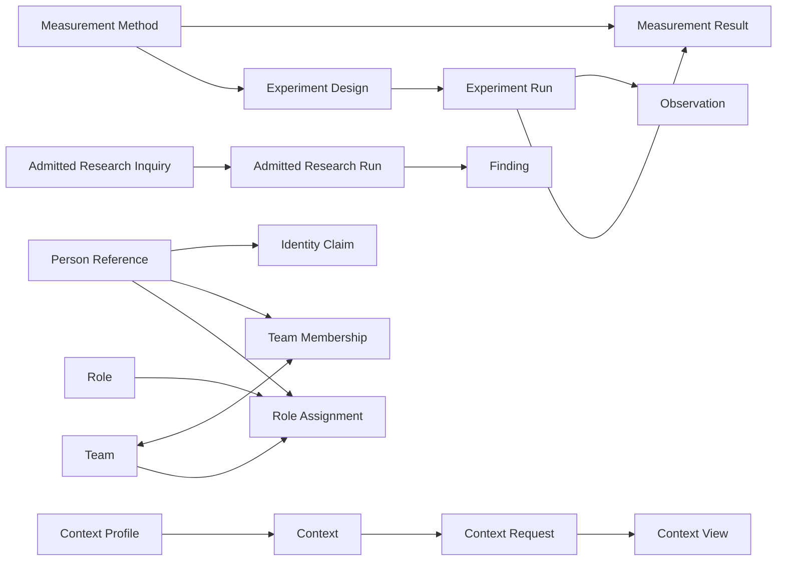

<!-- GENERATED FILE: canonical data is model.json and examples.json. -->

# Remaining 18 Artifact Types: complete review model

This is the one decision surface for the remaining migration queue. Every package is revised and validated, but none is admitted by this review candidate.

## Decision effect

A single approval will authorize one atomic admission decision covering the exact 18 Artifact Type contracts and schemas bound here. It will not admit example instances, activate consumers, grant identity or authority, run research or experiments, or establish findings as decisions.

## Complete model

| # | Family | Artifact Type | Definition | Depends on | Version | Validation |
| ---: | --- | --- | --- | --- | --- | --- |
| 1 | research conclusion | `cal.artifact-type.finding/v1` | `cal.definition.finding@1.0.0-candidate.1` | `cal.artifact-type.research-inquiry/v1`<br>`cal.artifact-type.research-run/v1` | `1.0.0-candidate.2` | `PASS` |
| 2 | empirical work | `cal.artifact-type.measurement-method/v1` | `cal.definition.residue-measurement@1.0.0-candidate.1` | none | `1.0.0-candidate.2` | `PASS` |
| 3 | empirical work | `cal.artifact-type.measurement-result/v1` | `cal.definition.residue-measurement@1.0.0-candidate.1` | `cal.artifact-type.measurement-method/v1` | `1.0.0-candidate.2` | `PASS` |
| 4 | empirical work | `cal.artifact-type.observation/v1` | `cal.definition.observation@1.0.0-candidate.1` | `cal.artifact-type.research-run/v1 or cal.artifact-type.experiment-run/v1` | `1.0.0-candidate.2` | `PASS` |
| 5 | empirical work | `cal.artifact-type.experiment-design/v1` | `cal.definition.experiment-design@1.0.0-candidate.1` | `cal.artifact-type.project-identity/v1`<br>`cal.artifact-type.research-inquiry/v1 (optional research framing)`<br>`Product Identity, Product Thesis, Product Capability, and Capability Realization Binding (optional product evaluation)`<br>`cal.artifact-type.measurement-method/v1` | `1.0.0-candidate.2` | `PASS` |
| 6 | empirical work | `cal.artifact-type.experiment-run/v1` | `cal.definition.experiment-run@1.0.0-candidate.1` | `cal.artifact-type.experiment-design/v1`<br>`cal.artifact-type.observation/v1`<br>`cal.artifact-type.measurement-result/v1` | `1.0.0-candidate.2` | `PASS` |
| 7 | knowledge model | `cal.artifact-type.ontology/v1` | `cal.definition.ontology@1.0.0-candidate.1` | none | `1.0.0-candidate.2` | `PASS` |
| 8 | context resolution | `cal.artifact-type.context-profile/v1` | `cal.definition.context@1.0.0-candidate.1` | none | `1.0.0-candidate.2` | `PASS` |
| 9 | context resolution | `cal.artifact-type.context/v1` | `cal.definition.context@1.0.0-candidate.1` | `cal.artifact-type.product-identity/v2`<br>`cal.artifact-type.project-identity/v1`<br>`cal.artifact-type.context-profile/v1` | `1.0.0-candidate.2` | `PASS` |
| 10 | context resolution | `cal.artifact-type.context-request/v1` | `cal.definition.context-request@1.0.0-candidate.1` | `cal.artifact-type.context/v1` | `1.0.0-candidate.2` | `PASS` |
| 11 | context resolution | `cal.artifact-type.context-view/v1` | `cal.definition.context-view@1.0.0-candidate.1` | `cal.artifact-type.context/v1`<br>`cal.artifact-type.context-request/v1` | `1.0.0-candidate.2` | `PASS` |
| 12 | model authority | `cal.artifact-type.model-instance-binding/v1` | `cal.definition.parent-instance-authority-separation-invariant@1.0.0-candidate.1` | none | `1.0.0-candidate.2` | `PASS` |
| 13 | people and teams | `cal.artifact-type.person-reference/v1` | `cal.definition.person-reference@1.0.0-candidate.1` | none | `1.0.0-candidate.2` | `PASS` |
| 14 | people and teams | `cal.artifact-type.identity-claim/v1` | `cal.definition.identity-claim@1.0.0-candidate.1` | `cal.artifact-type.person-reference/v1` | `1.0.0-candidate.2` | `PASS` |
| 15 | people and teams | `cal.artifact-type.role/v1` | `cal.definition.role@1.0.0-candidate.1` | none | `1.0.0-candidate.2` | `PASS` |
| 16 | people and teams | `cal.artifact-type.team/v1` | `cal.definition.team@1.0.0-candidate.1` | `cal.artifact-type.team-membership/v1`<br>`cal.artifact-type.role-assignment/v1` | `1.0.0-candidate.2` | `PASS` |
| 17 | people and teams | `cal.artifact-type.team-membership/v1` | `cal.definition.team-membership@1.0.0-candidate.1` | `cal.artifact-type.person-reference/v1`<br>`cal.artifact-type.team/v1` | `1.0.0-candidate.2` | `PASS` |
| 18 | people and teams | `cal.artifact-type.role-assignment/v1` | `cal.definition.role-assignment@1.0.0-candidate.1` | `cal.artifact-type.person-reference/v1 or cal.artifact-type.team/v1`<br>`cal.artifact-type.role/v1` | `1.0.0-candidate.2` | `PASS` |

## Dependency shape



The Experiment Run, Observation, and Measurement Result contracts form one mutually useful empirical cluster. Team and Team Membership form one lifecycle cluster. Atomic admission keeps those cross-references resolvable without pretending that any instance exists.

## Overlap dispositions

| Candidate | Adjacent carrier | Disposition | Boundary |
| --- | --- | --- | --- |
| `cal.artifact-type.context-profile/v1` | `cal.artifact-type.context/v1` | `specialized-policy-carrier` | Context Profile carries reusable construction and resolution policy derived from the admitted Context contract. It has no Product, Project, Goal, purpose-bound Context identity, or resolved source selection and cannot validate as a Context instance. |
| `cal.artifact-type.context/v1` | `cal.artifact-type.bounded-context/v2` | `distinct` | Context defines a purpose-specific relevance and interpretation boundary anchored to Product and optionally Project or Goal. Bounded Context defines a semantic ownership boundary for a domain model. |
| `cal.artifact-type.experiment-run/v1` | `cal.artifact-type.research-run/v1` | `distinct` | Experiment Run executes a predeclared controlled design with variables or interventions. Research Run executes a bounded inquiry method and may be observational or analytical without an Experiment Design. |
| `cal.artifact-type.model-instance-binding/v1` | `cal.artifact-type.capability-realization-binding/v1` | `distinct` | Model Instance Binding is the generic parent-to-instance authority separation contract. Capability Realization Binding is the Product Capability-specific relation with adoption and realization evidence semantics. |
| `cal.artifact-type.ontology/v1` | `cal.artifact-type.ontology-package/v1` | `distinct` | Ontology carries governed typed knowledge and relations. Ontology Package is a packaging carrier and does not replace the Ontology semantic identity. |

## Experiment and Research relations

| Source | Relation | Target | Current carrier | Relation-kind state |
| --- | --- | --- | --- | --- |
| Experiment Design | `belongs-to-project` | Project Identity | `project_ref` | `migration-contract-only` |
| Experiment Design | `advances-goal` | Goal | `goal_refs` | `exact-kind-missing` |
| Experiment Design | `tests-question-from` | Research Inquiry | `research_refs` | `exact-kind-missing` |
| Experiment Design | `evaluates-product-context` | Product, Product Thesis outcome, Product Capability, or realization binding | `product_evaluation_context` | `exact-kind-missing` |
| Experiment Design | `uses-method` | Protocol and Measurement Method | `protocol_ref and measure_refs` | `migration-contract-only` |
| Experiment Run | `executes-design` | Experiment Design | `design_ref and design_version_ref` | `exact-kind-missing` |
| Experiment Run | `preserves-research-trace` | Research Inquiry | `research_refs` | `exact-kind-missing` |
| Experiment Run | `preserves-product-evaluation-context` | Product, Product Thesis outcome, Product Capability, or realization binding | `product_evaluation_context` | `exact-kind-missing` |
| Experiment Run | `produces-observation` | Observation | `observation_refs and Observation.run_ref` | `exact-kind-missing` |
| Experiment Run | `produces-measurement` | Measurement Result | `measurement_result_refs` | `exact-kind-missing` |
| Experiment Run | `produces-evidence` | Evidence Set | `evidence_set_ref` | `exact-kind-missing` |
| Observation | `derives-from` | Experiment Run or Research Run | `run_ref` | `migration-contract-only` |
| Measurement Result | `uses-method` | Measurement Method | `method_ref` | `migration-contract-only` |
| Finding | `derives-from` | Research Run or Evidence Set | `research_run_refs and evidence_set_refs` | `migration-contract-only` |
| Evidence | `supports or contradicts` | Finding | `evidence_refs and counterevidence_refs` | `migration-contract-only` |

## Complete relation audit

The repository has **25 admitted migration contracts** for relation kinds. They select migration semantics only; they do not provide admitted canonical relation carriers. The revised Artifact Types carry the references below, but the graph is incomplete until endpoint gaps and missing exact kinds are resolved.

### Existing relation kinds with endpoint gaps

| Relation | Current source kinds | Missing source kinds | Why it matters |
| --- | --- | --- | --- |
| `belongs-to-product` | `product-capability`, `product-thesis` | `context` | Context is anchored to one Product. Experiments should use evaluates rather than claiming Product membership. |
| `belongs-to-project` | `research-inquiry`, `experiment-design`, `goal`, `work`, `evidence-set`, `capability-realization-binding` | `context`, `experiment-run`, `research-run` | These carriers preserve Project scope, but the admitted migration contract does not accept their source kinds. |
| `uses-method` | `research-run`, `experiment-run` | `measurement-result`, `observation`, `project`, `product` | Empirical records and the existing Identity Graph fixture carry Method links, but the current endpoint contract only types run-to-method edges. |
| `evaluates` | `evaluation` | `experiment-design`, `experiment-run` | An Experiment can evaluate declared Product anchors, but it is not an Evaluation artifact under the current contract. |
| `instance-of` | `implementation`, `product-capability` | `capability-instance` | The instance is the source endpoint; Model Instance Binding remains the lifecycle-bearing relation record. |

### Unmodeled exact relationship semantics

These 27 rows are semantic gaps found in the field model and repository examples. They are not a recommendation to create one relation kind per row; the normalization below reuses generic relations and combines repeated meanings.

| Family | Relation | Source | Target | Current field carrier | Priority |
| --- | --- | --- | --- | --- | --- |
| semantic-governance | `carries-definition` | Artifact Type | Definition | `semantic_definition_refs and semantic_definition_bindings` | `required` |
| semantic-governance | `admits` | Decision | Definition, Artifact Type, Relation Kind, or other governed version | `admission decision bindings` | `required` |
| product | `contributes-to-product` | Project | Product | `new Project-to-Product typed relation` | `required-when-present` |
| research | `executes-inquiry` | Research Run | Research Inquiry | `Research Run.inquiry_ref` | `required` |
| research | `tests-question-from` | Experiment Design | Research Inquiry | `research_refs` | `required-when-present` |
| research | `executes-design` | Experiment Run | Experiment Design | `design_ref and design_version_ref` | `required` |
| research | `advances-goal` | Research or Experiment | Goal | `goal_refs` | `required` |
| evidence | `produces-observation` | Research Run or Experiment Run | Observation | `observation_refs and Observation.run_ref` | `required` |
| evidence | `produces-measurement` | Experiment Run | Measurement Result | `measurement_result_refs` | `required` |
| evidence | `produces-evidence-set` | Research Run or Experiment Run | Evidence Set | `evidence_set_ref` | `required` |
| evidence | `answers-inquiry` | Finding | Research Inquiry | `inquiry_ref` | `required` |
| product | `tests-thesis-hypothesis` | Experiment Design | Product Thesis hypothesis | `product_evaluation_context.thesis_hypothesis_refs` | `required-when-present` |
| product | `tests-thesis-outcome` | Experiment Design | Product Thesis outcome | `product_evaluation_context.thesis_outcome_refs` | `required-when-present` |
| product | `evaluates-capability` | Experiment Design | Product Capability | `product_evaluation_context.product_capability_refs` | `required-when-present` |
| product | `tests-realization` | Experiment Design | Capability Realization Binding | `product_evaluation_context.realization_binding_refs` | `required-when-present` |
| context | `conforms-to-profile` | Context | Context Profile | `profile_ref` | `required` |
| context | `resolves-context` | Context Request | Context | `context_ref and context_version_ref` | `required` |
| context | `fulfills-request` | Context View | Context Request | `request_ref` | `required` |
| context | `projects-context` | Context View | Context | `context_ref and context_version_ref` | `required` |
| ontology | `contains-node` | Ontology | Ontology node | `node_refs` | `required` |
| ontology | `asserts-relation` | Ontology | Typed relation | `relation_refs` | `required` |
| model-authority | `binds-instance-to-parent` | Model Instance Binding | exact parent model and local instance | `parent_model_ref, parent_model_version_ref, and instance_ref` | `required` |
| model-authority | `inherits-contract` | Model Instance Binding | Inherited contract | `inherited_contract_refs` | `required` |
| model-authority | `conforms-to` | Model Instance Binding | Conformance evidence | `conformance_refs` | `required-when-active` |
| people-and-teams | `claims-identifier-for` | Identity Claim | Person Reference | `person_reference_ref` | `required` |
| people-and-teams | `defines-responsibility` | Role | Responsibility | `responsibility_refs` | `required-when-present` |
| people-and-teams | `bounded-by-authority-claim` | Role Assignment | Authority Claim | `authority_claim_refs` | `required-when-present` |

### Relation records that must retain identity

- `member-of` (Person Reference -> Team) is represented by `Team Membership`. The edge must retain membership_ref, state, period, basis, owner, and challenge route so the lifecycle record is not erased.
- `assigned-role` (Person Reference or Team -> Role) is represented by `Role Assignment`. The edge must retain role_assignment_ref, state, period, basis, scope, owner, and challenge route so the assignment record remains authoritative.

### Superseded verb-level relation proposal

The initial proposal added **17** relation kinds and expanded five contracts. The admitted Classification Axis, Classification Orthogonality, Typed Coupling, Root-Axis Independence, Governance-Axis Independence, and Identity Relation definitions showed that this still duplicated semantic axes. It is retained below as audit history and is superseded by the axis-orthogonal successor.

| Relation | Action | Consolidates | Endpoint shape |
| --- | --- | --- | --- |
| `carries-definition` | `add` | `artifact-type-carries-definition`, `binds-definition` | Artifact Type -> exact Definition version |
| `admits` | `add` | `decision-admits-artifact-type` | Decision -> exact governed version admitted by that decision |
| `contributes-to-product` | `add` | `coordinated-by`, `project-serves-product` | Project -> Product |
| `addresses-inquiry` | `add` | `executes-inquiry`, `tests-question-from`, `preserves-research-trace` | Research Run, Experiment Design, or Experiment Run -> Research Inquiry |
| `executes-design` | `add` | `executes-design` | Experiment Run -> exact Experiment Design version |
| `advances-goal` | `add` | `advances-goal`, `pursues-goal` | Project, Research, or Experiment carrier -> Goal |
| `answers-inquiry` | `add` | `answers-inquiry` | Finding -> Research Inquiry |
| `tests-thesis-proposition` | `add` | `tests-thesis-hypothesis`, `tests-thesis-outcome` | Experiment Design -> Product Thesis hypothesis or outcome |
| `conforms-to` | `add` | `conforms-to-profile`, `conforms-to` | Context -> Context Profile; capability instance -> exact parent contract |
| `requests-resolution-of` | `add` | `resolves-context` | Context Request -> exact Context version |
| `fulfills-request` | `add` | `fulfills-request` | Context View -> Context Request |
| `projects-context` | `add` | `projects-context` | Context View -> exact Context version |
| `contains` | `add` | `contains-node`, `asserts-relation` | Ontology -> governed node or typed relation |
| `inherits-contract` | `add` | `inherits-contract` | Capability instance -> inherited contract, qualified by Model Instance Binding |
| `claims-identifier-for` | `add` | `claims-identifier-for` | Identity Claim -> Person Reference |
| `defines-responsibility` | `add` | `defines-responsibility` | Role -> Responsibility |
| `bounded-by-authority-claim` | `add` | `bounded-by-authority-claim` | Role Assignment -> Authority Claim |

Existing kinds to reuse:

- `derives-from`: Observation, Measurement Result, and Evidence Set -> producing Research Run or Experiment Run
- `evaluates`: Experiment Design or Experiment Run -> Product, Product Capability, or Capability Realization Binding
- `belongs-to-product`: Context -> Product
- `belongs-to-project`: Context, Research Run, or Experiment Run -> Project
- `uses-method`: Observation, Measurement Result, Project, or Product -> Method, with a usage-role qualifier when the Method is constitutive
- `instance-of`: Capability instance -> exact parent model
- `governed-by`: Context or Ontology -> Policy
- `successor-of and supersedes`: All successor-bearing candidates

### Current axis-orthogonal relation model

The current candidate compresses `42` verb-level kinds into `23` independently valued relation axes, preserves all prior meanings as qualifier values, and passes `10` hostile no-collapse cases.

Canonical candidate: `authority/relation-kinds/candidates/0002-axis-orthogonal-model/model.json`

Validation receipt: `authority/relation-kinds/candidates/0002-axis-orthogonal-model/receipts/validation.json`

### Corrections applied during this audit

- Measurement Result.subject_ref now identifies the Experiment Run that produced the result in the coherent example.
- Experiment Run.design_version_ref now names a complete logical version instead of a truncated pseudo-digest.
- Model Instance Binding.parent_model_version_ref now names a complete parent version instead of the ambiguous @v1 shorthand.
- Identity Claim and Team Membership now use person_reference_ref, making the endpoint kind explicit rather than implying a direct Person record.

## Revised examples

### 1. Finding

Records one attributable evidence-bounded conclusion derived from exact Research Runs and Evidence Sets, with question fidelity, support assessment, counterevidence, limitations, lifecycle, ownership, challengeability, revisions, successors, and an explicit claim ceiling.

Canonical example: `authority/artifact-types/finding/v1/fixtures/valid/record.json`

```json
{
  "authority_effect": "none",
  "challenge_route": "route:artifact-type-migration-research-challenge",
  "claim_ceiling": "Candidate Finding fixture only. The cited repository evidence supports a bounded contract-gap conclusion; it does not admit an Artifact Type, prove migration completeness, create a Definition or decision, or authorize implementation or runtime effects.",
  "counterevidence_refs": [
    "evidence:research-inquiry-original-scaffold-preserved-question-method-and-stop-conditions"
  ],
  "created_at": "2026-10-05T13:05:00Z",
  "evidence_refs": [
    "observation:research-inquiry-definition-gap-review",
    "observation:research-inquiry-package-validation"
  ],
  "evidence_set_refs": [
    "evidence-set:research-inquiry-v1-review"
  ],
  "finding_state": "draft",
  "inquiry_ref": "research-inquiry:artifact-type-migration-review",
  "kind": "finding",
  "last_updated_at": "2026-10-05T13:05:00Z",
  "limitations": [
    "The comparison covers the admitted Definition and current repository candidate only",
    "It does not establish behavior of external or unavailable CyberAlchemy v2 systems"
  ],
  "node_id": "finding:research-inquiry-v1-contract-gap",
  "owner_ref": "role:migration-research-owner",
  "owner_route": "role:migration-research-owner",
  "question": "Which reconstructed CyberAlchemy v2 Artifact Types should be admitted into CyberAlchemy Lab without duplicating or weakening already admitted carriers?",
  "research_run_refs": [
    "research-run:research-inquiry-v1-review:2026-10-05"
  ],
  "revision_history": [],
  "scope_ref": "scope:artifact-type-migration-review",
  "statement": "Research Inquiry/v1 candidate.1 preserved a bounded question, Project, method, scope, and stopping conditions but omitted Goal linkage, source policy, evidence and counterevidence separation, Finding references, limitations, timestamps, owner route, challenge route, and a claim ceiling required to carry the admitted Definition without semantic weakening.",
  "status": "candidate-unadmitted",
  "successor_refs": [],
  "support_assessment": {
    "rationale": "The missing fields are directly observable by comparing the admitted Research Inquiry Definition with the candidate.1 schema; the original scaffold's preserved fields are recorded as counterevidence against claiming total absence of Research semantics.",
    "support_state": "supported"
  }
}
```

### 2. Measurement Method

Defines one residue-entropy observable after a declared source operation, including entropy register, typed residue, mathematical reading, scope, procedure, uncertainty, claim status, authority treatment, and interpretation.

Canonical example: `authority/artifact-types/measurement-method/v1/fixtures/valid/record.json`

```json
{
  "authority_effect": "none",
  "authority_treatment": "non-governing",
  "challenge_route": "route:measurement-challenge",
  "claim_ceiling": "The method defines one finite residue-entropy observable. It does not supply a result, prove novelty, or determine authority.",
  "claim_status": "review",
  "conditions": [
    "The source set and normalization revision are fixed",
    "Every unresolved term belongs to exactly one declared residue class"
  ],
  "entropy_register": "finite-probabilistic",
  "interpretation": "Higher entropy means unresolved terms remain distributed across more distinguishable classes in this normalization run; it is not generic disorder or automatic promotion.",
  "kind": "measurement-method",
  "mathematical_reading": "H(R) = sum over unresolved term classes of -rho(x) log rho(x).",
  "name": "Definition normalization residue entropy",
  "node_id": "measurement-method:definition-normalization-residue-entropy",
  "observable_kind": "shannon-entropy",
  "owner_ref": "role:artifact-type-owner",
  "owner_route": "role:measurement-owner",
  "procedure": "Classify every unresolved source term after normalization, compute its empirical probability mass, then calculate Shannon entropy over the finite class set.",
  "property": "residue entropy",
  "residue_type_ref": "residue:unresolved-source-term",
  "scope_kind": "probabilistic",
  "scope_ref": "scope:cyberalchemy-lab-model-review",
  "source_operation_ref": "operation:normalize-source-terms-to-definition-identities",
  "status": "candidate-unadmitted",
  "uncertainty_rule": "Report bootstrap interval over source-term resamples and preserve the class counts.",
  "unit": "nats"
}
```

### 3. Measurement Result

Records one attributable residue-entropy result produced by an exact Measurement Method, preserving entropy register, source operation, typed residue, mathematical reading, scope, uncertainty, claim status, authority treatment, evidence, and receipt.

Canonical example: `authority/artifact-types/measurement-result/v1/fixtures/valid/record.json`

```json
{
  "authority_effect": "none",
  "authority_treatment": "non-governing",
  "challenge_route": "route:measurement-challenge",
  "claim_ceiling": "This result quantifies distinguishability within one declared finite residue model. It does not prove novelty, generic disorder, promotion, or authority.",
  "claim_status": "review",
  "entropy_register": "finite-probabilistic",
  "evidence_ref": "evidence:unresolved-term-class-counts",
  "kind": "measurement-result",
  "mathematical_reading": "H(R) over 12 unresolved terms grouped into 4 declared classes.",
  "method_ref": "measurement-method:definition-normalization-residue-entropy",
  "node_id": "measurement-result:definition-normalization-residue-entropy:2026-10-05",
  "observable_kind": "shannon-entropy",
  "observed_at": "2026-10-05T14:18:00Z",
  "owner_ref": "role:artifact-type-owner",
  "owner_route": "role:measurement-owner",
  "receipt_ref": "receipt:residue-entropy-calculation",
  "residue_ref": "residue-set:unresolved-source-terms:2026-10-05",
  "scope_kind": "probabilistic",
  "scope_ref": "scope:cyberalchemy-lab-model-review",
  "source_operation_ref": "operation:normalize-source-terms-to-definition-identities",
  "status": "candidate-unadmitted",
  "subject_ref": "experiment-run:definition-normalization-residue:2026-10-05",
  "uncertainty": {
    "interpretation": "Bootstrap standard error over source-term resamples.",
    "value": 0.12
  },
  "unit": "nats",
  "value": 1.21
}
```

### 4. Observation

Records one attributable perception or instrument readout during a Research Run or Experiment Run, including method, conditions, provenance, uncertainty, and limitations.

Canonical example: `authority/artifact-types/observation/v1/fixtures/valid/record.json`

```json
{
  "authority_effect": "none",
  "challenge_route": "route:research-challenge",
  "claim_ceiling": "This observation records what was seen in one run and is not an explanatory Finding.",
  "conditions": [
    "Reviewed semantic-key map applied",
    "Source and class vocabularies fixed"
  ],
  "evidence_ref": "evidence:unresolved-term-class-counts",
  "kind": "observation",
  "limitations": [
    "One source set, one normalization revision, and one residue vocabulary"
  ],
  "method_ref": "protocol:definition-normalization-residue-comparison/v1#classify",
  "node_id": "observation:definition-normalization-residue-classes",
  "observed_at": "2026-10-05T14:18:00Z",
  "observer_ref": "person-reference:repository-reviewer",
  "owner_ref": "role:artifact-type-owner",
  "owner_route": "role:research-owner",
  "provenance_refs": [
    "receipt:definition-normalization-classification"
  ],
  "run_ref": "experiment-run:definition-normalization-residue:2026-10-05",
  "scope_ref": "scope:cyberalchemy-lab-model-review",
  "statement": "Twelve unresolved source terms remained after normalization and were classified into four declared residue classes.",
  "status": "candidate-unadmitted",
  "subject_ref": "residue-set:unresolved-source-terms:2026-10-05",
  "uncertainty": "Manual classification may assign ambiguous terms differently under another reviewed vocabulary."
}
```

### 5. Experiment Design

Defines one pre-run empirical test with explicit Project and Goal linkage, optional Research Inquiry and Product evaluation context, hypothesis, protocol, variables, measures, prerequisites, stop rules, timestamps, ownership, and challenge route.

Canonical example: `authority/artifact-types/experiment-design/v1/fixtures/valid/record.json`

```json
{
  "authority_effect": "none",
  "challenge_route": "route:research-challenge",
  "claim_ceiling": "This design specifies a test. It does not show that the test ran or that the hypothesis is supported.",
  "conditions": [
    "Same source-term set",
    "Same residue classification vocabulary"
  ],
  "created_at": "2026-10-05T13:40:00Z",
  "design_state": "ready",
  "environment": "CyberAlchemy Lab local checkout at one fixed revision",
  "evidence_refs": [],
  "finding_refs": [],
  "goal_refs": [
    "goal:reduce-unresolved-definition-residue"
  ],
  "kind": "experiment-design",
  "last_updated_at": "2026-10-05T13:40:00Z",
  "limitations": [
    "The design measures one finite normalization residue model and does not establish general semantic quality or product value"
  ],
  "measure_refs": [
    "measurement-method:definition-normalization-residue-entropy"
  ],
  "node_id": "experiment-design:definition-normalization-residue",
  "owner_ref": "role:artifact-type-owner",
  "owner_route": "role:research-owner",
  "prerequisites": [
    "Source-term set is digest-bound",
    "Residue classes are frozen before the run"
  ],
  "product_evaluation_context": {
    "evaluation_purpose": "Measure one normalization-residue signal relevant to the governed Definition admission realization without treating it as proof of the Product outcome or thesis.",
    "product_capability_refs": [
      "capability:craft:governed-definition-admission"
    ],
    "product_ref": "CA2-PRODUCT-CRAFT",
    "product_thesis_ref": "product-thesis:craft",
    "realization_binding_refs": [
      "binding:craft:governed-definition-admission:workflow-v1"
    ],
    "thesis_hypothesis_refs": [],
    "thesis_outcome_refs": [
      "product-thesis:craft#outcome-authoritative-state"
    ]
  },
  "project_ref": "project:lab-semantic-governance",
  "protocol_ref": "protocol:definition-normalization-residue-comparison/v1",
  "question_or_hypothesis": "Applying the reviewed semantic-key map lowers finite probabilistic residue entropy in the fixed unresolved source-term set.",
  "research_refs": [
    "research-inquiry:definition-normalization-residue"
  ],
  "run_refs": [],
  "scope_ref": "scope:cyberalchemy-lab-model-review",
  "status": "candidate-unadmitted",
  "stop_rules": [
    "Stop after baseline and intervention classifications complete",
    "Stop if source or class vocabulary changes"
  ],
  "subject_ref": "pipeline:definition-normalization",
  "variables_or_interventions": [
    {
      "kind": "intervention",
      "name": "semantic-key map",
      "planned_value": "baseline versus reviewed map"
    }
  ]
}
```

### 6. Experiment Run

Records one attributable execution of an exact Experiment Design while preserving its Project, Goal, optional Research Inquiry trace, and optional Product evaluation context together with actual inputs, environment, interventions, deviations, observations, measurements, timing, and stop state.

Canonical example: `authority/artifact-types/experiment-run/v1/fixtures/valid/record.json`

```json
{
  "authority_effect": "none",
  "challenge_route": "route:research-challenge",
  "claim_ceiling": "This run records one execution. Completion does not establish a Finding or product value.",
  "design_ref": "experiment-design:definition-normalization-residue",
  "design_version_ref": "experiment-design:definition-normalization-residue@1.0.0-candidate.1",
  "deviations": [],
  "environment": "CyberAlchemy Lab local checkout at revision review-2026-10-05",
  "evidence_set_ref": "evidence-set:definition-normalization-residue-run-2026-10-05",
  "goal_refs": [
    "goal:reduce-unresolved-definition-residue"
  ],
  "input_refs": [
    "fixture:unresolved-source-terms/v1",
    "vocabulary:normalization-residue-classes/v1"
  ],
  "interventions": [
    "Apply reviewed semantic-key map before residue classification"
  ],
  "kind": "experiment-run",
  "measurement_result_refs": [
    "measurement-result:definition-normalization-residue-entropy:2026-10-05"
  ],
  "node_id": "experiment-run:definition-normalization-residue:2026-10-05",
  "observation_refs": [
    "observation:definition-normalization-residue-classes"
  ],
  "owner_ref": "role:artifact-type-owner",
  "owner_route": "role:research-owner",
  "period": {
    "end": "2026-10-05T14:20:00Z",
    "start": "2026-10-05T14:00:00Z"
  },
  "product_evaluation_context": {
    "evaluation_purpose": "Preserve the exact Product evaluation scope from the design without converting this run into Product evidence acceptance or an owner decision.",
    "product_capability_refs": [
      "capability:craft:governed-definition-admission"
    ],
    "product_ref": "CA2-PRODUCT-CRAFT",
    "product_thesis_ref": "product-thesis:craft",
    "realization_binding_refs": [
      "binding:craft:governed-definition-admission:workflow-v1"
    ],
    "thesis_hypothesis_refs": [],
    "thesis_outcome_refs": [
      "product-thesis:craft#outcome-authoritative-state"
    ]
  },
  "project_ref": "project:lab-semantic-governance",
  "research_refs": [
    "research-inquiry:definition-normalization-residue"
  ],
  "run_state": "completed",
  "scope_ref": "scope:cyberalchemy-lab-model-review",
  "status": "candidate-unadmitted",
  "stop_reason": null
}
```

### 7. Ontology

Defines one governed meaning layer as typed nodes, typed relations, branch and role context, provenance, confidence, promotion state, and use obligations.

Canonical example: `authority/artifact-types/ontology/v1/fixtures/valid/record.json`

```json
{
  "authority_effect": "none",
  "boundaries": [
    "Covers repository semantic governance",
    "Does not describe runtime infrastructure"
  ],
  "branch_refs": [
    "branch:authority"
  ],
  "challenge_route": "route:ontology-challenge",
  "claim_ceiling": "This ontology governs represented meanings and relations. It does not prove that referenced real-world objects exist or are correct.",
  "confidence_policy_ref": "policy:ontology-confidence/v1",
  "governance_rules": [
    "Every relation has a registered kind",
    "Contradictions remain visible until resolved",
    "Promotion requires an owner decision"
  ],
  "kind": "ontology",
  "name": "Artifact governance ontology",
  "node_id": "ontology:artifact-governance",
  "node_refs": [
    "cal.definition.artifact-type",
    "cal.definition.definition",
    "cal.definition.validation"
  ],
  "ontology_version": "1.0.0-candidate.1",
  "owner_ref": "role:artifact-type-owner",
  "owner_route": "role:ontology-owner",
  "promotion_state": "draft",
  "provenance_refs": [
    "authority/definitions/registry.json",
    "authority/artifact-types/registry.json"
  ],
  "purpose": "Represent Artifact Types, Definitions, instances, decisions, owners, and their governed relations.",
  "relation_refs": [
    "relation.carries-definition",
    "relation.admits"
  ],
  "role_assignment_refs": [
    "role-assignment:definition-owner"
  ],
  "scope_ref": "scope:cyberalchemy-lab-model-review",
  "status": "candidate-unadmitted",
  "successor_refs": []
}
```

### 8. Context Profile

Carries reusable construction and resolution policy derived from the admitted Context contract, including anchor rules, source eligibility, freshness, exclusions, output constraints, and succession, without representing a Context instance.

Canonical example: `authority/artifact-types/context-profile/v1/fixtures/valid/record.json`

```json
{
  "allowed_context_kinds": [
    "product",
    "project",
    "goal"
  ],
  "allowed_source_kinds": [
    "admitted authority",
    "digest-bound candidate",
    "validation receipt"
  ],
  "authority_effect": "none",
  "challenge_route": "route:context-policy-challenge",
  "claim_ceiling": "This profile constrains Context construction and resolution. It is not a Context identity or resolved view.",
  "consumer_requirements": [
    "Name the review consumer",
    "Declare intended use"
  ],
  "exclusion_policy": [
    "Exclude secrets and live operator state",
    "Exclude unbound narrative claims"
  ],
  "freshness_policy": "Re-resolve when any bound source digest changes.",
  "kind": "context-profile",
  "lifecycle_state": "active",
  "name": "Governed repository review",
  "node_id": "context-profile:governed-review",
  "output_constraints": [
    "Preserve included and excluded material",
    "Expose limitations and expiry"
  ],
  "owner_ref": "role:artifact-type-owner",
  "owner_route": "role:context-policy-owner",
  "required_anchor_fields": [
    "product_ref",
    "purpose",
    "consumer_refs",
    "subject_scope",
    "source_policy_refs"
  ],
  "scope_ref": "scope:cyberalchemy-lab-model-review",
  "status": "candidate-unadmitted",
  "successor_refs": [],
  "successor_rule": "Create a successor when anchor rules, allowed sources, or output obligations change materially."
}
```

### 9. Context

Defines one durable owner-qualified boundary of relevance and interpretation for a purpose, exact Product, optional Project or Goal, consumers, subject scope, and source policies.

Canonical example: `authority/artifact-types/context/v1/fixtures/valid/record.json`

```json
{
  "authority_effect": "none",
  "bounded_context_refs": [
    "bounded-context:semantic-governance"
  ],
  "challenge_route": "route:context-challenge",
  "claim_ceiling": "This Context defines relevance and interpretation boundaries. It is not a Bounded Context, source assertion, or Context View.",
  "consumer_refs": [
    "consumer:artifact-type-review"
  ],
  "context_kind": "project",
  "goal_ref": null,
  "intended_uses": [
    "Artifact Type review",
    "Admission decision preparation"
  ],
  "kind": "context",
  "lifecycle_state": "active",
  "node_id": "context:lab-artifact-type-admission",
  "owner_ref": "role:artifact-type-owner",
  "owner_route": "role:context-owner",
  "product_ref": "product:craft",
  "profile_ref": "context-profile:governed-review",
  "project_ref": "project:lab-semantic-governance",
  "purpose": "Resolve evidence needed to review and admit Artifact Type contracts.",
  "revision_history": [],
  "scope_ref": "scope:cyberalchemy-lab-model-review",
  "source_policy_refs": [
    "policy:admitted-authority-first",
    "policy:exact-digest-provenance"
  ],
  "status": "candidate-unadmitted",
  "subject_scope": [
    "Definitions",
    "Artifact Type packages",
    "validation receipts",
    "admission decisions"
  ],
  "successor_refs": []
}
```

### 10. Context Request

Records one bounded attributable request to resolve an exact Context version for named consumers and uses under explicit selectors, freshness, exclusions, budget, and output constraints.

Canonical example: `authority/artifact-types/context-request/v1/fixtures/valid/record.json`

```json
{
  "authority_effect": "none",
  "budget": {
    "max_bytes": 2000000,
    "max_items": 250
  },
  "challenge_route": "route:context-request-challenge",
  "claim_ceiling": "This request authorizes resolution only; it does not mutate Context, grant source authority, or admit Artifact Types.",
  "consumer_refs": [
    "consumer:artifact-type-review"
  ],
  "context_ref": "context:lab-artifact-type-admission",
  "context_version_ref": "context:lab-artifact-type-admission@sha256:79e1",
  "exclusions": [
    "Secrets",
    "Live service state",
    "Unrelated dirty work"
  ],
  "freshness_requirement": "All selected files must match their declared SHA-256 at resolution time.",
  "intended_uses": [
    "Review the remaining 18 Artifact Type candidates as one batch"
  ],
  "kind": "context-request",
  "node_id": "context-request:remaining-18-review",
  "output_constraints": [
    "One complete model",
    "One exact example per type",
    "One admission decision"
  ],
  "owner_ref": "role:artifact-type-owner",
  "owner_route": "role:context-request-owner",
  "requested_at": "2026-10-05T15:00:00Z",
  "scope_ref": "scope:cyberalchemy-lab-model-review",
  "selectors": [
    "Admitted Definition bound to each target",
    "Candidate artifact schema and fixture",
    "Existing admitted Artifact Type carriers"
  ],
  "status": "candidate-unadmitted"
}
```

### 11. Context View

Records one immutable digest-bound projection resolving an exact Context Request against one Context version and source epoch, including included and excluded material, lineage, limitations, and expiry.

Canonical example: `authority/artifact-types/context-view/v1/fixtures/valid/record.json`

```json
{
  "authority_effect": "none",
  "challenge_route": "route:context-view-challenge",
  "claim_ceiling": "This immutable view records a bounded projection. It is not the Context itself and does not make included claims true.",
  "context_ref": "context:lab-artifact-type-admission",
  "context_version_ref": "context:lab-artifact-type-admission@sha256:79e1",
  "excluded_material": [
    {
      "reason": "Outside the repository review Context",
      "source_ref": "runtime:live-services"
    }
  ],
  "expires_at": "2026-10-06T15:05:00Z",
  "generated_at": "2026-10-05T15:05:00Z",
  "included_material": [
    {
      "selector": "admitted entries bound by remaining 18 packages",
      "sha256": "aaaaaaaaaaaaaaaaaaaaaaaaaaaaaaaaaaaaaaaaaaaaaaaaaaaaaaaaaaaaaaaa",
      "source_ref": "authority/definitions/registry.json"
    }
  ],
  "kind": "context-view",
  "limitations": [
    "The view covers repository state at one source epoch"
  ],
  "lineage_refs": [
    "context-request:remaining-18-review",
    "receipt:remaining-18-model-validation"
  ],
  "node_id": "context-view:remaining-18-review:2026-10-05",
  "owner_ref": "role:artifact-type-owner",
  "owner_route": "role:context-view-owner",
  "request_ref": "context-request:remaining-18-review",
  "scope_ref": "scope:cyberalchemy-lab-model-review",
  "selection_basis": "Exact request selectors and admitted-authority-first source policy.",
  "source_epoch": "git-worktree:2026-10-05T15:05:00Z",
  "status": "candidate-unadmitted"
}
```

### 12. Model Instance Binding

Binds one exact governed parent model to one locally owned instance while separating inherited contract, extensions, owners, authority scopes, conformance, and lifecycle.

Canonical example: `authority/artifact-types/model-instance-binding/v1/fixtures/valid/record.json`

```json
{
  "authority_effect": "none",
  "binding_state": "active",
  "challenge_route": "route:model-binding-challenge",
  "claim_ceiling": "The binding connects parent and instance contracts. It does not transfer parent ownership or prove runtime effectiveness.",
  "conformance_refs": [
    "conformance:lab-artifact-type-reviewer:v1"
  ],
  "extension_scope": [
    "Render batch review documents"
  ],
  "inherited_contract_refs": [
    "contract:definition-admission-boundaries/v1"
  ],
  "instance_authority_scope": "scope:lab-review-tool-operation",
  "instance_owner_route": "role:lab-tool-owner",
  "instance_ref": "capability-instance:lab-artifact-type-reviewer",
  "kind": "model-instance-binding",
  "local_override_refs": [],
  "node_id": "model-instance-binding:artifact-type-reviewer",
  "owner_ref": "role:artifact-type-owner",
  "owner_route": "role:model-binding-owner",
  "parent_authority_scope": "scope:product-capability-semantics",
  "parent_model_ref": "product-capability:governed-definition-admission",
  "parent_model_version_ref": "product-capability:governed-definition-admission@1.0.0-candidate.1",
  "parent_owner_route": "role:product-capability-owner",
  "scope_ref": "scope:cyberalchemy-lab-model-review",
  "status": "candidate-unadmitted",
  "successor_refs": []
}
```

### 13. Person Reference

Provides one minimal purpose-bounded reference to a Person while limiting exposed personal data and separating the reference from identity claims, accounts, roles, memberships, and authority.

Canonical example: `authority/artifact-types/person-reference/v1/fixtures/valid/record.json`

```json
{
  "authority_effect": "none",
  "challenge_route": "route:person-reference-challenge",
  "claim_ceiling": "This is a minimal Person reference, not proof of identity, account ownership, role, membership, or authority.",
  "identity_scope": "CyberAlchemy Lab semantic-governance records",
  "kind": "person-reference",
  "lifecycle_state": "active",
  "local_label": "Repository reviewer",
  "minimization_basis": "Only a stable opaque reference and functional label are needed for attribution.",
  "node_id": "person-reference:repository-reviewer",
  "owner_ref": "role:artifact-type-owner",
  "owner_route": "role:people-data-owner",
  "permitted_uses": [
    "Attribute review observations",
    "Bind explicit assignments"
  ],
  "prohibited_uses": [
    "Infer legal identity",
    "Infer employment or permissions"
  ],
  "purpose": "Attribute repository review observations without storing private identity attributes.",
  "reference_type": "opaque-local",
  "reference_value": "person-local-001",
  "scope_ref": "scope:cyberalchemy-lab-model-review",
  "status": "candidate-unadmitted",
  "successor_refs": []
}
```

### 14. Identity Claim

Records one attributable challengeable assertion that a Person Reference denotes a particular identifier under declared evidence and assurance policy.

Canonical example: `authority/artifact-types/identity-claim/v1/fixtures/valid/record.json`

```json
{
  "asserted_at": "2026-10-05T15:10:00Z",
  "asserted_identifier": "workspace-handle:reviewer-001",
  "assurance_level": "self-asserted",
  "assurance_policy_ref": "policy:workspace-identity-assurance/v1",
  "authority_effect": "none",
  "challenge_route": "route:identity-claim-challenge",
  "claim_ceiling": "The evidence supports only the declared workspace identifier relation and no private attributes, roles, membership, or authority.",
  "claim_scope": "CyberAlchemy Lab review attribution",
  "claim_state": "current",
  "evidence_refs": [
    "evidence:workspace-handle-owner-attestation"
  ],
  "expires_at": null,
  "kind": "identity-claim",
  "limitations": [
    "No legal identity verification",
    "No authority or permission inference"
  ],
  "node_id": "identity-claim:repository-reviewer:workspace-handle",
  "owner_ref": "role:artifact-type-owner",
  "owner_route": "role:identity-claim-owner",
  "person_reference_ref": "person-reference:repository-reviewer",
  "scope_ref": "scope:cyberalchemy-lab-model-review",
  "status": "candidate-unadmitted"
}
```

### 15. Role

Defines one reusable scope-bounded position with expected functions, responsibilities, eligible authority relations, explicit exclusions, ownership, lifecycle, and challenge route.

Canonical example: `authority/artifact-types/role/v1/fixtures/valid/record.json`

```json
{
  "authority_boundary": "The role may recommend an admission decision but does not admit, activate, publish, or deploy by itself.",
  "authority_effect": "none",
  "challenge_route": "route:role-challenge",
  "claim_ceiling": "This Role describes expected work and eligible authority relations; it grants no authority without a separate assignment and authority claim.",
  "eligible_authority_relation_kinds": [
    "relation.claims-authority-over"
  ],
  "exclusions": [
    "No implicit repository-owner authority",
    "No runtime permission grant"
  ],
  "functions": [
    "Compare schema to admitted Definition",
    "Review example and validation receipt",
    "Record unresolved residue"
  ],
  "kind": "role",
  "lifecycle_state": "active",
  "name": "Artifact Type Reviewer",
  "node_id": "role:artifact-type-reviewer",
  "owner_ref": "role:artifact-type-owner",
  "owner_route": "role:role-model-owner",
  "purpose": "Review candidate Artifact Type contracts against admitted Definitions and evidence boundaries.",
  "responsibility_refs": [
    "responsibility:artifact-type-review-quality"
  ],
  "scope_ref": "scope:cyberalchemy-lab-model-review",
  "status": "candidate-unadmitted",
  "successor_refs": []
}
```

### 16. Team

Defines one durable owner-qualified collective identity for Persons coordinating toward a declared purpose and scope, separately from membership, roles, responsibilities, and authority.

Canonical example: `authority/artifact-types/team/v1/fixtures/valid/record.json`

```json
{
  "authority_claim_refs": [],
  "authority_effect": "none",
  "challenge_route": "route:team-challenge",
  "claim_ceiling": "The Team record defines collective identity. Membership, roles, responsibilities, and authority require separate records.",
  "identity_boundary": "The team is identified by this purpose, repository scope, and owner route; membership changes do not replace it.",
  "kind": "team",
  "lifecycle_state": "active",
  "membership_refs": [
    "team-membership:reviewer:semantic-governance"
  ],
  "name": "Semantic Governance Team",
  "node_id": "team:semantic-governance",
  "owner_ref": "role:artifact-type-owner",
  "owner_route": "role:team-owner",
  "purpose": "Coordinate Definition and Artifact Type review for CyberAlchemy Lab.",
  "responsibility_refs": [
    "responsibility:maintain-definition-authority"
  ],
  "revision_history": [],
  "role_assignment_refs": [
    "role-assignment:reviewer:artifact-type-reviewer"
  ],
  "scope_ref": "scope:cyberalchemy-lab-model-review",
  "status": "candidate-unadmitted",
  "successor_refs": []
}
```

### 17. Team Membership

Records one owner-qualified time-bounded Person-to-Team membership relation with its own lifecycle, basis, succession, and challenge route.

Canonical example: `authority/artifact-types/team-membership/v1/fixtures/valid/record.json`

```json
{
  "authority_effect": "none",
  "basis_ref": "decision:semantic-governance-team-membership",
  "challenge_route": "route:team-membership-challenge",
  "claim_ceiling": "This record establishes only the scoped membership relation and does not assign a Role, responsibility, permission, or authority.",
  "kind": "team-membership",
  "membership_state": "active",
  "node_id": "team-membership:reviewer:semantic-governance",
  "owner_ref": "role:artifact-type-owner",
  "owner_route": "role:team-membership-owner",
  "period": {
    "end": null,
    "start": "2026-10-05T00:00:00Z"
  },
  "person_reference_ref": "person-reference:repository-reviewer",
  "scope_ref": "scope:cyberalchemy-lab-model-review",
  "status": "candidate-unadmitted",
  "successor_refs": [],
  "team_ref": "team:semantic-governance"
}
```

### 18. Role Assignment

Records one owner-qualified time-bounded assignment of a Person Reference or Team to a Role in an exact scope and lifecycle epoch, with separate responsibility and authority claims.

Canonical example: `authority/artifact-types/role-assignment/v1/fixtures/valid/record.json`

```json
{
  "assignee_kind": "person-reference",
  "assignee_ref": "person-reference:repository-reviewer",
  "assignment_basis_ref": "decision:assign-artifact-type-reviewer",
  "assignment_state": "active",
  "authority_claim_refs": [
    "authority-claim:may-recommend-artifact-type-admission"
  ],
  "authority_effect": "none",
  "challenge_route": "route:role-assignment-challenge",
  "claim_ceiling": "This assignment binds an assignee to a Role in scope and time. It does not create Team Membership or authority beyond separately admitted claims.",
  "kind": "role-assignment",
  "node_id": "role-assignment:reviewer:artifact-type-reviewer",
  "owner_ref": "role:artifact-type-owner",
  "owner_route": "role:role-assignment-owner",
  "period": {
    "end": null,
    "start": "2026-10-05T00:00:00Z"
  },
  "responsibility_refs": [
    "responsibility:artifact-type-review-quality"
  ],
  "role_ref": "role:artifact-type-reviewer",
  "scope_ref": "scope:cyberalchemy-lab-model-review",
  "status": "candidate-unadmitted",
  "successor_refs": []
}
```

## Claim ceiling

This complete model proves that the exact 18 candidate Artifact Type packages were revised as one coherent model, bound to admitted Definitions, checked for exact duplicates and close overlaps, and validated against their fixtures. It does not admit the Artifact Types or any instances and does not activate consumers or behavior.
