# Repository integration map

This map extends [governance module candidate 0001](MODULE.md) to the complete **repository inventory selection**: tracked and present non-ignored untracked files. The existing [path and digest manifest](../../../../.arcanum/inventory/inventory.json) remains the exhaustive file catalog; this module adds governance zones, status lookup routes, and source-linked integration edges. Git internals, ignored files, empty directories, and the inventory's generated self-referential outputs are outside that selection. The map does not inspect private ignored state.

The machine-readable [zone map](repository-map.json) assigns every inventoried path to its most specific zone. [map_repository.py](map_repository.py) checks total coverage and lets a reader inspect a path or browse a zone. A zone tells **where to look for status**. It does not infer admission, permission, or runtime activation from a directory name.

## Two meanings of “inside Lab”

1. **Physically present:** a file is in the repository inventory with a path, digest, and Git tracking state.
2. **Governed current state:** an exact Definition, contract, instance, relation, decision, or Project State has an effective status through its specific registry or admission overlay.

The first does not imply the second. Candidate source, implementation code, validation evidence, copied admission material, and derived indexes can all be physically present while having different governance effects. The [D72 Project State](../../../admissions/project-state-bootstrap/v1/instances/artifacts/project-state.json) lists an exact bounded set of admitted refs through Decision 0071; it is not a snapshot of every file in the repository.

## Integration path

```mermaid
flowchart LR
  Sources[External and repository sources] --> Evidence[Migration and research evidence]
  Evidence --> Candidates[Definitions, contracts, model and instance candidates]
  Candidates --> Decisions[Owner decisions and exact admission overlays]
  Decisions --> State[Project State plus distinct semantic and governance histories]
  State --> Views[Bounded Context and Ontology Views]
  Views --> Agents[Ephemeral Agent sessions]
  Candidates --> Build[Craft, Product, implementation and ontology lifecycle work]
  Build --> Checks[Validation and conformance evidence]
  Checks --> Decisions
  Inventory[Repository inventory] -. navigation only .-> Sources
  Inventory -. navigation only .-> Candidates
  Inventory -. navigation only .-> Build
```



The arrows describe navigation and possible governed handoffs. They are **not** admitted Typed Relations between all files. A Context View, Ontology View, or Agent context requires its own source selection and contract; no such view is created by this map.

## Where each repository area fits

| Area | Physical contents | Governance interpretation |
| --- | --- | --- |
| [`.arcanum/`](../../../../.arcanum/) | Complete file/content index and ontology-vault notes | Derived navigation and candidate synthesis. Neither is an admission. |
| [`authority/`](../../../) | Definitions, Artifact Types, Relation Kinds, profiles, owners, decisions, admitted bundles, candidate packs, and this module | Authority is resolved through exact registries, decisions, and overlays. Copied candidate bytes preserve provenance. |
| [`docs/`](../../../../docs/) | Decision records, authorizations, proposals, plans, and packs | Read each decision's scope and effect. A proposal or plan is not execution. |
| [`evidence/`](../../../../evidence/) | Migration candidates/executions, validation, and conformance | Supplies bounded source and outcome evidence. A receipt does not automatically admit its subject or prove whole migration completion. |
| [`contexts/`](../../../../contexts/) | Context maps, governance and lifecycle contexts | Defines bounded selections and vocabulary; a derived Context View must bind exact sources and cursor. |
| [`coordination/`](../../../../coordination/) | Goals, Projects, coordination contexts | Coordinates work; membership and goal references do not grant authority. |
| [`craft/`](../../../../craft/) | Architecture, capabilities, research, formalization, and implementation | Candidate/product/implementation work whose adoption and execution must be decided separately. |
| [`ontology-lifecycle/`](../../../../ontology-lifecycle/) | Ontology model, event runtime witness, candidates, activation contracts, fixtures, conformance | Contains several different stages: candidate witness, product approvals, a bounded local runtime decision, and cutover work. No folder-level runtime claim is valid. |
| [`implementation/`](../../../../implementation/) | Implementation bindings | A binding identifies a proposed or admitted realization; effectiveness and activation need separate evidence. |
| [`product/`](../../../../product/) | Product models and prototypes | Product identity, thesis, capability, realization, adoption, activation, and execution remain distinct. |
| [`tests/`](../../../../tests/) and [`tooling/`](../../../../tooling/) | Checks, fixtures, generators, validators, importers, inventory tools | Support repeatable evidence and projections. Source code alone is not a passing result or admission. |
| [`claude/`](../../../../claude/) and root files | Local context pointer, repository foundation text, metadata, standalone artifacts | Context and navigation only unless an exact decision selects a subject. |

Within `authority/`, the [zone map](repository-map.json) separates the live Definition registry from its candidate sources; Artifact Type and Relation Kind contracts from instance overlays; D71 foundation source from admitted copies; D72 Project State transition source from admitted history instances; and this candidate governance projection from all canonical sources.

## Current governed anchors

| Anchor | State and boundary |
| --- | --- |
| [Definition registry](../../../definitions/registry.json) | 188 admitted versions, 182 current identities. Exact version suffixes can retain `candidate.N` while their registry lifecycle state is admitted. |
| [Artifact Type registry](../../../admissions/project-state-bootstrap/v1/registries/artifact-type-registry.json) | 129 admitted contract versions, 115 current identities. A type does not admit an instance. |
| [Relation Kind registry](../../../admissions/definition-complete-lab-model/v1/relation-kind-registry.json) | 40 kinds with closed endpoint pairs and qualifiers. A kind does not create a connection instance. |
| [D71 foundation](../../../admissions/cyberalchemy-lab-operational-foundation/v1/bundle.json) | Nine artifact instances and thirteen Typed Relation instances admitted; Project histories initially declared empty at cursor zero. |
| [D72 bootstrap](../../../admissions/project-state-bootstrap/v1/bundle.json) | Three more artifact instances, two more Typed Relations, one semantic event, one governance event, and the first successor Project State. The initial state is historical. |
| [Migration contract registry](../../../decisions/migration-contracts/v1/registry.json) | 83 exact contracts selected for this migration, a separate scope from the Lab's live Definition and Artifact Type registries. Consumer activation remains a separate step. |

The [ontology lifecycle witness](../../../../ontology-lifecycle/README.md) and its [current candidate status](../../../../ontology-lifecycle/conformance/d65-status.json) are separate from D71–D72's zero-runtime-effect admissions. [Decision 0049](../../../../docs/decisions/0049-ontology-event-runtime-activation/decision.json) authorized one local CLI instance; [Decision 0050](../../../../docs/decisions/0050-source-runtime-v4-product-approval/decision.json) approved an isolated product prototype. Neither establishes general migration cutover.

## Inspect and maintain

From repository root:

```bash
python3 authority/governance/candidates/0001-three-lens-module/map_repository.py --summary
python3 authority/governance/candidates/0001-three-lens-module/map_repository.py --zone artifact-types --limit 25
python3 authority/governance/candidates/0001-three-lens-module/map_repository.py --path authority/admissions/cyberalchemy-lab-operational-foundation/v1/instances/artifacts/product-capability.json
python3 authority/governance/candidates/0001-three-lens-module/map_repository.py --check
```

For a path that corresponds exactly to a registered Definition, Artifact Type, admitted artifact instance, or Typed Relation instance, the lookup adds its effective governed match. Other paths retain an explicit status route without inventing a file-level lifecycle state. For a D71–D72 artifact instance, use [project.py](project.py) for the three full governance lenses.

The [inventory query view](../../../../.arcanum/inventory/queries/governance-repository-map.md) provides a second navigation entry point. Refresh the inventory and its content map when repository files change; the governance map must then pass coverage and freshness checks again.
