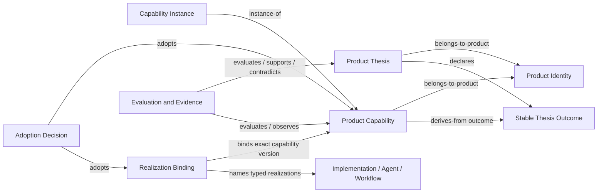

<!-- GENERATED FILE: canonical data is model.json. -->

# Complete Product Context candidate

- Model: `CAL-PRODUCT-CONTEXT-COMPLETE-0001`
- Status: `candidate-unadmitted`
- Authority effect: `none`

## Canonical ownership

| Concern | Canonical owner | Reverse view |
| --- | --- | --- |
| Product purpose, value promise, lineage | Product Identity | Direct |
| Product proposition and identified outcomes | Product Thesis | Product selects current thesis |
| Stable repeatable outcome contract | Product Capability | Product capability list is derived |
| Owner-local adoption | Capability Instance | Capability instance list is derived |
| Implementation endpoints and contract mapping | Capability Realization Binding | Capability realizations are derived |
| Runtime, conformance, observations, and value | Separate evidence and evaluation artifacts | Never inferred from binding existence |

## Core rule

Product Capabilities are not embedded in Product identity. Each capability owns `product_ref`, `product_thesis_ref`, and `thesis_outcome_refs`. Product-facing capability lists are read-only inverse projections.

## Claim ceiling

This candidate defines and validates the complete Product context contract and one cross-linked example. It does not admit Product Identity/v2, Product Thesis, Product Capability, or Capability Realization Binding; it does not adopt a Capability Instance or realization, activate a consumer, prove runtime conformance, or prove Product value.
