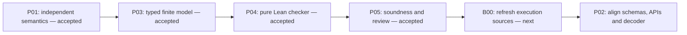

# First phase result: formal model and proved reference checker

**F0 is complete for the candidate L0 profile.** P01, P03, P04 and P05 have current, hash-bound acceptance records. All subsequent tasks remain not started. This result covers three relation kinds, 28 exact ordered endpoint pairs and 31 endpoint kind constructors.



## What is now proved

Lean 4.33.1 checked these general statements over arbitrary finite typed graphs and assertions:

```lean
instance_check_sound (g : Graph) (e : Assertion) :
  checkInstance g e = true → InstanceValid g e

graph_check_sound (g : Graph) :
  checkGraph g = true → Inv g

addition_preserves (g : Graph) (e : Assertion) :
  checkAddition g e = true → Inv (applyAddition g e)
```

`Inv` is defined independently of checker success. It requires valid exact endpoint pairs, closed qualifiers, resolved version and assessment bindings, well-formed inventories and unique identities. Addition rechecks the whole resulting graph, so its theorem does not require an unnecessary assumption that the starting graph is valid.

Completeness is also proved: `checkGraph g = true ↔ Inv g`, with the corresponding instance and addition equivalences. Addition preserves the admission-root inventory by equality. These are general theorems, not correctness claims restricted to the fixture examples.

## A checked inhabited example

The fixture graph contains these three assertions, bound to exact `v1` node versions:

| Assertion | Ordered pair | Bound qualifier/evidence |
|---|---|---|
| `conforms` | capability-instance → contract | scope `static`, target `v1`, accepted assessment bound to both endpoints and scope |
| `declares` | decision → effect | effect value `authorization`, target `v1`; no execution |
| `materializes` | admission-transaction → generated-output | receipt `receipt`, role `artifact`, content identity `output-content` |

The Lean controls establish `checkGraph validGraph = true`. Starting with the first two assertions, `checkAddition baseGraph materializes = true`; the preservation theorem yields `Inv` for the resulting graph. The graph is nonempty and includes every supported relation kind.

Two additional inhabited witnesses establish valid conformance with no admission roots and valid coexistence with a separately supplied admission root. This preserves the distinction between conformance and admission without banning independently supplied provenance.

## Verification evidence

| Verification | Result |
|---|---|
| Fresh Lean replay | 8 proof/model/control modules pass |
| Declared ordered pairs | All 28 have kernel-checked accepted controls |
| Positive fixture controls | 32 pass |
| Negative fixture controls | 22 reject |
| Hostile proof/type/policy controls | 11 reject |
| Audited declarations | 64, including the exact required statements and witnesses |
| Transitive core import files | 1,893 hashes recorded |
| Actual transitive axioms | `propext`, `Quot.sound`; no custom axioms or `sorryAx` |
| Semantic review | Accepted candidate evidence, Codex author self-review |

Negative fixtures include phantom and reversed pairs, wrong qualifier constructors, empty fields, stale versions, missing references, wrong assessment scope, unaccepted assessments, misbound receipts, wrong roles/content identities, duplicate identities, and an invalid existing graph during addition.

Hostile controls reject weakened conclusions, conclusion-as-premise proofs, assumed `sorry` and custom-axiom proofs, missing/extra typed fields, unknown kinds, accept-all/condition-removal checker variants, native proof evaluation and skipping kernel checks. The assumed-proof probes compile in Lean but fail the explicit transitive-axiom policy, as required.

## Files to inspect

| Artifact | Purpose |
|---|---|
| [Semantic contract](specification/l0/semantic-contract.md) | Normative meanings, all exact pairs, invariant and trust boundaries |
| [Required theorem statements](specification/l0/required-theorem-statements.md) | Targets fixed independently of implementation |
| [Input types](core/RelationalInput.lean) and [semantic predicates](core/RelationalSemantics.lean) | Closed finite domain and independent propositions |
| [Definition audit](core/semantic-definition-audit.md) | Source fidelity, independence and scope review |
| [Reference checker](reference-checker/l0/ReferenceChecker.lean) | Total constructive checker |
| [General proofs](proofs/l0/CheckerSoundness.lean) | Soundness, completeness and preservation |
| [Inhabited witnesses](proofs/l0/inhabited-example.lean) | Non-vacuity and admission-boundary examples |
| [Fixture controls](reference-checker/l0/formal-checker-controls.lean) | All 54 accepted/rejected input checks |
| [Statement and axiom audit](proofs/l0/statement-and-axiom-audit.json) | Exact declarations, dependency identities, controls and source hashes |
| [Replay log](proofs/l0/lean-replay.log) | Elaborated statement types, transitive axioms and hostile-control diagnostics |
| [Formalization review](proofs/l0/formalization-review.json) | Every task criterion and explicit review ownership |

## Practical boundary

This theorem establishes the stated invariant relative to supplied typed inputs and assessment records. It does not authenticate real evidence or authority, establish cryptographic content identity, prove atomic transaction execution, verify JSON decoding, prove compiled-host equivalence, or implement a running API. The semantics and proof profile are candidate artifacts. The review is an author self-review; independent organizational approval is not claimed.

Existing JSON schemas and API contracts remain draft projections. B00 must refresh execution sources and assess drift, then P02 must align the decoder and interfaces with this model before runtime checking proceeds. The full registry, extension obligations and protected inference closure are later layers.

The toolchain is pinned to the [official Lean 4.33.1 release](https://github.com/leanprover/lean4/releases/tag/v4.33.1). Kernel reduction and axiom auditing follow Lean's [proof validation documentation](https://lean-lang.org/doc/reference/latest/ValidatingProofs/). The exact local evidence and trust boundaries above govern this result.

## Replay

From the repository root:

```bash
python3 craft/formalization/candidates/relational-theorem-checker/v1/formal/validate_f0.py
python3 docs/plans/relational-theorem-checker/compile_plan.py check
```

The first command creates a fresh temporary build, checks the exact toolchain identity, replays all Lean modules, checks source bindings, traverses the actual core import closure and reruns hostile controls. It does not overwrite acceptance evidence. `--write` explicitly regenerates the proof audit; changed audit bytes invalidate downstream acceptance records until review and synchronization.

The isolated toolchain lives in ignored `.toolcache/`. On another host, extract the official Linux x86-64 release and pass its `bin/lean` using `--lean`. Verify the archive checksum in [toolchain-lock.json](toolchain-lock.json); this runner also enforces the pinned binary and kernel/runtime library hashes. No global toolchain installation is needed.
