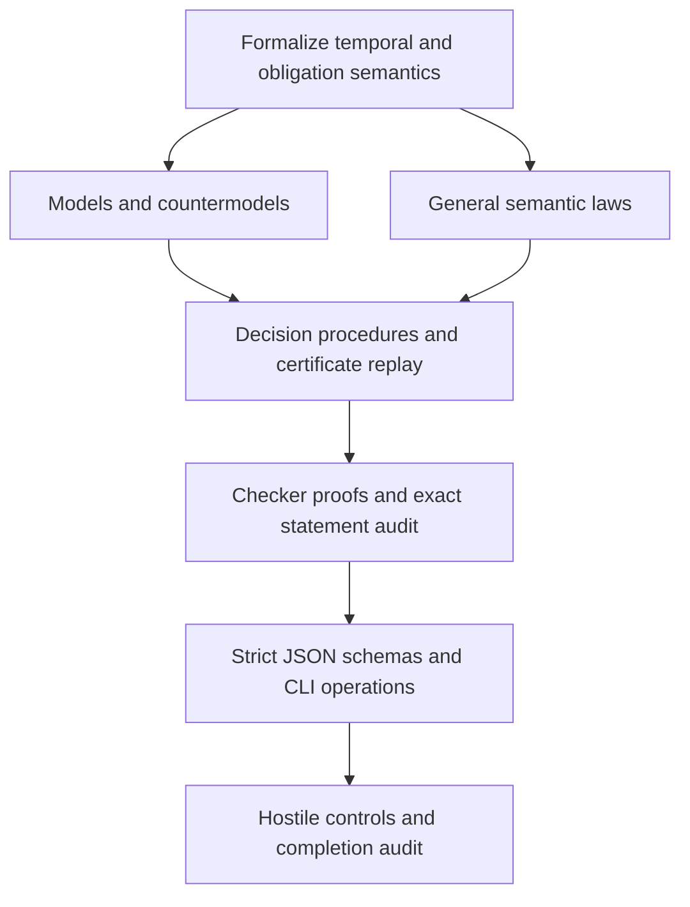

# Implementation DAG

Candidate profiles only. The original F0 definitions, admission records and broader L3 plan remain unchanged.

| Task | Deliverable | Acceptance |
|---|---|---|
| S01 | `SEMANTICS.md`, typed data and independent predicates | Exact revisions, epoch boundaries, unknown cases, finite rule vocabulary and trust boundary specified before checker code. |
| S02 | `StressWitnesses.lean` | Inhabited profiles; expired/revoked historical records; inheritance without conformance; conflict without unrelated consequences. |
| S03 | `StressLaws.lean` | Restriction preservation, revocation stability, derivation origin preservation and conformance independence. |
| S04 | `StressCheckers.lean` | Four-state delegation evaluation, complete direct obligation closure, finite indexed certificates and resource budget. |
| S05 | `StressProofs.lean`, `StressStatementAudit.lean` | General soundness/closure completeness, certificate soundness; independent required statement assignments; approved transitive axioms only. |
| S06 | `schemas/`, `api-contract.json`, `stress_cli.py` | Strict transport, three callable local operations, example requests and validated responses. |
| S07 | `validate_stress.py`, `audit.json`, `RESULT.md` | Fresh pinned Lean replay, all ten stressors, hostile proof controls, deterministic plan receipt; parent source bindings unchanged. |

The temporal profile has no restoration or successor evaluation. The finite normative profile has one propagation rule plus identity forwarding; it is not the general L3 rule language. Overrides and permitted redelegation chains return unknown. Public transport is candidate-local; global interface admission and service deployment are outside this implementation.
