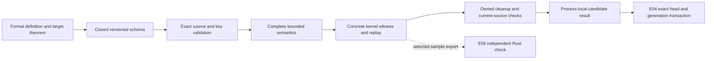

# The seven extensions: meanings, implementation and review

All seven selected extension units are implemented and author reviewed. The successor plan has 19 accepted units: twelve core hardening/review units plus seven extensions. E00–E05 provide separate candidate runtime profiles; E06 provides an actual independent-checker feasibility sample. Your actual feedback on meanings, diagnostics and measured suitability is recorded in P11. The complete-plan audit verifies the final receipts and current evidence.

These results remain suitable for bounded local shadow experiments. They produce consequences of exact supplied facts and assessments. They do not authenticate real-world facts, issue live publication authority or complete the separately pending original v1 R06/G4 gates.

## What changed and what to review

| Unit | New capability | Definition to review | Main theorem/evidence |
|---|---|---|---|
| E00 | Nested conditions | Three-valued AND, OR and NOT; missing leaves remain unknown | Universal evaluator/independent denotation agreement and exact activation; six full witnesses |
| E01 | Multiple evidence references | Any accepted exact selected assessment suffices; retain every valid support | Universal support soundness/completeness and unchanged roots; four full witnesses |
| E02 | Bounded redelegation | Every ancestor constrains scope, action and time; intermediate hops permit redelegation | Universal non-amplification and complete bounded enumeration; three full witnesses |
| E03 | Verified fulfillment | Intent linkage alone does not complete a request; every named criterion needs action/output evidence | Universal quantified fulfillment and linked-only counterexample; two full witnesses |
| E04 | Separate lifecycle | Declaration, eligibility and committed current head are distinct | Universal exact transition/history preservation; three full witnesses plus writer/crash controls |
| E05 | Canonical typed IR | Preserve whole typed values, exact Unicode, references and keys after decoding | Universal IR import/denotation preservation; one full witness covering seven whole values |
| E06 | Independent checking study | A correct proof must have the intended statement and definitions | Rust kernel checked an actual theorem and all 18 exported declarations; sample only |

The final extension reports contain 277 passing control records and 19 complete final-source supervised extension witnesses. Those control records include repeated scenario/API observations, so they are not 277 independent mathematical theorems. The separate independent sample checks one original theorem with its complete exported closure.

## E00 — conditions can express uncertainty

Example: activate a review obligation when `Reviewed AND NOT Suspended` holds.

| Reviewed | Suspended | Result | Obligation active? |
|---|---|---|---|
| yes | no | yes | yes, if it was already a potential obligation |
| yes | unknown | unknown | no |
| no | unknown | no | no |

OR yields yes if a branch is yes, while AND yields no if a branch is no. NOT preserves unknown. All supplied leaf evidence is validated before evaluating branches, so an irrelevant branch cannot hide a conflicting assessment. A leaf lookup uses exact profile, context, subject, target, scope, epoch and condition revision.

The theorem says the evaluator agrees with an independently stated evidence-rail meaning for every expression, and activation is exactly potential membership plus a yes condition. Both require and forbid origins remain visible if both activate; the evaluator does not invent a winner, admission or fulfillment. Mapped origins are inspected against an exact original source/proof, with the frame and root condition checked again.

Review the truth-table policy and exact-key rule. [Detailed expression review](/home/vlad_/projects/CyberAlchemy-lab/craft/formalization/candidates/relational-theorem-checker/v3/e00/expression-review.md) · [Schema](/home/vlad_/projects/CyberAlchemy-lab/craft/formalization/candidates/relational-theorem-checker/v3/e00/expression.schema.json) · [Formal definitions](/home/vlad_/projects/CyberAlchemy-lab/craft/formalization/candidates/relational-theorem-checker/v3/e00/ExpressionSemantics.lean).

## E01 — aggregation is an explicit policy

Example: the selected evidence list contains assessment A=yes and a distinct assessment B=no, both current and exactly matching the contract revision and scope. The proposed policy reports conformance through A and retains A as support. B stays in the bound source but supplies no positive support. Two accepted matching assessments are both retained in source order.

A duplicate/conflicting identity, missing token, stale source identity or mismatched frame is invalid. The adapter checks the full accepted registry definitions and their 41 source references, so changing allowed endpoint kinds without changing a label is rejected.

The theorem says projected supports are exactly the selected current accepted matching assessments, and the projection preserves admission roots. Legacy evidence remains one opaque token: `assessment:a,b` is one reference, not a two-element list. Because legacy assessments lack their own revisions, the new reference binds the token to an immutable normalized source graph identity.

Review whether any accepted support is the intended policy. Current here means present in that exact bound source; it is not an authenticity, wall-clock expiry or external-world claim. [Migration review](/home/vlad_/projects/CyberAlchemy-lab/craft/formalization/candidates/relational-theorem-checker/v3/e01/migration-review.md) · [Schema](/home/vlad_/projects/CyberAlchemy-lab/craft/formalization/candidates/relational-theorem-checker/v3/e01/evidence-collection.schema.json) · [Formal definitions](/home/vlad_/projects/CyberAlchemy-lab/craft/formalization/candidates/relational-theorem-checker/v3/e01/EvidenceCollectionSemantics.lean).

## E02 — chaining cannot amplify permission

Example: Alice delegates review approval to Bob for `[0,10)`, permits redelegation, and has a yes gate/no revocation. Bob delegates the same permission to Carol for `[2,8)`. At epoch 5 the chain can support Carol's review approval.

If Bob adds administration to the delegated scope, that widened path is ineffective. If Alice's gate is missing, the otherwise valid path is unknown. If an ancestor expires or is revoked, it cannot support a positive path. A different valid direct path may still support the query; rejecting one broken path does not invalidate every alternative.

The theorem says every ancestor of each reported effective path covers the queried scope/action/epoch. Complete enumeration checks every source-edge word within the declared depth, then retains joined simple paths. Cycles and empty/reflexive paths establish no authority. Completeness is bounded by nodes=32, hops=64, depth=4 and enumerated words=4096; excessive work refuses before partial search. No within depth is a bounded absence conclusion, not a statement about every unbounded path.

Review the restriction and simple-path policies. The new profile explicitly supports principals with both principal and agent roles; it does not silently change the old direct endpoint kinds. [Chain review](/home/vlad_/projects/CyberAlchemy-lab/craft/formalization/candidates/relational-theorem-checker/v3/e02/chain-review.md) · [Schema](/home/vlad_/projects/CyberAlchemy-lab/craft/formalization/candidates/relational-theorem-checker/v3/e02/chain.schema.json) · [Formal definitions](/home/vlad_/projects/CyberAlchemy-lab/craft/formalization/candidates/relational-theorem-checker/v3/e02/ChainSemantics.lean).

## E03 — intent does not prove completion

Example: a request requires criteria C1 and C2. An asserted link to that request says it is intended to be fulfilled. If no action/output/criterion evaluations exist, the completion verdict is unknown and fulfilled=false.

If an accepted action produces its owned accepted output and both exact criterion evaluations are yes at the bound request/requirement revisions and frame, fulfilled=true. A missing criterion stays unknown. An unrelated output, stale requirement or conflicting criterion identity is rejected. An active obligation does not supply an action; the accepted active-norm example still reports fulfillment not established.

The theorem says reported fulfillment entails a supported exact yes evaluation for every named criterion. The full criterion list comes from the bound source, not a caller-selected subset. Whether that source lists every real-world requirement and whether its action/output facts are true remain assumptions.

Review the intended-versus-completed distinction and criterion universe. [Fulfillment review](/home/vlad_/projects/CyberAlchemy-lab/craft/formalization/candidates/relational-theorem-checker/v3/e03/fulfillment-review.md) · [Schema](/home/vlad_/projects/CyberAlchemy-lab/craft/formalization/candidates/relational-theorem-checker/v3/e03/fulfillment.schema.json) · [Formal definitions](/home/vlad_/projects/CyberAlchemy-lab/craft/formalization/candidates/relational-theorem-checker/v3/e03/FulfillmentSemantics.lean).

## E04 — replacement needs a separate transition

Example: the candidate store has head A at generation 0. Two separately checked proposals name B and C as successors of A. They also need matching eligibility and current-head review. Their qualifications do not change A.

When the writers compete, one transaction commits generation 1; the other receives a head/generation conflict. Old declarations and proof/input identities remain in immutable history. A declared successor without yes eligibility cannot commit. Saved/new-client, changed and rule-only receipts fail the public commit gate. Real crash controls recovered generation 0 before commit and generation 1 after commit, always with fresh_event=false.

The theorem preserves history/evidence prefixes, advances exactly one generation and prevents historical reactivation. A cooperating lock and SQLite transaction enforce one current head in the owned candidate store. Recovery can recognize a commit; it cannot mint a fresh event. Replacement follows this lifecycle policy, rather than stretching the old fixed-frame append/conservativity theorem.

Review the transition policy and recorded-state/fresh-event distinction. Accepted control stores are frozen evidence; create a fresh owned directory for new experiments. [Lifecycle review](/home/vlad_/projects/CyberAlchemy-lab/craft/formalization/candidates/relational-theorem-checker/v3/e04/lifecycle-review.md) · [Schema](/home/vlad_/projects/CyberAlchemy-lab/craft/formalization/candidates/relational-theorem-checker/v3/e04/lifecycle-transition.schema.json) · [Store API](/home/vlad_/projects/CyberAlchemy-lab/craft/formalization/candidates/relational-theorem-checker/v3/e04/store.py) · [Formal definitions](/home/vlad_/projects/CyberAlchemy-lab/craft/formalization/candidates/relational-theorem-checker/v3/e04/LifecycleSemantics.lean).

## E05 — the checked value must match the whole decoded meaning

Example: natural 0 and Boolean false remain different constructors. `é` and `e` plus a combining accent remain different scalar sequences. Reference version v2, scope review and every hash character remain exact. Record order is normalized explicitly and checked as strictly ordered/unique; duplicate JSON fields are refused by the raw decoder.

The theorem starts at canonical typed IR: successful import denotes exactly the independent typed semantic value. The actual full witness compares the core graph and all E00–E04 semantic results, plus a Unicode/control-character/type/key challenge. Primary scalar emission uses ord; the independent expectation uses UTF-32 bytes. Invalid scalars and malformed array/record shapes are rejected in Lean.

Earlier expensive constructions returned resource refusals. The final primitive-fold scalar representation completed under the unchanged stage/whole-run policy. The final measured batch took 125.951 seconds, with 991.5 MiB peak aggregate RSS observed and 43.091 seconds for its concrete compilation. RSS observation remains advisory. This is evidence for the measured batch, not a guarantee that every statically admitted batch completes. The raw JSON parser, Python/source emitter and hash/host boundaries remain assumptions. This does not replace the original exact-input proof checks or reissue a fresh core qualification.

Review the preservation scope and remaining parser boundary. [Transport review](/home/vlad_/projects/CyberAlchemy-lab/craft/formalization/candidates/relational-theorem-checker/v3/e05/transport-review.md) · [Schema](/home/vlad_/projects/CyberAlchemy-lab/craft/formalization/candidates/relational-theorem-checker/v3/e05/ir.schema.json) · [IR](/home/vlad_/projects/CyberAlchemy-lab/craft/formalization/candidates/relational-theorem-checker/v3/e05/CanonicalIR.lean) · [Import theorem](/home/vlad_/projects/CyberAlchemy-lab/craft/formalization/candidates/relational-theorem-checker/v3/e05/ImportCorrectness.lean).

## E06 — independent checking still needs intended definitions

The actual sample is `tNot unknown = unknown`. Lean4export retained its exact statement/proof, definitions, universe instances, finite constructors and recursors; the standalone Rust nanoda kernel checked all 18 exported declarations with no permitted axioms and no Nat/String extensions. This is an actual separately implemented checker, distinct from running Lean again. [Official proof-validation guidance](https://lean-lang.org/doc/reference/latest/ValidatingProofs/).

A meaningful negative example substitutes the definition of tNot with the constant unknown function. Its equation is still a valid theorem, so the independent kernel accepts it. The original definition-closure pin rejects that export. This shows why proof validity and the intended meanings must both be checked. Other controls reject forged acceptance flags with invalid proofs, dropped universe information, an unpermitted axiom and missing dependencies.

Review the sample-only claim. Export/statement plumbing, informal meanings, host/compiler behavior and potential common checker bugs remain assumptions. There is no universal translation proof or independent validation of every core theorem. [Feasibility](/home/vlad_/projects/CyberAlchemy-lab/craft/formalization/candidates/relational-theorem-checker/v3/e06/feasibility.md) · [Translation contract](/home/vlad_/projects/CyberAlchemy-lab/craft/formalization/candidates/relational-theorem-checker/v3/e06/translation-contract.md) · [Actual sample report](/home/vlad_/projects/CyberAlchemy-lab/craft/formalization/candidates/relational-theorem-checker/v3/e06/sample-check-report.json).

## Runtime flow and APIs



For E00–E05, use the fixed owned client and raw bytes. Select the profile explicitly; the original atomic/direct APIs remain separately available.

```python
from v3.execution.extension_runtime import Client

client = Client("E02", operator_resource_policy)
answer = client.qualify(original_request_bytes)
# Check answer status and answer["value"]["value"]["verdict"].
# A checked unknown/no value is not a positive effective permission.
fresh = client.live_event(answer)
```

The import root is `craft/formalization/candidates/relational-theorem-checker`; scripts in the package demonstrate exact requests. Each schema contains the closed request contract and `$defs.result`. Saved/new-client results cannot rehydrate a fresh event. E04 additionally exposes Store.create/snapshot/commit/recover for a new owned directory; its public commit gate needs the original E04 client. E06 is a research executable/report, not a whole-core qualification profile.

After applying limits, invalid means malformed/mismatched evidence; unsupported means a meaning/backend outside the installed profile; unknown-resource means no complete answer under the policy. A complete unknown semantic answer is distinct from resource refusal. Default memory observation remains advisory; required enforcement is available only with an actual delegated host backend.

The final audit is [complete-plan-audit.json](/home/vlad_/projects/CyberAlchemy-lab/craft/formalization/candidates/relational-theorem-checker/v3/execution/complete-plan-audit.json). Unit reviews and control reports are immutable evidence. Subsequent changes should create a new candidate/review run rather than overwrite accepted review artifacts.
