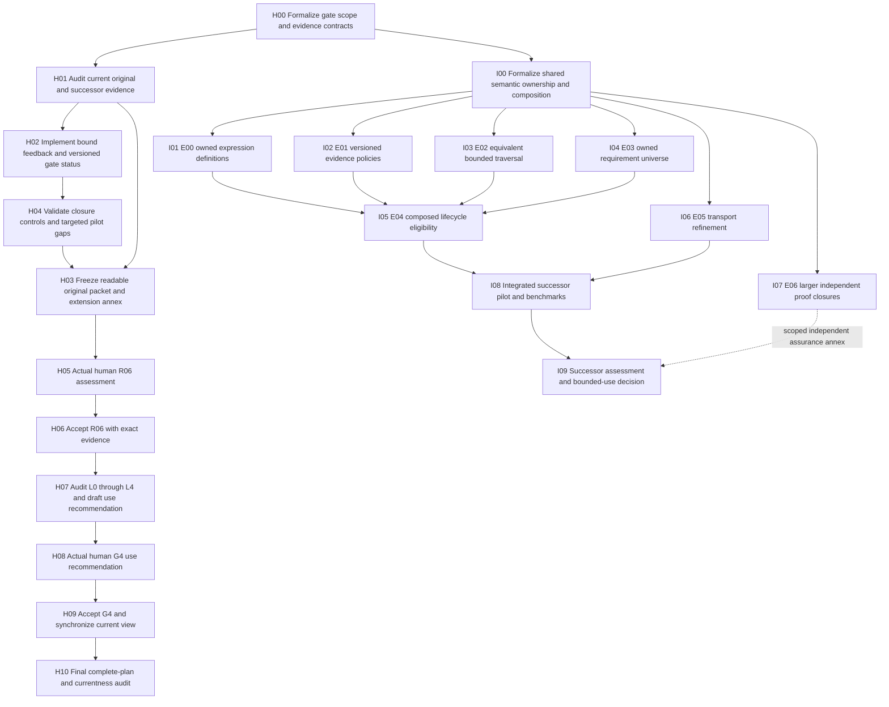

# Proposed implementation plan for R06/G4 and extension improvements

Status: proposed, not executed. First step: formalize the review, gate and scope contracts. R06/G4 retain their original task identities and acceptance criteria. The original selected successor plan remains complete; this follow-up does not reopen its 19 accepted units.

There are two outcomes. Track H completes the original bounded-use gates. Track I improves the seven extensions for a separately reviewed integrated successor. Track I is not a prerequisite for Track H when the current limits are explicit and the human recommends the bounded scope.

## DAG

The dotted edge permits an honest supported-subset or refusal report from I07. A whole-core independent-checking claim requires a separately selected complete theorem inventory and successful checks for every entry; it cannot be granted by I09 on a sample report.

## Track H — completing the original gates

### H00 — formalize gate scope and evidence contracts

Owner: implementation/proof reviewer. Inputs: original task definitions, pilot and use matrix, v3 P11 feedback, this implementation review.

Specify the original task criteria as immutable obligations. Separate scope IDs for the original pilot, extension annex, R06 meaning/diagnostic assessment and G4 bounded-use recommendation. Define freshness/currentness as distinct from historical observed execution. Define a closure transition that preserves every prior task receipt and denies acceptance when any required criterion, binding or actual human assessment is absent.

Outputs: `closure-contract.md`, closed `human-gate-review.schema.json`, `gate-status-overlay.schema.json`, `scope-manifest.json`, and a formal gate model with proofs: acceptance entails complete mandatory bindings; feedback cannot transfer between scope IDs; nonaccepted/revision feedback cannot enable an accepted gate; G4 acceptance requires accepted R06.

Exit: definitions/theorems precede finalizer changes. Scope explicitly excludes admission/deployment and makes all supported exclusions visible. Formal gate theorems reason over faithfully captured feedback; checking that a quote came from the actual human remains an operator trust boundary. The schema includes actual response provenance but makes no claim to authenticate a human cryptographically.

### H01 — audit current evidence and metadata impact

Owner: implementation/proof reviewer. Dependency: H00.

Recheck the original 33 receipts, R04/R05 prerequisites, machine pilot outcomes, complete obligation inventories and source/toolchain identities. Independently recheck the 19 successor receipts, final witnesses and embedded provenance bindings. Classify old live-state observations as historical where appropriate. Enumerate every source affected by a gate-status change, including P05's original plan binding; distinguish proof dependency from documentary status dependency explicitly.

Outputs: `predecessor-current-audit.json`, `pilot-coverage.json`, `mutation-impact.json`, `supported-use-matrix.json` for the proposed reviewed snapshot. Include versioned profile IDs, truth assumptions, owner decisions, measured envelope and exclusions. Produce an obligation-to-extension crosswalk; unresolved inherited obligations remain unresolved unless exact reviewed definitions and proofs discharge them.

Exit: no missing/stale hard evidence. A stale record is recaptured/requalified or retained as an explicitly historical observation; it is never relabeled current.

### H02 — implement strict feedback and versioned gate status

Owner: implementation reviewer. Dependency: H01.

Implement new closure tooling under a fresh follow-up directory. Leave the prepared legacy finalizers as historical sources. Resolve current task status from the exact base plan plus an append-only, validated closure overlay. The overlay keeps original task IDs and criteria and references exact new acceptance receipts. Produce a current task view outside the frozen generated DAG. This avoids invalidating accepted P05 input hashes by rewriting the captured original plan.

Require actual human feedback to bind the exact reviewed packet, matrix, pilot and audit. Validate closed fields, unique/nonempty mandatory artifacts, scope, criterion answers and the actual direct answer/question provenance. Allow accepted, revisions-required and undecided responses; only the required positive assessments permit acceptance. A label or JSON quote cannot independently prove human provenance: the operator must capture an observed response.

Outputs: `record_feedback.py`, `accept_r06.py`, `accept_g4.py`, `resolve_gate_status.py`, current-state view renderer, schema examples and focused closure controls. New R06 artifacts live under `v1/pilot/reviews/<run>/`; G4 artifacts under `v1/gates/l4/<run>/`; the new overlay is stored separately from the frozen original plan. Before execution, the scope contract must explicitly recognize these versioned paths and the reader as the current interpretation of the original tasks.

Exit: missing/empty/wrong-scope bindings, substituted packets, stale sources, copied P11 feedback, conflicting outcomes and premature G4 all refuse. The current reader counts accepted gates only from checked receipts. Visible feedback/matrix/current-status fields agree; historical questions remain untouched. This is candidate status bookkeeping, not authority publication.

### H04 — validate closure and fill actual pilot gaps

Owner: implementation/proof reviewer. Dependency: H02.

Run focused finalizer/overlay controls in disposable fixtures, including interruption between receipt and view publication, idempotent recovery, refusal with preserved state and concurrent stale-head publication. Recompute the original pilot inventories and expected CLI states from current inputs. Rerun proof workflows only when stale evidence, changed contracts or a missing scenario makes it necessary; do not rerun every accepted proof merely to increase a test count.

If the extension annex proposes composed use, it needs a new actual composed pilot; the existing separate extension results do not supply that evidence. The recommended original gate scope excludes composed use for now. Any new lifecycle experiment creates a new owned store rather than modifying accepted control stores.

Outputs: `closure-controls.json`, `targeted-pilot-report.json` when needed, `coverage-gap-disposition.json`, observations with stage/run time and aggregate RSS/enforcement mode.

Exit: original required categories covered, no unaccounted hard gap, no partial evidence accepted after interruption, and every result names its supported profile/resource boundary. Advisory RSS is never presented as a hard limit.

### H03 — freeze the concrete review packet

Owner: implementation/semantic reviewer. Dependencies: H01, H04.

Prepare a readable original pilot packet showing one supported addition, one meaningful semantic mismatch, one compatible rule change, protected-head/endpoint exclusions, and unchecked-search/resource distinctions. Show exact raw inputs, outcomes, obligations and next actions. Explain where the proof starts and what its premises assume. Attach a distinct seven-extension annex containing this review's worked limits and boundary observations.

Outputs: original `review-packet.md`, `extensions-annex.md`, `review-manifest.json`, `reviewer-feedback.md` initially pending, and exact packet/matrix/pilot/audit hashes. All later answers bind this manifest. Freeze content before presenting it; a material change requires renewed assessment of that changed scope.

Exit: a reviewer can tell what each relation means, why each result follows, what remains unknown and exactly what bounded use is proposed. No preexisting P11 approval is transferred to the new packet.

### H05 — capture actual R06 human assessment

Owner: human semantic/use reviewer. Dependency: H03.

Present the frozen original packet. Capture assessment of meanings and diagnostic usefulness independently of machine proof validity. If the annex is also assessed, record its scope separately. Any requested revisions return to the affected preparation/validation step and produce a new manifest; elapsed time or silence is no answer.

Outputs: source-bound `human-review.json` and readable feedback. Exit: actual positive R06 assessment of both required criteria with exact reviewed bindings. This is the human requirement in the original R06 task, not an additional approval invented by this review.

### H06 — accept R06

Owner: implementation reviewer. Dependency: H05.

Recheck prerequisite receipts and all mandatory packet/source hashes immediately before acceptance. Emit an R06 receipt containing both original criteria, complete pilot coverage and actual human meaning/diagnostic evidence. Append the validated overlay entry; render consistent current feedback, matrix and task status.

Exit: current resolved original-plan view has 34/35 accepted, R06 accepted, G4 pending. Replaying the receipt remains historical checking; it does not issue a fresh qualification event.

### H07 — audit all layers and prepare G4 recommendation

Owner: implementation/proof/semantic reviewer. Dependency: H06.

Audit L0 semantic/checker soundness, L1 structural/source guarantees, L2 compatibility/preservation/conservativity, L3 inference/absence/protected lineage and L4 exact proof/workflow/application/pilot evidence against their promised criteria. Preserve the distinction between selected-data checks, universal preservation and model expansion. Explain outstanding source meanings, trusted bridges, cooperative store assumptions and measured limits.

Outputs: draft `l4-review.json`, `alignment-and-layering-audit.json`, `bounded-use-recommendation.md`, G4 review manifest. Annex extension status without claiming the original gate established all extension composition.

Exit: every original promise is evidenced or excluded consistently with its accepted scoped contract; no unresolved hard promised obligation disappears into prose. The recommendation names exact supported profiles and says candidate local shadow use only.

### H08 — capture actual G4 use recommendation

Owner: human use reviewer. Dependency: H07.

Present the concrete layer audit and proposed bounded use. Capture the actual recommendation against its exact bindings. A prior R06 answer may supply this only if it explicitly covered the same final G4 artifacts and recommendation; the recommended sequence requests it after H07 to remove ambiguity.

Exit: actual bounded-use recommendation with owner decisions recorded. Requests for broader use trigger a separately scoped design/assurance decision; they are not silently added to this gate.

### H09 — accept G4 and synchronize current view

Owner: implementation reviewer. Dependency: H08.

Recheck accepted R06, layer receipts and reviewed G4 identities. Emit the three original required outputs and G4 acceptance receipt, append its validated overlay entry, and update only the new current view. Never overwrite historical author or human evidence.

Exit: the validated current original-plan view resolves 35/35 accepted. The frozen original source still accurately represents its earlier captured state. All current documents link the overlay and distinguish the two views; merely writing `accepted` in a new file is insufficient.

### H10 — final audit

Owner: implementation/proof reviewer. Dependency: H09.

Verify all 35 original tasks, 40 working units, 56 dependency edges, current acceptance bindings and H05/H08 scope. Recheck the successor's 19 accepted units and embedded historical snapshot hashes. Verify consistent output/status views, no unauthorized authority/application flags, and no accepted artifacts changed. Emit a reproducible final audit and completion receipt bound to both plan identities and the closure overlay.

Exit: every original R06/G4 criterion is satisfied and auditable; unsupported capabilities stay explicitly bounded. No deployment or admission follows.

## Track I — successor implementation improvements

Use a new candidate version. Preserve accepted E00–E06 and shared helpers. Every task starts with its specific definitions/theorem contract before runtime edits. Do not silently enlarge existing profiles or raise resource ceilings to hide refusals.

| Task | Implementation and required proof | Validation/exit |
|---|---|---|
| I00 — shared ownership and composition | Define owner-resolved immutable definitions, criterion universes, evidence policy and snapshot provenance; typed profile imports; composed eligibility; complete obligation coverage; freshness invalidation. Specify contracts/APIs before code. | Independent meaning target, versioned schemas and counterexamples to unauthorized substitution and incomplete qualification. |
| I01 — E00 | Add owned condition-definition resolver; prove root revision resolves exactly one reviewed AST/hash and activation uses it. | Same revision/different AST refuses; changed revision invalidates prior evidence; unknown/conflict behavior remains explicit. |
| I02 — E01 | Add individually versioned evidence and issuer/policy bindings; prove exact all-support retention and legacy projection. Add alternative aggregation policies only as separate definitions. | Wrong issuer/revision/policy, missing member and legacy comma cases; any/quorum policies cannot exchange receipts. |
| I03 — E02 | Implement adjacency/visited-set enumeration after proving equality with current complete bounded simple-path semantics. | Differential finite graph/path universes, unknown ancestor/alternate path/cycle/restriction cases; sparse/dense cost measurements; cutoff yields refusal rather than partial no. |
| I04 — E03 | Resolve owned requirement revision and criteria; bind action/output provenance; prove fulfillment entails the exact owned universe and supported criteria. | Removing a required criterion, changing requirement content under one revision and using stale completion evidence refuse; intent remains insufficient. |
| I05 — E04 | Consume exact complete qualification plus owner review; prove transition eligibility composition and well-formed history preservation; implement recapture/atomic commit. | Missing hard obligation, mismatched frame, stale head, saved event and forged eligibility refuse; public-path crash/concurrency/recovery controls; isolated new stores. |
| I06 — E05 | Define byte-parser refinement or parse-certificate verification and profile-specific semantic import; prove composition with decoded typed meaning. | Malformed bytes, duplicate keys, Unicode, type/coercion and whole-value differential controls; kernel cost envelope; remaining host/hash assumptions explicit. |
| I07 — E06 | Inventory selected substantial theorem closures; automate trusted challenge/definition anchoring and independent checking with explicit axiom/resource policies. | Core soundness and nontrivial semantic samples, substituted definitions, missing universes/recursors, unsupported features, disagreement and timeout controls. Report supported subset; whole-core claim requires full inventory success. |
| I08 — integrated pilot | Define explicit cross-profile links and complete obligations, then run expression/evidence/chain/fulfillment/eligibility/IR workflow end to end. | Each stage keeps source/version/frame lineage; no stage manufactures roots or fulfillment; fresh/saved distinction; small and boundary benchmark envelopes. |
| I09 — successor assessment | Explain the composed meanings, diagnostics and measured limits, then obtain actual successor-scoped human assessment and audit. | No automatic transfer of P11 or original G4 approval; candidate assurance matches measured implementation. |

Priority: implement H00 → H01 → H02 → H04 → H03, then satisfy the original human gates. In the improvement track, prioritize I01/I04/I05 because they connect definitions and fulfillment to owned sources and lifecycle to complete qualification. I03 improves operational reach; I06/I07 deepen assurance. None removes the need to review whether the formal meanings are the ones the owners intend.

The tasks remain proposed. Their outputs and exit criteria distinguish original gate closure from stronger future capability.
