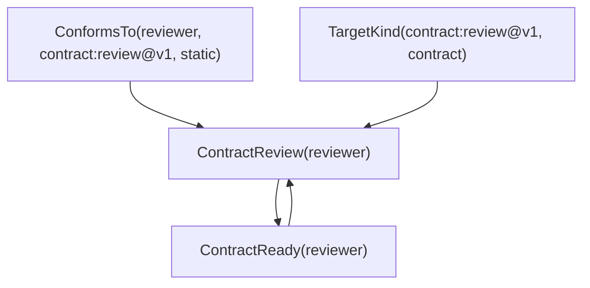

# Worked review: relations, proofs and bounded use

The core can check a bounded positive relational extension, explain its exact derivation or absence, and apply a freshly checked extension to a local shadow store. It preserves the old interpretation under the extension conditions. It does not establish the external truth of an assessment. Eleven core units P00–P10 are accepted. This packet completes P11's machine and author review; P11 still needs your assessment of this particular packet. All seven selected extensions remain to be implemented after that gate.

The [worked evidence index](/home/vlad_/projects/CyberAlchemy-lab/craft/formalization/candidates/relational-theorem-checker/v3/p11/worked-examples.json) records 16 passing controls. It contains one newly completed, full twenty-obligation qualification for the wrong-scope case. The other explanations inspect exact existing evidence; reading it does not create a fresh qualification event. These examples use the unchanged public P09 API/CLI. The [execution review](/home/vlad_/projects/CyberAlchemy-lab/craft/formalization/candidates/relational-theorem-checker/v3/p11/plan-execution-review.md) separates accepted implementation, human assessment and future work.

## 1. The relation that carries semantic meaning

`ConformsTo(subject, contractRevision, scope)` says that the selected source assertion and its accepted assessment support conformance of this exact subject to this exact contract revision in this exact scope. Every argument matters. Conformance to another revision or in another scope cannot be substituted. The older unary `Conforms(subject)` summarizes less information and cannot supply this stronger fact.

Our concrete subject is `capability:reviewer@v1`, contract is `contract:review@v1`, and scope is `static`. `TargetKind(contract:review@v1, "contract")` records the selected node's kind. The source checks membership, endpoints, revisions, scope and assessment linkage. The assessment's truth remains supplied from outside the theorem checker.

The fresh rule is:

```text
ConformsTo(x, contract:review@v1, static)
and TargetKind(contract:review@v1, "contract")
    => ContractReview(x)
```

This rule carries more meaning than the predicate names alone: readiness depends on the designated contract and scope. We do not interpret `ContractReview` as evidence that a real person reviewed something. Its meaning here is exactly the rule above.

## 2. The relations that stretch the logic

Two further rules form a positive recursive cycle:

```text
ContractReview(x) => ContractReady(x)
ContractReady(x)  => ContractReview(x)
```

A cycle can propagate an existing seed, but cannot supply its own seed. The richer fixture has sixteen declared domain values, eight predicates and four rules. One old rule derives `BaselineSignal(x)` from unary conformance; it does not seed the scoped readiness cycle.

The positive example derives readiness as follows:



The [actual public explanation](/home/vlad_/projects/CyberAlchemy-lab/craft/formalization/candidates/relational-theorem-checker/v3/p11/evidence/c28deedcb7054f4bb09918320e64b081/positive-rich-trace-output.json) says `present`, with `recorded-current` inspection. Its trace uses the exact predicate/rule identities and substitution `x = capability:reviewer@v1`. The leaves identify assertion `relation:conforms`, assessment `assessment:conformance` and node `contract:review@v1`. The trace is a finite DAG of the derivation, rather than an infinite traversal around the cycle. It has two relevant source premises, and explicitly leaves application authorization false.

## 3. What the theorem actually says

There are several distinct claims. Keeping them separate is essential when adding relations.

The model-expansion theorem has this shape:

```text
CheckedExtension(before, after)
=> for every M:
     SemanticModel(before, suppliedFacts, M)
     => there exists N:
          SemanticModel(after, suppliedFacts, N)
          and for every old atom a, N(a) iff M(a)
```

It quantifies over every old model satisfying the premises, rather than comparing two sample closures. `CheckedExtension` includes preservation of the old frame and the restrictions that make the fresh positive rules safe: complete grounded-rule coverage, typed heads, protected-root constraints and fresh-head conditions. `N` expands the old model with consequences of the added rules. No old atom changes truth value in that expansion. A separately proved source-faithfulness preservation claim applies when the old model's sealed source predicates already agree exactly with the supplied source interpretation; that premise is not imposed on every generic model.

The complete-closure claim is different:

```text
a belongs to the checked complete closure
    iff a is derivable from the selected theory and supplied facts.
```

Derivation soundness then places a derived atom in every semantic model satisfying that theory and those facts. This is logic about the specified semantics. It does not prove that the supplied conformance assessment is true in the world. The concrete compilation, complete closure/certificate, required theorem statement bundle, axiom inventory and fresh general replay must all match the exact request before qualification succeeds.

The [retained general proof](/home/vlad_/projects/CyberAlchemy-lab/craft/formalization/candidates/relational-theorem-checker/v2/s13/build/RecursiveConservativity.lean:42) implements model expansion. The [v3 query theorem](/home/vlad_/projects/CyberAlchemy-lab/craft/formalization/candidates/relational-theorem-checker/v3/p04/QuerySemantics.lean:55) connects complete-closure nonmembership to absence of a selected derivation. P00's [required statements](/home/vlad_/projects/CyberAlchemy-lab/craft/formalization/candidates/relational-theorem-checker/v3/p00/RequiredEvidenceStatements.lean) retain the predecessor guarantees while formalizing evidence and freshness requirements first.

## 4. A fully checked extension can have an absent result

For the new example, the fresh seed rule requires `other-scope` instead of `static`. The old frame, declared domain and source facts stay fixed. Its rules remain a permitted conservative extension, so the [new full qualification](/home/vlad_/projects/CyberAlchemy-lab/craft/formalization/candidates/relational-theorem-checker/v3/p11/evidence/c28deedcb7054f4bb09918320e64b081/wrong-scope-full-qualification-output.json) succeeds with all twenty independently selected obligations.

But the supplied conformance fact has scope `static`. There is no matching `other-scope` seed. Consequently neither recursive predicate is derivable for the reviewer. The [actual query answer](/home/vlad_/projects/CyberAlchemy-lab/craft/formalization/candidates/relational-theorem-checker/v3/p11/evidence/c28deedcb7054f4bb09918320e64b081/wrong-scope-unseeded-cycle-output.json) is `absent-in-complete-profile`.

That means no derivation exists from these selected facts and rules, because the inspected closure is complete and the query is well typed and inside the declared profile. It does not say the atom is false in every arbitrary model: a positive Horn model may contain additional facts. It also does not say the capability failed an external review. Qualification certifies the permitted change; this query reports one consequence of its semantics.

## 5. Norm propagation, activation and conflict

The mapped inheritance examples check one selected source assertion with exact subject, binding, contract revision, scope and evaluation context. They are individual examples, not a qualification of an entire legacy graph. Their contexts are not merged.

In the [unknown-condition example](/home/vlad_/projects/CyberAlchemy-lab/craft/formalization/candidates/relational-theorem-checker/v3/p11/evidence/c28deedcb7054f4bb09918320e64b081/unknown-potential-norm-explanation.json), propagation is `yes`, condition evaluation is `unknown`, and there is one potential `require receipt` norm. There are zero active norms. Propagation preserves where a norm came from; activation additionally needs the condition to hold for the exact context, subject, target, scope and epoch. Unknown is not a negative condition result, and is not a reason to activate the norm.

In the [active-conflict example](/home/vlad_/projects/CyberAlchemy-lab/craft/formalization/candidates/relational-theorem-checker/v3/p11/evidence/c28deedcb7054f4bb09918320e64b081/active-conflicting-norms-explanation.json), the condition is `yes`. Two norms activate: `require receipt` and `forbid receipt`. The checker reports one conflicting pair and retains both origins. It does not silently select a winner, prove fulfillment, or derive admission. Both explanations explicitly report `fulfilled: not-established` and `admission: not-derived`.

Arbitrary executable conditions and redelegation chains are not supported by this direct core profile. Their new semantics are among the selected extensions below.

## 6. Diagnostics you can act on

| Situation | Actual output | Meaning and next action |
| --- | --- | --- |
| Supported positive readiness query | `present` | Read the exact rule substitution and source leaves; check supplied assessment truth separately. |
| Typed wrong-scope query after complete proof | `absent-in-complete-profile` | Inspect the missing scoped premise. Changing the relation requires a new exact proposal and proof. |
| Required model-expansion obligation removed | `invalid` | Inspection refuses the incomplete manifest. Restore the complete bound proof inventory; a status string cannot replace it. |
| Potential norm with unknown condition | propagation `yes`, condition `unknown` | Obtain an exact scoped evaluation before activation. |
| Opposed active norms | one active conflicting pair | Resolve the normative policy outside this propagation claim; both sources are retained. |
| Actual atomic proof deadline exhaustion | `unknown-resource`; explanation `incomplete` | No complete proof or absence claim exists. Investigate cost or propose a separately reviewed policy change. |
| Actual operator cancellation | `cancelled`; explanation `incomplete` | The invocation stopped without authorizing application. A later attempt needs fresh execution. |

The [missing-proof refusal](/home/vlad_/projects/CyberAlchemy-lab/craft/formalization/candidates/relational-theorem-checker/v3/p11/evidence/c28deedcb7054f4bb09918320e64b081/missing-obligation-refusal-output.json) names the problem: `manifest does not match independently selected obligation inventory`. The operational failures inspect retained actual public executions, not simulated labels. Their explanations cannot manufacture closure absence.

The numeric successor regression also checks the equality boundary: JSON epoch `0.0` denotes canonical natural epoch `0`, and its trace is selected from the actual bound closure atom. JSON `false` is rejected as an invalid natural query, despite Python's Boolean/integer equality. Predicate versions, hashes, domain membership and scope identity still have to match.

## 7. What bounded local shadow use entails

The public [API contract](/home/vlad_/projects/CyberAlchemy-lab/craft/formalization/candidates/relational-theorem-checker/v3/p09/API.md) supports qualification, saved inspection, explanation, bootstrap, application and recovery. A current saved result is useful evidence but cannot supply the live event required for a new application. Freshness belongs to a specific owned invocation, not to JSON containing the word `qualified`.

A local application checks the current reviewed head and a fresh proposal qualification, then performs a separate fresh registration of the exact successor snapshot. Each selected mapped witness also needs its individual fresh check. Generation-checked head metadata and the transaction commit share a SQLite transaction under the cooperating lock. Immutable snapshots retain prior states. Recovery can report an already committed transaction; it cannot turn that recovery into a new proof event. Applied results bind concrete before/after heads and the committed transaction.

P09 actually applied two successive extensions in each proof layout and compared normalized semantics, complete closures, certificates and supports. P08 checked real competing writers and process crashes. These are bounded tests of the implementation. Abstract Lean transaction properties do not verify SQLite, the filesystem, operating system scheduling or Python. Host, hash, cooperating-lock and storage behavior remain assumptions. Candidate shadow publication has no effect on live authority or deployment.

## 8. The measured limits

The operator policy used here gives each atomic tool 60 seconds and the run 600 seconds, an advisory 4 GiB memory budget, a 4 MiB output envelope and one parallel run. The host's default memory backend observes aggregate RSS; it does not enforce a hard cap. A required hard-control policy refuses before launch when the delegated cgroup capability is unavailable.

The [P10 measurements](/home/vlad_/projects/CyberAlchemy-lab/craft/formalization/candidates/relational-theorem-checker/v3/p10/performance-decision.md) retain both success and refusal:

| Workload | Complete qualification? | Client seconds | Peak observed RSS MiB |
| --- | --- | ---: | ---: |
| Rich sixteen-value cycle, cold local proof dependencies | yes | 429.352 | 2209.8 |
| Same semantics, warm verified local dependencies | yes | 236.029 | 1909.8 |
| Fresh rule with three variables, 4,144 candidate substitutions | no: `unknown-resource` | 202.878 | 1346.1 |
| Exact three-variable repeat under unchanged policy | no: `unknown-resource` | 195.304 | 1381.4 |

Both stress attempts stopped at the complete-closure compilation stage. Neither issued a qualification event. Completing preflight within the work ceiling does not guarantee a proof within the deadline. Compiling some preliminary modules does not establish the complete closure. The two stress rules have a changed meaning; only cold and warm inputs are a semantic-equivalence comparison.

These are four instrumented samples, not a latency guarantee. Cold/warm describe local dependency compilation/cache verification; OS page-cache state and host load were uncontrolled. Compilation, general replay and source/cache guards dominated; the evaluator process took less than a second in these samples. No optimization was selected. Guard/replay time is retained because it supports the proof claim.

Work ceilings are joint restrictions: input 4 MiB, JSON depth 64, domain 32, predicates 16, rules 16, variables per rule 4, arity 4, grounded candidate substitutions 50,000 and atom-universe bound 3,000,000. Graph nodes are capped at 128 and assertions/assessments at 256 each. Additional stress, conflict, saturation and certificate limits apply. None promises all maxima are simultaneously tractable. A parent stage can exceed 60 seconds because it encloses several separately bounded tools.

## 9. What changed since your approved v2 packet

Your actual v2 assessment was that its meanings fit, diagnostics were clear and bounded local shadow use was suitable. That record remains bound to the v2 packet. It cannot assess changes introduced afterward.

The retained semantic claims remain positive recursive closure, every-old-model expansion, exact scoped conformance, and origin-preserving conditional norm activation. V3 adds explicit evidence/freshness formalization first; closed strict transport contracts; one exact proof-layout verifier; full raw-input supervision and cancellation; owned run/cache isolation; stronger local transaction and recovery contracts; unified public refusal handling; canonical numeric trace selection; and measured whole-path proof costs. None supplies external assessment truth.

The older v2 performance numbers used a different recipe and scope. Comparing them directly with these supervised, fully guarded runs would not establish a speed regression or improvement. The important new observation is the repeatable proof refusal for a legal, small-domain but more expensive rule.

## 10. Remaining work and review decision

| Selected extension | New meaning or trust improvement still to implement |
| --- | --- |
| E00 condition expressions | Bounded expression AST and explicit three-valued evaluation/activation laws. |
| E01 multiple evidence references | Explicit aggregation policy, exact matching and retention of supporting evidence. |
| E02 redelegation | Finite chains with non-amplification, time/revocation checks and complete-or-unknown traversal. |
| E03 fulfillment | Separate requested linkage from verified fulfillment with complete criteria. |
| E04 lifecycle | Separate succession/removal/history semantics; append-only conservativity cannot justify deletion. |
| E05 checked IR | Reduce the tested decoder/generator bridge and unify typed identity representation. |
| E06 independent checker | Assess a genuinely different checker and its translation/trust boundary; another Lean invocation is not independent assurance. |

Each extension needs its own formal definitions, contracts, implementation, adversarial checks and review. The core is not a solver for arbitrary logic, negation, changing universes or whole-domain ontology correctness. Its proofs use the same pinned Lean kernel with inspected foundational axioms. Decoder/generator correctness is tested rather than universally proved. Independent checking remains future work.

The original v1 R06/G4 gates also remain separate and pending; see the [original gate follow-up](/home/vlad_/projects/CyberAlchemy-lab/craft/formalization/candidates/relational-theorem-checker/v3/p11/original-v1-gate-followup.md). P11 assessment does not silently close those differently scoped gates.

Please assess whether this packet's relation meanings fit your intent, its diagnostics explain the examples clearly, and its measured limits make this bounded candidate-only local shadow use suitable. The approved [source plan](/home/vlad_/projects/CyberAlchemy-lab/docs/plans/relational-theorem-checker/reviews/2026-10-09/post-implementation-planning/plan.json) requires P11's “Human gates close only with actual in-scope feedback.” This assessment releases the selected extension sequence; it does not authorize deployment or declare the whole plan complete.
