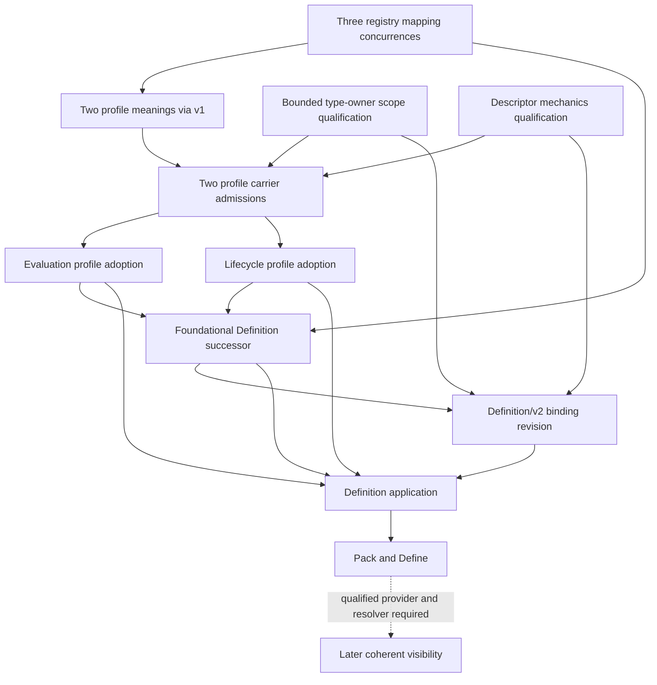

# Complete Definition integration admission proposal

## Outcome and present boundary

One review package now contains the six exact meanings, profile/carrier mechanics, owner requests, registry views, consumer dispositions, incident specimen, scoped assurance and publication requirements. No further semantic Definition was created in this preparation.

Your latest acceptance is recorded against the exact fresh evidence manifest `19bbecca1fffd7e8508b34903475ebbe985922e038781e8745388de42201ab6f`. It closes the fresh interpreted correspondence review for Definition application candidate.1, Definition Pack candidate.4 and CyberAlchemy Define candidate.4 within the previously stated limits. The three earlier exact foundational/profile fidelity acceptances remain preserved. See [acceptance](fresh-fidelity-acceptance.json) and [assurance disposition](assurance-disposition.json).

**This is a complete conditional admission proposal, not an admission-ready PASS or an applied package.** Profile standing, independent mapping concurrence, bounded type-owner scope qualification and admission remain unselected. Runtime provider and binding-resolver qualification are still technical requirements before coherent publication and operational use. Preparation checks cannot satisfy those authority or runtime gates.

The current repository still has **189 admitted Definition versions / 183 current identities**. Its registry, index, drift audit, type catalog, current Project State pointer, runtime bundle, all 189 canonical Definition sources and selected operational consumers are unchanged.

## 1. The complete semantic model

| Exact selected meaning | Purpose | Carrier | Incident application |
| --- | --- | --- | --- |
| Definition `1.0.0-candidate.3` | One reusable, versioned, owner-scoped meaning with one normative voice and two explanatory voices. | Definition/v2 | Defines what a reusable completeness criterion means; it does not set Northstar's incident values. |
| Definition Evaluation Profile `1.0.0-candidate.3` | Meaning of an exact contract for evaluating a Definition. | Definition/v1 bootstrap | Separates criterion quality from whether a particular extraction meets that criterion. |
| Definition Lifecycle Profile `1.0.0-candidate.3` | Meaning of permitted state transitions and their gates. | Definition/v1 bootstrap | A review or PASS does not by itself admit the reusable criterion. |
| Definition application `1.0.0-candidate.1` | One exact meaning bound to declared task values without changing that meaning. | Definition/v2 | Binds snapshot S-1042, Northstar, active-status filter and extraction E-1042 inside the Pack. |
| Definition Pack `1.0.0-candidate.4` | A task-scoped preparation record containing dispositions, inline working meanings, applications, optional assessments, gaps and provenance. | Definition/v2 | Keeps values, missing-record evidence and FAIL/PASS assessments together for INC-1042. |
| CyberAlchemy Define `1.0.0-candidate.4` | Prepares and evaluates required meanings, with explicit reuse/specialize/propose/open dispositions and selected materialization. | Definition/v2 | Reuses an accepted criterion if available or prepares a local proposal; it does not automatically create follow-up work or admit a shared Definition. |

Exact IDs, source bytes, schema/generator bindings and human views are in [selected subjects](subjects.json). The complete wording and formal explanation remain in the [six-definition index](../../consolidated-model/v2/formal-assurance/v1/DEFINITIONS-INDEX.md) and [complete integrated model](../../consolidated-model/v2/formal-assurance/v1/COMPLETE-MODEL.md). This summary does not redefine their semantics.

There are **five new identities and one foundational successor**, yielding 195 exact versions and 188 current identities if the complete cohort is later qualified and applied. Applications do not receive a new Artifact Type here, and a task-local working meaning remains unadmitted unless separately materialized and admitted.

### The incident, from meaning to assessment

```text
Reusable criterion
  Every eligible record ID in the selected snapshot/account/filter
  must occur in the selected extraction.
       ↓ bind declared values; keep the same criterion
Application 1 in Pack INC-1042
  snapshot S-1042 · account Northstar · filter status=active · extraction E-1042
       ↓ assess these exact inputs and evidence
Assessment 1
  required 12,000 · present 11,800 · missing 200 → FAIL
       ↓ retry; new extraction and application revision
Application 2 + Assessment 2
  new extraction evidence · required 12,000 · present 12,000 · missing 0 → PASS
```

The original FAIL remains evidence. The retry does not rewrite it. Both applications and assessments stay inside the Pack. The specimen's criterion is a working proposal, so the diagram's reuse architecture does not pretend that this example is already a shared admitted criterion. If a suitable shared criterion is later admitted, an application can point to that exact version instead.

The specimen assumes synthetic globally unique integer record IDs. Presence of all required IDs alone does not establish field accuracy, exclusion of extra records, root cause, incident closure or permission to act. The [incident Pack](../../consolidated-model/v2/incident-pack.json), [controls](../../consolidated-model/v2/incident-controls.json) and [checked bridge](../../consolidated-model/v2/formal-assurance/v1/incident-bridge.json) retain those limits.

## 2. Profile standing and the bootstrap order

The existing Definition/v1 evaluation and lifecycle profiles have admitted standing through their exact Foundation admission overlay. Their embedded candidate labels are historical source bytes. The proposed v2 profiles and their carrier revisions are still candidates.

### Resolve the bootstrap without weakening a lifecycle gate

The existing v1 lifecycle requires a **full current evaluation PASS** before entering `validated-candidate`. We do not rename a predecision prefix as that result.

1. Review the three independent registry mapping determinations: mechanics, Definition-registry semantics and evidence conformance.
2. Recheck actual v1 checks 01–06 for the two v1-carried profile meanings. Until concurrence is recorded, check 06 remains NOT_EVALUABLE.
3. Only when those checks pass, an applicable owner may select the exact conditional admission Decision under the existing evaluation admission rule. Check 07 is then evaluated against that actual Decision.
4. Obtain full current PASS before recording the existing lifecycle transitions in order. Exact owner review and confirmed application are recorded separately. No state transition occurs in this package.
5. Use the now admitted meanings as the semantic premises for profile carrier admission. Adopt evaluation and lifecycle profiles under their separate owner routes.
6. Re-evaluate the remaining Definition/v2 subjects under the actually adopted exact profiles. Check 11 cannot pass using these candidate profiles as their own authority.

This proposes an ordering of existing gates, not a lifecycle amendment or a retroactive transition. The owner must qualify the exact sequence before its effects occur. The [standing record](standing.json) keeps actual results separate from that conditional route.

### Correct the carrier mechanics against the current root

The current type catalog selects **Artifact Type/v3**. The frozen staged descriptors had bound the historical v2 root. This package supplies new descriptor revisions for:

- [Definition Evaluation Profile carrier](carriers/evaluation-profile/ARTIFACT.md), version `2.0.0-candidate.2`.
- [Definition Lifecycle Profile carrier](carriers/lifecycle-profile/ARTIFACT.md), version `2.0.0-candidate.2`.
- [Definition/v2 binding revision](carriers/definition-binding/ARTIFACT.md), descriptor version `2.0.0-candidate.3` under the same stable TypeRef.

The descriptors now distinguish the descriptor's own `artifact-type` classification from the semantic kind of its instances. They bind the exact current v3 root, carry its registration policy, expose their instance schema and include executable checks and negative witnesses. Profile JSON, profile schema/check contract/generator, Definition/v2 instance schema/discriminator and existing relation roles stay unchanged.

**A specific mechanical limitation remains explicit:** the admitted v3 schema is a self-instance schema with metamodel constants. It cannot validate an arbitrary profile descriptor. The package therefore proposes a separate closed local descriptor review schema and field-by-field correspondence. Passing that checker is not general admitted-v3 schema conformance. Exact mechanics concurrence and type-owner qualification are prerequisites to admitting these revisions. See [mechanics correspondence](carriers/mechanics-correspondence.json).

The existing type-owner assignment expressly names v1. A shared principal and earlier isolated v2/v3 Decisions do not grant a new scope. The package includes a bounded repository-owner qualification request for these exact three targets. Every unrelated assignment remains preserved.

## 3. Registry, index and drift requirements

| Material | Exact proposal | Current effect |
| --- | --- | --- |
| Strict v1 bootstrap authoring view | 189 inherited versions plus the two prospective v1-carried profile meanings = 191. Validates against the unchanged original v1 authoring schema. Future `admitted` entry labels describe the conditional postimage only. | None. |
| Historical metadata mapping | Preserve exact old admission/lifecycle metadata alongside the narrow authored view; the narrow view alone is not a lossless admitted-output registry. | Scoped owner concurrence pending. |
| Full mixed review projection | 195 versions / 188 proposed current identities. Every entry resolves its exact v1 or v2 carrier. Six additions retain candidate state and null actual Decision refs. | Local review format only. It is not a Registry/v1 instance or an admitted Registry/v2 contract. |
| Current Definition lookup | Select exact `definition_id@version`, including foundational candidate.3 and five new identities. | Proposed only. No implicit predecessor withdrawal or supersession. |
| Type registration | Preserve all 143 admitted contract rows and all historical descriptors; propose two profile carrier contracts, for 145 after qualified application. Select profile v2 TypeRefs in the proposed current map. | No newly admitted type. Predecessors retain exact history. |
| Definition/v2 binding | One explicit descriptor revision and exact semantic-binding overlay under the existing TypeRef. | No duplicate contract and no implicit runtime resolver support. |
| Drift | Original-carrier scoped candidate audit plus the exact preserved live historical audit. | Explicit owner/standing/publication findings remain open. No global zero-drift claim. |

Read the [mixed projection](registry/mixed-review.json), [generated full index](registry/DEFINITIONS-INDEX.md), [strict v1 view](registry/v1-bootstrap-authored.json), [v1 index](registry/V1-BOOTSTRAP-INDEX.md), [mapping disposition](registry/representation-disposition.json), [type registration](registry/artifact-type-registration.json), [binding overlay](registry/definition-binding-overlay.json) and [scoped drift audit](registry/DRIFT-AUDIT.md).

The full applied registry cannot have an exact final admission Decision digest today: that Decision has not been selected or created. The package freezes the candidate views, exact source bytes and [output/publication recipe](publication-recipe.json). Actual Decision and application identities must be captured when those acts occur; invented placeholders are not receipts. No live registry is replaced by this candidate format.

## 4. Consumer compatibility

### Preserve exact admitted meanings and sources

All 189 canonical Definition sources remain byte-identical. The earlier structured inventory still distinguishes **34 direct source users, 2 evidence users and 1 foundational self-reference**: 36 actual consumers across 37 records. The fresh scan examines all 189 canonical versions against the six selected identities and captures 41 records with reference/text matches. Those matches are an inventory, not 41 newly proven normative dependencies.

For the foundational successor, scope, normative statement and formal expression match the admitted predecessor exactly. Its applicable carrier/profile criterion changes explicitly. Old consumers keep their exact predecessor source and evidence references. No dynamic lookup silently rebinds an admitted source. Existing unsupported historical relation-shaped references are preserved as history; they are not copied into a new Typed Relation.

### Preserve existing operational behavior; qualify new use separately

The CLI, context adapter, specialized review implementation, source provider and selected documentation are captured by exact digest in the [compatibility record](consumers/compatibility.json). The specialized review protocol does not become a generic Define admission route by sharing a name or role.

Two concrete technical requirements remain before operational publication:

1. **Source provider:** the current provider verifies the canonical Definition registry against the older immutable admission registry digest. A changed canonical mirror fails that equality. New admission/Decision inventory also changes source freshness. A successor provider must select one exact immutable epoch, understand the mixed per-entry carriers and refresh derived context/ontology/review from that epoch.
2. **Binding resolver and CLI:** the current provider does not consume this proposed Definition/v2 binding-revision overlay. The current CLI emits the legacy Pack format. A separately qualified resolver/exporter/adapter must implement the revised embedded applications and assessments before operational use is claimed.

This package does not implement or activate those successors. Semantic review can consider the proposed meanings with those operational effects excluded. An owner must explicitly accept that disposition; if operational availability is required as part of admission, those technical requirements block that broader selection. See the proposed [documentation addendum](consumers/DOCUMENTATION-ADDENDUM.md).

## 5. One package, independently owned decisions

All requests are unselected. A single human review can address the package, but each independently owned effect still needs exact attribution and prerequisite evidence.



The exact [owner requests](owner-requests.json) contain 13 proposed review/admission prerequisite requests and one later visibility request excluded from this semantic selection. They name the subjects, source hashes, role routes, dependencies and requested effects. No external identity assurance or Role Assignment is invented.

**What a later bounded selection could cover:** the independent mapping/mechanics/scope determinations, two profile meanings, two profile carriers, separate profile adoptions, foundational successor, binding revision, Definition application and revised Pack/Define—always conditional on actual prerequisite checks and exact Decisions.

**What it would still not prove:** implementation of the revised CLI, production provider compatibility, ontology/context runtime activation, authenticated human identity, unlimited formal consistency, incident closure or an agent's permission to act.

## 6. Evidence, claim limits and reproducibility

The accepted fresh formal package retains 36 formula fragments, 105 scientific clauses, 59 typed axioms, 73 comparison pairs with 146 directed witnesses, 609,688 bounded assignments and 2,304 separate-reader checks. These are interpreted, typed finite evidence. They are not a theorem of arbitrary natural-language equivalence, infinite traces, global repository consistency or runtime correctness. The old 17 limits and fresh 7 boundaries remain registered; a scoped acceptance does not erase their limitations.

This preparation adds **1,524 passing checks** and **20 rejected negative cases**, recorded in [verification.json](verification.json). Checks cover exact inputs, all six Definition schemas/projections, strict and mixed registry representations, original drift schema, deterministic views, type/root/premise bindings, preserved sources, unique contract/Definition identities, request order and honest pending effects.

Negative cases cover wrong descriptor roots, forged admitted premises, extra fields, unauthorized profile effect fields, wrong profile subject carriers, bare lookup versions, duplicate entries, wrong entry carriers, forged source digests and v2 declarations under the v1 authoring schema. The read-only verifier does not rerun or overwrite the accepted formal package and does not issue an adopted-profile Evaluation.

```bash
python3 define/development/m1-preparation-preview/v1/reviews/admission-package/v1/verify.py
```

`prepare.py` reproduces local candidate projections only. After sealing, regeneration belongs in a new revision: do not overwrite this frozen package or refresh its historical evidence in place. Routing/currentness observations and mutable navigation are excluded from the seal and grant no authority.

## 7. Present disposition

- **Recorded:** exact fresh fidelity acceptance within limits.
- **Prepared and checked:** the complete semantic cohort, descriptor/standing route, independent owner requests, registry/index/drift candidates, consumer preservation dispositions and output recipe.
- **Not selected:** owner mapping/mechanics/scope determinations, type/profile standing, semantic admission and actual application.
- **Still required for operational publication:** qualified successor source provider, explicit binding resolver, revised CLI adapter/exporter and coherent epoch/consumer verification.

Review the package as one unit. There is no claim that these pending authority and operational requirements have already been satisfied.
