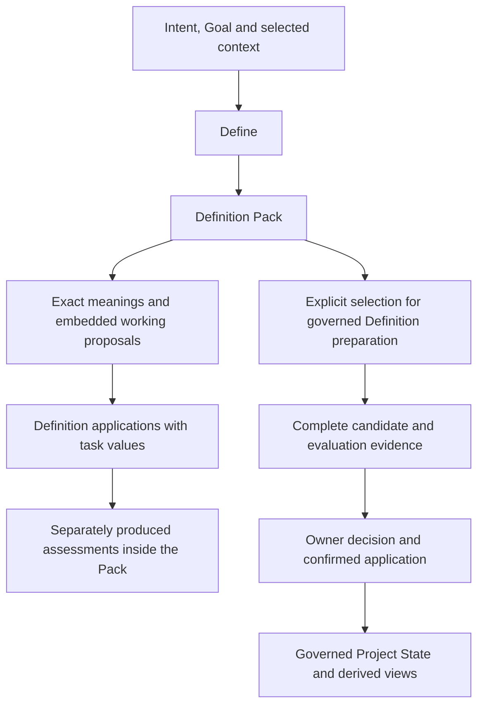

# Define in CyberAlchemy Lab — revised model with Definition applications

Status: proposed integration model. This is one consolidated user review of the proposal. The proposal selects six meanings: new Definition application candidate.1, revised Pack/Define candidate.4 and the three unchanged candidate.3 meanings. Changed wording needs fresh review; admission and profile adoption remain pending.

## 1. The outcome

A person or agent asks what a task depends on. Define identifies the meanings already available, the meanings that need a proposal and the questions still unanswered. It produces a reviewable bundle. Proposed meanings can then pass the applicable checks, receive an exact owner decision and become available to later work through governed Project State and its views.

The practical deliverable is a complete preparation workflow using the Lab's existing context, ontology and review interfaces. Success requires a usable CLI demonstration, a complete embedded task Pack, exact evidence and complete Definition records when their admission preparation is selected, with visible blockers. Building the definitions prepares those interfaces and gates; it does not complete the implementation.




These arrows explain data and review flow. They do not declare new global Typed Relations.

## 2. The six meanings

| Meaning | Question it answers | Incident example |
| --- | --- | --- |
| Definition | What does one term mean, within whose scope, with which boundaries? | What does identifier completeness mean for this export? |
| Definition Pack | Which concepts does this task require, and how is each handled? | Incident reused; Work specialized; completeness proposed; exclusivity open. |
| CyberAlchemy Define | What transformation prepares those meanings for the task? | Clarify the investigation's meaning and unresolved criteria using saved evidence. |
| Definition Evaluation Profile | Which checks, evidence, outcomes and phase gates assess an exact Definition? | Check the completeness Definition and its package independently of the export data. |
| Definition Lifecycle Profile | Which states and directed changes are allowed, with what evidence and authority? | The proposed completeness meaning starts authored; later validation, review and admission are separately evidenced. |
| Definition application | Which exact meaning is being applied to which task values? | Bind S-1042, Northstar, status=active and E-1042; keep the assessment separate. |

Definition application is `1.0.0-candidate.1`; Pack and Define are `1.0.0-candidate.4`; the other three remain `1.0.0-candidate.3`. The two profile meanings use Definition/v1 as their explicit bootstrap carrier. Definition, Pack, Define and Definition application use the existing Definition/v2 carrier. A profile meaning is a Definition; the concrete reusable profile is a different artifact. These are six semantic subjects. The incident working proposal, application and assessment are embedded task records outside their admission cohort.

The full selected candidate normative statements, formulas, notation, explanations, boundaries and sources are collected in [Contracts and definitions](../CONTRACTS.md). This explanatory model introduces no replacement canonical meanings.

## 3. What Define receives and returns

### Input

- One explicit Goal with its Project link and originating Intent.
- Declared context, named consumer and intended use.
- A finite, nonempty set of required concept identities.
- Exact selected source records and evidence, with standing at capture.
- Applicable owner routes, or explicit gaps where those routes are unresolved.

Goal, Intent and required-concept revisions retain attributable reasons and prior lineage. A consumer solution cannot silently replace the request.

### Four handling choices

| Disposition | Required payload | Example |
| --- | --- | --- |
| reuse | Exact admitted Definition version, captured standing and applicability. | Existing Incident meaning. |
| specialize | Exact parent plus application parameters, or an explicit proposed semantic change. | Existing Work applied to investigating this incident. |
| propose | An explicitly unadmitted working meaning embedded in the Pack by default. Complete Definition export is required when selected for admission preparation. | Export identifier completeness, retained inside this investigation Pack. |
| open | Question, reason, affected use, owner route or gap, and continuation. | Whether extra records are permitted. |

Each declared concept receives exactly one current choice and matching payload. Duplicate, omitted and undeclared handling rows are rejected. An open question can be part of a conforming Pack and still block a particular later use.

Define can yield zero, one or many proposed Definitions. It records the missing meaning or a continuation; creation and selection of a follow-up Intent belongs to its own route. Define does not select the consumer's solution, achieve its Goal, appoint an owner or authorize execution.

### Output artifacts

1. A version-exact candidate Pack with scope, concept handling, evidence, ownership gaps and use-specific readiness.
2. Embedded Definition applications, task values, task-local working proposals and optional separate assessments. Complete standalone Definition JSON/Markdown is emitted only for explicitly selected admission preparation.
3. Field lineage identifying reused, supplied, generated and unresolved fields.
4. Scoped preparation evidence and separately supplied task assessments. A governed Evaluation, when required and actually executed, retains exact subject/profile/input bindings, all declared check outcomes, causal blockers and claim limits.
5. A frozen review package: selected candidates, consumer dispositions, registry/index/drift postimages, independent owner scopes and the output recipe.

The Pack is a candidate input bundle in this release. A new independently admitted Pack Artifact Type or Pack instance is outside the selected first release. The proposed closed embedding preview and the incident fixture are in [pack schema](../pack-embedding.schema.json) and [one incident Pack](../incident-pack.json). The complete strict production wire contracts and exporter remain implementation work; this preview is not a new admitted Artifact Type.

## 4. The incident, end to end

### The request

**INC-1042: Northstar's active-account export may omit rows after pagination.** The intended investigation uses a saved source snapshot and saved output. The agent needs an explicit criterion for identifying missing records.

| Bound input | Selected value |
| --- | --- |
| Account A | Northstar |
| Filters F | status=active |
| Source snapshot S | S-1042 |
| Saved output E | E-1042 |
| Required unique IDs | 12,000 |
| Required unique IDs present | 11,800 |
| Missing required IDs | 200 |

This is a synthetic fixture whose inclusion comparison was executed locally during self-review. It is not a production incident observation or Define CLI run. The fixture assumes globally unique identifiers; account-local identifiers would need an explicit composite identity contract.

### The task-local proposed meaning

**Export identifier completeness:** for a fixed source snapshot S, declared account A, declared filters F and saved output E, every identifier required by S, A and F appears in E.

```text
CompleteIds(S,A,F,E) iff RequiredIds(S,A,F) subseteq ExportedIds(E)
```

S is one identified source snapshot; A selects the account; F selects records within that account; E is the saved export. The required identifier population must be established. An unknown population is NOT_EVALUABLE; a genuinely established empty population satisfies inclusion.

### Two different assessments

| Assessment | Subject | Result in this example |
| --- | --- | --- |
| Coverage assessment | Saved export compared with the required population. | FAIL: 200 required IDs are missing. |
| Definition evaluation | Meaning, representation and governance package for the proposed criterion. | Requires the 14 checks below; the embedded synthetic coverage assessment is not that Definition evaluation and selects no admission. |

A valid criterion can expose a failing export. A missing-ID count does not establish the cause of the incident. Pagination is a hypothesis requiring independent evidence.

An export containing all required IDs can satisfy this inclusion criterion while still containing inaccurate values, duplicates or unauthorized extra records. Accuracy, exclusivity and incident closure therefore remain separate questions. The proposed Definition grants no production access, extraction, repair or closure permission.

### Meaning, application and assessment

The reusable meaning is selected exactly once. A Definition application supplies the task values under its declared parameter contract. A separately attributable assessment records what was established for those values and evidence.

```text
Meaning: every required ID appears in the saved output
    ↓ declared parameter substitution
Application: S-1042 / Northstar / status=active / E-1042
    ↓ separately executed synthetic inclusion comparison
Assessment: 12,000 required / 11,800 present / 200 missing → FAIL
```

All three records, plus the selected input evidence, live in [one incident Pack](../incident-pack.json). The application is `/applications/0`; its assessment is `/assessments/0`; the unadmitted working proposal is `/working_meanings/0`. Local subtree digests bind those exact values without requiring a self-hash of the containing Pack. The complete Pack file is sealed separately for subsequent retrieval.

Changing E to a saved retry creates a new application and assessment revision under the same meaning. Allowing 1% missing changes the criterion: an undeclared tolerance is rejected as a parameter substitution. Missing required parameters remain explicit gaps; unknown required population yields NOT_EVALUABLE. Established empty population is different and satisfies inclusion.

An application can have no assessment, or several separately bound assessments. Define preparation records supplied assessment provenance; it does not automatically run one. Assessments in this fixture are illustrative criterion results, not new globally admitted artifacts or complete Evaluation/Measurement Result carriers. Requiring those governed claims still requires their existing contracts.

### Storage, authority and materialization

Applications, task values and assessments stay inside the task Pack by default. A new task-local proposed meaning also stays embedded and unadmitted. `propose` remains its handling disposition; this is not a fifth disposition or an extra lifecycle state.

Selecting a separately materialized Definition requires an explicit purpose, intended authority scope and applicable owner route. A one-use consequential criterion may warrant this; frequency alone does not select admission. Embedding is a storage decision, not an authority exemption, and cannot override an applicable admitted meaning or Policy.

When a result/decision cites the Pack, preserve the exact full Pack and selected evidence. Retention/archive follows applicable rules; no deletion or expiry is selected here. Routine context can be a bounded view rather than loading all completed-task details. Durable task state still uses the applicable Project State route; the agent remains Session-bound.

### How the agent uses the result

An ephemeral machine-agent instance receives context from Project State through Context and Ontology Views. It can prepare the proposed criterion and evidence within its authorized Session. Short-term memory belongs to that Session. Later agents obtain durable knowledge from governed project records and views; a saved chat or work-session file does not become accepted Project State automatically.

## 5. The complete evaluation model

An Evaluation binds one exact Definition version, the exact applicable profile, selected input/evidence epoch, scope and phase. One user review may consider the whole model; each actual Evaluation still preserves its own subject and evidence.

- **PASS:** applicable evidence establishes the required predicate in the selected scope.
- **FAIL:** applicable evidence establishes a violation.
- **NOT_EVALUABLE:** required evidence, standing, input, execution or review is absent, unsupported or stale.

Independent checks continue after another check fails. A blocked dependent check records NOT_EVALUABLE and its causal reason. Every declared check is reported, while only the selected phase's required checks contribute to its aggregate.

### All fourteen proposed v2 checks

| Check | Required evidence / established condition | Dependencies |
| --- | --- | --- |
| DEF2-01-REPRESENTATION | Exact discriminator, schema identity/digest and closed schema pass; subject identity/version unique. | None |
| DEF2-02-VOICES | All voice fields and notation/boundary/testable declarations satisfy carrier requirements; semantic agreement is assessed separately in DEF2-10. | DEF2-01-REPRESENTATION |
| DEF2-03-SOURCES | Every declared governing source resolves at exact digest with applicable standing and use. Missing applicable source evidence is NOT_EVALUABLE; known inadmissibility/mismatch is FAIL. | DEF2-01-REPRESENTATION |
| DEF2-04-OWNER | Role names resolve to admitted assignments, owner scope is established, and no local key is treated as identity or appointment. | DEF2-01-REPRESENTATION |
| DEF2-05-PROJECTION | Two renders are byte-identical and match the bound human projection; this does not authenticate origin. | DEF2-01-REPRESENTATION |
| DEF2-06-CONNECTIONS | Every declared connection resolves under current contract, with qualifiers where required. An empty embedded list passes only its bounded reference subcheck; absence of undeclared required coupling is not inferred. | DEF2-01-REPRESENTATION |
| DEF2-07-REGISTRY-DRIFT | Exactly one selected candidate version is proposed, history preserved, postimages reproducible and drift owner/route current; placeholder strings do not count as resolved material. | DEF2-01-REPRESENTATION |
| DEF2-08-IMPACT | All required current bindings have supported compatible/update dispositions; blocking or unsupported deferred obligations remain visible and block readiness. | DEF2-03-SOURCES, DEF2-06-CONNECTIONS |
| DEF2-09-SEMANTIC-ASSURANCE | Required bounded checks have applicable evidence, assumptions, executed coverage and no unresolved required counterexample. Unsupported temporal/deontic/empirical clauses require explicit owner-qualified disposition; they cannot receive a fabricated global PASS. | DEF2-02-VOICES, DEF2-03-SOURCES |
| DEF2-10-FIDELITY | Owner review explicitly accepts fidelity to selected meaning and source scope. Author commentary, lexical differences or answering go-next does not satisfy this check. | DEF2-08-IMPACT, DEF2-09-SEMANTIC-ASSURANCE |
| DEF2-11-PROFILE-COMPATIBILITY | Required profile mechanics/type/evaluation/lifecycle determinations and foundational compatibility are effective for the intended use. Proposed-only schemas/profiles are usable for preview discussion, not assumed admitted enforcement. | DEF2-01-REPRESENTATION |
| DEF2-12-REVIEW-COHORT | Review material identifies exact candidates, evidence, independent roles, postimages/recipes and invalidation conditions without requiring the future admission Decision or hashing itself. | DEF2-07-REGISTRY-DRIFT, DEF2-08-IMPACT, DEF2-10-FIDELITY, DEF2-11-PROFILE-COMPATIBILITY |
| DEF2-13-ADMISSION-DECISION | Applicable owner Decision exists and matches the exact eligible subject, evidence/recipes and selected effect; no Decision is fabricated during preview. | DEF2-12-REVIEW-COHORT |
| DEF2-14-APPLICATION | Exact authorized application is confirmed, with coherent selected epoch and replay-safe identity; a Decision alone does not prove the effect occurred. | DEF2-13-ADMISSION-DECISION |

### Phase aggregation

| Phase | Required checks |
| --- | --- |
| representation | 01, 02, 05 |
| validation | 01, 02, 03, 04, 05, 06, 07, 08, 09, 11 |
| owner_review | 01, 02, 03, 04, 05, 06, 07, 08, 09, 10, 11, 12 |
| pre_decision | 01, 02, 03, 04, 05, 06, 07, 08, 09, 10, 11, 12 |
| decision | 13 |
| application | 14 |

For each selected phase, an established required FAIL takes precedence; otherwise any required NOT_EVALUABLE yields NOT_EVALUABLE; otherwise the phase is PASS. The pinned pre-decision set is nonempty. There is no global average that can hide a required failure.

Before admission, checks 01–12 must PASS on current exact inputs. Check 13 may be NOT_EVALUABLE solely because the admission decision has not occurred; check 14 is excluded before application. An existing Decision is assessed as an existing exact record, rather than relabeled pending.

### What an evidence record must retain

The record retains subject identity/version/digest, profile identity/digest/standing, phase and scope, exact inputs and source standing, all fourteen check outcomes, evidence references, causal blockers, phase aggregate, pre-decision eligibility, producer/Session attribution and explicit claim limits. Exact Decision and application references remain absent until the corresponding facts exist. This is a description of required information; implementing its closed carrier and evaluator remains separate work.

Changing the subject, source selection, profile, consumer/effect set or evidence epoch reopens affected checks. Old receipts remain bound to their original inputs and cannot be silently refreshed.

## 6. Lifecycle and actual changes


Withdrawal is also permitted from each non-withdrawn state through its declared owner gate. All directed pairs and gates follow.

| From | To | Gate | Effect |
| --- | --- | --- | --- |
| candidate-authored | validated-candidate | Exact validation phase in the bound check contract is PASS under adopted applicable profile/carrier bindings; checks 13-14 are excluded. Record a separate attributable transition for this exact candidate epoch. | Record scoped validation posture; create no semantic authority. |
| validated-candidate | owner-reviewed | Checks 01-12 PASS; applicable owner review/fidelity record binds the exact candidate and evidence; a separate transition record confirms review completion. | Record review completion; select no admission effect. |
| owner-reviewed | admitted | Pre-decision eligibility is established without a prior admission; exact owner Decision passes check 13 and its authorized application passes check 14. | Only confirmed applicable admission makes the selected exact version authoritative within its scope. |
| admitted | superseded | Exact owner successor Decision and confirmed coherent application select the admitted replacement and preserve predecessor bytes/history. | Retire current lookup for this predecessor only after the exact successor becomes effective. |
| candidate-authored | withdrawn | Exact applicable owner withdrawal Decision and confirmed application; if the subject is current, bind a replacement or terminal lookup route. | Record withdrawal and preserve evidence/history; remove current authority only when applicable. No deletion is inferred. |
| validated-candidate | withdrawn | Exact applicable owner withdrawal Decision and confirmed application; if the subject is current, bind a replacement or terminal lookup route. | Record withdrawal and preserve evidence/history; remove current authority only when applicable. No deletion is inferred. |
| owner-reviewed | withdrawn | Exact applicable owner withdrawal Decision and confirmed application; if the subject is current, bind a replacement or terminal lookup route. | Record withdrawal and preserve evidence/history; remove current authority only when applicable. No deletion is inferred. |
| admitted | withdrawn | Exact applicable owner withdrawal Decision and confirmed application; if the subject is current, bind a replacement or terminal lookup route. | Record withdrawal and preserve evidence/history; remove current authority only when applicable. No deletion is inferred. |
| superseded | withdrawn | Exact applicable owner withdrawal Decision and confirmed application; if the subject is current, bind a replacement or terminal lookup route. | Record withdrawal and preserve evidence/history; remove current authority only when applicable. No deletion is inferred. |

Passing a gate establishes a condition. A separately attributable transition record and any required selected/confirmed effect establish an actual change. Revise, defer and reject are review outcomes; they do not automatically create withdrawal. Pre-decision eligibility is an assessment and does not add a seventh state.

The existing v1 lifecycle's full-PASS wording is preserved. A v1 pre-decision eligibility assessment cannot silently be renamed a full-PASS lifecycle transition; applicable owner interpretation must be resolved for an execution that relies on it. The proposed v2 phase gates express that distinction explicitly. No transition is claimed here.

## 7. Authority, provenance and lifecycle in this workflow

| Lens | What it records | Incident example |
| --- | --- | --- |
| Authority | Applicable admitted meanings/contracts, independent owners, permitted effects and scope. | The completeness Definition can govern a bounded criterion after exact admission; the agent still needs applicable action authority. |
| Provenance | Where exact selected information came from, its source epoch, evidence and attributable reviews. | S-1042, E-1042, account/filter selection, identifier comparison and its producer. |
| Lifecycle | Current posture, allowed directed changes and evidence of actual transitions/effects. | Candidate criterion, later review, exact admission and confirmed visibility. |

An exact digest establishes integrity of selected bytes. It does not establish source truth, owner identity, currentness for every later use or permission. A passed check and a directory location supply no owner authority.

### Independent responsibilities in one review package

| Role | Responsibility | Required separation |
| --- | --- | --- |
| artifact-mechanics-owner | Exact representation, schema, generator and field/projection mapping. | Excludes semantic admission. |
| definition-owner | Meaning, scope, exact version, preservation and semantic admission/Definition lifecycle effects. | A reviewed draft is distinct from selected admission. |
| evidence-conformance-owner | Evaluation contracts and sufficiency of scoped evidence. | Excludes semantic truth and admission. |
| artifact-type-owner | Applicable type registrations and exact contract bindings. | Existing v1 scope does not silently confer every v2 effect. |
| source-admission-owner | Applicable external source selection/admission. | Capture alone does not promote a source. |
| Applicable Product/capability owner | Product outcome, scope and realization/adoption decision. | Product approval does not select semantic or source admission. |

The current owner map and its admitted decision are exact inputs. A single person can hold several recorded roles, but each determination retains its own scope. One consolidated presentation can collect those outcomes without transferring roles.

Ontology Views can explain relationships already supported by admitted typed endpoint contracts. Embedded owner/source references, Pack relationship suggestions and presentation arrows do not manufacture global graph edges. Historical predecessor links are preserved; unsupported Definition→Role or Definition→SourceAdmission interpretations are not copied into new Typed Relations.

## 8. Bootstrap, type changes and effective visibility

The new profile meanings are reviewed through existing admitted v1 authority, then the new profile mechanics, carriers and concrete adoption receive their own applicable determinations. The revised activation recipe adds Definition application after the applicable profiles and foundation, before revised Pack/Define. The table below retains the prior foundation/profile stages; the new meaning and revised meanings require fresh evidence. The exact revised ordering is in [model.json](../model.json).

| Stage | Depends on | Review scope |
| --- | --- | --- |
| PROFILE-MEANINGS | Existing authority | existing admitted Definition/v1 and v1 review profiles |
| PROFILE-MECHANICS | Existing authority | independent mechanics owner |
| PROFILE-TYPES | PROFILE-MEANINGS, PROFILE-MECHANICS | artifact-type owner; admitted semantic bindings required |
| PROFILE-ADOPTION | PROFILE-TYPES | separate evidence and Definition lifecycle owners |
| FOUNDATIONAL-SUCCESSOR | PROFILE-ADOPTION | exact v2 subject review, evidence and compatibility decisions |
| DEFINITION-BINDING | FOUNDATIONAL-SUCCESSOR | binding-only artifact-type owner effect |
| DEFINITION-APPLICATION | PROFILE-ADOPTION, FOUNDATIONAL-SUCCESSOR, DEFINITION-BINDING | New exact v2 meaning review and owner effects; pending |
| PACK-AND-DEFINE | PROFILE-ADOPTION, FOUNDATIONAL-SUCCESSOR, DEFINITION-BINDING, DEFINITION-APPLICATION | separate exact v2 Definition review; formal/fidelity obligations open |
| COHERENT-VISIBILITY | PACK-AND-DEFINE, PROFILE-MEANINGS, PROFILE-MECHANICS, PROFILE-TYPES, PROFILE-ADOPTION, FOUNDATIONAL-SUCCESSOR, DEFINITION-BINDING, DEFINITION-APPLICATION | single frozen Project State epoch and explicit derivative mirror compatibility recipe; no application here |

Definition application is one new reusable semantic Definition carried by existing Definition/v2. Its embedded task records create no new Artifact Type registration. The registration proposal has two new profile/v2 type registrations and one Definition/v2 semantic-binding descriptor revision. The Definition/v2 instance schema, discriminator and relation roles remain unchanged. Existing historical contracts and Definition source records remain intact.

| State or scenario | Definition versions | Current identities | What it means |
| --- | --- | --- | --- |
| Current live baseline | 189 | 183 | Existing actual standing and lookup. |
| Two-meaning v1 bootstrap | 191 | 185, conditional | Two profile meanings only; foundational predecessor remains selected. |
| Revised six-meaning cohort | 195 | 188, conditional | Five new semantic identities and one foundational successor version; selected Pack/Define candidate.4 replaces candidate.3 in this review. |

The 143 existing admitted type-contract rows are preserved. Two pending type registrations are additional proposals, rather than already admitted rows. The revised candidate registry/index preview is prepared. Exact revised drift and qualified full-cohort compatibility remain open; the prior frozen drift material is preserved. The 12 inherited drift findings are preserved, and the 17 registered assurance limits remain open.

### Registry compatibility

The original closed v1 authoring registry and later admitted-output registry have different representation roles. The prepared v1 authoring postimage uses conditional future admitted entry labels under a candidate root. Those labels are not evidence of current standing. Actual candidate posture, admission metadata and current selection remain separately recorded.

The mapping preserves all 189 inherited rows and metadata. Recovering actual standing is lossless only with that metadata; the reduced authored view alone cannot restore it. The exact mechanics, semantic-preservation and evidence-conformance mapping scopes remain unselected. Actual v1 checks 06 and 07 therefore remain NOT_EVALUABLE.

The revised six-meaning mixed-registry/Project State visibility recipe is a further exact representation/consumer effect. Reviewing the limited two-meaning v1 mapping does not adopt that global recipe. Publication uses a selected immutable cohort and one coherent effective-epoch lookup; it remains implementation and application work. No intermediate draft lookup is exposed here.

## 9. How this fits the existing Lab implementation

The existing Lab-owned CLI is a runnable candidate successor using Lab operational runtime v2 context, bounded ontology queries and Store.review. Its current output retains the legacy candidate Pack shape. That Pack does not already provide the complete Definition export required here.

| Interface | Selected reuse | Work still required for this model |
| --- | --- | --- |
| Source/provider | Existing source capture and freshness interfaces. | Strict bounded read/hash/parse of the same exact bytes, current selected-epoch support and original-byte transport. |
| Context | Existing Project State and Session views. | Complete strict preparation input binding and scoped freshness/readiness. |
| Ontology | Existing bounded graph query with diagnostics. | Lawful selected links and explicit boundary/impact handling. |
| Review | Existing Store.review on an explicitly selected local branch. | Exact full-Definition owner package, independent scoped outcomes and guarded recipes. |
| Exporter | Candidate-file behavior and deterministic generators. | Closed Lab preparation adapter, full per-disposition export, field lineage and safe early freeze. |
| Agent | Ephemeral native app-server session. | Qualify the strict preparation realization without attributing authority to model output. |
| Craft compilation | Existing public API; pure semantic functions lower to Calculation. | Preserve supported legacy compilation; v2 Pack compilation remains unsupported in this release. |
| Application/views | Existing governance surfaces. | Exact authorized epoch publication, recovery/idempotency and read-back, with explicit consumer compatibility. |

Inspection and early preparation create no private key, store or admission. Local work-session persistence is retained as work data and does not establish persistent machine-agent memory or accepted Project State.

## 10. The bounded completion plan

| Area | Outcome | Items |
| --- | --- | --- |
| G01 — Define, Definition Pack and Definition application meanings | Three candidate three-voice meanings with explicit source standing and exact semantic admission targets. | 9 |
| G02 — Product ownership and CLI realization | One exact Product anchor, explicit owner scope, a Define capability candidate and separately evidenced CLI realization. | 6 |
| G03 — Definition/v2 evaluation and lifecycle | Explicit v2 profiles and foundational compatibility resolution; review eligibility cannot require its own completed admission. | 6 |
| G04 — Pack, session and supplemental contracts | Closed, versioned preparation contracts with complete per-disposition payloads, source standing and use-specific readiness. | 10 |
| G05 — Task Pack and selected Definition exporter | A candidate prepare command emits the embedded task Pack and complete Definition/v2 records when selected, with exact field lineage and safe output. | 7 |
| G06 — Reuse, specialization, proposal and open outcomes | Each disposition maps to an exact lawful output; changed meaning, application parameters and unanswered questions remain distinct. | 6 |
| G07 — Semantic scope, ownership and effect enforcement | Definition-specific authority evidence is checked in review, authorization and application; local operator identity is not substituted for semantic ownership. | 10 |
| G08 — Review packages and exact transactions | Complete exact review/apply preparations with independent member decisions, closed target sets and recoverable consequences. | 9 |
| G09 — Source epochs, Project State and derived views | An admitted successor becomes readable without breaking the frozen prior epoch, and only supported connections enter derived views. | 8 |
| G10 — Verification, adoption and documentation | Exact candidate evidence supports Product approval, distinct authority decisions and observable bounded integration. | 8 |

The existing amended work map has 79 items. [Integration amendments](../integration-amendments.json) map this change into its meaning, contract, exporter, handling, review, state and verification areas; those amendments are proposed and runtime enforcement remains pending. Its complete IDs, actions, dependencies, outputs and completion criteria are retained in [Contracts and definitions](../CONTRACTS.md). Its historic planned labels are not a fresh claim that completed semantic preparation never happened. Current frozen preparation and accepted scope reviews are later evidence; implementation and owner effects need their own closure records.

### Delivery gates

1. **M1 — preparation preview:** strict provider and exporter produce a complete bounded candidate preview or exact blockers, with generated records and field lineage. Preserve legacy APIs and candidate-only effects.
2. **M2 — guarded review:** one user-facing package exposes exact subjects, independent roles, outcomes, consumer preservation/update choices and registry/index/drift/visibility recipes.
3. **M3 — application and visibility:** exact verified implementation, checked documentation, applicable Product approval and independently authorized effects produce coherent state plus verified read-back.

Implementation completion is demonstrated with the incident and another bounded consumer: useful generated records, repeatable evidence, visible gaps and successful governed retrieval by a subsequent agent. The incident criterion needs its own domain/assurance/review closure if selected for actual admission; its task-local proposal remains embedded and is not included in the six-meaning cohort.

## 11. Review conclusions and one requested evaluation

This proposal brings the whole selected integration model into one review. The review examined meaning separation, representation, profile phases, lifecycle gates, source/owner scope, dependency ordering, registry preservation, incident boundaries, runtime status and registered assurance limits.

The structural and source-integrity results are in [Review report](REVIEW.md). They establish consistency of the selected preparation material within that scope. They do not establish whole-repository semantic consistency, runtime conformance, owner concurrence, admission or applied visibility.

The remaining conditions are visible together:

- Exact qualified concurrence for the existing three-scope v1 registry mapping; actual checks 06/07 remain pending.
- Applicable v1 lifecycle gate interpretation for any relying bootstrap execution, without changing the v1 source.
- Independent meanings/mechanics/type/profile/compatibility owner effects under the selected final dependency order.
- Full-cohort representation and consumer visibility compatibility before global state changes.
- Strict M1 provider/exporter and later application qualification, including preservation of legacy behavior.
- Fresh fidelity/non-collapse correspondence and impact closure for the new application meaning and changed Pack/Define bytes; earlier acceptance is not transferred.
- Production qualification of embedded selectors, parameter contracts, optional assessments, explicit materialization and epoch invalidation.
- All 17 registered assurance follow-ups, with their bounded claim ceilings retained.

**Review requested:** evaluate this complete model, its boundaries, dependency order and completion plan in one pass. You may accept it, identify changes or defer it. Any acceptance is recorded with the scope you state; semantic admission and application are not inferred from accepting the proposal. If you explicitly select those effects later, their exact role/effect records remain separate even when presented together.

No new owner outcome or admission has been recorded by preparing this document.
