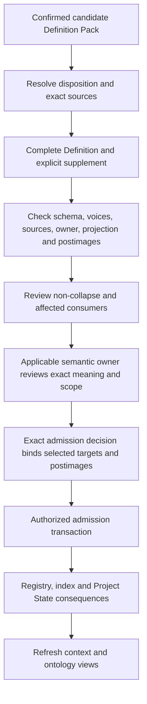

# Proposal: Definition Pack → Lab Definition and owner review

**Standing:** proposed, unadmitted. **Effects:** preparation only. No live Definition, registry, index, drift audit, Project State or runtime code was changed.

## Recommendation

Treat a Definition Pack as the source bundle for **zero or more exact Definition candidates and reference bindings**. A pack remains a distinct artifact. Its confirmation and deterministic checks do not admit any meaning.

Use the currently admitted `cal.artifact-type.definition/v2`. Its original descriptor still says candidate; the selected admission overlay establishes its effective current standing. Keep the governing scientific/formal voice together with explicitly non-normative plain-language and domain-context voices. Add an explicit preparation supplement rather than silently deriving missing semantics, owner scope, formalization or relations.

[Machine mapping](mapping.json) · [Exact example record](example/definition.json) · [Generated readable Definition](example/DEFINITION.md) · [Field lineage](example/field-lineage.json) · [Owner review plan](review-plan.json)

## 1. Handle each concept's disposition

| Pack disposition | Proposed Lab handling | Admission target |
| --- | --- | --- |
| Reuse | Bind an exact current Definition and review whether its scope fits this use. | None. Do not copy or re-admit the existing meaning. |
| Specialize | Distinguish selecting application parameters from creating a narrower normative meaning. Parameter selection records a use binding. A changed meaning needs a complete new candidate with an exact parent source binding and explicit identity/lifecycle choice. | Only the explicitly authored new or revised meaning. |
| Propose | Prepare a complete Definition/v2 record with supplementary fields and owner review. | One exact candidate, after applicable gates. |
| Open | Retain the question, reason, next owner and blocking posture. | None; no inferred Definition. |

A new specialization is not automatically a revision or replacement of the parent. Parent provenance is not a new Typed Relation. Use a declared connection only when its exact kind, endpoints and carrier roles permit it; otherwise follow the existing connection-extension rule.

A pack may contain several candidates. One review bundle can group them, with independent stable Decision cores for independent target effects. If the owner selects a subset, record that subset explicitly and keep the rest of the pack open.

## 2. Map the content

| Lab field | Source or required addition |
| --- | --- |
| Stable ID and version | Explicit semantic-owner selection. A concept/session/pack ID is not a Definition ID. |
| Term and aliases | Original term plus visible terminology review. Do not introduce a broader alias silently. |
| Scientific/formal statement | The proposed normative wording is the starting draft. Record changes explicitly. |
| Formal expression, notation, conditions | Explicit author supplement, reviewed with the statement. The mapper cannot invent a proof. |
| Plain-language voice | Proposed plain wording, marked `normative: false`, checked for matching scope. |
| Domain-context voice | Context explanation and concrete examples, marked `normative: false`. Context text alone is insufficient. |
| Semantic owner | Resolve the applicable admitted role assignment and its exact authority scope. `owner_route` is a routing hint. |
| Applicability and exclusions | Explicit supplement. Neither the goal nor consumer label grants authority scope. |
| Boundaries | Original boundary plus the exact scientific/domain exclusions. |
| Governing sources | Resolved source selectors, hashes and actual admission standing. |
| Evidence | Frozen pack, source context, language checks, supplementary files and review receipts. Evidence is not automatically an admitted governing source. |
| Consumers | Exact intended Work/Evaluation/other consumer references where available; unresolved illustrative consumers remain visible. |
| Registry/index | Candidate postimage and deterministic index, with exact live predecessor hashes. |
| Drift route | Explicit accountable owner, audit and applicable challenge route. |
| Source direction | One canonical `definition.json`, generated `DEFINITION.md`, actual schema and generator hashes. |
| Connections | Explicit declared relations; no inferred graph edges from labels or pack membership. |
| Residue and claim ceiling | Remaining obligations and the exact proposed effects. |

The original pack remains unchanged. [Field lineage](example/field-lineage.json) records the proposed adaptations. The supplement is preparation metadata; additional fields are not stuffed into the closed Definition schema.

## 3. Incident example

[INC-1042](example/incident-ticket.json) is a realistic **synthetic** ticket: Northstar's active-account export may omit records after pagination. It is not an observed production incident.

The actual CLI-generated [pack](example/definition-pack-result.json) proposes **“complete export”**:

> A complete export contains every required identifier in the selected source snapshot, account and filter set.

The proposed Lab name is **Export identifier completeness**. This is an explicit clarification awaiting review, with no global “complete export” alias.

### Proposed governing meaning

For a fixed source snapshot S, declared account A, declared filters F and saved output E, export identifier completeness holds exactly when every identifier required by S, A and F appears in E.

```text
CompleteIds(S,A,F,E) iff RequiredIds(S,A,F) ⊆ ExportedIds(E).
```

The required population must be established. Unknown expected identifiers cannot be treated as an empty set. S, A and F must match across the expected population and saved export.

### Plain-language explanation

Every required row identifier for the chosen account, filters and snapshot must appear in the saved output.

### Domain explanation

For S-1042, Northstar, `status=active` and E-1042, the missing-ID fixture contains 12,000 required identifiers and only the first 11,800 in the export. The 200 missing IDs fail coverage. A file with 12,000 rows but 200 duplicate replacements still fails. A retry with all 12,000 required IDs passes coverage.

That retry may still have inaccurate values or extra account records. Accuracy, exclusivity, disclosure permissions, extraction permission and incident closure require separate criteria and decisions. The agent can apply the accepted criterion in a permitted investigation; acceptance would grant no new tool permission.

The [declared cases](example/criterion-cases.json) include missing IDs, all IDs present, duplicates, inaccurate values, extras and an unknown required population. They are illustrative cases, not an executed production measurement or proof.

### Ownership

- `role:artifact-mechanics-owner`: reviews representation, schema and generator mechanics.
- `role:evidence-conformance-owner`: reviews the explicit Definition/v2 preparation checklist binding.
- `role:definition-owner`: proposed reviewer of exact meaning, stable identity, scope, postimages and semantic admission, grounded in the existing admitted assignment.
- Incident commander: proposed domain reviewer for the example's applicability. The pack's string does not make this person the Lab's semantic owner.
- Source-admission owner: required separately if an unadmitted external source is needed as a governing premise.
- Local runtime operator: controls only the provisioned local branch. Signing a local proposal cannot establish repository-wide semantic ownership.

The admitted foundational Definition record is cited for representation and authority boundaries. It does not prove an external customer's export policy or the incident's facts. The incident ticket and cases remain candidate evidence.

## 4. Owner review flow



The preparation checklist explicitly selects Definition/v2. The older evaluation profile names a v1 subject; adopting this mapping should include the explicit v2 binding of the corresponding schema/voice/source/owner/projection/registry/decision purposes. It must not silently relabel that v1 profile or its old receipts.

`Store.review` supplies the existing local structural preflight, decision cores and planned consequences. It does not verify every business policy or perform semantic-owner review. When a local proposal is prepared, bind the exact store HEAD, source snapshot, scope, policy and challenge route. Independently check the Definition's nested authority scope and semantic-owner assignment: the current runtime's top-level scope check is insufficient for that semantic obligation.

A local signed apply remains local. Canonical repository admission follows its separately authorized exact transaction and postimages. One human checkpoint may bundle the applicable role-specific Decisions, while keeping their independent effects and digests explicit. No mapping approval pre-authorizes future generated meanings.

## 5. Prepared material and standing

The example satisfies the current Definition/v2 JSON schema and matches its actual selected generator. The proposed postimage contains the existing 189 versions plus this one candidate; its proposed lookup has 184 identities. The live registry remains at 189 versions / 183 current identities.

[Preparation checks](preparation-checks.json) distinguish structural results from pending semantic review. [Drift review material](drift-audit-postimage.json) states distinctions against Measurement Method, Measurement Result, Finding, Decision, accuracy and exclusivity. These are proposed distinctions, not a completed corpus-wide formal non-collapse verdict.

The example's consumers are illustrative and unadmitted. Exact semantic-owner review, domain applicability review and the admission decision remain pending. Context currentness must be rechecked before an actionable review; a frozen pack remains provenance when its view expires.

**Decision proposed now:** adopt this mapping and its explicit v2 review preparation binding. The exact example Definition is a separate subject for semantic review and any later admission.
