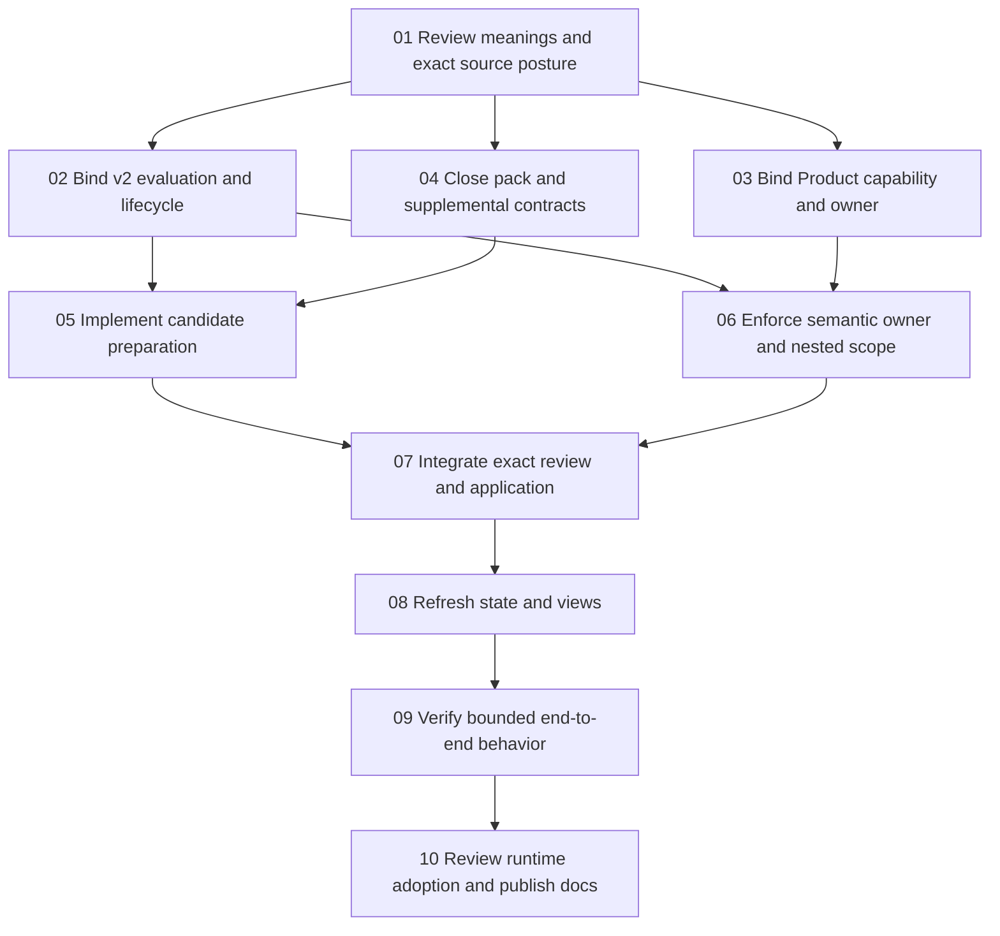

# Finish Define integration into CyberAlchemy Lab

Status: proposed, not executed or admitted. Prepared 2026-10-11.

## What this plan finishes

A user can clarify meaning with Define, inspect a frozen Definition Pack, prepare complete Lab Definition candidates, obtain the appropriate owner review, and apply only exact authorized effects. Accepted changes become visible through Project State, Context Views and Ontology Views. Reuse, unresolved questions and declined proposals remain distinguishable throughout.

The existing CLI is a runnable candidate. This plan completes its semantic and admission boundary. It does not promise migration of every historical handled record, registration of the entire imported ontology, production deployment, or live-provider quality evidence.

## Start with meaning

The live registry has **183 current identities and 189 versions**. Neither CyberAlchemy Define nor Definition Pack is a current admitted meaning. The immutable imported vocabulary contains four proposals; none becomes Lab authority by import.

Prepare these two new Definitions first:

| Definition | Question it answers | Why existing meanings are insufficient |
| --- | --- | --- |
| [CyberAlchemy Define](definitions/cyberalchemy-define/DEFINITION.md) | What outcome must Define enable, and where does it stop? | Product Capability describes capabilities generally; it does not specify this capability's required concept coverage and handling outcomes. |
| [Definition Pack](definitions/definition-pack/DEFINITION.md) | What semantic state does its output freeze for a named use? | Definition describes one normative meaning; a pack can contain reused meanings, proposed meanings and unresolved questions. A Review assesses; a Decision Bundle requests effects. Neither is this input bundle. |

These are proposed specialized meanings, not new root primitives. The Definition of Define governs the capability outcome; its Product Capability instance, Product anchor, scope and realization bindings still need separate preparation. The CLI is a realization, not the capability itself.

The drafts use the current Definition/v2 carrier and its bound Markdown generator. They are authored candidates: source posture, product ownership, admission postimages and exact decisions remain open. A source proposal is cited as candidate evidence, not relabeled as an admitted premise. The previous export-identifier-completeness specimen is a separate application proposal; admitting it is not a prerequisite to integrate Define.

### Reuse existing meanings

Use Definition, Product Capability, Method, Intent, Goal, Source, Context View, Ontology View, Role Assignment, Authority Boundary, Review, Decision Scope, Decision Bundle, Admission Transaction and the existing typed-connection and claim-support rules. Exact references and their source digests are recorded in `semantic-coverage.json`.

Do not create generic Definitions named Definition Preparation, Mapping, Semantic Approval or Definition Disposition merely to name adapter fields. Dispositions are the pack's closed four-way contract. Preparation is a Method binding. Owner approval already has a Decision and Authority Boundary.

Defer separate **Define Session** and **Define Handled Definition Registry** meanings. Their immediate requirements belong in explicit session and handling-record contracts. A resumable human/CLI work session is not automatically an Agent Session. The existing Ledger meaning is usable only with a declared entry schema, ordering, integrity, correction and reconciliation contract; no second canonical definition registry should be created. Revisit separate meanings if they become independently governed consumer concepts.

## Evidence-backed gaps

| Gap | Current evidence | Work needed | Governing meaning |
| --- | --- | --- | --- |
| G01 — capability and output meaning | Imported `definitions.json` proposes four meanings; current Lab registry has no Define/Definition Pack identity. | Review the two drafts; bind exact sources and prepare semantic admission. | Proposed Define and Definition Pack; existing Definition. |
| G02 — capability ownership and realization | CLI entry and runtime manifest exist, but do not appoint an owner or establish a Product Capability. | Bind exactly one existing Product, an applicable product owner, outcome contract and exact CLI realization. Resolve assignment gaps through owner review. | Product Capability, Capability Realization Binding, Role Assignment. |
| G03 — v2 evaluation and lifecycle compatibility | Current carrier is Definition/v2. The only Definition evaluation/lifecycle profiles under `authority/profiles` explicitly name v1. The current Definition meaning also contains a v1-specific testable condition. | Prepare explicit v2 profile successors; review the foundational testable-condition compatibility and any required Definition successor. Clarify that pre-decision eligibility allows the decision check to remain pending; lifecycle must not require an already granted admission to reach review. | Definition, Evaluation, Validation, Authority Promotion. |
| G04 — pack contract and reference closure | The Lab result schema closes the outer envelope but types `definition_pack` only as object. Session checks enforce bounded structural conditions, not every source/owner/consumer's authority. | Create a closed pack contract, explicit reference-standing checks, evidence/owner gaps, named intended use, lineage and readiness distinctions. Preserve legacy wire compatibility or version the successor explicitly. | Proposed Definition Pack; Schema, Source, Claim-Support Compatibility. |
| G05 — carrier-complete preparation | Native candidate text has normative/plain/boundary fields. Full Definition/v2 requires 21 top-level fields and three voices. Mapping 0001 is a proposal, not a CLI exporter. | Implement a preview exporter with an explicit supplemental input contract, exact field lineage and read-only review-package output. Missing owner, domain voice, sources or scope must remain missing obligations. | Definition, Method, Generated Output. |
| G06 — disposition semantics and changes | Reuse/specialize/propose/open exist, but full Lab preparation and revision routes are not wired. | Exact current reuse; separate unchanged-meaning parameter bindings from new meanings/revisions; leave open concepts unresolved; preserve partial selections. | Definition, Decision Scope, Typed Coupling, proposed Definition Pack. |
| G07 — semantic authorization enforcement | Runtime `prepare` checks top-level `scope_ref`; Definition/v2 keeps authority scope nested in `scope.authority_scope_ref`. `Store.review` provides structural preflight. | Enforce nested scope, applicable role assignment and allowed semantic effects during preparation AND application. Bind evidence into exact decision cores; fail closed on scope mismatch or revoked standing. A local operator signature alone does not establish repository Definition ownership. | Authority Boundary, Role Assignment, Decision Scope. |
| G08 — review and application closure | Define can call existing local `Store.review`. It does not create a complete Definition-specific review proposal or repository admission transaction. | Generate exact target cores, source selections, candidate digests, registry/index/drift postimages, input state and consequences. Use independent member decisions; local apply and repository admission retain distinct authority boundaries. | Review, Decision Bundle, Admission Transaction. |
| G09 — derived state and stale inputs | Existing views and epoch/expiry checks work, but the future preparation/admission path is absent. | Refresh Project State and derived lookup/views after authorized application. Invalidate stale preparation and replay against exact current sources, owner standing and carrier bindings. Register only supported typed connections. | Project State, Context View, Ontology View, Derived Refresh, Typed Connection Extension Rule. |
| G10 — adoption evidence and documentation | Candidate audit evidence exists; runtime/package adoption and semantic-output admission are separate. Upstream validator still reports source drift. | Produce successor evidence, documentation and an exact bounded adoption package. Preserve upstream findings and immutable source; do not reuse historical PASS for new bytes. | Evidence, Validation, Capability Realization Binding. |

### No silent model extension

Keep the pack as a candidate protocol output initially. Creating its Definition does not register a new Artifact Type. If later work needs independently admitted pack instances, prepare a Definition Pack Artifact Type, generator and profiles through artifact-type ownership first. The basic integration can preserve an exact pack as candidate evidence and admit only its selected Definition outputs.

Likewise, pack relationship suggestions and specialization parent references are not new global Typed Relations. A needed endpoint pair must already be allowed or go through the admitted Typed Connection Extension Rule. Ontology-local projections remain scoped to their own contract.

## Dependency plan

Contract preparation and implementation can proceed as candidates while semantic decisions are pending. Admission eligibility and accepted runtime adoption require the applicable reviewed foundations. Steps 01 and 02 may share one human checkpoint only after all exact inputs exist; their member Decisions retain independent scopes and outcomes.

| Step | Dependencies | Concrete delivery | Finish condition |
| --- | --- | --- | --- |
| 01 | — | Two reviewed Definition candidates; bounded source disposition; proposed registry/index/drift; distinction analysis. | Each exact semantic target has a recorded owner outcome. Candidate source lineage is not treated as accepted truth. |
| 02 | 01 | Definition/v2 evaluation and lifecycle profiles, foundational compatibility determination, exact mechanics/evidence bindings. | Applicable checks and pre-decision eligibility are explicit. Any required foundational revision follows its own semantic decision. |
| 03 | 01 | Product Capability instance, Product anchor, owner assignment evidence and realization-binding candidate. | One Product and scope are explicit; no CLI routing hint is treated as ownership. |
| 04 | 01 | Closed pack schema, supplemental preparation schema, field-lineage and session/handling contracts. | Every disposition has its payload and limits; unknown references have explicit standing; preview/review/consumer readiness are distinct. |
| 05 | 02, 04 | Proposed `define prepare` preview path using the existing Lab carrier and generator. | Reuse yields exact references; propose yields complete candidates or blocking obligations; semantic narrowing follows an explicit new/revised-meaning route; open remains open. No overwrites or live admission. |
| 06 | 02, 03 | Definition-specific authorization checks and decision evidence bindings in the existing review/application path. | Both preflight and application reject mismatched nested scope, unassigned owner, unauthorized effect, stale role/contract or tampered target. Enforcement changes get their own reviewed runtime binding. |
| 07 | 05, 06 | Existing runtime-proposal and Decision Bundle adapters, exact postimages and admission-transaction preparation. | Review displays each exact consequence; only the applicable exact decisions permit application. Partial pack selection does not grant authority to unselected members. Repository promotion is not inferred from local application. |
| 08 | 07 | Derived-refresh integration, current lookup/history/state and context/ontology visibility. | Accepted targets resolve from refreshed views, rejected/open targets do not appear as admitted, and stale preparations must be rebuilt. |
| 09 | 08 | Implementation verification and finite semantic assurance report; regression and failure-path coverage. | All declared integration obligations pass or remain explicitly unresolved within the release scope; no global consistency claim is inferred from finite checks. |
| 10 | 09 | Updated CLI/docs, audit, source selection and runtime manifest; exact adoption package. | Applicable owner accepts the bounded successor and docs match behavior. Live model completion is claimed only if actually exercised. |

Machine-readable tasks and dependency frontiers are in `gap-plan.json`. Planned tasks are not recorded as completed implementation.

## One continuous example

For incident **INC-1042**, an agent needs to compare an export with a fixed source snapshot for the Northstar account and `status=active` filters.

1. Define preserves the goal and intent: investigate missing rows without changing customer data.
2. The pack reuses an exact existing Incident meaning, proposes **Export identifier completeness**, and keeps any unknown account-exclusivity criterion open. Readiness for review does not require inventing that answer; consumer readiness exposes its effect on the intended use.
3. Preparation makes the proposed meaning explicit: `CompleteIds(S,A,F,E) iff RequiredIds(S,A,F) subseteq ExportedIds(E)`. It retains the account and filters; value accuracy, extra rows, agent permissions and incident closure are separate.
4. Supplemental input names the semantic owner, exact scope, three voices, source posture and consumers. The incident-command routing hint does not assign the Definition owner.
5. Existing review presents the exact Definition, its checks and proposed consequences. The owner may accept this criterion while leaving another pack concept open.
6. An authorized transaction updates only those selected targets. Refreshed views can then supply the accepted criterion to another agent; the incident remains open until its own recovery and closure requirements are met.

The existing [worked mapping specimen](../0001-definition-pack-lab-mapping/README.md) supplies the concrete JSON and synthetic 12,000-ID cases. It establishes neither a production observation nor permission to repair customer data.

## Verification to perform during implementation

These are planned obligations, not tests executed by this planning pass:

- Two exact draft meanings remain distinct from capability instances, CLI implementations, individual Definitions, Review and Decision Bundle.
- Pack cases: zero/multiple current dispositions, duplicate concept IDs, undeclared answers, unknown fields, missing intent/consumer, unresolved source/owner standing and nonempty open questions.
- Exporter cases: reuse, unchanged-meaning parameter binding, new specialization identity, revision of an existing identity, propose, open and partial selection. Compare source text with final three-voice candidates and field lineage.
- Full carrier checks: exact v2 schema, source resolution/admission, owner scope, all three voices, deterministic projection, registry/index/drift closure and every supported typed endpoint.
- Authorization cases: nested-scope mismatch, wrong or revoked assignment, operator/semantic-owner mismatch, broadened effects, stale source/HEAD/context/contract and tampered target/core/bundle bytes.
- Transaction cases: local isolation, failure recovery without partial committed effects, replay/idempotency, changed-byte decisions, rejected and unselected members, exact state/receipt consequences.
- Refreshed-view checks: accepted meaning visible; unadmitted/open meaning retains its posture; derived graph/index do not become independent authority.
- Existing numeric/boolean Calculation and selected compilation behavior remain unchanged by the mapping. Run the relevant Define/Lab regressions on exact implementation bytes when implementation verification is authorized.
- Formal non-collapse and consistency evidence must name exact interpreted clauses, assumptions, signature, finite domain or proof method, obligations, coverage and fidelity review. The separate formal-assurance project currently has a candidate static foundation; it is not a blanket assurance service for these new meanings.

## Recommended next action

Review the two proposed meanings and the v1-to-v2 compatibility determination together, then prepare their exact source, profile and registry postimages for one review checkpoint. Keep the Definition admission decisions separate from mapping-contract adoption and runtime adoption. No admission is performed by this plan.
