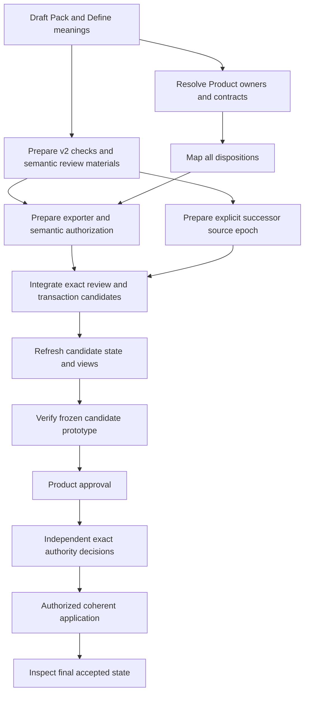

# Define integration: work mapped one gap at a time

Status: proposed work map. No implementation or admission executed.

The map expands the previous ten gaps into **67 concrete work items**. Each item names dependencies, actual input surfaces, proposed outputs, actions, applicable review routes and an observable finish condition.

## The ten work areas

| Area | Required result | Items | Detail |
| --- | --- | --- | --- |
| G01 — Define and Definition Pack meanings | Two reviewed three-voice meanings with explicit source standing and exact semantic admission targets. | 7 | [Work list](steps/g01.md) |
| G02 — Product ownership and CLI realization | One exact Product anchor, explicit owner scope, a Define capability candidate and separately evidenced CLI realization. | 6 | [Work list](steps/g02.md) |
| G03 — Definition/v2 evaluation and lifecycle | Explicit v2 profiles and foundational compatibility resolution; review eligibility cannot require its own completed admission. | 6 | [Work list](steps/g03.md) |
| G04 — Pack, session and supplemental contracts | Closed, versioned preparation contracts with complete per-disposition payloads, source standing and use-specific readiness. | 7 | [Work list](steps/g04.md) |
| G05 — Complete candidate exporter | A candidate prepare command produces complete Definition/v2 records or explicit blockers, with exact field lineage and safe output. | 6 | [Work list](steps/g05.md) |
| G06 — Reuse, specialization, proposal and open outcomes | Each disposition maps to an exact lawful output; changed meaning, application parameters and unanswered questions remain distinct. | 6 | [Work list](steps/g06.md) |
| G07 — Semantic scope, ownership and effect enforcement | Definition-specific authority evidence is checked in review, authorization and application; local operator identity is not substituted for semantic ownership. | 8 | [Work list](steps/g07.md) |
| G08 — Review packages and exact transactions | Complete exact review/apply preparations with independent member decisions, closed target sets and recoverable consequences. | 7 | [Work list](steps/g08.md) |
| G09 — Source epochs, Project State and derived views | An admitted successor becomes readable without breaking the frozen prior epoch, and only supported connections enter derived views. | 7 | [Work list](steps/g09.md) |
| G10 — Verification, adoption and documentation | Exact candidate evidence supports Product approval, distinct authority decisions and observable bounded integration. | 7 | [Work list](steps/g10.md) |

## Execution order is different from the topic numbering

The Definitions are drafted first. Their admission package needs the explicit v2 profile binding. Product/ownership, contracts, dispositions and source-epoch compatibility then feed a candidate prototype. Current prototype evidence and Product approval precede the separate exact authority decisions. Apply only the reviewed coherent target set.

This resolves an ordering problem in the coarse earlier plan: “complete semantic admission first” cannot be a prerequisite for preparing the very v2 checks needed to decide that admission. Prepared candidate contracts can be used in isolated prototypes; that use creates no authority.

The exact acyclic dependency graph is in [work-items.json](work-items.json); its frontiers are implementation opportunities, not authorization grants. All items remain planned.

## Additional work exposed by the file review

- The previous coarse plan placed semantic completion before the v2 profile binding it needs. Gap numbers are review topics, not execution order. Prepare meanings first; prepare profile/contract/prototype compatibility; obtain exact decisions once all reviewable inputs exist. The work-item DAG separates preparation from application.
- The source reader binds mutable registry equality to the D74 immutable vocabulary epoch. G09.02 prepares an explicit successor reader/profile before any authorized registry change. Never disable equality/freshness checks.
- Method Binding/v1 is a specialized Craft contract, despite the general Method Definition. G04.06 selects a compatible representation rather than assuming the carrier is generic.
- Local governance emits one owner boundary and uses the operator owner for both role and principal. G07.07/G07.08 bind actual independent roles/principals/scopes, with explicit protocol versioning.
- Generic record validation walks relation_refs; Definition/v2 exposes typed_relations. G07.05 adds explicit Definition source/consumer/typed endpoint obligations; G09.04 maps lawful graph visibility.
- The operational Challenge Contract does not explicitly list Definition as a challengeable subject kind. G07.04 selects an applicable admitted contract or prepares a bounded owner-reviewed successor.
- Existing Product/Thesis identity and governed-knowledge capability are already available as admitted source selections. G02.01 reuses the existing Lab Product/Thesis; G02.02 resolves ownership rather than inventing or borrowing a Craft-only assignment.
- The admitted prototype-first construction invariant requires current product-test evidence and eligibility for Product approval before separate authority requests. G10.02/G10.03 precede G10.05; early semantic review packages remain prepared candidates, not premature runtime authority.

## What to prepare first

1. **G01.01–G01.05:** exact source selection, final Definition Pack and Define drafts, source dispositions and distinction/fidelity obligations.
2. **G03.01–G03.06:** current-carrier compatibility, explicit v2 evaluation/lifecycle profiles, any foundational Definition successor and independent profile review targets.
3. **G01.06–G01.07:** generate exact registry/index/drift postimages and close the semantic review package.

These make the first review concrete. Continue the remaining candidate implementation work without treating preparation, review or Product approval as admission.

## Planned output boundaries

Output names inside each work item are proposed paths in future review/implementation packages. This mapping turn creates only these planning documents and their machine-readable source/work records. Existing candidate implementation paths identify source surfaces; choose successor placement and exact version before changing code. Preserve immutable import bytes and admitted implementation history.

## Deferred scope

- Independently admitted Definition Pack instances and their potential new Artifact Type.
- Separate Define Session / handled-registry semantic meanings unless later consumer requirements justify them.
- Bulk migration of the twenty historical handled records.
- Global registration of the imported business/system/bridge ontology.
- Production deployment, hosting, remote publication and live-provider outcome claims.

## Evidence and limits

[Source selection](source-selection.json) binds observed files and governing meanings. [Plan refinements](plan-refinements.json) explains changes to the earlier coarse plan. [Planning checks](planning-checks.json) covers JSON, source references, links and dependency structure only; no runtime tests or formal proof were executed.
