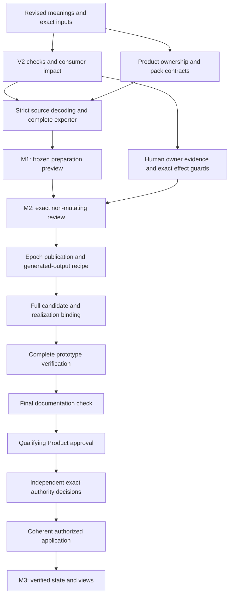

# Define integration: amended work map

Status: amendments applied to the plan; ready for plan review. Implementation, runtime verification, owner adoption and admission have not started under this revision.

The map retains the original ten areas and stable task IDs, applies all twelve audit obligations, and contains **79 work items**. Those obligations are concrete checks/contracts inside this integration, not twelve new subsystems.

## What changed

- Selected the existing trusted human-owner decision route for repository semantic admission. The CLI cannot manufacture that evidence or use a local key as global ownership.
- Required strict parsing of the exact source bytes being hashed, with Python owning new authority-record digests and signature bytes.
- Selected immutable admission bundles and one current Project State lookup visibility commit, with an explicit representation amendment and derivative compatibility surfaces.
- Separated reviewed input hashes, real owner outcomes and generated consequences to avoid future/self-referential digest assumptions.
- Added qualifying outcome guards, revision/partial-selection branches and exact retry rules.
- Required the full realization binding before prototype verification, and final documentation checks before Product/adoption decisions.
- Preserved legacy run/chat/compile/session protocols; the new preparation path uses an explicit adapter and closed Lab pack v2. V2 compilation is unsupported in this release.
- Added full declared consumer impact dispositions, bounded assurance coverage and concrete input/resource limits.
- Split the early preview freeze from the full candidate freeze, so useful output can be reviewed before the application path is complete.

The choices and their limits are specified in [DESIGN.md](DESIGN.md). [Risk resolution](risk-resolution.json) records the distinction between a resolved design and a still-pending runtime mitigation.

## The three deliverables

| Milestone | What the user receives | Boundary |
| --- | --- | --- |
| **M1 — Preparation preview** | Revised meanings, v2 preparation checks, a complete candidate or explicit blockers, generated Markdown and field lineage. | Read-only Lab inspection plus requested candidate files. No key, store provisioning, admission or selected-epoch change. |
| **M2 — Guarded review** | Exact targets, source/owner/scope evidence, independent decision requests, postimages and explicit consequences. | Review and isolated candidate fixtures; no implicit owner approval or repository promotion. |
| **M3 — Application and visibility** | Full verified candidate, final documentation, qualifying Product approval, exact owner effects, coherent application and refreshed views. | Only the dependency-closed, explicitly authorized target set is applied. |

M1 is now independent of completed governance-record generation, transaction application and successor context refresh. The full candidate and realization binding are frozen later in G02.05 before the complete verification matrix.

## All ten areas

| Area | Work to finish | Items | Detail |
| --- | --- | --- | --- |
| **G01 — Meanings** | Final Definition Pack and Define meanings, sources, assurance scope, impact and exact semantic review package. | 9 | [Work items](steps/g01.md) |
| **G02 — Product and realization** | Existing Lab Product/Thesis, applicable ownership, capability outcome, full candidate freeze and exact realization binding. | 6 | [Work items](steps/g02.md) |
| **G03 — Definition/v2** | Explicit v2 profiles, foundational Definition successor and independently scoped review targets. | 6 | [Work items](steps/g03.md) |
| **G04 — Contracts** | Closed preparation/pack/reference/readiness/session contracts, legacy adapters, Python digest ownership and limits. | 10 | [Work items](steps/g04.md) |
| **G05 — Exporter** | Bounded preparation Method, complete Definition emission, field lineage, safe publication and early preview freeze. | 7 | [Work items](steps/g05.md) |
| **G06 — Dispositions** | Current reuse, parameter specialization, changed meaning, proposal/open outcomes and selected-set closure. | 6 | [Work items](steps/g06.md) |
| **G07 — Authority** | Human-owner evidence, role/principal separation, nested scope, Policy/Challenge successors, references and outcome guards. | 10 | [Work items](steps/g07.md) |
| **G08 — Review and application** | Exact proposals/postimages, independent effects, attended repository route, publication and generated-output recipes. | 9 | [Work items](steps/g08.md) |
| **G09 — State and views** | Exact-byte source provider, successor epoch selection, old-store compatibility, lawful ontology links and bounded context. | 8 | [Work items](steps/g09.md) |
| **G10 — Evidence and adoption** | Complete matrix, full prototype results, checked docs, qualifying owner outcomes, application and read-back. | 8 | [Work items](steps/g10.md) |

Task numbers group subjects; the exact order is governed by [work-items.json](work-items.json), not by the table. The total and area counts are checked against that file.

## Audit closure in the plan

| Finding | Selected resolution | Enforcement evidence still required |
| --- | --- | --- |
| R01 | Grouped typed Pack interpretation; distinguish finite/structural/fidelity evidence. | Interpreted-model controls and exact semantic fidelity review. |
| R02 | Trusted human-owner route; no automatic repository promotion by local key. | Wrong-label/key and fabricated-human-evidence rejection. |
| R03 | Hash and parse one bounded byte buffer. | Strict decode and source-interleaving cases. |
| R04 | Immutable epoch plus one lookup commit; explicit representation/consumer amendment. | Reader/writer/crash/recovery and unsupported-storage cases. |
| R05 | Separate reviewed inputs, owner evidence and observed generated outputs. | Content dependency closure, actual recipe parity and no self-hash. |
| R06 | Python authority hash owner; typed digest kinds and original-byte transport. | Cross-runtime/number/Unicode/duplicate-key controls. |
| R07 | Realization before verification; final docs and review closure before decisions. | Evidence manifests and exact documented commands. |
| R08 | Outcome guards; rejected/deferred branches stop dependent effects; revisions invalidate evidence. | Partial selections, changed bytes and uncertain-outcome retry cases. |
| R09 | Preserve legacy consumers; explicit v2 preparation adapter; unsupported v2 compile. | Old/new prepare/compile/resume matrix. |
| R10 | Declared transitive impact inventory and exact consumer dispositions. | No unresolved incompatible required current consumer. |
| R11 | Fixed initial ceilings and explicit batch continuation. | Boundary/over-limit/timeout and coverage recomposition. |
| R12 | M1, M2 and M3 have separate bounded manifests and deliverables. | No writer/key/admission effect in the early preview. |

All twelve choices are resolved **in the plan**. Their implementation and verification remain pending; the audit's existing-runtime risks are not claimed fixed.

## The definition cohort

Three unadmitted drafts are prepared for review:

1. [Definition Pack](definitions/definition-pack/DEFINITION.md) — revised grouped formal expression and operational interpretation.
2. [CyberAlchemy Define](definitions/cyberalchemy-define/DEFINITION.md) — outcome and boundaries, independent of its CLI realization.
3. [Definition](definitions/definition/DEFINITION.md) — a successor of the existing foundational meaning, replacing its v1-only testable condition with an exact applicable carrier/profile binding.

The first two are new specialized meanings. The third is an existing identity's proposed successor, not an additional root primitive. All preserve exact lineage in [source-lineage.json](source-lineage.json). Upstream proposals are candidate evidence; no source admission or current Definition lookup change is performed here.

## Decision and iteration gates

- Completion of a review task means its outcome is recorded; continuation still requires the qualifying outcome.
- Product approval does not grant semantic, source, runtime or repository authority. Each member retains its own owner, scope, target and effect.
- Changed meaning, source, scope, target-set membership, governing contract, runtime or output recipe creates a new candidate episode and reopens affected preparation/evidence/decisions.
- A partial selection must be dependency closed; rejected and unselected meanings remain unadmitted.
- After an uncertain application outcome, inspect the committed lookup and receipt before retrying the same exact proposal/authorization.

These are explicit controls in [outcome-controls.json](outcome-controls.json). No executor or signature was created by this planning turn.

## First work to start after plan review

1. Freeze the exact selected inputs and complete the three candidate meanings/impact interpretations.
2. Prepare the v2 evaluation/lifecycle profiles and their independent review targets.
3. Close the pack/supplement/reference contracts and all disposition mappings.
4. Build the strict current-epoch source provider and candidate exporter, then show M1 with the incident example and another bounded consumer.

The account, filters, fixed source snapshot and saved output remain explicit in the incident example. A proposed identifier-completeness criterion grants neither production access nor incident closure.

## Verification and retained scope

The amended graph has no task cycles. Required guards, audit traceability, source hashes, candidate schemas and generated projections are checked as planning artifacts in [planning-checks.json](planning-checks.json). Runtime tests and formal assurance execution remain future obligations.

The first release excludes independently admitted Pack instances/new Pack Artifact Type, implicit migration of historical handled records/stores, global import of the upstream ontologies, machine-key repository promotion, deployment and remote publication. Existing private state, keys and immutable/admitted history are preserved.
