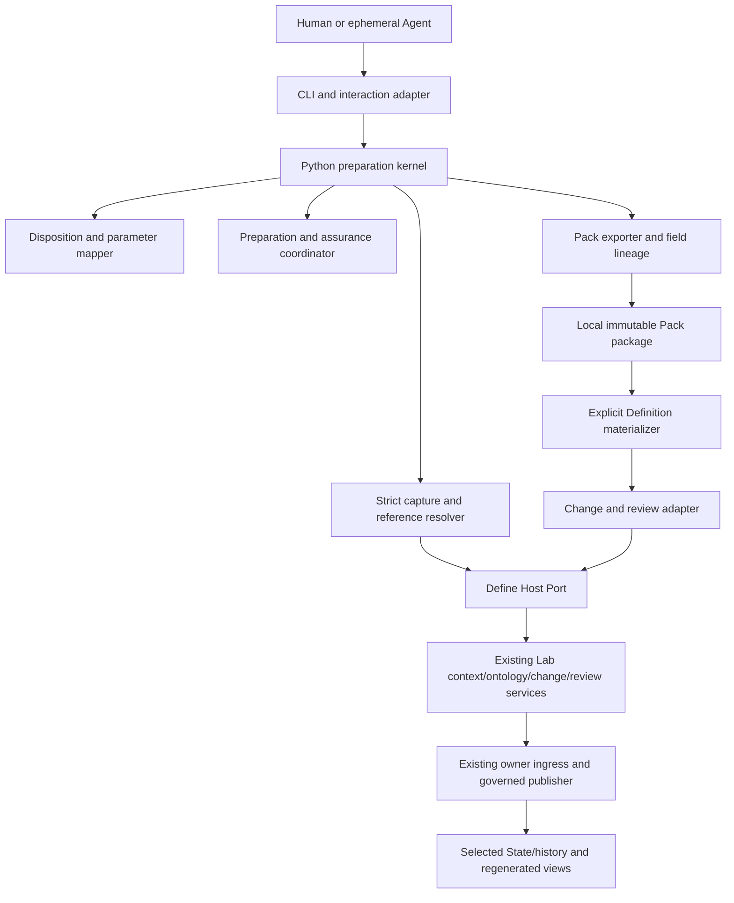

# System design

Status: proposed; authority effect none. The canonical candidate meanings and their exact acceptance limits remain in the [reviewed admission package](../../development/m1-preparation-preview/v1/reviews/admission-package/v1/REVIEW.md). This design specifies their intended software realization.

## 1. User outcome and scope

Define makes the meanings needed for a bounded Goal and originating Intent explicit. It prepares a Pack containing exactly one current disposition per declared concept: reuse, specialize, propose or open. It preserves exact sources, standing, applicability, consumer/use, unresolved obligations and validation scope.

The integrated runtime adds three concrete user paths:

1. Prepare or revise a task Pack, including applications and available assessments.
2. Select reusable proposed meanings for complete Definition/v2 materialization and exact owner review.
3. Inspect the Lab host's separately authorized application and reconstruct the result in a subsequent session.

The first implementation preserves legacy run/chat/compile/session behavior. New Pack compilation is explicitly unsupported in this release. Define does not execute incident investigations, generate follow-up work, appoint owners, maintain private long-term agent memory or decide that an incident is closed.

## 2. Integration target and selection

### Observed baseline

The current CLI directly imports runtime/v2. That provider binds the D74 vocabulary registry and cannot consume an advanced canonical registry by simply replacing its digest. A newer common candidate selects API17/family5/capture5. The maintained operator selection now points to revision3, with independent Base, Action and Governance branches. It is candidate technical evidence; complete current qualification and genuine operational issuer authority are still pending.

### Chosen target for the successor

Target the **existing API17 protocol and selected host interfaces**, through an explicit Define Host Port. Pin the reference API/source/profile/schema/operator bindings in the design source baseline. Never discover a backend by selecting the highest version directory.

An installation-specific runtime profile selects the actual host implementation, exact executable and protocol bindings, selected source/current-State contract, installed dependency closure, available operations, authority posture, transport limits and credential locators. It contains no embedded private key, inferred owner assignment or automatically renewed grant. Only a separately reviewed selection may change it.

The port can use an authenticated Base reader for preparation if its declared operations suffice. Action/Governance branches are needed only for their selected later effects. `serve.py` alone is not evidence that a full composite is running. The actual host advertises and enforces its surface; a missing operation returns an explicit unsupported result.

A source/profile change produces a new profile selection and recapture. Do not patch frozen v1/v2 runtime bytes, relabel old receipts, or silently change existing stores. An epoch-aware host/provider successor must be qualified before the new registry/binding revision is used operationally.

## 3. Components and ownership



These arrows represent software dependencies, not proposed global Relation Kinds.

| Component | Responsibility | Boundary |
| --- | --- | --- |
| CLI/interaction adapter | Commands, prompts, legacy dispatch and human-readable results | Does not determine source standing, owner identity or authority hashes |
| Strict capture/resolver | Bounded original-byte reads, exact references/selectors, source standing and currentness | No digest refresh to conceal drift; no arbitrary source code import |
| Disposition mapper | One matching payload per concept; explicit application versus changed meaning | No inferred meaning change from different task values |
| Parameter resolver | Exact declared names/types, required set, value provenance and applicability | No undeclared parameter invention or automatic context-to-parameter coercion |
| Preparation coordinator | Structural/reference/readiness checks and exact requested assurance evidence | It does not turn missing semantic evidence into PASS |
| Exporter | Canonical Pack, deterministic human view, field lineage and immutable package manifest | Local output is not Project State or shared authority |
| Definition materializer | Complete Definition/v2 only for selected reusable meanings | Does not materialize every application, assessment or unresolved concept |
| Change/review adapter | Translate selected targets to existing host proposals, validation and independent review requests | Does not synthesize owner decisions, sign for a human or apply writes |
| Host Port | Exact runtime/profile selection, authenticated transport and response/currentness validation | Private custody and branch authority remain in the host/operator |
| Lab host | Sessions, permissions, durable state, owner ingress, application, publication and recovery | Define does not implement a competing host or governing ledger |

## 4. Proposed implementation layout

The following paths are future implementation targets; this design does not create them.

```text
implementation/define-cli/v2/
  bin/define.mjs                   command dispatcher
  src/legacy-adapter.mjs           unchanged v1 protocol delegation
  src/prepare-client.mjs           bounded opaque-byte transport to Python
  python/define_runtime/
    cli.py                        new command dispatcher
    decode.py                     strict single-read capture and encoding
    references.py                 exact selected source/selector resolution
    host_port.py                  protocol adapter and authenticated host boundary
    dispositions.py               reuse/specialize/propose/open mapping
    applications.py               parameter contracts, bindings and revision lineage
    assessments.py                imported assessment binding checks
    assurance.py                  scoped check/provider evidence coordination
    prepare.py                    deterministic preparation Method realization
    materialize.py                complete selected Definition/v2 emission
    review_adapter.py             Lab change/review request construction
    export.py                     no-replace local package publication
  schemas/                        closed new preparation/Pack/result contracts
  runtime-manifest.json            exact implementation/dependency bindings
```

The existing Lab-owned Definition/v2 generator and selected profile/schema validators are reused by exact digest. Domain-specific assessment code and arbitrary LLM-generated formulas are not loaded by the preparation process. Host-owned source-epoch/publisher changes stay in their own successor package, not hidden inside `host_port.py`.

## 5. Runtime responsibility split

| Define may request | Existing Lab service | Effect ceiling in preparation |
| --- | --- | --- |
| Inspect source selection/catalog and exact artifacts | `lab.status`, `catalog.get`, `artifact.inspect`, `artifact.query` | Read selected authorized bodies/metadata |
| Obtain context and session state | `context.get`, `session.open/inspect/close` where the selected profile permits | Ephemeral Session/resource scope only |
| Obtain selected ontology understanding | Existing Context/Ontology View or declared query/projection route | A derived view, not invented edges or admission |
| Build and validate selected target changes | `change.prepare`, `change.validate` | Candidate proposal/evidence in the host's declared preparation custody |
| Prepare exact owner review | `proposal.review` | Pending review/checkpoint, no owner outcome |
| Inspect uncertain outcome | `operation.inspect` | Read exact host journal/receipt evidence |
| Resolve/apply later selected effects | `checkpoint.resolve`, `admission.apply` through the separately authorized host workflow | Actual host owner/scope/policy/effect checks; not an automatic Define command |

The port's public method names are internal interface methods, not new Lab API operations. A missing lawful operation is a reported adapter gap. A global protocol extension is a separate reviewed change only if the existing surface cannot express a necessary effect.

## 6. Data and semantic boundaries

### One task, one normal Pack output

The Pack owns declared concepts, working meanings, applications, optional imported assessments, value/evidence provenance, gaps and revision lineage. It does not own the reusable semantics of an exact admitted Definition. The existing semantic candidate and source digests are retained even when the Pack later becomes stale for a new use.

### Four dispositions and materialization selection

- **Reuse:** one exact current admitted meaning at capture plus applicability. An exact historical/candidate meaning may be preserved as context, but cannot be labelled current admitted reuse.
- **Specialize:** explicitly choose `application` or `meaning-change`. The former binds declared parameters with unchanged meaning. The latter is a new or successor working proposal, unadmitted by default.
- **Propose:** an embedded task-local meaning, unless selected for complete reusable materialization.
- **Open:** a question, reason, affected use, owner route or ownership gap, and continuation. It may be a conforming Pack outcome while blocking a later use.

Materialization is a separate request naming the selected working meaning/revision/digest, new-identity or exact-successor route, intended authority scope, purpose and applicable owner route. Missing requirements produce a field-level gap. Do not fill full Definition fields with the same prose just to satisfy schema presence.

### Parameters must be declared

Definition/v2 has no general top-level parameter field. The implementation must not add one silently. For an existing Definition, a mechanical parameter contract binds the exact semantic record and exact clauses/notation that declare the names/types and required set; any necessary fidelity/owner qualification is recorded. It can be carried inside the Pack as preparation material, not a new independently admitted Artifact Type.

If those declarations cannot be established, record `parameter-contract-unresolved`. A task reference or account label can remain context metadata without claiming that Work or Incident declares a corresponding parameter. A language model's extraction alone cannot create an authoritative parameter contract.

For a working meaning, its explicit parameter declaration travels with that exact local meaning. The same names/types/applicability checks apply; its standing remains `working-proposal`. This allows the incident criterion's S/A/F/E application without promoting it.

### Assessments remain independent

Define imports available assessment records and verifies their exact application/input/evidence/producer/profile bindings and stated execution posture. Preparation does not execute the assessment Method. A caller-supplied result or counts never become a completed Evaluation merely because the record has the right shape.

If required method/execution evidence is missing, retain the reported payload as unverified with explicit consumption blockers, or reject it if its bindings are invalid. Optional absence is valid. A structural PASS is not the assessment's domain PASS. Any separately selected domain Method execution belongs to Work/the host's Action route.

## 7. Source and authority invariants

1. Capture one bounded original byte buffer and hash/strictly decode/parse that same buffer. Later currentness checks compare, rather than substitute, bytes.
2. Keep original-source byte digests, new canonical record digests and host-defined decision-core digests distinct. Python owns new record encoding; the host owns its exact protocol/core encoding.
3. Resolve every selected reference against its declared root and digest/selector. No directory inference, implicit latest selection, symlink escape or arbitrary schema network retrieval.
4. Freeze source, executable/profile/schema/generator, intended use, concept set and dependencies for the preparation revision. Changed inputs require new preparation or a separately bound current-use assessment.
5. A local output, valid schema, model answer, routing receipt, owner label or local signing key grants no semantic admission or execution permission.
6. New normative meaning/source/scope/selection changes invalidate affected materialization/evidence/review. Unchanged frozen history is preserved.
7. The owning Pack identifies application/assessment revisions without requiring standalone task files. Historical external locators still need valid retention/custody.
8. Machine agents end with their Sessions. Saved draft work is an explicitly persisted work record, not private durable machine memory or automatically admitted Project State.

## 8. Local persistence versus governing publication

### Local preparation package

The exporter writes only a requested new output directory outside all selected input/source roots. It stages a sibling directory, writes bounded members and generated views, and commits it with no replacement under the declared local filesystem guarantees. It rejects existing targets and unsupported no-replace semantics; a check-then-rename sequence alone is not sufficient. A failure retains identifiable owned staging for inspection or declared cleanup and never deletes foreign material.

The package manifest binds members, excluding itself. `pack.json` contains no self/containing-manifest digest. Embedded references use stable local IDs/revisions and selectors plus selected semantic-entry digests; external references bind the exact member/source bytes. Complete-package digests live in an outer receipt or future reference.

### Governing publication

The host stages an immutable dependency-closed epoch from reviewed inputs and actual owner outcomes. It holds its cooperative writer lock, rechecks expected prior selection, validates/fsyncs staged material, publishes immutable members without replacement and atomically commits the current lookup. Compatibility registry/index/drift surfaces are derived after the selected pointer commit. Readers pin one selected epoch for the operation.

This requires the existing explicit representation amendment, per-entry carrier/binding resolver and required consumer compatibility. Define cannot implement these by merely updating a mutable registry file. Crash/retry/receipt/current-pointer inspection and recovery remain host-owned. A semantic reversal needs a separate successor/withdrawal effect, not deletion of an admitted epoch.

### Durable Pack retention

The first release does not add a Definition Pack Artifact Type. For an explicitly selected durable work result, the host can retain the immutable package bytes through its existing custody/material mechanism and prepare a Source/v1 record whose `locator` and `content_digest` bind that package. An Evidence Set/v1 can list the selected source/items and their coverage/limitations; the relevant Work revision can name those existing record refs in its input/output/evidence fields.

These are separately selected existing-carrier targets with their own applicable owner scopes. A Source record establishes a selected byte/provenance reference, not admission of the Pack's working meanings or assessment results. Resolve the actual reference/selector/retention contract and host support before enabling this path; an unsupported locator or missing owner is an explicit persistence blocker, not a reason to invent a Pack carrier or store arbitrary data under an unrelated schema.

A subsequent agent resolves the selected permitted Source/Evidence/Work records from Project State, checks retained package bytes and local selectors, and receives a derived bounded view. Local draft files alone do not establish durable Project State. Applications and assessments remain embedded; no per-application Source record or semantic admission is inferred.

## 9. Compatibility and adoption

- Keep `implementation/define-cli/v1/`, its552-row manifest and original protocols frozen.
- The proposed v2 dispatcher delegates existing command names and options to the exact selected v1 entry; stdout/stderr/exit status and legacy artifact protocols are preserved. New commands use disjoint parsers and never silently fall back on failure.
- Resume a legacy durable session only through its original handler. An explicit import can create a new v2 work revision with lineage; missing fields remain gaps. No automatic historical Pack/store migration.
- Legacy numeric Calculations and compile behavior remain separately qualified. Do not coerce the new Pack into the old compiler contract. `compile` of the new schema returns unsupported before output/effects.
- No launcher default switch is performed by this design or by a local preview. Adopt the exact successor only after its required realization, qualification, owner/profile and documentation evidence is selected.

## 10. External gates retained

| Gate | Candidate work can proceed | What still blocks the later claim |
| --- | --- | --- |
| Semantic/profile owner effects | Explicit candidate fixtures and preview | Actual adopted standing and applicable review/admission eligibility |
| Common operator/live credentials | Saved public snapshot provider and inert port contract work | Genuine current authorized host operation, complete session/caller qualification |
| Registry/source representation | Exact proposed postimages and provider successor | Accepted representation, required consumer compatibility and coherent visibility |
| Parameter/source fidelity | Explicit proposal examination and recorded gaps | Authoritative application/reuse without qualified declarations |
| Assessment Method/provider | Binding/shape validation of supplied records | Completed or trustworthy domain assessment claim |
| Craft baseline/layout | New Pack preparation independent of legacy compilation | Clean-checkout legacy compiler integration and release evidence |

These are explicit dependency gates, not requests for new foundational definitions. The design does not make a candidate gate effective by describing it.
