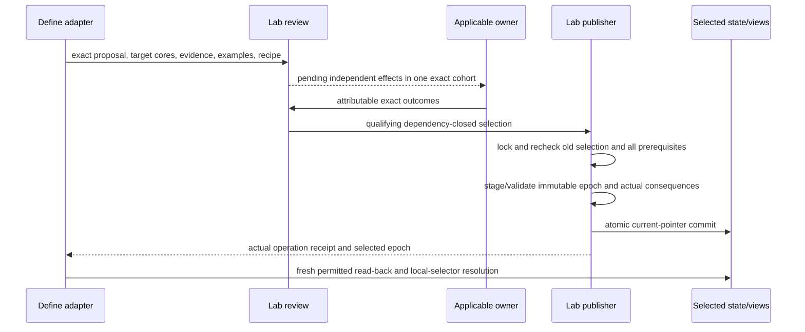

# Flows and failure behavior

Proposed software behavior; no executable or owner effect created by this design.

## 1. Prepare

Proposed command after the v2 implementation exists:

```text
node implementation/define-cli/v2/bin/define.mjs prepare \
  --input request.json --runtime-profile selected-profile.json --out NEW_DIRECTORY
```

For L0 the selected profile explicitly uses captured public source/context. L1 uses a real selected authenticated host. These are different evidence modes, never fallback aliases.

1. Decode the bounded request and exact profile. Reject ambiguity/invalid fields before opening a host or writing output.
2. Verify exact selected executable/protocol/dependency/profile bindings and obtain the declared source/context cut. Keep standing and freshness separately.
3. Capture each source/evidence once; verify original bytes/selector/permission and source standing. Store only authorized exportable bodies or lawful exact retained refs.
4. Validate unique required concepts and exactly one matching disposition for each.
5. Resolve parameter declarations and explicit bindings. Keep context labels as context when the meaning does not declare them as parameters.
6. Import optional existing assessments; verify bindings and record method/producer/execution gaps without running domain code.
7. Run scoped preparation checks and declared assurance-evidence verification. Distinguish structural PASS, source/fidelity evidence, intended-use readiness and domain outcomes.
8. Recheck mutable/profile/source currentness. Changed selected inputs invalidate current-use readiness; do not recompute an old digest to hide drift.
9. Produce Pack, deterministic human view, capture/readiness/lineage reports and no-replace local package manifest. Close owned resources even on failure.

### Local outputs

```text
NEW_DIRECTORY/
  pack.json                 one complete task Pack
  PACK.md                   generated reading view
  capture.json              exact source/context/profile/standing cut
  readiness.json            named-use results and explicit gaps
  lineage.json              field sources, entry revisions and selected changes
  evidence/                 only selected exportable exact evidence/receipts
  manifest.json             member digests; never includes itself
```

One Pack contains all applications/assessments. A failed attempt may leave only an attempt diagnostic and declared owned staging; it must not label a partial body a conforming Pack.

## 2. Revise/resume

A preparation revision is immutable. Resume accepts its exact manifest and a new attributable input/supplement; changed intended use, concept handling, meaning selection, parameter/input epoch or contract creates a new revision with predecessor/reason and field delta.

The new revision rechecks current inputs. Historical evidence remains historical and can still be inspected; it cannot be refreshed by changing a date. Legacy sessions resume with the legacy handler; an explicit import produces a new v2 revision, with missing fields visible.

Saved work is not persistent agent memory. On a fresh Session, the authorized agent reconstructs context from the relevant selected durable state/work records and permitted captured sources. It does not inherit the previous machine instance or credentials.

## 3. Materialize selected reusable meanings

Proposed command:

```text
node implementation/define-cli/v2/bin/define.mjs materialize \
  --package FROZEN_PACK --selection selection.json --out NEW_DIRECTORY
```

1. Verify the exact Pack, local selectors and source/currentness obligations for materialization.
2. Resolve each explicit identity/new-or-successor choice, purpose/scope and applicable owner route. Check the selected set is dependency closed.
3. Use exact source clauses and explicit authored supplement to prepare all required Definition/v2 fields. Record every field's source and any changed normative meaning.
4. Validate the selected Definition schema and deterministic generator/voice projection. Check source/connection/consumer/drift and applicable assurance obligations; missing standing/evidence remains a blocker.
5. Emit complete selected candidates with generated views and a materialization manifest. Incomplete candidates receive field-gap reports, not fake complete bodies.

This prepares candidate artifacts, not shared admission. No app/assessment is materialized just because it was used repeatedly. Meaning unchanged plus different values yields an application, not a successor Definition.

## 4. Prepare host review

Proposed command:

```text
node implementation/define-cli/v2/bin/define.mjs review-prepare \
  --materialization FROZEN_MATERIALIZATION --runtime-profile PROFILE --out NEW_DIRECTORY
```

1. Verify the source/profile/base cut, actual applicable profile/carrier standing and current role/scope sources. Bind exact target membership and output recipes.
2. Place only selected permitted bytes into the host's existing preparation custody/Vault through its declared interface. This requires preparation permission but does not mutate governing state.
3. Translate complete Definition targets and separately selected Source/Evidence/Work retention targets into existing change-proposal headers and exact body bindings.
4. Ask `change.prepare`/`change.validate` to compute actual target cores and outcomes. Preserve exact original message/body bytes.
5. Ask `proposal.review` to independently revalidate and prepare its declared single final checkpoint with independent role members. Show revised definitions, examples, consequences, gaps and exact inputs.
6. Return pending review refs and local reading material. `owner_outcome` and `applied_effect` remain unset.

The initial cohort follows the selected host all-or-nothing profile. A requested partial target selection starts a new dependency-closed frozen review cohort; an approval bound to the old package is not silently transferred.

A caller-supplied `approved:true`, actor/owner label, signing key or old Decision cannot fill a real owner outcome. Repository semantic admission and current native runtime authority remain separately scoped and checked.

## 5. Authorized application and visible state

This is an existing Lab-host workflow, not an automatic post-step of `prepare` or `review-prepare`.



Required outcome order: adopted prerequisite meanings/types/profiles and scope qualifications → current actual subject evaluation → exact independent owner selection → qualified application → verified effective source/current-State visibility. Prefix checks are not full lifecycle PASS.

The host preserves semantic/governance history and predecessor bytes. Compatibility mirrors follow the committed immutable epoch. A new Session reconstructs selected results through fresh views; session memory and old grants are not copied.

## 6. Retry, interruption and concurrency

| Condition | Required result | Continue only when |
| --- | --- | --- |
| Source/profile/input changed during preparation | Stale/incomplete attempt or historical inspection-only output | New capture and affected checks/lineage revision |
| Missing parameter declaration | Explicit gap; binding not fully established | Exact declaration/qualified interpretation or revised meaning supplied |
| Undeclared/wrong parameter value | Invalid input, no conforming application | Corrected new request/revision |
| Optional assessment absent | Valid Pack, no assessment claim | No need to invent one |
| Assessment claims a different input/evidence/producer | Reject invalid binding; do not retain it as verified | Exact corrected records or explicit unverified report with honest gaps |
| Open concept | Conforming `open` payload; affected use blocked | Named owner/meaning evidence resolves the question |
| Assurance unsupported/timeout/untranslated clause | `not-evaluable` for the required obligation | Supported exact provider/evidence or narrower declared claim |
| No current authenticated host/profile/permission | Block live operation; no automatic offline fallback | Explicit valid profile/channel or a separate snapshot-mode request |
| Context/Session expired | Refusal; cleanup; preserve diagnostic | New actual Session/context capture and revalidated request; no silent clock extension |
| Host constructor exceeds ordinary bridge timeout | Timeout/incomplete; close only owned resources and inspect uncertain state | New reviewed timeout/profile or corrected bounded implementation |
| Output directory already exists | No replacement | A new explicit output target |
| Two local exporters race | Exactly one no-replace publish succeeds | Loser retains/reports its owned staging; never deletes winner/foreign data |
| Review target/source/schema/scope changed | Old checkpoint no longer qualifies | New exact cohort and affected owner/evidence review |
| Owner revise/defer/reject | Dependent effects stop; independent history preserved | Qualifying exact outcome for a new/current dependency-closed cohort |
| Application response lost | `outcome-unknown`, not failure/success guessed | `operation.inspect` plus committed pointer/receipt establishes state |
| Writer interrupted before pointer commit | Host reports uncommitted/staging; old epoch remains selected | Recovery through declared owned staging protocol |
| Writer interrupted after pointer commit | Committed epoch retained; missing mirrors regenerated | Exact receipt/state read-back, no duplicate reapplication |
| Source lineage or retained body unavailable | Inspection/gap report, no complete provenance claim | Exact recovery or explicit compatible successor scope |

A timeout is not permission to retry a governing operation with a new identity. The host's idempotency/authorization/receipt contract governs uncertain retry. Same request ID with different bytes is rejected; same exact successful operation returns/inspects its existing result, not another effect.

## 7. Checkpoints and dependent work

| Checkpoint | What it establishes | What it cannot establish |
| --- | --- | --- |
| Frozen source/context | Exact selected historical/current cut and permitted use | Meaning truth or permission to apply |
| Prepared Pack | Complete declared handling and honest named-use readiness | Exhaustive discovery or domain assessment execution |
| Materialized Definition | Exact complete candidate and field lineage | Actual profile adoption or semantic admission |
| Pending review | Independently revalidated exact targets and owner requests | Genuine owner outcome |
| Selected owner effects | Exact qualifying independent decisions in scope | Applied state without confirmed application |
| Committed epoch/read-back | Exact selected effects visible through qualified current state/views | Product value, incident closure or broader release |
