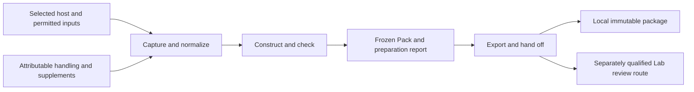

# Smaller proposed implementation design

Status: proposed repair; no semantic or operational admission.

## Abstraction levels

| Level | Unit | Closure |
| --- | --- | --- |
| System objective | Define integrated with Lab context, review and later reconstruction | Full operational handoffs remain FLAG |
| User operation | Prepare or revise one host-bound task Pack | Requires real permitted capture for live acceptance |
| Pure behavior | `prepare(request, captured_bundle)` | Conceptual closure PASS |
| Implementation anatomy | Files, modules and language layout of compatible pure transformations | Deferred until behavior/reuse evidence; Python authority-byte ownership retained |

The selected unit is the pure behavior nested within the user operation. It is not a replacement for the system objective.

## Three responsibilities



Arrows describe processing, not new ontology relations. The three responsibilities need no services of their own.

### Capture and normalize

The concrete adapter pins actual host/source/profile/schema/dependency and permission observations. Read and hash the same bounded original buffers, preserving digest kinds and exact selectors. Never parse and reserialize source bodies in Node before Python's authority-byte boundary.

The captured bundle records three populations:

1. **Host members:** selected exact source/cut members with the actual host's standing and capture observations.
2. **Local supplements:** attributable candidate meanings, handling and task values. No inherited host standing or epoch membership.
3. **External evidence:** separately identified producer, method, exact bytes and execution/claim limits.

A claimed local copy of a host member must match its exact binding. Permission and freshness observations are scoped evidence, not grants created by Define. The interaction adapter supplies attributable explicit handling; unsupported authoring assistance is reported rather than silently claimed.

### Construct and check

```text
prepare(explicit_request, captured_bundle)
  -> frozen Pack + preparation report
  or explicit blocking diagnostics, without a falsely complete Pack
```

Inputs name Goal/Intent/use, bounded concepts, handling, source selections, parameter declarations and optional independently supplied assessments. Output includes one disposition per concept, exact lineage, applications/task values, gaps, preparation-time readiness and a deterministic reading view.

Preserve these semantic distinctions:

- reuse / specialize / propose / open;
- application of unchanged meaning / changed meaning requiring its own proposal;
- supplied assessment / actual Method execution;
- working proposal / current admitted standing;
- preparation-time readiness / subsequent current-use observation.

An `open` concept can be a valid recorded outcome while blocking a particular use. No kernel inference fills missing owner authority, governing declarations or completed evaluations.

A later currentness observation does not silently change the Pack's intended use. Changed selected input, intended use, payload, concept set or meaning follows the reviewed rule for a new frozen revision with lineage.

### Export and hand off

Write a new immutable package using bounded staging and supported atomic no-replace publication. Existing output, unsupported filesystem semantics or incomplete output are explicit failures. Reuse proven publisher mechanics only through a safely selected entrypoint; do not blindly import a script with top-level CLI effects.

Explicit materialization selects only reusable working meanings for complete Definition/v2 emission. The host retains ownership of review, actual authorization, signing, publication and recovery. New Pack compilation and default launcher adoption remain outside this first integration path; legacy commands use their original selected handler.

## One incident through the smaller unit

Use the original INC-1042 example without upgrading its synthetic evidence scope:

| Input | Meaning in preparation |
| --- | --- |
| Selected Incident and Work references | Reuse only if exact current standing/applicability is actually established at capture |
| Local identifier-completeness criterion | Working proposal: every identifier required by fixed snapshot S, account A and filters F appears in extraction E |
| Application values | `S=S-1042`, `A=Northstar`, `F={status:active}`, `E=E-1042`; remain inside the Pack |
| Separately supplied synthetic assessment | Required 12,000; present 11,800; missing 200; FAIL, only within its recorded fixture limits |
| Account exclusivity | Open; identifier presence does not establish absence of extra/foreign IDs |

The normal result is **one Pack** with a local proposed meaning and application, not a new shared Definition for Northstar. If only the numbers arrive without producer/execution evidence, the report retains them as unverified and blocks the governed-evaluation claim.

Later, suppose a source prerequisite changes. A fresh use observation names this Pack's exact digest and refuses the affected use; it leaves the original FAIL and historical capture unchanged. A new extraction yields the applicable new application/Pack revision, not a silent edit. Selecting the general criterion for shared use starts the following separate handoff.

## Staged review handoff

This is one contract to close, not a new service. It is **not yet qualified** by this critique.

1. Freeze selected materialized bodies, exact source cut/profile/carrier/schema bindings, scope and proposed target identities.
2. Construct selected target metadata and proposed stable-core bytes using the exact host-owned pure encoding/target mechanics, including the selected custody representation. These are proposed control inputs, not owner signatures. Do not independently approximate the digest algorithm.
3. Obtain actual applicable provisioning permission and review routing under a supported selected policy. Record the historical authorization check as a compatibility dependency; do not treat its fixture binding as new authority.
4. Provision a **new immutable workspace/profile** containing exact bodies, metadata, schemas, proposed cores and permitted review-routing inputs. Never modify the active workspace manifest or invoke private Vault internals to inject content.
5. Build proposal envelopes and regenerate workspace-bound evidence/object references in that workspace. Body/core hashes may remain unchanged when their inputs are unchanged; generated object locators cannot simply be copied across workspace identities. A new workspace does not necessarily change the source cut: compare it explicitly.
6. Invoke supported `change.prepare`/`change.validate` and `proposal.review` as applicable. The host independently recomputes/verifies exact targets, cores, cut, routing, permission and complete cohort. Lazy routing lookup does not make routing mutable or waive its preselection.
7. Restage/revalidate affected material if source/schema/core/scope/routing inputs change or permission expires. Retain the original Pack and history. Actual owner outcomes and application remain separate authorized host effects.

**Unclosed bridge:** prove the supported nonfixture provisioning/policy route and actual review eligibility. The current exact historical authorization check cannot be bypassed by the adapter. If no existing route suffices, a separately governed host successor is required; do not add a generic upload operation by assumption.

## Retention and the next Session

Proposed identity convention:

```text
Source.content_digest -> exact root member-manifest bytes
root manifest        -> exact digest/locator for every required member
required closure     -> pack.json + required view/lineage/evidence members
```

The manifest excludes itself; Pack content does not include its containing manifest digest. Exact original members are retained, not regenerated into another Pack. One selected permitted resolver must traverse and verify the full required closure. A locator without that resolver is an unresolved dependency.

The existing Source/Evidence Set/Work carriers may describe the retained result if their selected contracts and owner routes permit it. This does not introduce a Definition Pack Artifact Type, a second governing store or a new admission rule. Actual durable custody, current-State publication and cold reconstruction still need evidence. Temporary review workspace objects alone are not long-term Project State.

A subsequent ephemeral agent gets its durable knowledge through selected Project State and Context/Ontology Views. Missing retained members produce exact gaps; private Session memory is not a fallback.

## Recomposition and acceptance

| Boundary | Required episode | Present status |
| --- | --- | --- |
| Pure preparation | Exact frozen inputs → complete Pack/report or truthful blockers | Coherent design; no execution in this review |
| Live preparation | Actual permitted host capture → same core → Pack, with expiry/stale refusal and cleanup | Depends on selected host/provider/caller qualification |
| Materialization/review | Explicit selected meaning → complete body → staged handoff → independently checked pending review | Ingress/policy/core recipe remains to qualify |
| Authorized publication/reconstruction | Actual owner effects → host epoch/custody → fresh Session resolves required closure | Host, representation, consumer and retention gates remain |

This makes the missing joins visible. Full recomposition is **FLAG**, not PASS: a smaller pure unit does not prove the external joins. The existing 79 work identities remain in force.

## Evolution and expiry

Concrete current pressures: legacy/new contract coexistence, capture versus subsequent use, candidate versus host custody, and later selected review. Keep boundaries for these. Defer multi-host registries, plug-in assessment engines and separate services until an actual second variant demands them.

Revisit this repair if the selected host/protocol/source representation, reviewed Pack meanings, C06 encoding contract, permission model or retention route changes. The result does not expire into authority or implementation approval.
