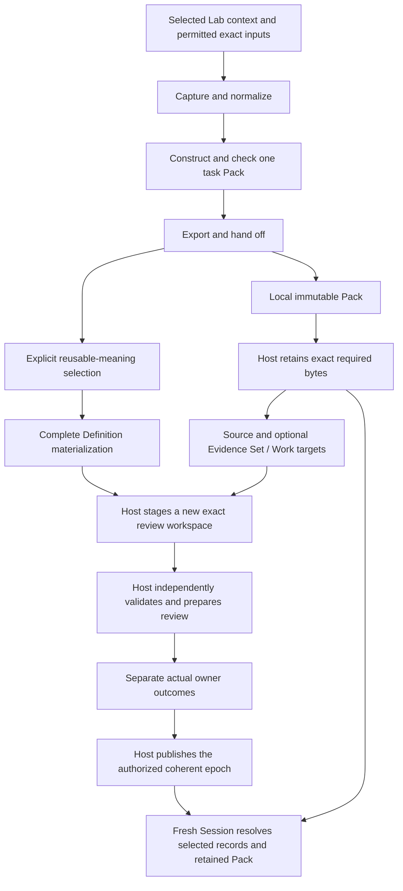

# Define runtime integration — revised complete design

Status: proposed design for review before implementation. Authority effect: none.

This revision applies the [two-round Distill result](../0007-runtime-design-distillation/README.md). It is the complete proposed implementation-design successor to [0006](../0006-runtime-integration-design/README.md). Earlier packages and reviewed meanings remain frozen. Operational selection and admission are separate later effects.

## The complete path



These are processing dependencies, not new ontology relations. Local preparation is useful with an empty materialization selection. Retention is explicitly selected; it does not admit the Pack's embedded working meanings.

## The smaller preparation unit

```text
prepare(explicit request, exact captured bundle)
       → frozen Pack + preparation report
       or truthful blocking diagnostics
```

Three responsibilities organize the implementation: **capture and normalize; construct and check; export and hand off**. No service per disposition, parameter map or assessment is required. A concrete adapter targets one selected Lab installation; a generic backend framework is deferred.

## The two gaps are now specified

| Gap | Design resolution | Software status |
| --- | --- | --- |
| New candidate bodies cannot enter an immutable review Vault | Host-owned stager computes proposed metadata/cores with selected host mechanics, verifies scoped permission, publishes a new immutable workspace and produces exact selection pins. Host review then independently recomputes the proposal. | Required successor implementation; not present merely because API17 exists |
| A saved manifest does not guarantee later reconstruction | Host-owned persistent custody stores the exact manifest root and complete required member set. Publication of a completion receipt is the custody commit point. A bounded resolver checks the whole closure, then restores exact bytes/selectors. | Required successor implementation; temporary Vault objects and restricted package import do not supply it |

Both mechanisms have inputs, algorithms, permission checks, failure/recovery behavior, ownership and acceptance criteria in this package. **Their design contracts are closed; their implementation, deployment and operational qualification remain pending.** No runtime success is inferred from document review.

## Read the full design

| Question | Document |
| --- | --- |
| Components, dependencies, ownership and complete lifecycle? | [System design](DESIGN.md) |
| Exact preparation, Pack, reference, encoding and readiness contracts? | [Contracts](CONTRACTS.md) |
| How do new bytes become an exact pending owner review? | [Review handoff](REVIEW-HANDOFF.md) |
| How are bytes retained, linked to Project State and reconstructed? | [Retention and reconstruction](RECONSTRUCTION.md) |
| How does INC-1042 pass through the whole path? | [Worked example](EXAMPLES.md) |
| What changed, what remains gated and what must be demonstrated later? | [Design review and delivery](REVIEW.md) |
| Which earlier obligations and sources remain in force? | [Work crosswalk](work-crosswalk.json), [source baseline](source-baseline.json), [closure register](closure-register.json) |

## Required host extension

The integration requires one explicitly selected **host successor with staging, scoped review permission and retained-material support**. It is a versioned implementation extension, not an additional governing ledger, foundational Definition or Pack Artifact Type. Its behavior is specified here; no executable successor is created by this revision.

Existing API17 read/context/prospective-validation/review mechanics are the source-bound reference. Its historical one-shot authorization checks, fixed source-provider bindings and temporary workspace custody cannot be silently relabelled as the new operational route. The successor must rebind its full source/schema/profile/dependency closure and be explicitly adopted for the intended scope.

## Before implementation

Review this package as the revised design. The first executable acceptance named **live integration** must use a genuinely permitted selected host capture, produce a Pack, refuse stale/expired use and close its owned Session resources. Fixture-backed core work can precede it with its narrower label.

No implementation, tests, credentials, private operator state, actual owner decision, runtime adoption or governing application was changed during preparation of this design.
