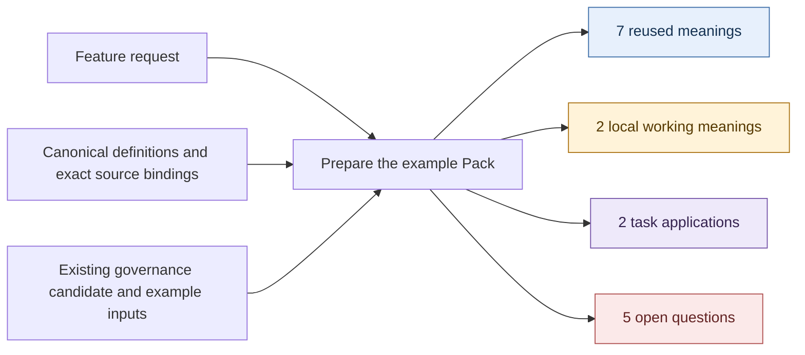
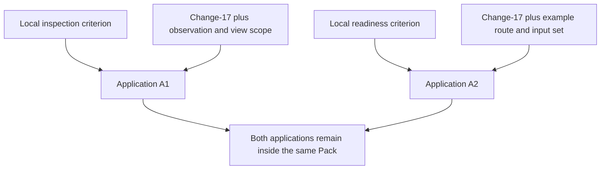
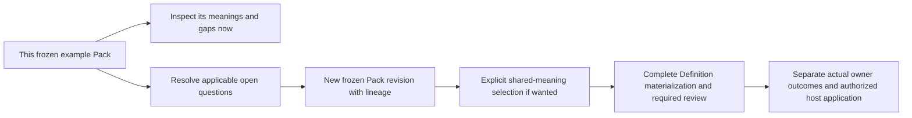

# Governance workspace — the actual example Pack

**Pack:** `pack:GOV-001-governance-workspace` · **Revision:** 1 · **Result:** prepared with gaps.

This is a concrete, manually prepared example Pack. Its seven reused meanings point to exact current entries in the captured canonical repository registry. Change-17 and its route/checklist are authored examples. No successor-runtime run, domain assessment, owner outcome, shared admission or implemented feature is claimed.

Open the complete [pack.json](pack.json), [example inputs](inputs.json), [repository source capture](capture.json) or [document checks](validation.json).

## 1. What went in, and what came out

**Intent:** Help people and agents understand the rules, responsibilities and history surrounding changes to the Lab.

**Goal:** For one proposed Definition change, explain its governing meanings/rules, sources, separate lifecycle states, reviewer-route gaps and missing requirements.

**First slice proposed for this example:** read-only inspection of Definition changes. The release scope still needs confirmation; no Project/Goal/Work artifact was instantiated by writing this Pack.



The Pack records 16 declared concepts: 7 reuse, 2 propose, 2 specialize/application and 5 open. It contains **zero assessments** and an **empty materialization selection**. The diagrams show processing and local references, not new global Typed Relations.

## 2. Reused meanings

Every row binds the exact selected version `1.0.0-candidate.1`, original file SHA-256, canonical registry/current-lookup selection and applicable admission Decision in `pack.json`. The version's word `candidate` is preserved source naming; the captured registry supplies its effective admitted-current standing. Live runtime currentness has not been evaluated.

| Reused Definition | What it contributes here |
| --- | --- |
| Authority | Governing meaning, representation, rules, connection boundaries and bounded rights/responsibilities; displayed owner text does not grant permission |
| Provenance | Exact origins and transformations; an accurate trail does not itself prove the claim |
| Review | Assessment of exact versions against declared questions/criteria/evidence; actual authority effects require their own Decision |
| Decision | An attributable scoped authority act, distinct from evidence that its selected effect was executed |
| Evidence | Support for a particular claim/subject/scope/currentness; quantity or existence alone is insufficient |
| Policy | Versioned rules within their issuer's authority; applicability does not establish compliance or execution |
| Governance-Axis Independence Invariant | Keep kind, status, evidence confidence, commitment, provenance, owner and residue separately reportable |

**Lifecycle is a lens here, not an invented eighth Definition.** The independence invariant and each selected object's lifecycle contract constrain how the view reports states. Contract admission, instance admission, domain completion and runtime activation remain separate.

The existing [governance module candidate](../../../authority/governance/candidates/0001-three-lens-module/module.json) is additional candidate context. Its Definition-registry pin does not match the captured current registry. The Pack records that exact mismatch and does not run or silently rebind the old projector.

## 3. Proposed meaning A — governance inspection

**ID:** `working:GOV-001-governance-inspection` · **Standing:** local working proposal.

For an exact subject, captured observation and declared read-only view scope, a governance inspection reports:

- Which meanings, representation/connection rules, policies and actor scopes govern it.
- Its exact origins and transformations.
- Separate contract, instance, domain and runtime states.
- Explicit gaps wherever a displayed claim cannot be bound to its source.

It preserves the independent governance facets and performs no governing transition.

| Declared parameter | Meaning |
| --- | --- |
| S | Exact subject reference |
| C | Exact captured observation/cut reference |
| Q | Exact read-only view-scope reference |

Formal reading: for every slot required by Q, the view has a source-bound claim or an explicit gap for S at C. Unknown facts remain unknown. This is a local feature criterion composed from existing meanings; selecting it for shared materialization would require its own review.

## 4. Proposed meaning B — review-input readiness

**ID:** `working:GOV-001-review-input-readiness` · **Standing:** local working proposal.

For an exact change, review route and input set, readiness requires an applicable qualified route, its required inputs with the required verification evidence, and no unresolved blocking obligation. Unknown route, requirement or verification facts cannot establish readiness.

| Declared parameter | Meaning |
| --- | --- |
| C | Exact proposed change revision |
| R | Exact applicable review-route/profile/owner-scope selection |
| I | Exact frozen input/evidence set |

```text
Ready(C,R,I) requires:
  applicable and qualified route R for C
  every required input resolved with its required verification evidence
  no unresolved blocking obligation
```

This asks whether a change is prepared for a particular review. Approval, admission and application remain separate effects. Its distinction from existing native readiness/validation/profile contracts has not been formally established; it remains local pending that review.

## 5. The two applications

The parameters above are explicitly declared by these local meanings. No parameter schema has been invented for the reused Authority, Policy or Review definitions.

| Application | Selected meaning | Values inside this Pack |
| --- | --- | --- |
| A1 — inspect Change-17 | Proposed governance inspection | S = Change-17 revision 1; C = illustrative observation GOV-001-cut-1; Q = read-only Definition-change view |
| A2 — examine readiness for Change-17 | Proposed review-input readiness | C = Change-17 revision 1; R = illustrative Definition-owner route; I = illustrative review-input set revision 1 |



Change-17 is a fictional proposed successor to a shared Definition used by an export capability. Its illustrative checklist says:

| Item | Authored scenario input |
| --- | --- |
| Exact target | Present as an example reference |
| Structural validation evidence | Reported present by the author; no actual validator receipt |
| Affected-consumer analysis | Missing |
| Reviewer routing | Label supplied; actual principal/key/scope/profile qualification missing |

These inputs demonstrate what missing information looks like. **There is no executed readiness assessment in this Pack.** `assessments` is empty. The Pack separately blocks actual review preparation because its required real route, contracts and source selection remain unresolved.

Values are bound for candidate examination; this does not make fictional records current Lab state or give the local criteria shared authority.

## 6. Open questions and continuation

| ID | Question | What it blocks / next action |
| --- | --- | --- |
| Q01 | Is the first release limited to Definition changes, or does it include Policy and Artifact Type changes? | Confirm feature scope and acceptance design through the Product/Project route |
| Q02 | Which actual principal/key/role/scope/profile route applies to a real selected change? | Resolve actual reviewer eligibility and permission before review submission |
| Q03 | What does that selected route require as inputs, validations and current evidence? | Select actual applicable contracts and producer evidence before assessing real readiness |
| Q04 | Which refreshed governance module/source/provider selection supplies the first live view? | Existing candidate registry pin is stale relative to this capture; prepare a reviewed successor/rebinding and real host capture |
| Q05 | Should either working criterion become shared, or remain local to this feature? | Compare existing meanings and obtain required distinction/fidelity/profile review before selecting materialization |

No owner has been appointed by this example. The owning routes are recorded as gaps where not established.

## 7. What this Pack is ready for

| Use | Recorded posture |
| --- | --- |
| Read the proposed meanings, source bindings, applications and gaps | Ready for this example's explanation/inspection |
| Examine the two local parameter applications | Ready within the fictional candidate-examination scope |
| Consume an executed assessment | Not evaluable: none exists |
| Materialize shared Definitions | Blocked: no selection; required semantic/profile review outstanding |
| Prepare actual owner review | Blocked: real route, required contracts and live compatible selection unresolved |
| Apply a governing change | Blocked: actual authority/outcomes/host-effect requirements unresolved |



The last route is future work. This package is local explanatory material; no durable host retention/Project State publication was performed. Shared admission of a criterion is not required merely to keep and inspect a task-local Pack.

## 8. Where the detail lives

- [pack.json](pack.json): all seven exact meaning references, two complete local meaning records, parameter contracts, two applications, five open dispositions and use-specific readiness.
- [inputs.json](inputs.json): the request framing and fictional Change-17/route/checklist values, with their actual authored posture.
- [capture.json](capture.json): canonical selection evidence and the measured old-registry-pin mismatch; no fake runtime source cut or Session.
- [source-baseline.json](source-baseline.json): exact external/local input digests and serialization rules.
- [validation.json](validation.json): document/data integrity checks and their limits; no runtime/schema/formal proof result.

Canonical Definitions and their index remain unchanged. `materialization_selection` and `assessments` are both empty arrays. The working meanings and task values are embedded in this one Pack, with local selectors and entry digests.
