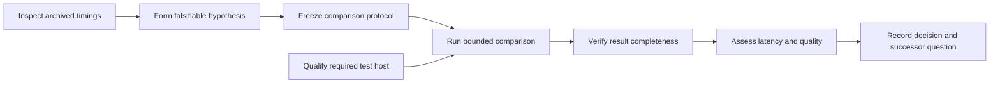
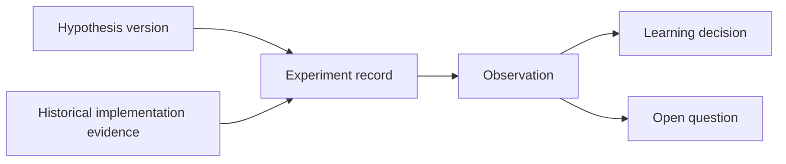

# Evidence-backed work process: semantic contract and research extension

Status: consolidated candidate draft v0.3. Authority effect: none.
Draft date: 2026-09-12. Semantic and research content: candidate v0.1.
Proposed process decision owner and core meaning owner: CyberAlchemy v2 product
owner; assignment unconfirmed. Proposed research meaning owners: CyberAlchemy
research and definitions owners; ARE and Workspace retain ownership of their
source records and runtime meanings.
Intended consumers: project owners, researchers, research authors, experiment
owners, developers, reviewers, and agents.

This single document contains the complete process, semantic contract, research
extension, open questions, and source manifest. The research extension includes
mappings to existing ARE records and five historical evidence examples. The
manifest appendix preserves all 16 source bindings and their recorded hashes.
This remains candidate meaning work, not an installed runtime schema.

## Contents

- [Process](#process)
- [Semantic contract](#semantic-contract)
- [Research extension](#research-extension)
- [Open Questions](#open-questions)
- [Source manifest](#source-manifest)

## Process

### Purpose and scope

Make work resumable and its conclusions traceable: a person or agent should be
able to identify the intended outcome, see what can proceed, inspect why work
is blocked, and follow each completion or decision back to exact evidence.

The user requested a draft after discussing general adoption of the research
ontology and DAG machinery. The working proposal covers research and development
across CyberAlchemy, with a bounded first pilot. Whether adoption should begin
with research alone remains open. This scope and the terminology below are
candidate interpretations, not confirmed domain definitions.

The process applies where dependencies, uncertainty, or handoffs justify explicit
records. A small task can use one task record and linked evidence; it need not
invent a research hypothesis or a large graph.

This document proposes meaning and behavior. It does not register an ontology,
select a runtime, create an executable work plan, or make the process mandatory.
It is a discussion draft, not a validated Definition Pack. The existing
[repository router](../../../agent-routing/ROUTER.md) continues to select work
routes, and existing user authorization retains its exact scope.

### Source basis

| Source | What this draft takes from it |
| --- | --- |
| [Define](../../README.md) | Intent, context, concepts, sources, owners, consumers, and unresolved meaning. |
| [Canonical definitions](../../../authority/definitions/DEFINITIONS.md) | Existing meaning authority, including the D65 construction boundary; this draft does not redefine it. |
| [Research records](../../../research/README.md) | Research produces candidate evidence with separate findings and promotion boundaries. |
| [ARE research-learning ontology](../../../implementation/agent-reasoning-engine/packages/evolution-runtime/ontology/research-learning-v1.json) | Falsifiable hypotheses, immutable observations, experiments, learning decisions, research questions, and work-plan bindings. |
| [ARE research DAG](../../../implementation/agent-reasoning-engine/packages/evolution-runtime/README.md#research-dag) | Explicit prerequisites, immutable successor lineage, cycle checks, dependency layers, and research frontier. |
| [ARE planned research work](../../../implementation/agent-reasoning-engine/packages/evolution-runtime/README.md#planned-research-work) | Derived readiness, event replay, task transitions, exact evidence criteria, and verifier bindings. |
| [Workspace-owned research runtime](../../../workspace/experiments/control-center/research-learning-owned/README.md) | A separate consumer-owned fork with historical provenance; reuse requires an explicit ownership choice. |

These links identify the inspected design sources. They are not a frozen runtime
binding or a claim of present conformance. A later implementation proposal must
select exact source versions and evaluate them for its own intended use.

### Candidate concepts and distinctions

The following handling choices apply only to this proposed process. Formal
definition handling and any promotion remain separate work.

| Concept | Proposed use | Handling |
| --- | --- | --- |
| Goal | The desired project result, its owner, and the evidence needed to judge success. Outcome names the result within a Goal. | Reuse canonical CAV2-D59; see the semantic contract. |
| Work item | A bounded activity with an owner, inputs, dependencies, expected output, and completion criteria. | Propose a generalization of the research task contract. |
| Dependency | An explicit prerequisite whose identified output is required by another work item. | Reuse the DAG's prerequisite-to-dependent direction. |
| Evidence | A source or artifact linked to the exact claim or criterion it supports, with limitations. | Reuse existing evidence meaning; specialize its task binding. |
| Verification | Checking artifact identity and the substance of a named completion criterion. | Specialize ARE's criterion-bound verifier contract. |
| Decision | A recorded judgment over selected evidence that identifies its owner and next disposition. | Propose a generalization; retain LearningDecision for research. |
| Hypothesis and experiment | A falsifiable explanation and the protocol used to test it. | Reuse for research activities only. |

A task completion states that the declared work was done and verified. It does
not by itself establish a successful treatment, goal achievement, product
approval, or permission to deploy. Running an experiment that rejects its
hypothesis can still complete the task of running that experiment.

Dependency readiness, authority to act, and resource availability are separate
observations. Two tasks in one topological layer may still contend for the same
files, machine, budget, or external service.

### Three cooperating layers

| Layer | Responsibility | Boundary |
| --- | --- | --- |
| Semantic records | Describe outcomes, work, evidence, questions, and decisions using owned terms. | The ontology may contain descriptive relations in both directions. |
| Dependency and work-state projection | Select prerequisite edges, derive readiness, and replay recorded activity and verification. | Only selected dependency edges form the DAG; an open research question is not automatically an executable job. |
| Execution adapter | Assign and perform a bounded task using an authorized person, agent, or tool; record attempts and outputs. | Check effects and resources before execution. Scheduling, durable storage, retries, and conflict management need explicit implementations. |

The existing ARE package supplies research-specific projection and work-state
mechanisms. Its documentation excludes automatic dispatch from those projections
and requires an injected substantive evidence verifier. General-purpose records
and adapters remain proposals here.

### Proposed workflow

#### 1. Establish the intended outcome

Record the original request, domain and context, desired result, consumer,
decision owner, constraints, and open questions. Mark interpretations as inferred
until confirmed. Reuse existing definitions; use Define when unresolved meaning
would force consequential guessing.

Name both task completion criteria and outcome success criteria. For example,
producing a complete comparison report is a task criterion; demonstrating a
latency improvement without quality loss is an outcome criterion.

#### 2. Describe bounded work and its dependencies

For each item, identify required inputs, expected outputs, ownership, criteria,
and the evidence verifier. Add a dependency only when the downstream work needs
that prerequisite. Explain what must flow across the edge. Check missing
references and cycles before using the graph to derive readiness.

Represent product construction and operational support separately, including the
affected stage and exact blocker. Host qualification may block a live experiment
without blocking analysis of already archived evidence.

#### 3. Select and perform eligible work

Inspect the derived ready set. Before starting a selected item, establish its
exact authorized effects, required resources, applicable limits, and input
currentness. Carry existing authorization forward; new scope needs its own
decision through the repository route that owns it.

Record who or what performs the work and which input and task versions the
attempt uses. Stop or block when an exact prerequisite cannot be satisfied;
preserve partial outputs and the reason. Independent work remains visible.

#### 4. Verify completion

Resolve each evidence artifact, verify its identity, and evaluate its named
criterion using the declared verifier. A digest establishes selected bytes, not
the correctness of a conclusion. A human review may serve as the substantive
verifier if its reviewer, criteria, selected evidence, and judgment are recorded.

Complete the item only when every required criterion has acceptable evidence.
Record failed, inconclusive, and unsupported judgments explicitly. Outcome
assessment then judges the intended result separately from task completion.

#### 5. Record the decision and next work

Link the decision to the evidence actually considered, remaining uncertainty,
decision owner, and disposition: accept the result for a stated use, revise,
replicate, stop, or open successor work. Acceptance here does not enlarge the
owner's authority or replace a separate product or operational gate.

Successors reference earlier records while preserving their history. When a
question motivates another hypothesis, add a new version and forward lineage
edge; do not create a cycle by rewriting an earlier experiment. New planning or
implementation objectives return through their separately selected routes.

### Minimum work-item contract

This is a candidate information contract, not an installed schema. A pilot may
use a document with these fields before any new runtime is built.

| Field group | Required information |
| --- | --- |
| Identity | Stable item ID, version, parent outcome or question reference, task kind. |
| Meaning | Intended result, context, consumer, scope, and exclusions. |
| Responsibility | Work owner, executor or unassigned posture, verifier, and decision owner. |
| Inputs | Exact artifact references, versions or digests, and any selected record or file section. |
| Dependencies | Predecessor IDs and the output or condition each dependency supplies. |
| Construction position | Product-construction or operational-support lane, affected stage, exact causal blockers. |
| Completion | Expected artifacts, criterion IDs, substantive verifier references, and required evidence bindings. |
| Execution constraints | Allowed effects and authorization reference, resources, conflicts, attempt limits, and stop conditions. |
| History | Attempt/event identities, selected task and plan version, observed results, and timestamps where known. |
| Follow-up | Decision reference, successor references, unresolved questions, and their owners. |

Research items use the research extension. An empirical hypothesis test declares
its hypothesis, falsifier, protocol, metrics, comparison baseline, and replication
requirements. Source collection and research synthesis retain their own methods
and criteria without inventing an experiment. Other task kinds provide criteria
suited to their domain.

Use the existing documented lifecycle as a starting point: `planned`, `ready`,
`running`, `blocked`, and `completed`, with `start`, `block`, `resume`, and
`complete` actions. Ready is derived. Stopping a workstream is recorded as a
decision; cancellation or supersession states require a separately defined
extension rather than silently changing the current lifecycle.

Completion evidence binds the exact plan, task, criterion, artifact, and verifier
identities. Replays must reject conflicting duplicate events and stale updates.
If selected evidence changes or cannot be verified, preserve historical records
but withhold a current completion/readiness claim for affected work. Unrelated
source changes do not invalidate an undeclared dependency.

### Worked example: evaluating a latency change

Illustrative only; no tasks below are registered or authorized for execution.



Timing inspection and host qualification have no dependency on one another.
The live comparison needs both a frozen protocol and a qualified host. If the
comparison is complete and valid but shows no improvement, the run task can
complete, the outcome assessment records failure to demonstrate benefit, and
the decision may open a revised hypothesis. Publication is outside this example.

### Candidate adoption approach

Begin with one bounded pilot and manual task selection. Choose a real question
whose evidence can be inspected without a broad new runtime. Before the pilot
starts, its owner should confirm scope, task and outcome criteria, costs, and
stop conditions through the applicable route.

Evaluate whether the pilot demonstrates all of the following:

- Another person or agent can recover the same work state from the selected
  records and identify the next eligible task without relying on chat history.
- Every completed item has traceable evidence for all declared criteria.
- Missing or changed selected evidence prevents unsupported current claims.
- A blocked operational prerequisite leaves independent product work available.
- Failed or inconclusive findings remain visible and can motivate explicit
  successor work without changing historical records.
- The owner records whether the process improved handoffs and decisions enough
  to justify its overhead, with concrete examples of benefit and friction.

The pilot method and thresholds must be fixed before claiming it passed. This
draft records intended evaluation behavior only; it contains no pilot results.

| Adoption concern | Proposed owner | Affected stage and dependency | Present disposition |
| --- | --- | --- | --- |
| Product frontier: confirm scope and shared concepts | Product owner | Required before treating the draft as an agreed process | Open; draft is available for review. |
| Runnable product work: refine the contract and example | Process author with intended consumers | Can proceed using existing source evidence | Drafting authorized; no implementation requested. |
| Select a bounded pilot and its outcome criteria | Pilot project owner | Required before a concrete pilot plan | Project and owner unselected. |
| Choose runtime source, persistence, and verifier adapters | Runtime owner | Required before an automated implementation depends on them | Deferred; manual process definition can proceed. |
| Operational tasks: hosts, credentials, budgets, scheduling | Relevant operator | Block only tasks that actually require the affected resource or effect | Exact needs remain pilot-specific. |
| Broader adoption, product approval, dispatch, and deployment | Respective product and operational owners | Separate decisions after relevant construction and evaluation evidence | Deferred operational residue. |

A later implementation-bearing proposal must carry the repository's D65
construction chain and exact source and test bindings. This draft does not
admit a ConstructionBinding, clear existing Goals or governance blockers, or
make the candidate ontology runtime a repository prerequisite.

## Semantic contract

### Purpose and authority

The semantic layer records what work is for, what its objects and relationships
mean, and which claims the available evidence permits. It enables a consumer to
answer: what is sought, what contributes, what is required, what was observed,
how it was assessed, who decided, and what remains unresolved.

The model follows [Ontology, CAV2-D19](../../../authority/definitions/DEFINITIONS.md#cav2-d19-ontology)
and [Definition, CAV2-D33](../../../authority/definitions/DEFINITIONS.md#cav2-d33-definition).
Canonical meanings remain in their source. New terms here are proposals in a
bounded process context. Local identifiers beginning `EW-` are candidate labels;
they allocate no canonical IDs. This document is not a saved or validated
Definition Pack and does not change a registry or admit a construction binding.

The [source manifest](#source-manifest) supplies exact selected source identities,
selectors, and SHA-256 bindings. A later consumer must check its selected bindings
before relying on their currentness. Whole-file hashes additionally identify the
inspected snapshot; unrelated changes outside a selected section are diagnostic.

### Meaning, records, and implementation

Keep three things identifiable:

1. A concept definition describes a type and its limits, such as WorkItem.
2. An instance records one particular item, claim, observation, or decision.
3. A binding says how an instance is represented by an existing record or runtime.

Business meaning, system behavior, and the bridge between them have separate
owners and provenance. A matching JSON field name is insufficient to establish
semantic equivalence. A binding names the exact source type, field mapping,
missing information, and the claims that remain unsupported.

### Core concepts

Each row supplies one current handling disposition and a proposed normative
meaning for this use. The common context is bounded project research and
development. The proposed meaning owner above owns new meanings; reused meaning
remains with its source owner. Concrete task, evidence, and decision ownership
is recorded per instance rather than inferred from this proposal.

| ID / concept | Disposition and meaning | Required content and boundary | Plain example |
| --- | --- | --- | --- |
| EW-GOAL / Goal | **reuse** CAV2-D59: an attributable desired future outcome for one project, with rationale, scope, owner, and success evidence. | Preserve the complete parent contract, including revision and challenge routes. Achievement requires adequate evidence for every success condition and an owner-recorded lifecycle change. | Reduce classification latency while preserving requirements. A completed benchmark alone does not achieve it. |
| EW-WORK / WorkItem | **propose**: a bounded activity intended to contribute to an identified Goal or research question through a stated output. | Intent, context, accountable owner, consumer, inputs, output requirements, completion criteria, constraints, and prerequisite declarations. It describes work; an execution attempt is a separate occurrence. | Produce the comparison report. |
| EW-CRITERION / Criterion | **propose**: an explicit condition used to assess one identified subject for one stated purpose. | Subject reference, purpose (`task-completion`, `goal-success`, or declared domain purpose), condition, evidence requirements, and verifier. Thresholds include units, population, and aggregation method where relevant. | Every scheduled trial has a valid result or a recorded failure. This differs from the treatment improving p95. |
| EW-ARTIFACT / Artifact | **propose**: an identified, retrievable version of source material or a produced output used by this process. | Location, version or content identity, producer/source, format, and selected content when relevant. An artifact's existence does not establish that its assertions are correct. | The archived result JSON at its recorded digest. |
| EW-CLAIM / Claim | **propose**: an attributable statement about a specified subject within an explicit context and scope. | Statement, subject, claimant, scope, relevant conditions, and source. Its evidence and assessments are separate links. A question or wish is not an asserted fact. | The compact representation reduced latency on the selected cases. |
| EW-OBSERVATION / Observation | **propose**: a recorded result obtained through a declared observation method under identified conditions. | Subject, method/version, observer or instrument, result, source, observation time or explicit unknown, and limitations. It records what was obtained; causal interpretation needs an assessment. | A selected trial took 1,250 ms, excluding thread startup. |
| EW-EVIDENCE / EvidenceBinding | **propose**: an attributable association of selected artifact content or observations with one target claim or criterion for a stated evidential use. | Target, selected sources, rationale, limitations, assessor, and posture (`supporting`, `counterevidence`, `inconclusive`, or `unevaluated`). The same artifact can support one claim and challenge another through separate bindings. | Quality results support preservation but timing results challenge the improvement claim. |
| EW-ASSESSMENT / Assessment | **propose**: a recorded judgment of one subject against declared criteria using identified evidence and an explicit method. | Subject, criteria, evidence, evaluator, method/version, per-criterion judgments, limitations, and derivation. `met`, `not-met`, `inconclusive`, and `not-evaluated` remain distinct. | Quality met; latency not met; host-dependent inference not evaluable. |
| EW-DECISION / Decision | **propose**: an attributable choice concerning a stated subject, based on named assessments, within the decision maker's scope. | Subject, decision maker and authority reference, assessments, rationale, disposition, allowed use, and follow-up. An algorithmic recommendation must say it is advisory. | Revise the hypothesis; retain the failed result. This does not authorize deployment. |

The normative Goal definition and its complete voices are bound as source
`CAV2-D59`. The table's short explanation does not replace them. The remaining
rows generalize behaviors evidenced by `ARE-ONTOLOGY`, `ARE-RUNTIME-DOC`, and
`ARE-WORK-PLAN`; those sources do not already define these general core types.

#### Formal interpretation

Let `ref(x)` identify an exact instance version. Let `selected(s)` identify the
source content selected for a particular use. Candidate records can be described
without choosing a serialization:

```text
WorkItem = (ref, goal_or_question_refs, intent, context, owner, consumer,
            inputs, output_requirements, criteria, prerequisites, constraints)
Criterion = (ref, subject_ref, purpose, condition, evidence_requirements, verifier)
Artifact = (ref, location, content_identity, producer_or_source, format, selector)
Claim = (ref, subject_ref, statement, claimant, scope, conditions, source_refs)
Observation = (ref, subject_ref, method, observer, conditions, result, time, limitations)
EvidenceBinding = (ref, target_ref, selected_sources, posture, rationale, assessor, limitations)
Assessment = (ref, subject_ref, criterion_refs, evidence_refs, evaluator,
              method, judgments, derivation, limitations)
Decision = (ref, subject_ref, decision_maker, authority_ref, assessment_refs,
            rationale, disposition, allowed_use, follow_up)
```

Unknown required information is recorded as a gap with an owner and use impact.
It is not replaced with invented values. A draft may contain gaps; a consumer
withholds only the conclusions or operations that require those missing facts.

### Common provenance and interpretation context

For definitions, preserve term, stable ID, version, aliases, normative meaning,
plain explanation, domain example, boundaries, disposition, source bindings,
meaning owner, consumers, and challenge/refresh route. `specialize` narrows a
parent's context; a broader meaning requires a proposal rather than being called
a specialization. Unresolved meaning uses `open` with its stop condition.

For instances and relation assertions, retain attribution, exact source/version,
context, limitations, and correction lineage. Record evidence confidence and
commitment confidence separately when a claim carries a decision; each needs a
method or an explicit unknown posture. An unexplained confidence number cannot
replace substantive evidence.

Source currentness, evidential judgment, task lifecycle, and authority posture
are separate axes. No axis derives another implicitly. Promotion status belongs
to the definition or governance assessment that owns it. Do not inject it into
existing Research or Experiment evidence records, whose contracts do not carry
authority-like lifecycle state.

### Typed relations

Cardinalities below constrain a claim-ready candidate view, not every historical
source record. Missing relationships in a historical adapter remain gaps. Each
edge assertion carries its ID, exact endpoint versions, asserting source,
context, and qualifiers; derived edges additionally name the derivation rule.

| Relation | Endpoints and cardinality | Meaning and required qualifiers | Permitted inference |
| --- | --- | --- | --- |
| contributes_to | WorkItem → Goal; zero or more direct goals, at least one Goal path through an explicit research binding | Intended contribution; name the expected contribution. | Relevance to that Goal, not achievement. |
| requires | WorkItem → input requirement; zero or more | A prerequisite input slot, its exact artifact or declared producer output, and acceptance criteria. | Can support a dependency edge only through the mapping below. |
| produces | WorkItem → Artifact; zero or more observed outputs | Link the producing attempt and its receipt. Planned outputs remain output requirements. | Artifact production only when its attempt evidence resolves. |
| has_criterion | WorkItem or Goal → Criterion; one or more | Criteria have exactly one subject and purpose. | Establishes what to evaluate, not the evaluation result. |
| bears_on | Observation → Claim; zero or more | State the assessed relevance through an EvidenceBinding. | Relevance, not truth or causality. |
| targets | EvidenceBinding → Claim or Criterion; exactly one | Sources, selection, context, posture, and rationale. | A scoped evidence association. |
| evaluates | Assessment → subject; exactly one, with one or more criteria | Every criterion must apply to the identified subject. | Only the explicit per-criterion judgments. |
| uses | Assessment → EvidenceBinding; one or more for an evaluated judgment | Name the evidence actually considered, including selected counterevidence. | Traceability; citation counts do not measure independence. |
| based_on | Decision → Assessment; one or more for an evidence-based decision | Scope, decision maker, rationale, and advisory/owner-decision posture. | An attributable choice within that scope. |
| supersedes | New record version → prior version of the same logical subject; zero or more | Explain the correction, material change, and owner. Preserve prior bytes. | A successor for the stated use, not deletion or retroactive truth. |

An input requirement is a structured value, not a claim that its artifact already
exists. A producer output binding can establish intended prerequisite order
before production. If several producers could fill a slot, the selected plan
must resolve the choice explicitly; it must not invent an all-producers join.

### Interpretation rules

| Rule | Required behavior |
| --- | --- |
| EW-I01: bounded claims | Interpret every claim and judgment in its declared scope, units, population, method, and source version. |
| EW-I02: no implicit truth | Missing support is unknown/unevaluated, not false. Structural validity and matching bytes establish neither semantic correctness nor causality. |
| EW-I03: preserve disagreement | Retain supporting and counterevidential bindings. An assessment explains how conflicts affect the conclusion; it never silently discards a failed gate. |
| EW-I04: separate completion | Complete a WorkItem only with acceptable evidence for every completion criterion. Goal achievement additionally follows CAV2-D59 and its owner decision. |
| EW-I05: separate authority | Readiness, evidence confidence, and a successful assessment grant no new effects. An advisory Decision stays advisory. |
| EW-I06: immutable correction | New material meaning, protocol, evidence selection, or judgment creates an attributable successor. Never re-date a retrospective hypothesis as preregistered. |
| EW-I07: selective currentness | Changed or missing selected dependencies withhold affected current claims. Historical records remain evidence of what was recorded; unrelated drift is diagnostic. |
| EW-I08: explicit use | Each consumer declares the records and selectors used and checks applicability. A source binding's existence is not proof it fits the new context. |

### Mapping to work DAGs

The semantic graph may contain reverse descriptive relations and cycles. Select
one versioned plan and its explicit prerequisite declarations for a work DAG.
Do not feed all ontology relations into topological sorting.

For an output-bound dependency, derive `A → B` only when B's required input slot
is explicitly bound to A's declared output in the selected plan. Preserve that
binding as edge provenance. For a completion dependency, retain the declaration
that B requires A's verified completion. Validate endpoint versions, the exact
condition supplied, and acyclicity. Distinguish these two dependency kinds.

Dependency-ready means all declared prerequisites have acceptable, current
evidence under their criteria. It says nothing about execution permission,
exclusive resources, budget, or whether the task is already running. Work-state
projection combines dependency readiness with lifecycle events before offering a
ready set. Only a separately authorized executor may start work.

The research evidence DAG has a different purpose: it exposes the logical
dependence of historical records. Its mapping is specified in the research
extension. An open-question frontier is not the work-plan ready set.

### Review examples

| Case | Expected interpretation |
| --- | --- |
| A valid experiment report shows quality PASS and latency FAIL. | Report-production criteria may be met; the combined improvement claim is not supported. |
| A report exists but its selected digest differs. | Do not reuse its old verification for current completion. Preserve the historical binding. |
| Two work items contribute to the same Goal. | No prerequisite or safe parallelism follows from shared purpose. |
| A research question has a successor hypothesis. | There is declared follow-up if lineage is provided; the original question is not automatically answered. |
| All tasks complete but the Goal owner has not recorded achievement. | Task progress is complete; Goal achievement cannot be asserted. |

These are semantic acceptance examples for review, not test receipts for a new
runtime. Structural checks can verify references and shapes; domain reviewers
must assess meaning and applicability.

## Research extension

### Scope and source posture

This extension is part of the present draft. Its initial evidence basis is
empirical engineering research in ARE and Workspace, plus CyberAlchemy's
canonical Research and Experiment meanings. Source collection and synthesis are
also represented without forcing them into an experiment.

[source manifest](#source-manifest) binds the selected canonical definition sections,
the existing ontology, the work-plan source, four ARE benchmark registrations,
and the Workspace CC006 registration. These five examples are a bounded evidence
selection, not a complete inventory of repository research. No benchmark was
rerun or independently re-scored to create this draft. Reported outcomes below
describe the selected records, not current implementation conformance.

### Research concepts

Handling decisions below are candidate use decisions. A source-local ARE meaning
can be reused within its original scope without making it a canonical
CyberAlchemy definition. Broader meanings are explicitly proposed.

| ID / concept | Disposition and proposed normative content | Formal content and boundary | Plain example |
| --- | --- | --- | --- |
| RX-RESEARCH / Research | **reuse** CAV2-D61: bounded investigation gathering sources and observations for one Project and one or more Goals, around one declared question. | Preserve question, scope, method, evidence aggregate, counterevidence, findings links, limitations, ownership, and challenge route. No `outcome` or authority-like lifecycle fields. | Collect evidence about why compact transport failed the latency condition. |
| RX-QUESTION / ResearchQuestion | **propose**, informed by ARE's existing question record: an attributable unresolved inquiry with a declared subject, scope, and intended use. | Question, Project/Goal or Research references, motivating evidence, owner, and closure criteria. An answer is represented through Findings and assessment, not by merely adding a successor. | Does a fresh replication preserve the observed result? |
| RX-HYPOTHESIS / Hypothesis | **propose** a broader subject scope from ARE-RL-D01: a falsifiable explanatory Claim naming a mechanism, observable predictions, conditions, and a falsifier. | Claim fields plus question, mechanism, metrics, falsifier, protocol/template, and provenance. Record prior-registration, retrospective, or unknown posture with evidence. | Explicit requirement accounting improves classification without losing requirements. |
| RX-EXPERIMENT / Experiment | **reuse** CAV2-D62: an attributable empirical test applying a declared protocol to a defined subject under named conditions. | Preserve Project/Goal/Research links, protocol, variables, measures, environment, prerequisites, stop rules, run/evidence/findings references, limitations, and owner. Missing run evidence means execution is not shown. | Compare full and compact representations under a frozen protocol. |
| RX-RUN / ExperimentRun | **propose**: one identified attempt to apply an exact experiment protocol to selected subjects in an observed environment. | Experiment/protocol version, runner, actual configuration, subject/sample IDs, attempts, times, raw outputs, deviations, stop reason, and evidence references. A manifest describes intended execution; it is not a run receipt. | An interrupted comparison preserves its completed prefix and remains inconclusive where required data are missing. |
| RX-HOBS / HypothesisObservation | **reuse** ARE-RL-D02 within ARE's scope: an immutable supporting, counterevidential, or inconclusive result bound to one hypothesis and exact source evidence. | Bind the ARE record as an Observation plus its qualified EvidenceBinding and any embedded evaluator judgment. Do not treat its posture as an unmediated measurement. Broader domains use EW-OBSERVATION and EW-EVIDENCE until an adapter is reviewed. | Quality PASS with latency FAIL is counterevidence for a conjunctive hypothesis. |
| RX-FINDINGS / Findings | **propose** a core Assessment specialization respecting CAV2-D61's separation: an attributable synthesis derived from a Research aggregate that answers or bounds the same question. | Research reference, same question, selected evidence, synthesis method, claims, per-claim assessments, counterevidence, limitations, and unresolved questions. It is separate from the aggregate and from the decision to act. | The selected experiment did not demonstrate a latency benefit; provider load remains uncontrolled. |
| RX-REPLICATION / Replication | **propose**: an Experiment explicitly related to an earlier test, with declared comparable conditions and a justified unit of independence. | Prior test/hypothesis references, retained and changed protocol factors, case/cohort identities, reuse or exposure, independence rationale, and aggregation method. Similar names, repeated turns, or duplicated registrations do not prove independence. | Repeated measurements of eight cases remain eight cases, not forty independent cases. |
| RX-LEARNING / LearningDecision | **reuse** ARE-RL-D04 within its source scope: a deterministic assessment selecting the next research action without changing the serving engine. | In the general core, bind both the embedded Assessment and advisory Decision views. Keep hypothesis, experiment, observations, reason codes, and source disposition intact. No new owner authority is inferred. | `collect-replications`, `revise-hypothesis`, or `inconclusive`, as recorded in the selected examples. |

Reused Research and Experiment retain the full canonical voices in manifest
entries `CAV2-D61` and `CAV2-D62`. In this extension, a Hypothesis is a Claim,
Findings is an Assessment specialization, and Replication specializes Experiment.
ExperimentRun supplies occurrences that the canonical Experiment references;
it does not redefine Experiment as a single command or output file.

The candidate meaning owner for the proposed rows is the research owner together
with the definitions owner. Each proposed row's limits, formal fields, and example
are part of the same proposal. Disputes follow RX-OQ1 below.

### Existing ARE record crosswalk

Source: [research-learning ontology](../../../implementation/agent-reasoning-engine/packages/evolution-runtime/ontology/research-learning-v1.json),
manifest entry `ARE-ONTOLOGY`. This is a proposed interpretive crosswalk, not a
new adapter or evidence migration.

| Existing record or definition | Core/extension interpretation | Preservation and gap rule |
| --- | --- | --- |
| ResearchHypothesis / ARE-RL-D01 | Hypothesis view of the recorded claim and test template | Preserve statement, scope, mechanism, metrics, falsifier, implementation pattern, and provenance. Do not broaden its original evidence scope. |
| HypothesisObservation / ARE-RL-D02 | Observation with hypothesis-specific evidence posture | Preserve one exact hypothesis and source result, evaluator, phase, and limitations. Extracted views retain the original record identity. |
| ResearchExperiment / ARE-RL-D03 | Source-local protocol and linked observation record | Its baseline/treatment, dataset, metrics, repetitions, criteria, and stops map into the Experiment view. Missing canonical Project/Goal/environment/run bindings remain gaps; do not call it a fully conforming CAV2 Experiment. |
| LearningDecision / ARE-RL-D04 | Assessment plus advisory Decision | Preserve counts and reasons, but do not equate counted observations with independent replications. |
| ImprovementRetention / ARE-RL-D05 | Candidate-specific verified reuse record | Exact implementation and evidence currentness can suppress rediscovery of that candidate only. Drift returns it to examination. It does not establish universal technique validity. |
| FailureHypothesisProjection / ARE-RL-D06 | Derived failure-to-hypothesis provenance | Exact failed benchmark result required; no projected hypothesis for PASS, visible unevaluated posture for missing evaluation. Projection is not code adoption. |
| ResearchDAG / ARE-RL-D07 | Evidence-dependency projection | Typed immutable record versions; forward prerequisite order only. Preserve explicit cross-iteration lineage and source digests. |
| ResearchWorkPlan / ARE-RL-D08 | Selected WorkItems tied to research questions | Preserve owners, lanes, stages, prerequisites, criteria, and verifier references. Plan existence does not complete work. |
| ResearchWorkState | Event-derived lifecycle projection | Preserve events and exact plan/evidence bindings. It belongs to the work-state layer, not to the truth status of a hypothesis. |
| BenchmarkRegistration | Artifact bundling retrospective record mappings and archived evidence | Preserve schema/record IDs, manifest/result digests, gates, limitations, and raw evidence links. Do not replace a source registration with a new generic ID. |
| ImplementationEvidence | Artifact identifying the implementation observed | Historical selected hashes identify provenance; they do not prove currentness or a transitive build closure. |
| ResearchQuestion | ResearchQuestion view | Retain the original question, source observation, and open posture. Same wording does not merge separately identified questions. |
| TechniqueCandidate and VariantComparison | Proposed technique and bounded comparison evidence | Preserve the source meanings and exact candidate identity. Neither technique creation nor comparison PASS activates an implementation. |

New general-purpose Project/Goal links, run identity, or replication lineage must
be asserted in a separately versioned binding with its own evidence. Never fill
these gaps by editing a historical registration or guessing from its filename.
Workspace uses a separately owned fork even where schema names match ARE.

### Research relations and cardinalities

All relation assertions inherit the core provenance and version requirements.
Cardinalities apply to the candidate research view for the stated use.

| Relation | Endpoints and constraints | Interpretation |
| --- | --- | --- |
| investigates | Research → ResearchQuestion; exactly one bounded question | A named inquiry, not a conclusion. Research also retains exactly one Project and at least one Goal. |
| offers_explanation_for | Hypothesis → ResearchQuestion; one or more explicit question bindings | A candidate explanation, not an answered question. |
| tests | Experiment → Hypothesis, ResearchQuestion, or Goal criterion; at least one declared target | Name the protocol and observable measures. A source ARE experiment targets one exact hypothesis. |
| executes | ExperimentRun → Experiment; exactly one protocol/version binding | Run evidence is required before claiming it occurred. |
| yields | ExperimentRun → Observation; zero or more | Preserve partial and failed runs; zero results cannot establish treatment success. |
| evaluates_hypothesis | HypothesisObservation → Hypothesis; exactly one in the ARE view | Retain source result, evaluator, posture, and limitations. |
| derives_from | Findings → Research; exactly one primary Research aggregate | The Findings question equals the Research question; additional sources are linked through its evidence selection. |
| replicates | Replication → prior Experiment; at least one explicit target | Carry protocol differences and independence rationale; no inferred lineage from chronology. |
| recommends | LearningDecision → proposed next research action; source disposition retained | Advisory action only; any resulting WorkItem is separately planned. |
| motivates_successor | Prior question → successor Hypothesis; explicit versioned endpoints and source | Logical follow-up for an evidence DAG; no automatic claim that the question is answered. |

### Evidence selection and research rules

| Rule | Required interpretation | Existing basis |
| --- | --- | --- |
| RX-I01: keep aggregate separate | Research collects; Findings synthesizes; Decision chooses. Research carries no outcome or promotion lifecycle. | CAV2-D61 and `RESEARCH-CARRIER`. |
| RX-I02: separate design from run | A protocol or registration cannot prove an experiment ran. Keep planned configuration distinct from observed configuration. | CAV2-D62 and the archived benchmark evidence. |
| RX-I03: preserve chronology | Bind preregistration evidence explicitly. Backfill remains retrospective even if a DAG places the hypothesis before the experiment. | E-01 through E-05. |
| RX-I04: preserve every gate | Evaluate a conjunctive hypothesis against all its declared conditions. A favorable metric does not erase a failed protected condition. | E-02, E-03, E-04. |
| RX-I05: count independence explicitly | Track run, case, cohort, and protocol identities separately. Retain reuse, exposure, and confounders. No universal sample threshold or numerical confidence is invented here. | E-01, E-03, E-04 limitations. |
| RX-I06: preserve ineligibility | An invalid host or missing controlled comparison limits the inference; it does not become evidence of repair benefit or automatically refute that benefit. | E-05. |
| RX-I07: retain counterevidence | Within the inherited ARE policy, counterevidence requires revision before technique proposal; one anomaly does not justify a technique. Broader-domain decision rules require explicit review. | ARE-ONTOLOGY. |
| RX-I08: bind evidence identity | Verify the selected result and implementation bindings before reuse. A new source version requires a new evidence binding; old hashes stay historical. | ARE-RUNTIME-DOC and ARE-ONTOLOGY. |
| RX-I09: state selection limits | A synthesis declares its question, inclusion/exclusion rules, selected sources, overlap and missing evidence, method, and claim ceiling. Repeated copies of one result count as one source of observations. | CAV2-D61 plus the five-example selection below. |

Conflicting findings may remain separately attributed. An assessment states
whether conflicts arise from different contexts, changed protocols, unsupported
judgments, or an unresolved disagreement. A later result does not rewrite an
earlier source's own claim or establish equivalence between their hypotheses.

### Five existing evidence examples

The following table is an inspectable summary of historical record contents.
It is not an aggregate estimate, a causal chain, or a claim that these five
sources are independent. File hashes and experiment/record IDs are pinned in
[source manifest](#source-manifest). Selection purpose: exercise supporting,
counterevidential, and inconclusive semantics and mixed per-criterion outcomes.

| Source | Recorded result | Recorded next disposition | Meaning preserved |
| --- | --- | --- | --- |
| [E-01: requirement-change-001](../../../implementation/agent-reasoning-engine/packages/evolution-runtime/research-records/af833e4192def01e459df9384e7d152eacc86bb9b0e15002eb879473e4d58fe7.json) | Classification improvement and requirement preservation true; supporting observation. | `collect-replications` | Eight development cases and one observation per variant do not establish independent replication or a population result. |
| [E-02: requirement-latency-001](../../../implementation/agent-reasoning-engine/packages/evolution-runtime/research-records/c485f4895f87031a1afa59621f9ba8986e92b9b6ae1db344aedf19b2919f4577.json) | Quality true; relative latency and wrapper deadline false; counterevidence. | `revise-hypothesis` | Preservation success does not satisfy the combined improvement claim. |
| [E-03: requirement-latency-002](../../../implementation/agent-reasoning-engine/packages/evolution-runtime/research-records/cef063f80f998047ff245642b428852b7e438a8a756df684725a474bfa076a61.json) | Cache balance and runtime integrity true; quality and relative latency false; counterevidence. | `revise-hypothesis` | Repeated observations are not independent cases; uncontrolled provider load remains a limitation. |
| [E-04: requirement-replication-001](../../../implementation/agent-reasoning-engine/packages/evolution-runtime/research-records/fbc7c1a6b01810478c5800fa07dba4f1cd3bd3e9a6fa2bb68bda5072198c30f9.json) | Classification improvement and runtime integrity true; requirement preservation false; counterevidence. | `revise-hypothesis` | A replication-named artifact can contradict the desired conjunction. Its name alone proves neither lineage nor independence. |
| [E-05: Workspace CC006](../../../workspace/experiments/control-center/research-learning-owned/registration.json) | Smoke FAIL, host REJECTED, repair-performance inference `not_evaluable`; inconclusive observation. | `inconclusive` | A failed smoke on an unqualified host does not establish whether the repair improves performance. |

#### Worked interpretation of E-02

The Claim is the hypothesis recorded in E-02: compact patches preserve quality,
reduce paired p95 by at least 20 percent, and fit the wrapper deadline. Its three
conditions remain separate Criteria. The selected result is an Artifact; its
measurements supply Observations. The registration's evaluator reports quality
met and the two timing conditions not met. Those judgments supply a
counterevidential EvidenceBinding to the combined hypothesis. The recorded
LearningDecision recommends revision.

The historical registration is preserved intact. A generic view must retain its
limitations: previously used development cases, a single observation per variant,
no held-out claim, and timing that excludes thread startup. This mapping does
not manufacture a general WorkItem completion receipt or an owner decision.

### Two different DAG projections

The existing ARE evidence projection derives six nodes per registration:
hypothesis, implementation evidence, experiment, observation, learning decision,
and open question. Its documented logical shape is:



This drawing illustrates the semantic direction; the exact source materializer
owns its emitted edges. A separately declared question-to-successor-hypothesis
link connects iterations while preserving acyclicity. These edges express
logical prerequisites, not historical creation order or proven causality.

The work DAG uses the core contract's explicit task prerequisites. The existing
[requirement research plan](../../../implementation/agent-reasoning-engine/packages/evolution-runtime/plans/requirement-research-v1.json)
binds the E-01 and E-02 registrations and nine tasks. Its initial dependency roots
are `latency.inspect` and `replication.design`. This statement describes the
selected plan's initial structure; it is not a claim about current replayed
progress. Later E-03/E-04 records do not silently replace that plan's bindings.

Planning a successor, adding a Findings record, or copying a registration grants
no automatic dispatch. A later binding must separately verify the selected
records, derive the intended projection, and satisfy task criteria and authority.

## Open Questions

### Process Open Questions

| ID | Missing decision | Proposed decision owner |
| --- | --- | --- |
| OQ-1 | Is the initial scope research only, or research and development across CyberAlchemy? | Product owner |
| OQ-2 | Which project and bounded outcome should be the first pilot, and who will consume its result? | Product owner and pilot project owner |
| OQ-3 | Do the candidate concepts and work-item fields fit the user's domain language; which should reuse existing owned definitions? | Product owner and definitions owner |
| OQ-4 | Who owns the shared process, its revisions, substantive verification, and disputes? | Product owner |
| OQ-5 | Should a later implementation reuse ARE, use the Workspace fork, or extract a separately owned component? What compatibility must survive? | Runtime owners |
| OQ-6 | Where should task events and evidence live, and what retention and privacy rules apply? | Project and data owners |
| OQ-7 | Which criteria require automated checks, named human review, or both? | Domain reviewers |
| OQ-8 | What pilot evaluation thresholds and overhead limits would justify wider adoption? | Pilot consumers and product owner |

All owner assignments above are proposals pending confirmation. Resolving these
questions can revise this draft; it does not itself authorize implementation
or operational adoption.

### Semantic Open Questions

- SC-OQ1: Which proposed core concepts fit the user's domain language, and which
  additional owned definitions should they reuse? Owner: product and definitions
  owners; blocks semantic promotion, not review of this draft.
- SC-OQ2: Who owns criteria and dispute resolution for each consuming project?
  Owner: project owner; blocks claim-ready assessments where unresolved.
- SC-OQ3: Which serialization and runtime binding should realize the contract?
  Owner: runtime owner; deferred until a separately routed implementation.
- SC-OQ4: How should a later plan represent alternatives and conditional
  prerequisites? This version requires explicit selection. Owner: process owner.

Adoption scope, pilot selection, and operational residue remain in the
[process Open Questions](#process-open-questions). The research extension owns
its domain-specific unresolved questions.

### Research Open Questions

- RX-OQ1: Are the proposed general Hypothesis, Question, Run, Findings, and
  Replication meanings sufficient outside the inspected empirical-engineering
  examples? Owner: research and definitions owners. Literature and other domains
  may need additional methods; their records must not be forced into a comparison.
- RX-OQ2: Which evidence establishes independent replication for each research
  domain, and which decision policies apply beyond ARE? Owner: domain reviewer.
- RX-OQ3: Which existing records supply missing Project/Goal, environment, run,
  and explicit lineage bindings for a general-purpose view? Owner: source owner.
  Gaps block those mapped claims, not inspection of the historical sources.
- RX-OQ4: Which additional evidence cohorts should be selected next, using which
  inclusion and overlap rules? Owner: research owner. This selection is bounded
  and is not the complete body of repository research.

Shared authority, consumer acceptance, adoption, and runtime questions remain in
the [semantic contract](#semantic-open-questions) and
[process draft](#process-open-questions).

## Source manifest

The following JSON is the embedded source manifest. Paths are relative to the
repository root. Only document-navigation metadata changed during consolidation;
all source entries and hashes are preserved.

```json
{
  "format": "evidence-backed-work-source-manifest/v0.1-candidate",
  "status": "candidate",
  "authority_effect": "none",
  "inspected_date": "2026-09-12",
  "path_base": "repository-root",
  "intended_use": "Source binding for the semantic contract and research extension in this document; not a runtime binding, canonical promotion, or benchmark verification receipt.",
  "selection_scope": "Five historical examples covering supporting, counterevidential, inconclusive and mixed-gate judgments, plus their owned semantic contracts; not a complete research inventory.",
  "hash_contract": {
    "algorithm": "sha256",
    "whole_file": "Exact on-disk bytes.",
    "markdown_section": "Exact bytes starting at the named level-2 heading, ending before the next level-2 heading or EOF; includes intervening whitespace.",
    "currentness": "Compare selector.sha256 for the declared selection. source_sha256 identifies the inspected whole-file snapshot; changes outside a selected section are diagnostic."
  },
  "evidence_limitations": [
    "Historical records were read, not re-scored or independently reproduced.",
    "File hashes do not establish internal registration-digest validity, substantive correctness, independent replication, or current implementation conformance.",
    "Current file contents are the source snapshot; no claim is made that they are all committed.",
    "No lineage or statistical independence is inferred between the selected examples."
  ],
  "sources": [
    {
      "source_id": "CAV2-D19",
      "path": "authority/definitions/DEFINITIONS.md",
      "role": "canonical-meaning",
      "source_sha256": "ecfbd64f334954809e83ffd5d4f9adfb759f39716de96c3ac1227d4ee869c6f8",
      "selector": {
        "kind": "markdown-section",
        "heading": "## CAV2-D19: Ontology",
        "end": "before-next-level-2-heading-or-eof",
        "sha256": "15ea042e7bd48e2ac57d7cacf7d0192add522d6944a19f3d513ba927248b6e4d"
      }
    },
    {
      "source_id": "CAV2-D33",
      "path": "authority/definitions/DEFINITIONS.md",
      "role": "canonical-meaning",
      "source_sha256": "ecfbd64f334954809e83ffd5d4f9adfb759f39716de96c3ac1227d4ee869c6f8",
      "selector": {
        "kind": "markdown-section",
        "heading": "## CAV2-D33: Definition",
        "end": "before-next-level-2-heading-or-eof",
        "sha256": "00e89bd7b1bd552cbd25870f67fa9a28e33e92ffd4d1f95d4e4309b20082d44f"
      }
    },
    {
      "source_id": "CAV2-D59",
      "path": "authority/definitions/DEFINITIONS.md",
      "role": "canonical-meaning",
      "source_sha256": "ecfbd64f334954809e83ffd5d4f9adfb759f39716de96c3ac1227d4ee869c6f8",
      "selector": {
        "kind": "markdown-section",
        "heading": "## CAV2-D59: Goal",
        "end": "before-next-level-2-heading-or-eof",
        "sha256": "f9589997351dcd40f5c37f970568aab3a09345c1b8ab6331860d5533d2c7a674"
      }
    },
    {
      "source_id": "CAV2-D61",
      "path": "authority/definitions/DEFINITIONS.md",
      "role": "canonical-meaning",
      "source_sha256": "ecfbd64f334954809e83ffd5d4f9adfb759f39716de96c3ac1227d4ee869c6f8",
      "selector": {
        "kind": "markdown-section",
        "heading": "## CAV2-D61: Research",
        "end": "before-next-level-2-heading-or-eof",
        "sha256": "f240fc2daa3a24bba146af1fd3e1955071782dcc112916b2f32191e9131db8f2"
      }
    },
    {
      "source_id": "CAV2-D62",
      "path": "authority/definitions/DEFINITIONS.md",
      "role": "canonical-meaning",
      "source_sha256": "ecfbd64f334954809e83ffd5d4f9adfb759f39716de96c3ac1227d4ee869c6f8",
      "selector": {
        "kind": "markdown-section",
        "heading": "## CAV2-D62: Experiment",
        "end": "before-next-level-2-heading-or-eof",
        "sha256": "15e0f5a3491e0672ed1e0ec6e4d8ac71bf7e0677ec953e45e7cc78cff3032104"
      }
    },
    {
      "source_id": "DEFINE-PACK",
      "path": "define/docs/DEFINITION-PACK.md",
      "role": "candidate-definition-handling-contract",
      "source_sha256": "d52378ceb47691a2a854ef23a32f319e1536c82113861fac9e32b1c3f1bcd609",
      "selector": {
        "kind": "whole-file",
        "sha256": "d52378ceb47691a2a854ef23a32f319e1536c82113861fac9e32b1c3f1bcd609"
      }
    },
    {
      "source_id": "RESEARCH-CARRIER",
      "path": "research/RESEARCH-DOCUMENT-TYPE.md",
      "role": "existing-private-record-contract",
      "source_sha256": "fa38cee35412f4be430fbc497f0c7f083fff7217039c64b703d26d774f20b7e2",
      "selector": {
        "kind": "whole-file",
        "sha256": "fa38cee35412f4be430fbc497f0c7f083fff7217039c64b703d26d774f20b7e2"
      }
    },
    {
      "source_id": "ARE-ONTOLOGY",
      "path": "implementation/agent-reasoning-engine/packages/evolution-runtime/ontology/research-learning-v1.json",
      "role": "source-local-candidate-ontology",
      "source_sha256": "18c671dc8929b07582295c68b286de152028125036ae7ec1188c2c1944cb0481",
      "selector": {
        "kind": "whole-file",
        "sha256": "18c671dc8929b07582295c68b286de152028125036ae7ec1188c2c1944cb0481"
      }
    },
    {
      "source_id": "ARE-RUNTIME-DOC",
      "path": "implementation/agent-reasoning-engine/packages/evolution-runtime/README.md",
      "role": "source-design-and-boundary-evidence",
      "source_sha256": "6241b390b683029c0dd55c9902a0362fcd1e3810f3abd06d4e194f65afbcbe4f",
      "selector": {
        "kind": "whole-file",
        "sha256": "6241b390b683029c0dd55c9902a0362fcd1e3810f3abd06d4e194f65afbcbe4f"
      }
    },
    {
      "source_id": "ARE-WORK-PLAN",
      "path": "implementation/agent-reasoning-engine/packages/evolution-runtime/plans/requirement-research-v1.json",
      "role": "historical-selected-plan-input",
      "source_sha256": "714014a73670fce69bd686ef4999d2365cc78d5f2522055852b5a82677cba5c7",
      "selector": {
        "kind": "whole-file",
        "sha256": "714014a73670fce69bd686ef4999d2365cc78d5f2522055852b5a82677cba5c7"
      }
    },
    {
      "source_id": "WORKSPACE-FORK",
      "path": "workspace/experiments/control-center/research-learning-owned/README.md",
      "role": "source-ownership-and-boundary-evidence",
      "source_sha256": "3bb1ce8e485c34adc51744d9a3da519e1c2d4429314e11167727c5de99205d66",
      "selector": {
        "kind": "whole-file",
        "sha256": "3bb1ce8e485c34adc51744d9a3da519e1c2d4429314e11167727c5de99205d66"
      }
    },
    {
      "source_id": "E-01",
      "path": "implementation/agent-reasoning-engine/packages/evolution-runtime/research-records/af833e4192def01e459df9384e7d152eacc86bb9b0e15002eb879473e4d58fe7.json",
      "role": "historical-example-not-independent-rescoring",
      "source_sha256": "351c9665791e020ae724457f0b4977c7e1f4dc6a6d5c94192e7f8a18be938fa3",
      "selector": {
        "kind": "whole-file",
        "sha256": "351c9665791e020ae724457f0b4977c7e1f4dc6a6d5c94192e7f8a18be938fa3"
      },
      "observed_record_summary": {
        "experiment_id": "requirement-change-001",
        "registration_digest": "af833e4192def01e459df9384e7d152eacc86bb9b0e15002eb879473e4d58fe7",
        "manifest_digest": "bad8436c364883c2de120cfc204b9a70879a3f166d66329fbf5c3952e1f6e854",
        "result_digest": "2ee727bffe75c116ee648a27a012574debfa3cb62774e9e235a19f7a9eea54b4",
        "gates": {
          "classification_improved": true,
          "requirement_preservation": true
        },
        "records": [
          {
            "record_id": "research-hypothesis:7a0422e73ee3046c27c3fbfbd699933d674a771061d04415275b86fb659fcd2d",
            "schema_version": "are.research-hypothesis/v1"
          },
          {
            "record_id": "hypothesis-observation:62ef32fa599e63d7d2c8c55b8c9244fb8296b8fc7724939bc632e02d63b8e9d0",
            "schema_version": "are.hypothesis-observation/v1",
            "observation_kind": "supporting"
          },
          {
            "record_id": "research-experiment:d8c7e77c277f10b3b8763be76dffb48c8f4887f89a8baeaf7e3ec84e76064125",
            "schema_version": "are.research-experiment/v1"
          },
          {
            "record_id": "learning-decision:fc85a2c5a9f1dc3fb6f75391a5ef6c44b13c3e9280c2342cd954c16e82440b3e",
            "schema_version": "are.learning-decision/v1",
            "disposition": "collect-replications"
          }
        ],
        "question_ref": "research-question:87fdabb15a896f5531ca997537f88b847ce95bb60389af3be94eb074adc73ab1"
      }
    },
    {
      "source_id": "E-02",
      "path": "implementation/agent-reasoning-engine/packages/evolution-runtime/research-records/c485f4895f87031a1afa59621f9ba8986e92b9b6ae1db344aedf19b2919f4577.json",
      "role": "historical-example-not-independent-rescoring",
      "source_sha256": "eace18163ed3d0ba5d22c90dd81c38820f4a044adc9258180093ef33fec5b8db",
      "selector": {
        "kind": "whole-file",
        "sha256": "eace18163ed3d0ba5d22c90dd81c38820f4a044adc9258180093ef33fec5b8db"
      },
      "observed_record_summary": {
        "experiment_id": "requirement-latency-001",
        "registration_digest": "c485f4895f87031a1afa59621f9ba8986e92b9b6ae1db344aedf19b2919f4577",
        "manifest_digest": "5fe24a8b95e155b43aef142f8ab59313a5f1d45f1083be1d8fca42d22bb36ad6",
        "result_digest": "6b09f6f743807cc2db027bfc304ed535883dd3409c003b40c5e33f2dd6e19083",
        "gates": {
          "quality": true,
          "relative_latency": false,
          "wrapper_deadline": false
        },
        "records": [
          {
            "record_id": "research-hypothesis:e0ed8e3e593b632a1d64d850ba3d84acd7a6e42e962ab9db32349fc881f50abc",
            "schema_version": "are.research-hypothesis/v1"
          },
          {
            "record_id": "hypothesis-observation:afc570647f677f58a4c7bb55cd87f4d9238c8f8c7513d65e0aa0f75318896c59",
            "schema_version": "are.hypothesis-observation/v1",
            "observation_kind": "counterevidence"
          },
          {
            "record_id": "research-experiment:4863b699e9221869e4e276db75d9e996c57a68415ba5a4486e1d24bdca32ebec",
            "schema_version": "are.research-experiment/v1"
          },
          {
            "record_id": "learning-decision:359cbb3ba22ed57be5589c55eb9225ecd819ad1f9fc248017b790b1af03d5ac1",
            "schema_version": "are.learning-decision/v1",
            "disposition": "revise-hypothesis"
          }
        ],
        "question_ref": "research-question:69efb6aca485aa724a281aa444587745b0372267b868ae5ff38f1533f47532d3"
      }
    },
    {
      "source_id": "E-03",
      "path": "implementation/agent-reasoning-engine/packages/evolution-runtime/research-records/cef063f80f998047ff245642b428852b7e438a8a756df684725a474bfa076a61.json",
      "role": "historical-example-not-independent-rescoring",
      "source_sha256": "9a9a9c6ca2387399a32fb01a7d1793295bd984b918b054181b6052bccf78e7f1",
      "selector": {
        "kind": "whole-file",
        "sha256": "9a9a9c6ca2387399a32fb01a7d1793295bd984b918b054181b6052bccf78e7f1"
      },
      "observed_record_summary": {
        "experiment_id": "requirement-latency-002",
        "registration_digest": "cef063f80f998047ff245642b428852b7e438a8a756df684725a474bfa076a61",
        "manifest_digest": "e8ac4ec22a9dd42e45157cdb10280ac2bd0cdb6b2306f6365dd2b964ea03d688",
        "result_digest": "f4c7cb7d70e7a126917b0d26cf53d091158a26e35955b02d9bf332321efac66c",
        "gates": {
          "cache_balance": true,
          "quality": false,
          "relative_latency": false,
          "runtime_integrity": true
        },
        "records": [
          {
            "record_id": "research-hypothesis:9a9b5b7260a84035a055ee1f90266028ae4a996df95cc078b8519ac987cd8d5a",
            "schema_version": "are.research-hypothesis/v1"
          },
          {
            "record_id": "hypothesis-observation:09ed2915caa40decfeb66e0c34a2fe388d545e7ed22b1ce6d253ffa61c5efc4b",
            "schema_version": "are.hypothesis-observation/v1",
            "observation_kind": "counterevidence"
          },
          {
            "record_id": "research-experiment:1f249e38558f6cf3dc582293b31622db134625b5f0013e20a5f4b2e0319b1846",
            "schema_version": "are.research-experiment/v1"
          },
          {
            "record_id": "learning-decision:5a19278463a966a1ab410affe5d85f566651ef854df5746c92f105191d062df1",
            "schema_version": "are.learning-decision/v1",
            "disposition": "revise-hypothesis"
          }
        ],
        "question_ref": "research-question:b916c7bb8ebf88ec7db90ba5c4e76c9868d0ce55a4c30830f56bb9228540ff5a"
      }
    },
    {
      "source_id": "E-04",
      "path": "implementation/agent-reasoning-engine/packages/evolution-runtime/research-records/fbc7c1a6b01810478c5800fa07dba4f1cd3bd3e9a6fa2bb68bda5072198c30f9.json",
      "role": "historical-example-not-independent-rescoring",
      "source_sha256": "231a124ce971a16067cef3a44b70c425dd895ceec037962664a371085882efe7",
      "selector": {
        "kind": "whole-file",
        "sha256": "231a124ce971a16067cef3a44b70c425dd895ceec037962664a371085882efe7"
      },
      "observed_record_summary": {
        "experiment_id": "requirement-replication-001",
        "registration_digest": "fbc7c1a6b01810478c5800fa07dba4f1cd3bd3e9a6fa2bb68bda5072198c30f9",
        "manifest_digest": "206023f9f202288c68fcb0586a2901e2c68738e73ad4abb3907bd1bd89be3b5c",
        "result_digest": "3d70d9d6a380ac3ec35a2d8a99860f07c7260aa0452162bf97c43c71960aee41",
        "gates": {
          "classification_improved": true,
          "requirement_preservation": false,
          "runtime_integrity": true
        },
        "records": [
          {
            "record_id": "research-hypothesis:eaab4b617b3218da1fac1c3f179620597a0d23d4b7a13c983d8eb09b5f51bf81",
            "schema_version": "are.research-hypothesis/v1"
          },
          {
            "record_id": "hypothesis-observation:1691082cdd2361f09ea7bd4a0ca7e5637822f2fa476496769eabb16eb96999ea",
            "schema_version": "are.hypothesis-observation/v1",
            "observation_kind": "counterevidence"
          },
          {
            "record_id": "research-experiment:44f9b2ecb6b2405eb664eb3a552ba376d752e73b5651ed4e95d26c8a8d908da6",
            "schema_version": "are.research-experiment/v1"
          },
          {
            "record_id": "learning-decision:1ef923f6a0e6a7c5ac702ed3ef807263ecce675ba13f49725469ba551bdea373",
            "schema_version": "are.learning-decision/v1",
            "disposition": "revise-hypothesis"
          }
        ],
        "question_ref": "research-question:f0ee0e19e7d09f1a1cf5455814f9c2af17a26531ca8bfd4a3a8abb228403e145"
      }
    },
    {
      "source_id": "E-05",
      "path": "workspace/experiments/control-center/research-learning-owned/registration.json",
      "role": "historical-example-not-independent-rescoring",
      "source_sha256": "38e65e1b7d5d8cc94819a317240759984c36add2b7e8a1b0739f504901148e10",
      "selector": {
        "kind": "whole-file",
        "sha256": "38e65e1b7d5d8cc94819a317240759984c36add2b7e8a1b0739f504901148e10"
      },
      "observed_record_summary": {
        "registration_digest": "ec469f2fab752787dfca7031e58a23da21d2b9493fd15e3d6e0073604de80eee",
        "assessment": {
          "smoke": "FAIL",
          "host": "REJECTED",
          "observation": "inconclusive",
          "performanceInference": "not_evaluable"
        },
        "records": [
          {
            "record_id": "research-hypothesis:e109cb584ffa383fe5d11d31aa16ac05d9d2e2d2bc48c85ca2f3b3d9af447e97",
            "schema_version": "are.research-hypothesis/v1"
          },
          {
            "record_id": "research-experiment:3474e1750e6c47dfb2c9dfd18f827a72bce6006a12c730ce50a63d5bb0293aaf",
            "schema_version": "are.research-experiment/v1"
          },
          {
            "record_id": "hypothesis-observation:2ce59bdb06268ff3cba9b44a33844b63c269955682f49d9d923057e34e9d9c91",
            "schema_version": "are.hypothesis-observation/v1",
            "observation_kind": "inconclusive"
          },
          {
            "record_id": "learning-decision:00f8be968963bf3b38a01b59db9507e1720ac870b29413b30c4d13454fb4554c",
            "schema_version": "are.learning-decision/v1",
            "disposition": "inconclusive"
          }
        ]
      }
    }
  ],
  "open_questions_ref": "#research-open-questions"
}
```
