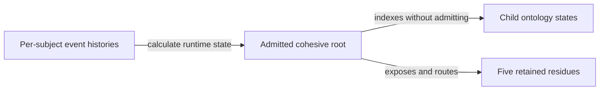

# Cohesive ontology-system root admission

Decision ID: `CAL-ONTOLOGY-SYSTEM-ROOT-ADMISSION-0045`  
Owner gate: `G-CAL-COHESIVE-ONTOLOGY-SYSTEM-ROOT-ADMISSION`  
Current result: `PASS` for exact `CLOSYS-ADM-1` selection  
Authority effect: `root-admission-only`

## Exact admitted root

- Root component: `CAL-LAB-ONTOLOGY-SYSTEM`
- System identity: `cal.ontology-system.lab-cohesion`
- Candidate digest: `ef3c79eb6bb662fa024c5fc0375fca242aa6b75e37483eae88362d33d7f69895`
- Ontology-system digest: `977ab3235bc52b3feddc2e8c4e7103349d763ab802f5982534ac409fd1e2c8c9`
- Scope: the exact root and 15-relation composition overlay over 14 components.

## Decision source

`CLOSYS-ADM-1`

## Authority boundary

The root is admitted as the authoritative navigation and composition overlay.
It does not admit a child ontology or replace per-subject ordered node and
relation event histories as the canonical runtime truth.

## Preserved child states

- 8 already-admitted components remain admitted.
- 1 Product-approved component remains not admitted.
- 1 accepted component remains not admitted.
- 4 candidate-only components remain candidate-only.
- Child ontologies admitted by this decision: `0`.
- Owner routes transferred: `0`.
- DomainSpec profiles selected: `0`.

## Claim ceiling

The exact Product-approved cohesive Lab ontology-system root and composition
overlay are admitted as an authoritative navigation layer. No runtime adoption,
activation, migration, cutover, publication, release, deployment, source
retirement, credential, destructive action, or external effect is authorized
or performed.
