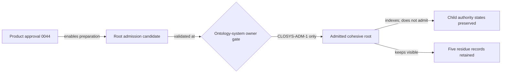

# Cohesive ontology-system root admission candidate

This package is the separate post-Product-approval authority boundary for the
cohesive Lab ontology system.

If `CLOSYS-ADM-1` is selected, the decision will admit only:

- the exact root `CAL-LAB-ONTOLOGY-SYSTEM`;
- the exact 15-relation composition overlay in the approved
  `ontology-system.json`; and
- the status-preserving catalog projection over 20 source packages and 10
  review groups.

It will not admit any child ontology. Eight already admitted components remain
admitted through their original decisions. One Product remains Product-approved
but not separately admitted, one binding remains accepted, and four components
remain candidate-only. The eleven profile-qualified
`domainspec-product-ontology@1` entries remain unselected.



Canonical event histories remain the runtime truth. Root admission does not
make the root, snapshots, projections, compiled graphs, system ontologies, or
read models into replay sources.

Run check-only validation from the Lab root:

```bash
python3 docs/decisions/0045-cohesive-ontology-system-root-admission/validate.py
```

Receipt materialization is explicit:

```bash
python3 docs/decisions/0045-cohesive-ontology-system-root-admission/validate.py --write-receipt
```

Passing validation proves admission readiness only. It does not record the
owner decision or grant any authority.
