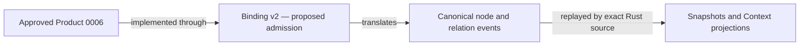

# Event-runtime binding admission candidate 0047

This review package proposes recognizing binding v2 as the implementation bridge
for the approved Ontology Product candidate 0006.



The proposed effect is **implementation-binding admission only**. The tested scope
is one exact navigation graph: 14 nodes, 15 relations, 29 semantic events and
29 governance events. The separate runtime adoption and activation decisions
remain open.

The prototype uses an empty typed-property profile. Its evidence covers initial
materialization, subject updates, replay, checkpoint recovery and restart.
It does not establish a general legacy importer or production storage guarantees.

Run from the Lab root:

```bash
PYTHONDONTWRITEBYTECODE=1 python3 docs/decisions/0047-ontology-event-runtime-binding-admission/validate.py
```

The validator checks the exact Product, binding, approval and receipts; rechecks
their bound source files; reruns Product tests; compares the result with the frozen
Product receipt; and rejects widened effects or missing source bindings.
A PASS means ready for review. It records no admission.

Review options are in `admissibility-request.json`. `EVRT-BADM-1` requests the
bounded admission; defer, reject and amendment remain available.

Construction frontier: Product candidate 0006 is tested and approved. This package
is operational support owned by the implementation-binding owner, affecting only
the post-approval admission stage. Runtime adoption, migration and publication
remain visible deferred work under their respective owners.
