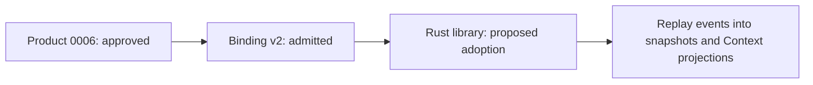

# Runtime adoption candidate 0048

The proposed decision selects the exact Rust lifecycle library as the runtime
provider behind admitted binding v2 for approved Ontology Product candidate 0006.



Adoption records which implementation provides the Product behavior. Activation
is a later operational action with a specific target and startup envelope.

This candidate covers the existing binding's `materialize` and `observe`
commands and its dependency lockfile. The standalone `ontology-at-cursor`
binary, services, enforcement hooks and general legacy migration are outside
this adoption scope.

The tested graph has 14 nodes and 15 relations, initially represented by 29
semantic and 29 governance events. Product tests cover deterministic replay,
subject updates, restart and checkpoint recovery. The empty typed-property
profile, source-owner residue and unproven production-storage properties remain
explicit limitations.

`EVRT-RADOPT-1` proposes runtime adoption only. Defer, reject and amendment
options are in `admissibility-request.json`.

Validate from the Lab root:

```bash
PYTHONDONTWRITEBYTECODE=1 python3 docs/decisions/0048-ontology-event-runtime-adoption/validate.py
```

Construction is at the approved Product frontier. This review package is
operational support owned by the runtime owner. Activation, migration and
publication remain deferred under their own owners; they do not block
independent Product construction.

No adoption decision is recorded in this package.
