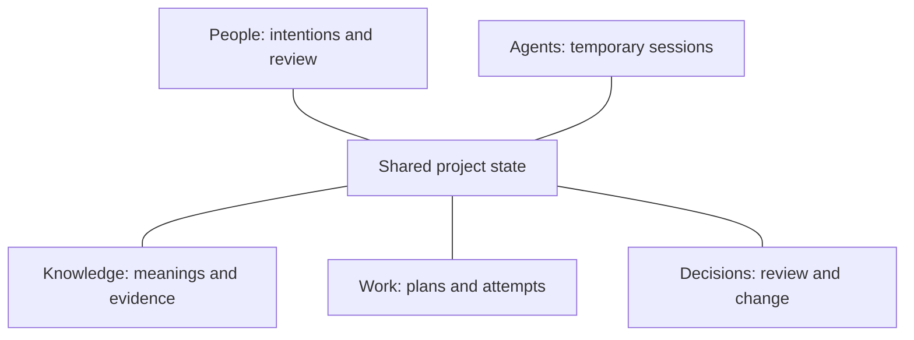

[Documentation home](README.md)

CyberAlchemy Lab / Open source

# An open company brain

Organize your company’s knowledge and work, so people and AI agents share the context behind each decision.

For software work, [Craft](company-brain.md#craft) makes concepts, rules and behavior explicit, giving implementation a model to work from.

[Explore the Lab](start-here.md)[Meet Craft](company-brain.md#craft)

A local operational foundation exists. Product and release work continues. [Current status & source](source-and-status.md)

## See one incident from meaning to decision.

Follow the Northstar example: a requirement, an attempted export, its evidence and the decision that follows. This is an illustrative case.

 [Follow an incident](tutorials/incident-walkthrough.md)

01 / The company brain

## Keep the knowledge behind the work.

A task list leaves some important questions open. What do the goals mean? Why was a decision taken, and what evidence supports the account of what happened? The project needs those answers too.

The Lab gives that knowledge a continuing structure. Definitions state the important meanings. Connected records let the next reader inspect attempts, claim support and decisions governing change.

When the work changes hands, those connections give the next participant a place to begin.

## How the company brain connects

| Part | Its role |
| --- | --- |
| People | Express intentions, examine evidence and make decisions within their authority. |
| Agents | Recover checked context and ontology views, then act within separately established permission. |
| Knowledge | Preserve definitions, sources, observations and lessons with their meaning and limits. |
| Work | Connect bounded jobs and attempts to their results and evidence. |
| Decisions | Record authorized, exact changes within their scope. |

The connections above explain responsibilities. They do not declare new ontology relation kinds. Machine sessions are temporary; durable knowledge belongs to Project State.

### How the connections become useful

**Knowledge**

Definitions, sources
and lessons

 informs  

**Work**

Plans, attempts
and evidence

 supports review  

**Decisions**

Review, acceptance
and next steps

Accepted decisions govern changes to shared project state.

Each attempt leaves evidence to examine. An accepted change follows its own authority route.

02 / How it works

## From an intention to an accountable next step.

1. ### State what the work means.

   

   Start with the intention and the meaning of success. If the task says “complete,” give people a criterion they can examine.

   [Definitions and authority](guide/authority.md#governance)
2. ### Connect the work to its evidence.

   

   Follow an assessment back to its sources, methods and observations. The finding should stay connected to its actual support.

   [Provenance and evidence](guide/provenance.md#evidence)
3. ### Make change explicit.

   

   Proposing a change, accepting it and deploying it have different consequences. Each needs its declared rules and authority.

   [Lifecycle and change](guide/lifecycle.md#change)
4. ### Continue from usable context.

   

   The next session needs relevant project knowledge, usable context and current permission. Check those before continuing.

   [Agent work and context](guide/agents-and-memory.md#agent)

03 / Working with agents

## The project remembers. The agent continues.

An agent session ends. The knowledge needed to continue belongs in the project.

Project State keeps that knowledge. Context Views select information for a task, and Ontology Views show relevant concepts and declared connections. A fresh session recovers context through those views.

Working memory belongs to the session. Expired views or changed permissions require refresh or a pause. A saved lesson also needs examination: later work should record its use and assess its benefit.

Session A**Investigate & record** Temporary session memory

Project state**Continuing knowledge** Work, evidence & decisions

Session B**Recover & continue** Fresh views & applicable permission

A handoff between sessions. The recorded project knowledge provides continuity.

04 / Software work

## Meet Craft

Craft is the software-design product within the Lab. Its explicit models describe the concepts, rules and behavior an implementation must preserve.

The Lab keeps the project context, evidence and decisions around that work. A model’s capacity check, for example, evaluates a request through a Calculation. Reserving the capacity changes state through an Operation. Those separate responsibilities give the implementation a clear reference.

[Read the Craft model](craft/model.md)

05 / Explore the Lab

## See the system from the inside.

[Begin here**Get to know CyberAlchemy Lab** A short introduction to the complete model.](start-here.md)[A concrete example**Follow an incident** See definitions, evidence, permissions and changes fit together.](tutorials/incident-walkthrough.md)[A visual explanation**Explore the system map** Inspect the model through different lenses.](guide/system-map.md#system-map)[The product story**Why we are building a company brain** The problem, the approach and its connection to alignment.](why-a-company-brain.md)

CyberAlchemy is a research lab studying intelligence and how people and machines work together. [Our research, culture and ambition →](research-and-culture.md)
