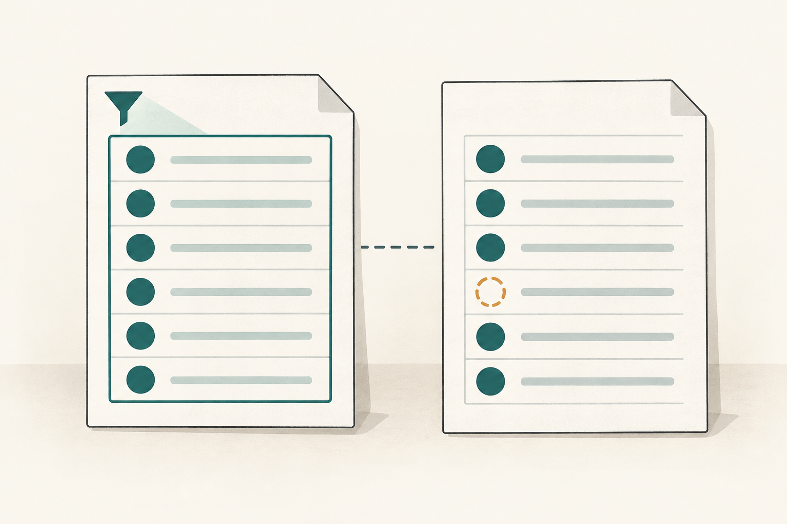

[Documentation home](../README.md)

# Authority and meaning

01

## Three questions to keep in mind

 [Explore this in the system map ↑](system-map.md#system-map) 

Once we’ve stated a meaning, there is more to understand. Someone has to be responsible for establishing it, and the claims built on it need support. We also need to know how the meaning is allowed to change.

**Governance** organizes those responsibilities and rules.

The Lab uses three questions to keep this manageable. **Authority** asks which accepted meanings and rules apply, and who has permission to act within the relevant scope.

For provenance, we follow a record back to its sources and the work that produced it. **Lifecycle** looks at its current state and the changes allowed from there.

We’ll start with authority in the incident. [Provenance and evidence](provenance.md#evidence) follows the investigation’s sources. [Lifecycle and admission](lifecycle.md#change) follows the changes and the decisions each needs.

### An export with missing records

We can examine all three questions in the same investigation. An accepted definition of completeness gives us a criterion, even while evidence about the software using it is incomplete.

Then there is permission. Investigating the incident and putting a change into use each require their own records and decisions.

Take a customer-data export. A customer says records are missing from the file they received. An agent investigates the report and prepares evidence for the owner responsible for the incident.

INC-0241 · Example incident ticket Response open

### Northstar export is missing required customer records

Opened 09:42 UTC Updated 10:10 UTC Investigation checkpoint

**Reported by**

Northstar · Customer support

**Incident owner**

Customer-data service owner

**Affected service**

Customer-data export · revision 7

**Assigned investigator**

Agent session 12 · investigation Work item

#### Customer report

> “Our customer-data export is missing records. Please investigate the file we received.”

200 

**Required identifiers missing from output E12**

The export requires 10,000 identifiers. The saved file contains 9,800 rows, and an identifier comparison confirms the omission.

Other accounts and downstream impact still need assessment.

**Account**

Northstar

**Filters**

`status = active`

**Source snapshot**

`S1`

**Export run**

12 · output `E12`

#### Investigation update

**Root cause**

Not yet established

**Containment / recovery**

Not yet established

**Proposed fix**

Revision 8 · candidate, efficacy unverified

**Agent paused**Task view 3 has expired. Refresh the view and confirm current permission before further work.

#### Next actions

1. Restore current task context and confirm the investigation delegation.
2. Investigate cause and the extent of customer impact.
3. Evaluate revision 8 and submit the evidence for owner review.

Deployment and incident closure require separate authorization.

### Activity and evidence 5 updates

1. 09:42

   **Incident opened**

   The owner records the reported **Failure Occurrence** and takes responsibility for the response.
2. 09:45

   **Investigation assigned**

   Session 12 receives a Work Assignment. The owner separately delegates 30 minutes to inspect saved material and prepare material for review. The assignment supplies the job; the delegation supplies its permission.
3. 09:55

   **Omission confirmed**

   Method 2 compares identifiers in snapshot S1 and output E12, using completeness definition 1.0.0. The Evidence Set preserves what the comparison found, so a **Failure Assessment** can examine the result within that scope.
4. 10:03

   **Candidate response saved**

   Revision 8 is proposed for evaluation. No recovery or deployment is established.
5. 10:10

   **Agent work paused**

   Task view 3 expires; the incident response remains open.

**Recorded evidence** Input snapshot S1 · saved output E12 · identifier comparison, method 2 · Operational Observation version 1

Incident record: active · Response: open Fictional ticket · times in UTC

### What does “complete” mean here?

The agent needs a criterion before it assesses the omission. In this example, that means recovering the accepted definition of “complete” for the export.

Here’s the definition.

### Complete customer-data export

One missing required identifier makes this criterion fail.

Within the identifier-coverage scope, a customer-data export is complete if and only if every required row identifier from the declared account, filters and fixed source snapshot is present in its saved output.

`Complete(E, S, A, F) ⇔ RequiredIds(S, A, F) ⊆ ExportedIds(E)`

### Read the full definition

Symbols in the formula

**E**

The saved export output being assessed.

**S**

The identified, fixed source snapshot.

**A**

The declared customer account.

**F**

The declared filters that select rows within that account.

**`RequiredIds(S, A, F)`**

The identifiers of rows in snapshot S that belong to account A and satisfy filters F.

**`ExportedIds(E)`**

The identifiers of rows present in output E.

The export is complete when every identifier selected by the account and filters in that fixed snapshot is present in its output.

Scope and boundaries

**Applicability**

Identifier-coverage assessments of customer-data exports from a fixed input snapshot, for the declared account and filters.

**Exclusions**

Data-access permission, value accuracy, duplicate or extra rows, response time, permission to deploy a fix and incident closure are assessed under their own criteria.

**Semantic owner**

The customer-data service owner, responsible for this meaning within the export assessment scope.

**Boundary conditions**

Each required row has a stable identifier, and the snapshot and output use the same identity rule. The sets record presence of identifiers. Account membership and filters are evaluated against the snapshot’s values. A different snapshot, account or set of filters requires its own assessment.

**Plain-language voice**

Every required row identifier is present in the output.

**Domain-context voice**

While investigating the Northstar export incident, the agent compares the identifiers required by snapshot S1 and filter `status = active` with those in saved output E12. This assesses the reported omission.

**Stable identity**

`example.definition.complete-customer-data-export` · version 1.0.0.

**Authority scope**

Customer-data export completeness assessments for this illustrative service.

**Testable conditions**

If every required identifier is present, the completeness criterion is satisfied. If any required identifier is absent, it is not satisfied. Without an identifiable fixed input snapshot, the assessment remains unestablished.

**Boundaries**

The explanatory voices preserve the governing meaning. A changed meaning requires a successor definition version and the responsible owner’s acceptance. This definition supplies no permission to read data or deploy software.

**Primary consumers**

The row-comparison method, the agent’s assessment and the owner’s review of the completeness claim.

**Sources and evidence**

The extraction requirement is invented for this article. The later evidence example identifies inputs, output and method; those records support a result assessed under this definition.

**Registry and index**

A real acceptance would select this exact version in the definition registry and synchronize its lookup index. This example is not registered.

**Drift and challenge route**

The service owner reviews whether later assessments preserve this meaning. Bring contradictory evidence or a proposed change of meaning to that owner through the recorded review route.

Illustration generated with imagegen. [Prompt and asset record](../assets/3576b635d532-definition-card-images.json).

The authorized service owner accepts **this exact version** for export completeness assessments.

 That decision makes version 1.0.0 the governing criterion within the declared scope.

Use the definition in the investigation

The definition gives the investigation a criterion. Now we can follow how the agent finds the rule, takes on the job and checks permission before applying it.

Authority in the incident

### What the agent checks before comparing the data

For INC-0241, the agent needs three things before comparing the data: the governing meaning, its assigned job and current permission. The comparison then has a stated scope.

1. #### Find the accepted meaning of “complete”

    Definition 1.0.0 · accepted (admitted) 

   The service owner has accepted version 1.0.0 for these customer-data export assessments. So the agent has a specific criterion to work from: every required identifier selected by the account, filters and fixed snapshot must appear in the output.
2. #### Identify the investigation job

    Agent Assignment · Work item 

   The owner gives session 12 the incident-investigation Work item. That establishes the job and expected participation. The permission to perform particular actions comes from a separate record.
3. #### Check permission for the next action

    Delegation · 30-minute window 

   The authorized owner permits inspection of saved input, output and run logs, comparison of identifiers, saving candidate assessment material and preparing a change proposal. To continue, the delegation must still be current and the task view usable.
4. #### Apply the criterion to this exact export

    Output E12 · snapshot S1 

   Compare E12 with the identifiers required for **Northstar** and `status = active` in S1. Use the account membership and filter values recorded in that snapshot. Otherwise, you’d be comparing different sets.

**Keep the next action within its permission.**

If permission expires or is revoked, or the task view becomes unusable, the agent pauses. It also stops before an action outside its scope. Changing source data, activating code and closing the incident each need authority for that particular effect.

### Inspect the exact assessment expression

`Complete(E12, S1, Northstar, { status = active })`

We now have an assessment to perform, a definition supplying the criterion and a separate delegation permitting the investigation actions. Each record answers its own question.

### Applying the meaning to work

Once the meaning is established, we need to know what a record must contain and which other records it is allowed to connect to. Accepted record formats and connection rules set those requirements.

Before acting, the agent also needs the policies and explicit permissions for its task, including who is responsible for that scope.

Each governing record has its own owner and scope. A definition supplies the meaning for an assessment, while a policy governs permitted actions during that assessment.

Acceptance identifies the version and purpose we’re working with. To say what happened in practice, we need evidence and operational records.

**Definition** The meaning of a term—for example, which customer rows qualify for inclusion.

**Artifact type** A required record format—for example, the fields needed to describe an export capability.

**Relation kind** A rule for a connection—for example, which kinds of records an experiment may evaluate, with which details.

**Policy + authority scope** The applicable rules, who may authorize actions and the limits of that permission.

### Seven details to keep separate when reading a record

The three governance questions help us read the record. Other facts still need their own place. Kind, status, evidence confidence, commitment confidence, provenance and owner stay separate under the Governance-Axis Independence Invariant. The wider model also tracks residue.

Strong evidence, for example, does not tell us how firmly an owner has committed to a proposal.

**Kind**

What is this: a definition, task, observation or another kind of record?

**Status**

Is it proposed, accepted or in another state defined for that kind?

**Evidence confidence**

How well does the evidence support this particular claim?

**Commitment confidence**

How strongly does the owner intend to proceed?

**Provenance**

Which sources, people, software versions and transformations produced it?

**Owner**

Who is responsible for this record and the decisions within its scope?

**Residue**

What remains unresolved, missing or not preserved?

### How accepted meaning informs later work

A definition can shape a schema, validator, task view or later decision through explicit bindings. To follow that influence, we need an identifiable implementation and observed effect too. Accepting the definition does not execute software, change a database or authorize every related action.

### What the comparison can establish

The agent starts with the saved output from run 12. It selects the required identifiers from snapshot S1 for Northstar and `status = active`, then compares those identifiers with E12. The export retrieved rows in successive batches, or **pagination**. The completeness criterion still covers the whole required set.

The comparison confirms 200 missing required identifiers. That gives the agent a bounded basis for assessing the reported failure. Cause and wider impact still need evidence, and any operational change needs its own authority. We will follow the basis of the assessment next.

### Definitions and sources

[Definition](../reference/records/def-cal-definition-definition.md#def-cal-definition-definition) · [Premise](../reference/records/def-cal-definition-premise.md#def-cal-definition-premise) · [Axiom](../reference/records/def-cal-definition-axiom.md#def-cal-definition-axiom) · [Invariant](../reference/records/def-cal-definition-invariant.md#def-cal-definition-invariant) · [Authority](../reference/records/def-cal-definition-authority.md#def-cal-definition-authority) · [Authority Claim](../reference/records/def-cal-definition-authority-claim.md#def-cal-definition-authority-claim) · [Authority Boundary](../reference/records/def-cal-definition-authority-boundary.md#def-cal-definition-authority-boundary) · [Governance-Axis Independence Invariant](../reference/records/def-cal-definition-governance-axis-independence-invariant.md#def-cal-definition-governance-axis-independence-invariant) · [Policy](../reference/records/def-cal-definition-policy.md#def-cal-definition-policy) · [Constitution](../reference/records/def-cal-definition-constitution.md#def-cal-definition-constitution) · [Provenance](../reference/records/def-cal-definition-provenance.md#def-cal-definition-provenance) · [Evidence](../reference/records/def-cal-definition-evidence.md#def-cal-definition-evidence) · [Operational Observation](../reference/records/def-cal-definition-operational-observation.md#def-cal-definition-operational-observation) · [Semantic Epoch](../reference/records/def-cal-definition-semantic-epoch.md#def-cal-definition-semantic-epoch) · [Context View](../reference/records/def-cal-definition-context-view.md#def-cal-definition-context-view) · [Incident](../reference/records/def-cal-definition-incident.md#def-cal-definition-incident) · [Failure Occurrence](../reference/records/def-cal-definition-failure-occurrence.md#def-cal-definition-failure-occurrence) · [Agent Assignment](../reference/records/def-cal-definition-agent-assignment.md#def-cal-definition-agent-assignment) · [Delegation](../reference/records/def-cal-definition-delegation.md#def-cal-definition-delegation) · [Artifact Type](../reference/records/def-cal-definition-artifact-type.md#def-cal-definition-artifact-type) · [Relation Kind](../reference/records/def-cal-definition-relation-kind.md#def-cal-definition-relation-kind) · [Agent Profile](../reference/records/def-cal-definition-agent-profile.md#def-cal-definition-agent-profile) · [Tool](../reference/records/def-cal-definition-tool.md#def-cal-definition-tool)

- [Proposed governance module](../../../authority/governance/candidates/0001-three-lens-module/MODULE.md)
- [Governance module index](../../../authority/governance/README.md)
- [CyberAlchemy Lab operational foundation](../../../authority/operational-foundations/candidates/0001-cyberalchemy-lab-foundation/FOUNDATION.md)
- [Governance transaction approval](../../decisions/0074-governance-transaction-surface-admission/DECISION.md)
- [Committed Project State](../../../authority/project-state-transitions/current.json)
- [Local runtime: storage, approvals and replay](../../../implementation/lab-runtime/v1/lab_runtime/store.py)
- [Local runtime: governed consequences](../../../implementation/lab-runtime/v1/lab_runtime/governance.py)
- [Local runtime implementation overview](../../../implementation/lab-runtime/v1/README.md)
- [Local runtime: temporary agent sessions](../../../implementation/lab-runtime/v1/lab_runtime/session.py)
