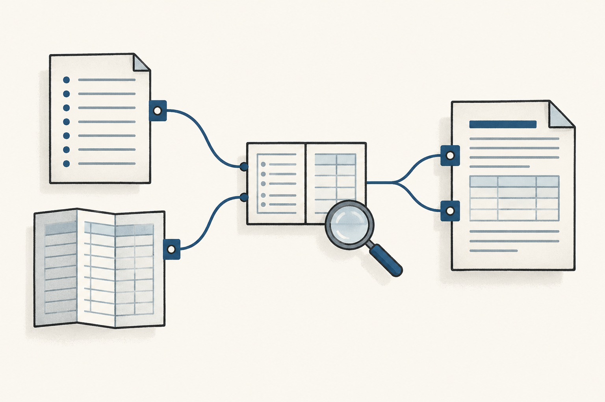

[Documentation home](../README.md)

# Provenance and evidence

02

## Show what the evidence actually supports

 [Explore this in the system map ↑](system-map.md#system-map) 

The agent saves the missing identifiers and the comparison that found them. A reviewer should be able to recover the exact inputs, the operation and the responsible recorder. Provenance supplies that account. Here is its meaning in the Lab’s Definition format.

### Provenance

Sources and operations remain traceable.

Provenance is the declared origin and transformation chain for an exact object version. It identifies the sources or earlier objects on which that version depends, the typed relationships and operations connecting them, the owners or processes involved and the authority standing at each relevant step.

`Prov(x) = [(sourceᵢ, relationᵢ, operationᵢ, ownerᵢ, postureᵢ)]*`

### Read the full definition

Symbols in the formula

**x**

The exact version of the record, claim, rule or other object whose origins are being examined.

**`sourceᵢ`**

An identifiable source or earlier object version used at step i.

**`relationᵢ`**

The declared relationship at that step, under the applicable connection rules.

**`operationᵢ`**

What was done with that source: for example, a comparison, adaptation or generated projection.

**`ownerᵢ`**

The owner or process responsible for that step.

**`postureᵢ`**

The authority standing at that step, such as a recorded source or an accepted definition.

**`[…]*`**

A sequence of trail entries. Any missing segment must be recorded explicitly, with an owner responsible for its review.

Scope and boundaries

**Applicability**

Tracing the origins and transformations of definitions, records, claims, decisions and results before relying on, adapting or publishing them.

**Exclusions**

Establishing truth, granting permission, validating a result or accepting a record. Those require their own evidence and authority routes.

**Semantic owner and scope**

The definition owner is responsible for the meaning of provenance in the Lab’s lineage scope. A service owner maintains the particular export trail within its own responsibility.

**Boundary conditions**

Sources, versions, relationship types and operations must be identifiable. Missing or uncertain steps remain visible and have an owner route for review.

**Plain-language voice**

The trail that lets someone inspect where a record came from and what happened to it.

**Domain-context voice**

For the Northstar incident assessment, the trail identifies snapshot S1, output E12, software revision 7, comparison method version 2 and investigation session 12. It also records their roles and authority standing.

**Identity and version**

This article illustrates the Lab’s selected Provenance definition. The reference library preserves its exact identity and version.

**Sources and standing**

The meaning and trail expression come from the Lab’s Provenance definition. This presentation explains that meaning; the business records below are invented examples.

**Primary consumers**

Reviewers, source imports, measurement records and agents examining the basis of a conclusion.

**Testable conditions**

A reviewer can locate the declared sources and operations, distinguish their roles and identify any unresolved segment and its responsible owner.

**Registry and index**

Selected authority is looked up through the definition registry and its synchronized index. This article adds no definition selection.

**Drift and challenge route**

Changes to the meaning go to the definition owner. Changes or gaps in a particular trail go to the owner responsible for that record and its source review.

Illustration generated with imagegen. [Prompt and asset record](../assets/3576b635d532-definition-card-images.json).

Build the trail described by the definition

The definition tells us what the trail needs to preserve. In this investigation, the trail identifies the sources, operations and responsibilities behind the S1 and E12 comparison.

Provenance in the incident

### Follow the missing-record claim back to its sources

Follow the comparison for INC-0241 back through its saved inputs, method and recorded observation. The authority records permit the investigation. The source trail explains the assessment it supports.

1. #### Identify the two inputs

    Source records · exact versions and file digests 

   **Required set · S1**

   **10,000 identifiers** Northstar · `status = active`

   

   **Saved output · E12**

   **9,800 exported rows** Run 12 · service revision 7
2. #### Compare the actual row identifiers

    Comparison method · version 2 

   Method 2 identifies the required identifiers absent from E12. The counts are useful context, but they would not tell us which rows are missing. The comparison has to retain the identifiers.

   

   200 required identifiers are absent.
3. #### Save what was observed and how

    Operational Observation · version 1 

   Session 12 records the missing identifiers, exact sources, method execution and limitations. Export run 12 and investigation session 12 happen to share a number. They are still separate records.
4. #### Use the evidence for a bounded assessment

    Evidence Set supports Failure Assessment 

   An Evidence Set keeps the sources and comparison together for this claim, including counterevidence and gaps. It supports an assessment of E12 under definition 1.0.0, for this account, filters and snapshot.

**The omission is established within this scope.**

The omission is established within that scope. Cause, downstream uses, other accounts and recovery still need investigation. The service owner stays responsible for the assessment and response.

### Inspect the formal result and provenance fields

`R = RequiredIds(S1, Northstar, { status = active })``M = R ∖ ExportedIds(E12)``|R| = 10,000; |M| = 200 ⇒ ¬Complete(E12, S1, Northstar, { status = active })`

**Subject · x**

The exact Operational Observation version 1.

**Sources · sourceᵢ**

The Source records identifying snapshot S1 and saved output E12.

**Relationships · relationᵢ**

The observation *originates from* each Source record, with the origin role declared as required input or observed output.

**Operation · operationᵢ**

Method 2’s identifier comparison, execution record and limitations.

**Recorder and owner · ownerᵢ**

Agent session 12 records the observation; the service owner retains responsibility for the assessment and response.

**Standing · postureᵢ**

Inputs are recorded sources. Definition 1.0.0 has its own owner acceptance. The observation records a datum; the assessment remains candidate review material.

If a Finding is recorded, it derives from the Evidence Set and carries the same support and limits. The trail explains how the information was produced. Permission to act still comes from the applicable authority records.

### How the trail supports the claim

A later agent or reviewer can return to the same snapshot, account, filters, output and method. They can inspect the operation behind the observation and decide whether the assessment stays within those conditions.

The owner’s acceptance record supplies the authority for definition 1.0.0. Its source trail lets someone inspect that acceptance.

A source bears on a claim through a declared relationship with a subject version, conditions and freshness. The **Evidence Set** keeps the comparison, counter**evidence** and gaps. A **Failure Assessment** then examines occurrence, cause, impact, containment and recovery without hiding uncertainty in any of them.

For E12, the omission is confirmed. Cause and recovery are still unestablished.

**Diagram labels:** Northstar incident · inspect the basis of the omission claim. · Sources · S1 + output E12 Northstar · active · Comparison · Required identifiers minus output identifiers · Evidence Set · 200 required identifiers missing · Assessment · Omission confirmed Cause unresolved · Showing missing rows does not yet establish why they are missing.

### Read this diagram as text

Definition 1.0.0 requires every identifier selected for Northstar with status = active in S1. E12 contains 9,800 rows. Method 2 compares the actual identifier sets and finds 200 required identifiers missing. The Evidence Set supports the Failure Assessment. Any recorded Finding derives from that set. We still haven’t established why the rows are missing or whether recovery succeeded.

- Northstar incident · inspect the basis of the omission claim.
- Sources
- S1 + output E12 Northstar · active
- Comparison
- Required identifiers minus output identifiers
- Evidence Set
- 200 required identifiers missing
- Assessment
- Omission confirmed Cause unresolved

Figure 01 The count alone is insufficient: preserve the selected identifiers, exact snapshot and output, account, filters, method and recording session. The Evidence Set supports a bounded assessment of the omission.

### Keep the evidence records distinct

The records let another reader follow the reasoning one step at a time. A **Measurement Method** explains how to count or compare; a **Measurement Result** records one execution and its conditions. Ordinary project work uses **Operational **Observation****. Research and experiment runs use the separate Observation kind.

A **Finding** derives from an Evidence Set and states its conclusion, limitations and challenge route. Its contract can also permit support from a Research Run. Recording each part keeps the conclusion connected to its actual support.

A **digest** is a digital fingerprint of a file’s contents. It helps us identify the exact file used in the comparison. The fingerprint does not tell us whether the contents, or our conclusion about them, are correct.

### What the trail preserves

A trail identifies who recorded or transformed information. To find out whether that participant can authorize a change, we need the authority records for the scope. A copied definition might have a faithful source trail and still need its own acceptance.

**What the agent can say**“This export omitted rows that the comparison rule required. We have not yet established the cause.”

### Definitions and sources

[Source](../reference/records/def-cal-definition-source.md#def-cal-definition-source) · [Provenance](../reference/records/def-cal-definition-provenance.md#def-cal-definition-provenance) · [Measurement Method](../reference/records/def-cal-definition-measurement-method.md#def-cal-definition-measurement-method) · [Measurement Result](../reference/records/def-cal-definition-measurement-result.md#def-cal-definition-measurement-result) · [Evidence](../reference/records/def-cal-definition-evidence.md#def-cal-definition-evidence) · [Evidence Set](../reference/records/def-cal-definition-evidence-set.md#def-cal-definition-evidence-set) · [Finding](../reference/records/def-cal-definition-finding.md#def-cal-definition-finding) · [Operational Observation](../reference/records/def-cal-definition-operational-observation.md#def-cal-definition-operational-observation) · [Observation](../reference/records/def-cal-definition-observation.md#def-cal-definition-observation) · [Research Run](../reference/records/def-cal-definition-research-run.md#def-cal-definition-research-run) · [Failure Occurrence](../reference/records/def-cal-definition-failure-occurrence.md#def-cal-definition-failure-occurrence) · [Failure Assessment](../reference/records/def-cal-definition-failure-assessment.md#def-cal-definition-failure-assessment) · [Incident](../reference/records/def-cal-definition-incident.md#def-cal-definition-incident)

- [CyberAlchemy Lab operational foundation](../../../authority/operational-foundations/candidates/0001-cyberalchemy-lab-foundation/FOUNDATION.md)
