# Governance architecture ontology: dependency plan

Status: proposed DAG, 2026-10-06. Authority effect: none. [Research baseline](RESEARCH.md) is the evidence map; [dag.json](dag.json) is the machine-readable dependency list; [implementation layering](IMPLEMENTATION-LAYERING.md) states the decision unlocked by each wave.

Progress: [R0 source baseline](R0-SOURCE-BASELINE.md) and [C1 query contract](C1-QUERY-CONTRACT.md) are complete as research/specification artifacts. The D73 version-reference finding remains explicit. The next node is **C2**. S1 must resolve or fail closed on the finding before L0 claims exact-version traversal.

## Target result

From any of the three governance lenses, answer: **what does this mean, which exact contracts and records realize it, where is it implemented, what evidence supports the connection, what is its effective current state, and what is still missing?** The graph is a digest-bound, rebuildable read model. Source Definitions, admission overlays, Typed Relations, event histories, and exact implementation bytes keep their own authority.

## DAG

```mermaid
flowchart LR
  R0["R0 Source baseline"] --> C1["C1 Query and claim contract"]
  C1 --> C2["C2 Ontology profile and edge rules"]
  C2 --> S1["S1 Effective-state resolver"]
  C2 --> S2["S2 Implementation source catalog"]
  S1 --> L0["L0 Lifecycle vertical slice"]
  S2 --> L0
  L0 --> A1["A1 Authority slice"]
  L0 --> P1["P1 Provenance slice"]
  A1 --> B1["B1 Evidence-backed bridges"]
  P1 --> B1
  B1 --> Q1["Q1 Unified graph queries"]
  Q1 --> F1["F1 Freshness and coverage"]
  F1 --> M1["M1 Repeatable refresh"]
  M1 --> G1["G1 Separate governance reviews"]
  G1 -. separate decision .-> X1["X1 Optional runtime adapter"]
```

`A1` and `P1` may proceed in parallel. `S1` and `S2` may proceed in parallel. Dotted `X1` is optional and outside the minimum result.

| ID | Depends on | Deliverable | Completion evidence |
| --- | --- | --- | --- |
| **R0 Source baseline** | — | Fresh source manifest and exact D70-D73 effective-state matrix; candidate/admitted/runtime boundaries and initial coverage obligations. | Source paths/digests, decisions, overlays, history cursors, unresolved conflicts, and excluded areas are recorded. Inventory and governance map currentness are assessed before reuse. |
| **C1 Query and claim contract** | R0 | Three example queries and a response shape: `show Lifecycle`, `why may this Decision count?`, `where did this capability come from?` | Each expected answer lists required subjects, edge meanings, evidence, state layers, exclusions, and unknown values. Claim ceiling is written before implementation. |
| **C2 Ontology profile and edge rules** | C1 | Candidate Lab governance-architecture ontology profile: business/system/bridge branches, node identity, local edge vocabulary, global-projection rule, ownership, challenge route, versioning, and schema-fit decision. | No wildcard/catch-all global endpoints; local/global non-collapse, source authority, and independent governance facets are explicit. Any new Definition, carrier, or Relation Kind need is identified, not silently introduced. |
| **S1 Effective-state resolver** | C2, R0 | Read-only resolver for Definition/contract/instance/Typed Relation state across D70-D73 registries, decisions, copied sources, and admission overlays. Resolve the [R0 version-reference finding](r0-version-ref-audit.json) or expose it as an unresolved alias. | A D73 copied `candidate` field resolves to the admitted effective state while remaining visible as source provenance; stale, ambiguous, or unbound version references return unknown/error. |
| **S2 Implementation source catalog** | C2, R0 | Bounded catalog of code declarations, schemas, writers, projectors, validators, and evidence sources relevant to the three lenses. Start with governance projector, Project State transition scripts, and ontology carriers. | Each symbol has exact path/selector/digest and an observed, designed, or gap posture. No file-presence-to-implementation inference. |
| **L0 Lifecycle vertical slice** | S1, S2 | Candidate graph rooted at Lifecycle with D71-D73 Project State revisions, `relation.successor-of`, decisions, separate Project event histories, the reporting projector, and explicit writer/runtime gaps. Include one read-only traversal and human view. | One command/view can trace current state to predecessor, transition evidence, contract, and source implementation, with contract/instance/domain/ontology/runtime/session tracks distinct. It reports D73's zero runtime activations. |
| **A1 Authority slice** | L0 | Authority graph through Definition, claim, role/delegation, Policy, Decision, scope, declared effect, overlay, and implementation/gap. | A D73 query shows the exact admitted effect and does not infer action permission or runtime activation. Owner text, policy applicability, and grant remain separate. |
| **P1 Provenance slice** | L0 | Provenance graph through exact source selector/digest, origin/derivation Typed Relation, transformation or Agent action where present, output, and evidence assessment/gap. | The D71 Product Capability traces to its Product Thesis without being reported fulfilled; missing source or digest drift is visible. |
| **B1 Evidence-backed bridges** | A1, P1, S2 | Candidate architecture links from meaning/contracts to implementation and checks, each with evidence from both business and system sides or an explicit gap. | `realized-by`, `tested-by`, `observed-by`, and similar local meanings are differentiated; no local link becomes a global Typed Relation or implementation claim by label alone. |
| **Q1 Unified graph queries** | B1 | Common read-only query interface for lens-root traversal, subject-centric three-panel view, inbound/outbound dependencies, bounded depth, and explain-why paths. | The three C1 questions return reproducible paths, exact source links, effective states, evidence, and gaps. Traversal is bounded and cycle-safe. |
| **F1 Freshness and coverage** | Q1 | Source-digest comparison, invalidation, coverage obligations, gap/drift report, and historical snapshot identity. | Changed/missing sources cannot appear current. Every in-scope governance contract has an explicit mapped or unmapped result. Coverage reports distinguish paths, governed subjects, and implementation symbols. |
| **M1 Repeatable refresh** | F1 | Documented deterministic rebuild workflow and operator-facing currentness summary, initially local/on-demand. | Repeating a build over identical source digests produces the same graph; source changes produce a new snapshot or a clear stale result. No background service is presumed. |
| **G1 Separate governance reviews** | M1 | Reviewable exact ontology profile, graph instance, receipts, drift/residue, and decision requests for any necessary Definition/carrier/relation changes. | Owners can decide each authority effect separately. A review/validation receipt alone changes no admission or runtime state. |
| **X1 Optional runtime adapter** | G1 plus an explicit runtime decision | If justified, an adapter from canonical ontology events to the existing candidate Rust graph read model. | Exact source and cursor parity, challenge joins, and read-only claim ceiling are independently evidenced before any adoption/activation proposal. |

## Execution waves and decisions

1. **Foundation: R0 → C1 → C2.** Decide whether existing carriers and an ontology-local edge vocabulary can express the graph without a new global Relation Kind.
2. **Minimum proof: S1 ∥ S2 → L0.** Decide whether a Lifecycle-root query answers a real D71-D73 question with correct status and provenance.
3. **Three-view coverage: A1 ∥ P1 → B1 → Q1.** Decide whether one subject can be understood coherently across all three lenses and implementation bridges.
4. **Ongoing use: F1 → M1.** Decide whether repository changes can be detected and refreshed without stale authority claims.
5. **Governance: G1.** Review exact candidate bytes and effects. Any later runtime use follows a separate decision at X1.

## Critical rules for every step

- Resolve effective state from decisions and overlays; preserve candidate bytes as provenance.
- Keep source subject, contract, Ontology Node, file, code symbol, global Typed Relation, and local Ontology Edge distinct.
- Keep semantic and governance event histories distinct; a graph index, Cut, View, or inventory is never a replay source.
- Model separate business/system evidence on every implementation-alignment bridge. Unproven alignment is a gap.
- Report unknown, not-evaluated, and stale explicitly. Do not infer authority, proof, fulfillment, or runtime liveness from adjacency.
- Do not mass-create Ontology Nodes for all inventory files. Add a governed subject or implementation symbol when a specific query/coverage obligation needs it.

## Next executable work item

Start **C2** with the [C1 query contract](C1-QUERY-CONTRACT.md): define the governance ontology profile, node identities, closed local edge signatures, global projection rules, and exact carrier fit. This is candidate specification work; it does not admit or activate anything.
