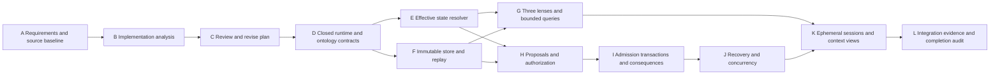

# Lab operational runtime

Status: implemented, verified and owner admitted by [Decision 0075](../../decisions/0075-lab-operational-runtime-v1-admission/DECISION.md), 2026-10-07; all A–L nodes complete. See [implementation analysis](IMPLEMENTATION-ANALYSIS.md), [review](PLAN-REVIEW.md), [completion audit](COMPLETION-AUDIT.md), and [exact validation receipt](../../../implementation/lab-runtime/v1/receipts/validation.json). The exact reviewed local implementation is admitted through an external overlay; its frozen package and D74 source profile remain unchanged. This work builds the complete local operational boundary discussed in the runtime proposal: source-bound reads, governed writes, replay/recovery, and ephemeral Agent context. The admission creates no product runtime activation.

## Intended result

An operator can inspect the admitted repository through D74, explain Authority/Provenance/Lifecycle, prepare an exact change, supply an independently authenticated approval, and apply the change once. The transaction produces a successor Project State, separate semantic/governance history entries, and an exact receipt. Agent contexts derive from that durable state; working memory expires with the session. All operations are local and on demand.

## Dependency DAG

| Node | Depends on | Deliverable and completion evidence |
| --- | --- | --- |
| A | — | Requirements, exact D74 inputs, canonical/runtime/candidate boundaries, independently tracked state axes. |
| B | A | Source inspection of governance projector, D74 apply script, v4 ontology runtime, graph read model, current schemas/registries and their fit/gaps. |
| C | B | Written review retaining the full requested scope, correcting obsolete D73 assumptions and stating justified implementation choices. |
| D | C | Closed command/proposal/approval/store contracts; explicit ontology-local edges, exact versions, challenge route, source schema fit, no inferred global connection. |
| E | D | Digest-bound Definition/type/relation/instance catalog and effective overlays through D74; historical records retained; ambiguous versions visible and excluded from confirmed traversal. |
| F | D | Immutable transaction chain, atomic HEAD, separate histories, deterministic replay, source freshness and store identity checks. |
| G | E,F | State, subject, Authority, Provenance, Lifecycle and bounded traversal commands with source links, implementation bridges, gaps, limits and coverage. |
| H | E,F | Exact proposal dry run and independently verified approval binding actor, policy, scope, targets, base HEAD and source snapshot. No owner-text permission inference. |
| I | H | Reusable admissions/revisions/withdrawals for declared record classes; schemas and closed endpoints checked; one transaction materializes state and both histories without another bookkeeping approval. |
| J | I | Stale-head rejection, idempotency, serialized writes, crash injection, fresh-process recovery and corrupt-history rejection. |
| K | G,J | Source-bound Context/Ontology projections for an ephemeral session, expiry/head/freshness checks, session-only working memory and explicit promotion of durable output via a proposal. |
| L | K | Real D74 read, repeatable isolated write/restart demonstration, hostile cases, CLI docs, synchronized DAG and requirement-by-requirement completion evidence. |

## Implementation layers

| Layer | Decision question | Scope and outcome | Exit evidence |
| --- | --- | --- | --- |
| 0 | After this layer, we know whether current Lab records can be reconstructed accurately. | A–G: source capture, exact status resolution, read model, three lenses. | D74 current state and histories; D73 version gap reported; stale inputs fail closed; reproducible source snapshots. |
| 1 | After this layer, we know whether one authorized operation can produce all declared consequences once. | H–I: proposals, approval verification, closed validation, atomic transaction. | Multiple record classes, schema/endpoint checks, receipt and Project State/history parity. |
| 2 | After this layer, we know whether the state survives interruption and conflicting writers. | J: recovery, integrity, idempotency, serialized publication. | Fresh-process replay, failure before/after HEAD, stale writers, corrupt chains and recovery controls. |
| 3 | After this layer, we know whether an Agent can work from trustworthy derived context. | K–L: ephemeral sessions, scoped views, memory expiry, integrated demonstration. | Session ends/expiry invalidate context; durable output requires authorized transaction; complete audited command coverage. |

Later layers preserve every earlier guarantee. Source schemas and decisions remain authoritative for the repository; runtime protocol schemas describe this candidate's executable interface. The local store owns only explicitly authorized local operational transactions after its frozen repository baseline. Canonical repository publication/adoption is a separate effect.

## Verification policy

Use real D74 sources for read coverage and temporary stores/keys for write and hostile tests. Never manufacture a repository owner admission, modify historical admitted bytes, or use a passing receipt to claim implementation admission. Verify every DAG obligation before claiming the complete runtime built. Production deployment, network services, multi-host writes and external actions require their own product scope.

## Delivery location

Executable implementation: `implementation/lab-runtime/v1/lab.py`. The source profile, protocol schemas, operator guide, repeatable suite, disposable demonstration and exact validation receipt live alongside it. The machine DAG records per-node completion evidence; the final completion audit must match that receipt and the inspected files.
