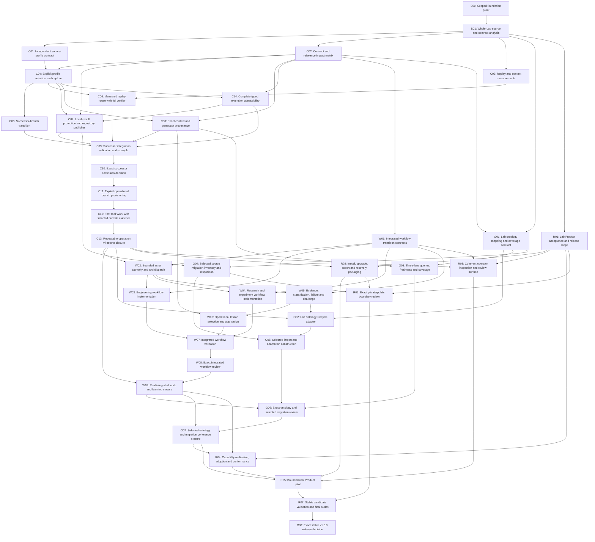

# Complete task DAG

Status: proposed dependencies; authority effect: none. [dag.json](dag.json) is the machine dependency source. Edges mean accepted upstream evidence, not global semantic Relation Kinds. Owner nodes require actual exact dispositions; no simulated approval.

