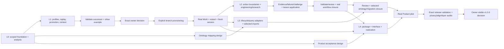

# Integrated Lab analysis and dependency plan

Status: **proposed**, 2026-10-07. Authority effect: **none**. Scope: the complete five-milestone Lab roadmap; 40 task nodes and 57 smallest working units. This request creates analysis and planning artifacts; no runtime implementation, new admission, provisioned store or release is claimed.

## Read in this order

For the requested consolidation into one final owner interaction, see the [proposed single-checkpoint variant](single-checkpoint/PLAN.md). It preserves the original scope, moves intermediate admissions into final review preparation, and keeps actual admitted-operation closure after approval. Feasibility is conditional; this original DAG remains preserved.

1. [Complete milestone analysis](ANALYSIS.md): objectives, current implementation, gaps, construction approach, acceptance and costs for every step.
2. [Implementation analysis](IMPLEMENTATION-ANALYSIS.md): exact modules/selectors to reuse or adapt; proposed new write scopes.
3. [All-current contract coverage](CONTRACT-COVERAGE.md): 121 current carriers and 41 Relation Kinds with machine schema/endpoint matrix.
4. [Work pack](WORK-PACK.md): task board, dependency/status, SWUs and evidence gates.
5. [Execution waves](EXECUTION-PACK.md), [full task DAG](DAG.md), [machine DAG](dag.json).
6. [Planning review](PLAN-REVIEW.md): structural checks and unresolved design choices.

## Main dependency structure

## Milestone joins

| Layer | Join | Required result |
| --- | --- | --- |
| L0 | B00 + B01 reconciliation | Exact foundation proof distinguished from current executable/source/repository state. |
| L1 | C13 | Same executable, reviewed new profile, explicit branch continuity, real Work and fresh session. |
| L2 | W09 | Engineering/research paths, enforced action bounds and assessed later lesson application. |
| L3 | O07 | Selected ontology/migration scope reconstructible with exact joins, coverage and gap disposition. |
| L4 | R08 | Actual owner stable-release decision for exact validated useful Product package. |

## Recommended next unit

**C01 / SWU-C01-01: specify the independent source-profile contract.** C02 contract impact, C03 replay measurements and R01 Product acceptance design are dependency-independent after B01; O01 follows C02. Construction then joins through C09 before one exact successor review at C10. Provisioning and real work follow their explicit operational scope.

The plan recommends preserved historical branches and a reviewed separate successor branch, not an in-place rebase. Full replay remains the independent verifier; measured reuse cannot turn a cache into authority. The existing runtime and ontology components are reused rather than rebuilt wholesale.

## Review and authority discipline

Each owner node reviews an exact revised package and realistic example. One envelope can carry multiple independent effects. Deterministic state/history/receipt consequences require no second decision. Software admission, profile transition, provisioning/adoption, action permission, observed runtime, Product value and release remain distinct even when selected effects share an envelope.

Dates and duration-based critical path are deferred until bounded scopes are estimated. The graph ranks in the execution pack are dependency waves, not deadlines. Every closure node verifies contract/typed-axis alignment and preserved layer guarantees. Selected rejection, missing evidence or changed bytes prevents downstream promotion.

## Major deferrals

Unselected legacy sources, automatic source retirement, persistent services, multi-host writes, additional frontends and automatic lesson promotion. These become work only through selected Product/operational requirements and declared effects.
