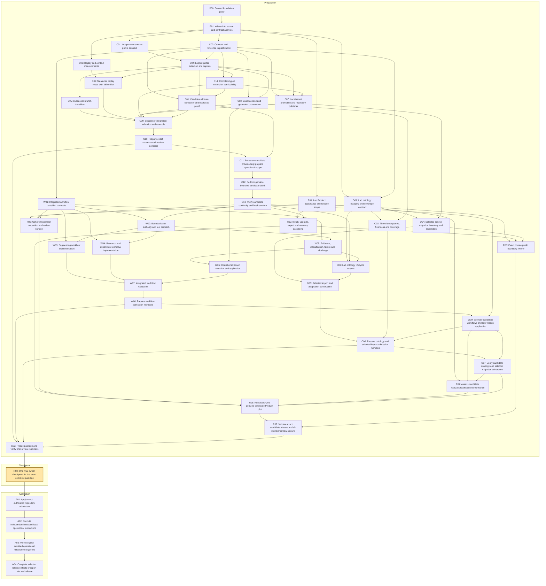

# Proposed single-checkpoint DAG

Status: proposed analysis variant; no execution authority. Original roadmap remains preserved. **One human checkpoint at R08; application and operational verification follow it.**

## Reading the graph

C10, W08 and O06 prepare exact member Decisions. They confer no authority on downstream candidate work. C11–C13, W09, O07 and R04–R05 supply candidate evidence in the pre-approval branch; actual admitted obligations remain at A02/A03. S01 supplies the missing isolated candidate bootstrap. S02 closes final targets, carrier fit and evidence.

A04 is a guarded selected release disposition: a required new semantic Decision, missing admitted pilot evidence or unrepresentable conditional authorization blocks full release. Internal quality gates and all original semantic/evidence criteria remain.

The [machine graph](dag.json) maps all 40 original tasks and adds six explicitly scoped integration nodes (46 total). The [transformation matrix](task-transformation.json) retains each original acceptance criterion. Original SWUs need phase reconciliation before execution; this is not an authorized execution pack.
