# Lab roadmap with one final owner checkpoint

Status: **proposed analysis variant**, 2026-10-07. Authority effect: **none**. Implementation, tests, provisioning, admissions and release are not authorized by this analysis.

## Answer

**We can build, exercise and review the complete bounded candidate in one continuous run, then present one final approval.** The current plan needs phase changes to do this. Actual admission, selected local operations and verification follow that approval.

**We cannot promise that every original operational milestone will be complete before the approval, or that future evidence and targets will need no later decision.** A complete stable release under one checkpoint is conditional on available pilot evidence, exact targets, owner authority, operational scope and carrier fit. The feasibility verdict is **flag: viable design, execution readiness still conditional**.

```mermaid
flowchart LR
  B["Build integrated candidate"] --> E["Authorized candidate Work, learning and pilot"]
  E --> V["Validate; freeze all targets; show examples"]
  V --> H["ONE owner checkpoint"]
  H --> A["Atomic repository admission"]
  A --> O["Separately authorized local operations"]
  O --> P["Observe actual operation; check release conditions"]
  P --> R["Selected release or explicit blocked result"]
```

## Start here

1. [Feasibility analysis](ANALYSIS.md): what can move, what remains conditional, and a realistic example.
2. [Revised DAG](DAG.md), [machine graph](dag.json): 46 nodes, one human checkpoint; every original task retained.
3. [All-task transformation](task-transformation.json): preserved criteria and deferred operational obligations.
4. [Proposed approval boundary](approval-boundary.json): exact final preconditions and invalidation rules; this is **not** a materialized Decision Bundle.
5. [Independent review and reconciliation](ROLE-REVIEW.md), [source baseline](SOURCE-BASELINE.json), [planning check](receipts/planning-check.json).

The [original roadmap](../PLAN.md), its 40 task contracts, 57 SWUs and historical evidence remain preserved. This variant overrides phase and claim boundaries; changed SWU contracts must be reconciled before execution.

## Recommendation

Use **one checkpoint at the end of preparation**, replacing C10/W08/O06 with preparation of members for R08. Keep every internal dependency and quality gate. Start implementation with C01/C02 and include S01 candidate bootstrap and S02 exact review closure.

At C02/R01, establish the operational authorization carriers and whether release acceptance permits a genuine candidate pilot. If release instead requires newly admitted operational evidence or new semantic targets, record that the complete release cannot be promised with the same single checkpoint. Do not relax acceptance to meet an approval-count target.

No additional approval is needed for deterministic State, history, receipts, indexes and projections already declared by the exact approved package.
