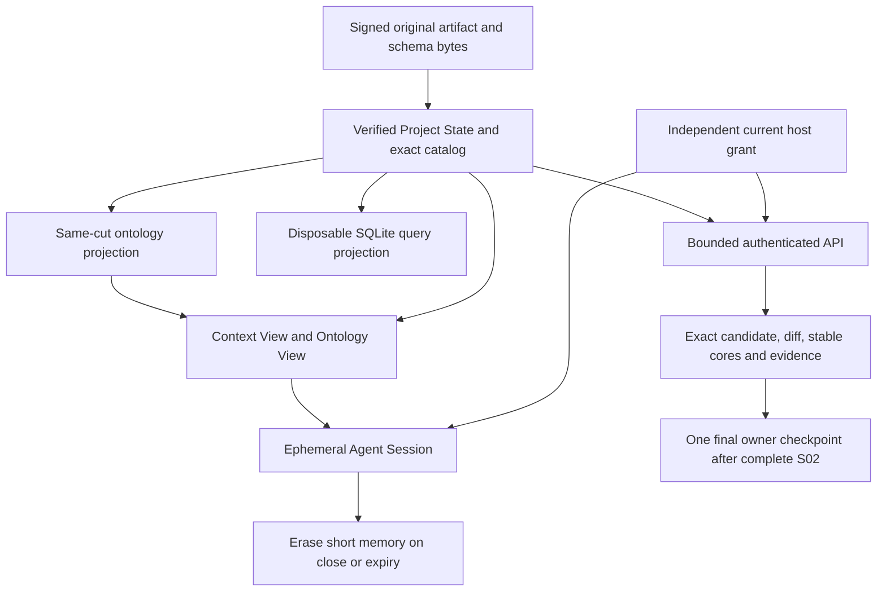

# Lab API integration — correction in verification

API-v18 is an immutable candidate. Its full 129-test suite is running; qualification and admission are pending. The full plan remains **35/46 criteria closed**, with **12/34 API operations implemented and 22 remaining**. The currentness check passed with no drift across 36 active receipts, 77 original planning files and 887 original bound sources.

## Changes made

| Area | Correction | Preserved boundary |
|---|---|---|
| Catalog and artifact instances | Keep the explicit catalog discriminator for the 41 Relation Kind declarations, whose signed projection has no instance carrier field. Use the raw source reader for instances. | Exact original file/body hashes, closed metatypes, typed endpoints and unknown-encoding refusal. |
| Session request construction | Copy exact selected artifact references before a negative case alters a request. | Resolver state and source closure remain independently guarded. All test assertions remain unchanged. |
| Session test lifetime | Provision a fresh owned host, key, nonce and bounded grant for each method, then clean it up. | Production grant limits, actual expiry timers, memory erasure and the original absolute Assignment interval are unchanged. |
| Failure evidence | Print failure detail immediately and retain the complete final test receipt. | Every original test remains selected; frozen predecessors remain unchanged. |

## Actual independent diagnostic

A separately frozen diagnostic made eight real authenticated calls under a new Ed25519 nonce and removed its owned host afterward. Its nonce and original request hashes were independently verified.

| API-v17 operation | Actual observed reply |
|---|---|
| lab.status | Result |
| catalog.get | Result |
| artifact.query | Error: integrity-failed |
| artifact.inspect | Result |
| change.prepare | Result |
| change.validate | Result |
| operation.inspect | Result |
| projection.refresh | Error: indeterminate; inspect before reconciliation |

These observations identify the repair target. They do **not** qualify API-v17 or prove API-v18 passes. The complete predecessor suite continues, preserving all failures and traces. The successor suite runs all 129 selected cases, including both Session source branches and the complete SQLite projection.

## Model retained

Signed original bytes remain authoritative. SQLite supports queries and can be rebuilt. Long term Agent context comes from current Project State through Context and Ontology Views; short memory belongs to the Session.

## Verification and next actions

1. Consume the actual terminal results of API-v17 and API-v18; preserve every predecessor failure. Any new defect requires an immutable successor.
2. After a complete successor pass, freeze and run the independent audit: all raw bytes and catalog declarations, all 12 actual operations in both branches, full SQLite custody, wrong-core refusal, nonce proof and cleanup.
3. Synchronize the partial R03 evidence and currentness, then implement the remaining 22 API contracts and finish R04–R07/S02.
4. Present the complete exact package for the sole final R08 owner checkpoint. Actual human pilot and owner responses remain separate evidence requirements.

No admission or owner outcome has been recorded by this correction.

## Exact files

- [Frozen API-v18 source](/home/vlad_/projects/CyberAlchemy-lab/product/lab/release-candidates/v1/interface/api-v18/source-manifest.json)
- [API-v18 full-suite log](/home/vlad_/projects/CyberAlchemy-lab/product/lab/release-candidates/v1/interface/api-v18/checks-0001.log)
- [Independent eight-call diagnostic](custody-api-diagnostic-result-0001.json)
- [Diagnostic terminal](custody-api-diagnostic-terminal-0001.json)
- [Correction context](context-R03-custody-api-0003.json)
- [Independent audit context](context-R03-custody-api-audit-0002.json)
- [Currentness receipt](currentness-receipts/0081.json)
