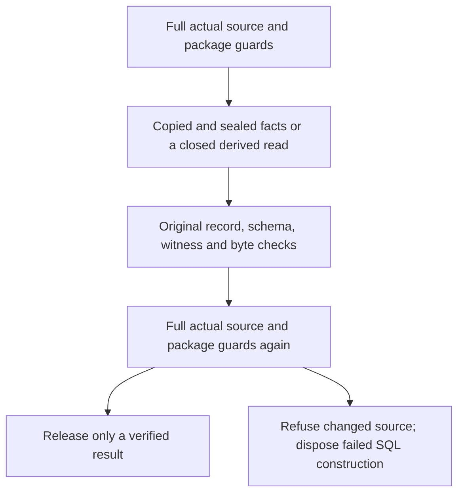

# R03 guarded calculation successor — verification in progress

**Status: candidate; full regression and independent qualification pending.** The plan remains 35/46 criteria closed and 12/34 public APIs implemented. No new admission or owner response.

## Actual findings

- Untraced measurements retained 12 observations. A public raw header took about 0.7–0.9 seconds because it verified the entire producer package on every call; the same selected original reader calculated the identical header in microseconds. Original byte reads were also identical.
- Two unchanged original API-v19 Session tests passed under method timers without line tracing: distinct Session/Agent identities and exact same-key retry. All 36 method observations, wire replies, original Session journal metadata and public nonce proofs are retained; owned hosts and keys were removed.
- Opening preflight took roughly 35–39 seconds per pass and repeats after a durable key claim. These timings motivate the candidate performance change. The targeted pass is not full-suite qualification or proof that every earlier failure had one cause.
- API-v18 completed all 129 tests: 11 failures and two errors. Its complete original source, cases, traces, wire observations and actual terminal are frozen. API-v19 continues unchanged.

## Implementation

API-v20 is frozen against 1,240 exact files. It retains all 129 original test method ASTs and adds 17 guard tests.

For Session eligibility, the original ExactSources implementation validates copied facts. Every access verifies their sealed scope, cut, original records, schemas and validators. The original source guard callback is preserved. PermissionBridge still checks the actual parent source and host policy; the entire preflight repeats after the key claim. Snapshots are closed after use.

For disposable SQLite calculations, the exact selected original byte model is reused inside a closed batch. Full producer verification runs at both boundaries. Original per-record byte/current-source checks remain. The captured configuration, baseline, projection, HEAD, transactions and original hashes must remain unchanged. Reads outside a batch retain their prior full preflight. A generation is disposed if its exit guard fails.

This introduces no body cache, owner authority, current Role Assignment, canonical effect, restored memory or extended grant. The original absolute Assignment expiry remains 2026-10-10T02:45:14.443492+00:00.

## Current validation

- All 17 new tests passed: exact facts and witnesses, original callback preservation, closed snapshots, changed records/schema/validators/scope/cut/witness rejection, parent source corruption detection, exact header/body equality, both batch boundaries and foreign-view refusal.
- The first six raw original API checks have passed, including the complete SQLite original-body BLOB check. Full 146-case verification is still running.
- A successful complete run still needs the independent raw-source, SQLite, nonce, source-integrity and Session audit with all predecessor failures retained.

## Scope that remains

Public proposal.review integration, independent governing-role coverage, the 42 proposed owner-carrier Decision cores, all 22 remaining public contracts and the original R04–R07/S02 obligations remain open. The exact complete package is presented once at R08.

## Evidence

- [New source](/home/vlad_/projects/CyberAlchemy-lab/product/lab/release-candidates/v1/interface/api-v20/source-manifest.json)
- [New full-suite log](/home/vlad_/projects/CyberAlchemy-lab/product/lab/release-candidates/v1/interface/api-v20/checks-0001.log)
- [Implementation](/home/vlad_/projects/CyberAlchemy-lab/product/lab/release-candidates/v1/interface/api-v20/guarded_reads.py)
- [Actual untraced Session proof](/home/vlad_/projects/CyberAlchemy-lab/docs/plans/0010-lab-one-shot-execution/runs/0001-candidate-construction/custody-session-diagnostic-proof-0003.json)
- [Complete predecessor failure proof](/home/vlad_/projects/CyberAlchemy-lab/docs/plans/0010-lab-one-shot-execution/runs/0001-candidate-construction/custody-api-failed-proof-0002.json)
