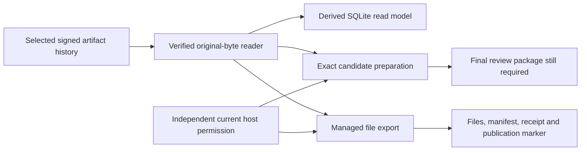

# Metadata preparation and managed file export

Status: verified candidate progress. R03 and the full plan remain in progress.
Authority effect: none. Actual owner response: none.

## Completed work

| Area | Actual result | Practical meaning |
| --- | --- | --- |
| API-v23 metadata/preparation suite | 86/86 PASS: 17 read guards, 47 preserved preparation checks, 22 metadata/scope checks | Fresh metadata authentication can prepare and validate all 42 exact owner-representation targets without renewing the expired Agent Assignment. |
| Independent metadata audit | PASS: original bytes, source hashes, declarations, nonce signatures, owner cores and SQLite checks | All 23 raw bodies, 189 Definition declarations, 41 Relation Kind declarations and 582 source revisions retain their byte and source distinctions. All 42 cores and 21 domain hypotheses were checked through real public prepare/validate calls. |
| Managed file export kernel | 24/24 PASS | Exports an exact selected artifact closure as original bytes or a pinned JSON rendering. Unsafe paths, changed selection/privacy bindings, stale permission and pending/tampered outputs are refused. |
| Independent file export audit | 20 checks PASS | Independently decoded original Intent/Goal bytes match exported files. Manifest, receipt and marker hashes match. Permission loss after a durable claim preserves an indeterminate generation; a later current permission cannot redispatch it. |

The metadata audit's 30,590 checks include repeated file-integrity comparisons;
they are not 30,590 separate behavioral tests. Its inherited
`actual_public_API_operations: 12` field describes the declared supported handler
count. The independent positive public journeys exercised by that audit are
`change.prepare`, `change.validate` and `lab.status`. The qualified audit proof
records this distinction explicitly. The complete 86-check suite is separate.

## Architecture

Artifact history supplies replay truth. SQLite and generated files are derived.
An ontology or context view supplies project facts; it does not grant an actor
permission. Metadata access uses a distinct current Principal and purpose with
no Agent Instance, Assignment or Session. Original Agent participation remains
historical after its fixed expiry of `2026-10-10T02:45:14.443492+00:00`.

The 21 owner domain configurations are explicitly hypothetical and unprovisioned.
Preparing a structurally valid Role or Role Assignment does not make it current
authority. The prepared 42-artifact result remains blocked for operational
admission and final review.

## New implementation and contracts

`product/lab/release-candidates/v1/interface/file-materialization-v1` contains:

- `base.py`: exact API-v23 source/profile and original source-reader selection.
- `kernel.py`: immutable material selection, pinned renderer, host permission and
  source guards, descriptor-based path traversal, exclusive generation/file
  creation, durable publication marker, observed output hashes and retry checks.
- `test_exports.py`: 24 checks using real selected original Intent/Goal bodies.
- `freeze.py` and `checks.py`: source freeze before owned effects, exact checks,
  source verification after checks and immutable receipts.
- `DESIGN.md`: trust boundaries, publication behavior and remaining integration.

The original proposal 0007 request/receipt schemas and proposal 0008
`files.materialize` API contract remain unchanged. The private generation manifest
records output paths, artifact references, original source locators and encodings,
privacy review, renderer and source cut. The manifest is an implementation record,
not a newly admitted artifact type.

Only a complete verified publication marker makes a generation published. A
partial generation is retained for inspection. Existing unmanaged files are
preserved. Fixture owners removed their newly owned temporary output directories
and metadata keys/workspaces after actual checks. The kernel neither deletes nor
repairs generations.

## Exact evidence

- Metadata suite: `metadata-scope-api-terminal-0002.json` and
  `metadata-scope-api-proof-0001.json` in this run.
- Metadata audit: `metadata-scope-audit-terminal-0001.json` and
  `metadata-scope-audit-proof-0001.json` in this run.
- File export suite: `file-materialization-terminal-0001.json` in this run and
  `file-materialization-v1/receipts/proof-0001.json` in the interface tree.
- File export audit: `file-materialization-audit-terminal-0001.json` and
  `file-materialization-audit-proof-0001.json` in this run.

Earlier failed suites and their complete frozen evidence remain preserved.
The initial file-kernel freeze encountered an absolute external-source path in
the inherited source manifest. Its path binding was corrected before the kernel
source was frozen and before any export checks ran; no runtime failure is implied.

## Remaining work and next implementation

Qualified plan progress remains **35/46 criteria and 12/34 APIs**. A standalone
kernel does not qualify a thirteenth public API. Next, integrate this kernel into
public `files.materialize` with an explicitly provisioned export policy, complete
source selection, privacy review and output-root binding. Exercise public
positive calls, key conflicts, current-authority retry, durable operation
inspection, incomplete-generation recovery and the relevant existing regressions.

The full 22 remaining APIs are: `proposal.review`, `checkpoint.resolve`,
`admission.apply`, `action.evaluate`, `action.dispatch`, `action.reconcile`,
`workflow.transition`, `classification.prepare`, `failure.assess`,
`challenge.submit`, `challenge.resolve`, `lesson.select`, `lesson.apply`,
`lesson.assess`, `ontology.project`, `files.materialize`, `package.export`,
`package.import`, `installation.execute`, `typed.extension.prepare`,
`capability.adoption.prepare`, and `release.prepare`.

A genuinely new bounded Agent episode and its relevant full Session regressions
remain required. Final owner coverage, the complete review package, S02 and R08
remain required. The sole final admission checkpoint stays at R08 after complete
S02; this progress report requests no interim admission.
