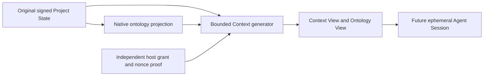

# Original-source Context delivery result

R03-0021 is verified candidate implementation evidence. It does not close R03 or the complete plan.

## What runs

1. Replay the exact signed candidate source using its selected engine and original artifact/schema bytes.
2. Read the independently selected native ontology projection at the same signed source cut.
3. Provision an owned, bounded host permission and fresh transport key. Authenticate an actual nonce with Ed25519.
4. Generate and validate 30 actual artifact bodies: 15 Ontology Nodes, 10 Ontology Edges, an Ontology, Ontology Cut, Ontology View, Context Request, and Context View.
5. Retain exact artifact headers, body hashes, enclosing transaction hashes, source selectors, schemas, Definition layers, typed endpoints, and 25 native semantic/governance joins.
6. Remove the owned host policy and transport key. The saved package is historical validation evidence. Future consumption needs a current permission and a freshly validated view.

The final Session step remains to be integrated in the successor API. The views do not create an active Agent or confer action authority.

## Evidence

| Measure | Actual result |
| --- | --- |
| Selected Context test methods | 46 passed |
| Original method ASTs retained | All 38 unchanged |
| New original-source criteria | 8 |
| Independent audit checks | 28,385 passed |
| Generated artifacts | 30 across 7 carrier families |
| Original raw bodies in provenance | 23 |
| Exact native joins | 25 |
| Prior proof files retained | All 9,261 |
| Complete source subjects accounted | 582 |
| Active Agents created | 0 |
| Public API operations added here | 0 |
| Repository admissions applied | 0 |

Lesson selection now checks the declared carrier's semantic kind. A generic artifact-instance projection cannot hide an Operational Lesson. This actual signed source has zero current Operational Lesson instances; applicability for a future Lesson remains an explicit requirement.

## Real example

`examples/R03-0021/actual-context-view.json` is a byte-for-byte copy of the generated Context View. Its companion provenance binds the original body, header, source proof, and delivery. It expired at **2026-10-09 22:35:32 UTC** and is presented as historical evidence. It is not a reusable host credential or a current view.

## Next implementation

Integrate this exact source into a successor of API-v16. Preserve its 12 existing handlers and all 34 operation contracts, former source histories, independently current host permissions, full disposable SQLite DDL/privacy/gap/watermark checks, raw body/schema custody, candidate decision-core bindings, and ephemeral Session disposal. Then implement the remaining 22 APIs and complete the remaining original task criteria.

The overall plan remains **35/46 criteria closed** and **12/34 APIs implemented**. The actual human pilot and final owner checkpoint remain outstanding. One actual R08 decision follows the complete S02 package. The original Assignment interval remains unchanged: 2026-10-09T02:45:14.443492+00:00 through 2026-10-10T02:45:14.443492+00:00.
