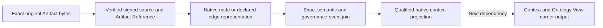

# Qualified original artifact mapping: verified candidate result

R03 is still in progress. This result supplies the native mapping dependency for Context delivery and the public API.

## What now works

The selected mapper reads the independently signed original-byte source. It projects **15 exact Artifact instances** as native node representations and **10 already declared Typed Relations** as directed edge representations. Every one of the **25 semantic events** has a separately sealed exact governance join. Actual native processes sealed the events and reproduced the same output in cold replay.

The complete source has **582 captured subjects** and **29 included current domain instances**. Each captured subject has a mapping disposition. The selected context represents 25 subjects. The remaining subjects and the older instance-bound Assignment diagnostic remain visible in the source accounting; their absence from this context graph grants no inference about their lifecycle or repository absence.

## The layers remain distinct

The Artifact Reference carries the actual original body hash. The native subject identifier hashes the Reference header under the declared mapping rule. They identify different objects. Source admission is a source fact; native lifecycle describes the representation; neither is an active Machine Agent or current host permission.

The current mapping semantics retain both ontology representation and represented domain layers. Each node has an `ontology-node/v2` representation component and a component for its represented Artifact carrier. Exact ontology and domain Definition witnesses qualify both components. Schema hashes, relation signatures, orthogonal axis, endpoint tuples and qualifiers retain distinct roles.

Source HEAD sequence **2**, native semantic cursor **25** and governance cursor **25** are separate coordinates. The native selector remains explicitly `test-complete-profile/v1`; an admitted production selector or SLA is not claimed.

## A real Assignment example

The [original native Assignment event](/home/vlad_/projects/CyberAlchemy-lab/docs/plans/0010-lab-one-shot-execution/runs/0001-candidate-construction/examples/R03-0020/original-native-assignment-event.json) is copied byte-for-byte from the actual native serializer output. Its [provenance](/home/vlad_/projects/CyberAlchemy-lab/docs/plans/0010-lab-one-shot-execution/runs/0001-candidate-construction/examples/R03-0020/provenance.json) connects the exact event, Artifact Reference and selected proof. The original Assignment body remains available in the [previous source example](/home/vlad_/projects/CyberAlchemy-lab/docs/plans/0010-lab-one-shot-execution/runs/0001-candidate-construction/examples/R03-0019/original-assignment.json).

This graph represents the new Profile-eligible Assignment. It does not start an Agent, authorize work or supply Session memory. Its original absolute validity interval is unchanged. Future Agent participation still needs independent current host permission, verified Context delivery and a bounded ephemeral Session.

## Validation

- **29 methods passed**: all 20 earlier mapping method ASTs are unchanged; nine additional criteria cover raw byte properties, current profile/cursors, complete diagnostics, original interval and ontology qualification.
- The independent audit passed **28,091 checks**, including a third independent actual cold native process, all 23 original body hashes carried into native properties and exact witness/endpoint joins.
- Every one of the **9,110 prior proof bindings** remains in the new partial evidence closure.
- The first frozen mapper build is retained. Inspection identified the newer mapping semantics already selected by Context delivery; the verified successor incorporates those semantics and has a distinct ontology namespace.

## What follows

Generate source-bound Context/Ontology carrier outputs using the same reader/eligibility/record module identities and native package. Provision fresh owned host permission and transport signing resources; retain the original Assignment interval and delete ephemeral resources after validation. Preserve all 38 original Context delivery checks and add raw-body and source/module/cut guards. Then integrate the complete public API and SQLite projection.

Overall status remains **35/46 criteria closed; 12/34 public APIs implemented; 22 APIs remaining**. Canonical admission, human pilot, final owner response and stable release are not produced by this mapping. The single actual R08 checkpoint remains after the complete S02 package.

## Evidence

- [R03-0020 partial proof](/home/vlad_/projects/CyberAlchemy-lab/product/lab/release-candidates/v1/interface/custody-mapped-context-v2/receipts/R03-0020.json)
- [Independent audit](/home/vlad_/projects/CyberAlchemy-lab/product/lab/release-candidates/v1/interface/custody-mapped-context-v2/receipts/independent-audit.json)
- [Frozen mapper source](/home/vlad_/projects/CyberAlchemy-lab/product/lab/release-candidates/v1/interface/custody-mapped-context-v2/source-manifest.json)
- [Frozen private derived package](/home/vlad_/projects/CyberAlchemy-lab/product/lab/release-candidates/v1/interface/custody-mapped-context-v2/packages/0001/manifest.json)

- [Currentness PASS](/home/vlad_/projects/CyberAlchemy-lab/docs/plans/0010-lab-one-shot-execution/runs/0001-candidate-construction/currentness-receipts/0079.json)
- [Next integration handoff](/home/vlad_/projects/CyberAlchemy-lab/docs/plans/0010-lab-one-shot-execution/runs/0001-candidate-construction/custody-integration-handoff-0004.json)
