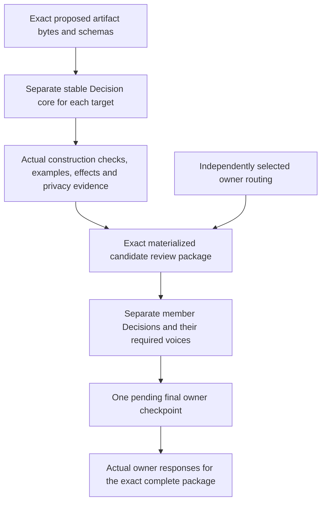

# One final review — candidate implementation in verification

**Status: candidate preparation; validation and public integration pending.** The full plan remains 35/46 criteria closed and 12/34 public API operations implemented. These new candidates have not been admitted.

## Recommendation being executed

Continue implementation and verification under the recorded development authorization. Prepare every exact target, its independent Decision core, examples, schema changes, effects, privacy review, and evidence for the complete S02 package. Present that exact package once at the final R08 owner checkpoint.

No additional admission decision is needed to repair the candidate. Actual owner responses, canonical admission, operations on existing stores, activation, and publication still require their applicable authority.

## Work prepared

| Candidate | Change | Verification state |
|---|---|---|
| Review package v2 | Revalidate actual prepared targets, retain separate Decision cores and multiple owner voices, materialize a pending Decision Bundle and Checkpoint, and preserve one final checkpoint. Correct the fixture request key. | Full 20-case suite passed. Independent audit passed 94 checks across both source branches; 21 original objects per preview are retained in a 1,090-file frozen proof. |
| API-v19 | Keep explicit Definition and Relation Kind declaration mappings; use the selected original-byte reader for artifact instances. Release the unused parent fixture lease before its real child server starts. | Frozen against 1,114 exact files. Full 129-case suite is running; all original method assertions retained. |

API-v17 completed all 129 tests with four failures and 31 errors. Its source, complete cases, traces, and wire observations are preserved. API-v18 continues unchanged; its raw-source artifact query has failed. An independent completed diagnostic inspected all 582 revisions and found 189 Definition declarations with no instance carrier field. Its actual SQL construction trace is retained.

## What one review contains

The same person may supply multiple required voices at one checkpoint. Each voice retains its role, member scope, evidence, and outcome. Preparation supplies no owner response.

## Gaps retained explicitly

- The current preference names `principal:lab-owner`; the recognized current Principal is `principal:repository-owner`. The preview refuses to alias them. Its positive fixture includes a proposed preference as another exact target with its own Decision core; it remains unadmitted.
- Current role declarations support routing metadata. Public `proposal.review` still requires independent coverage of every governing role, authenticated host integration, durable idempotency, and complete API contract verification.
- The protocol review-workflow reference is explicit configuration, not an invented Workflow Run artifact.
- Construction checks do not erase semantic or operational gaps. Missing pilot evidence and actual owner authority remain pending.
- A direct review kernel is not the thirteenth public API handler. All 22 remaining API contracts stay in scope.

## Next actions

1. Retain the actual complete API-v18 and API-v19 suite terminals; diagnostic and review-kernel terminals are already recorded.
2. Finish the complete API-v19 129-case suite, and then perform the independent raw-source/SQL/Session audit.
3. Review the completed original-byte archive and actual example. Public adapter, governing role coverage and full contract integration remain required.
4. Integrate the remaining public contracts and original acceptance obligations, assemble S02, and present R08.

## Files

- [Existing execution authorization](/home/vlad_/projects/CyberAlchemy-lab/docs/plans/0010-lab-one-shot-execution/runs/0001-candidate-construction/authorization.json)
- [Existing approval boundaries](/home/vlad_/projects/CyberAlchemy-lab/docs/plans/0010-lab-one-shot-execution/runs/0001-candidate-construction/ONE-APPROVAL-BOUNDARIES.md)
- [Review v2 source](/home/vlad_/projects/CyberAlchemy-lab/product/lab/release-candidates/v1/interface/review-package-v2/source-manifest.json)
- [Review v2 full-suite log](/home/vlad_/projects/CyberAlchemy-lab/product/lab/release-candidates/v1/interface/review-package-v2/checks-0001.log)
- [API-v19 derivation](/home/vlad_/projects/CyberAlchemy-lab/product/lab/release-candidates/v1/interface/api-v19/derivation.json)
- [API-v17 complete terminal](/home/vlad_/projects/CyberAlchemy-lab/docs/plans/0010-lab-one-shot-execution/runs/0001-candidate-construction/custody-api-terminal-0001.json)

## Actual example and proof

- [Two-target candidate example](/home/vlad_/projects/CyberAlchemy-lab/docs/plans/0010-lab-one-shot-execution/runs/0001-candidate-construction/examples/R03-review-kernel-0001/EXAMPLE.md)
- [Frozen 20-test / 94-check proof](/home/vlad_/projects/CyberAlchemy-lab/product/lab/release-candidates/v1/interface/review-package-v2/receipts/independent-proof-0001.json)
- Currentness receipt 0082: PASS, 35/46 criteria, 36 active receipts, 77 original planning files, 887 sources, no changes.
