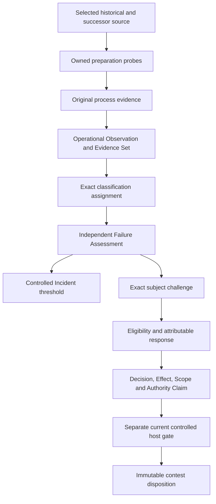

# W05 — Evidence, classification, failure and challenge

Result: **PASS for candidate implementation criteria**. Full plan: **24/46** tasks closed. Actual R08 owner outcome: **null**.

The original task and both SWUs are satisfied for the explicitly controlled candidate scope. Task Session and Context Builder selected 24 sources covering seven obligations before implementation. The development authorization covers the owned examples and necessary tests. Candidate proof creates no canonical admission or production authority.

## Actual example

1. Re-execute the retained historical W04 builder in a fresh owned child directory against selected current dependencies. Preparation actually rejects its unsupported `experiment-design` Hypothesis inline counterpart. The schema validator correctly detects the invalid output; the preparation is the failed operation.
2. Execute the corrected builder independently. Thirteen selected records validate. The historical source bytes remain unchanged. This demonstrates successor recovery and preserves review residue for the historical revision.
3. Retain original selected actor/Tool bytes, explicit host permission, stdout, stderr, traceback and observation manifest before interpreting them. The replay is controlled and does not reproduce the original historical runtime environment.
4. Bind exact Classification Scheme, Value, axis and subject revision. The selected assignment is an annotation; it supplies no permission. Cardinality survives reconstruction.
5. Assess occurrence, mode, cause, impact, containment and recovery independently. Occurrence and manifestation are supported in this controlled case; cause remains an open Hypothesis. Impact is one owned preparation; control effectiveness has no inferred evidence. Recovery does not silently repair the historical revision.
6. The selected production Incident policy returns a valid negative result. A separately selected controlled threshold creates an explicitly labeled controlled Incident from the observed failed preparation.
7. Submit a contest against the exact historical Implementation revision. Check eligibility, respond with attributable evidence within the selected 300 second window, and apply a local fixture Decision effect that accepts the contest for revision. The gate binds the exact Decision, Effect, Scope, Authority Claim, response, subject, Principal, Session, cut and expiry.
8. Produce an immutable resolved Challenge Event successor. Preserve the submitted event, challenged source and original observations. The fixture outcome remains separate from actual R08 owner approval.



## Implementation and retained outputs

- [Evidence service](/home/vlad_/projects/CyberAlchemy-lab/implementation/lab-workflows/candidates/v1/evidence/service.py): original-byte resolution, source/current permission checks, declared output kinds and budgets, owned process observations and pending no-redispatch boundary.
- [Independent failure service](/home/vlad_/projects/CyberAlchemy-lab/implementation/lab-workflows/candidates/v1/failures/service.py): exact classification and reconstructed cardinality, independent assessments and selected Incident thresholds for this bounded preparation profile.
- [Challenge service](/home/vlad_/projects/CyberAlchemy-lab/implementation/lab-workflows/candidates/v1/challenges/service.py): exact eligibility, response and declared local fixture disposition.
- [Fresh preparation probe](/home/vlad_/projects/CyberAlchemy-lab/implementation/lab-workflows/candidates/v1/evidence/probe_child.py): independently pinned source execution and original outcome capture.
- [Concrete episode index](/home/vlad_/projects/CyberAlchemy-lab/implementation/lab-workflows/candidates/v1/failures/receipts/0004/observed/episode-index.json): 27 candidate carrier revisions, 26 typed connections and one independently pinned capability input, totaling 54 selected record rows. Four adapter Implementations are separately identified as exact R08 review members; test fixtures receive no automatic admission.
- [Failure Assessment](/home/vlad_/projects/CyberAlchemy-lab/implementation/lab-workflows/candidates/v1/failures/receipts/0004/observed/failure-assessment-fb95dd426a0bc8ea4cd8.json) and [resolved Challenge Event](/home/vlad_/projects/CyberAlchemy-lab/implementation/lab-workflows/candidates/v1/failures/receipts/0004/observed/challenge-event-b4cc27c0dfdccdf59100.json): reviewable concrete records.

Existing carrier schemas and exact relation contracts govern every produced record. Inline references resolve selected endpoints and declared ordered pairs; they create no additional implicit global edge. Machine Agents remain ephemeral. Persisted observations and artifact candidates are scoped Project work evidence; Session notes are erased when the lease closes.

## Validation

Executed:

```bash
python3 implementation/lab-workflows/candidates/v1/failures/validate.py
```

[Active receipt 0004](/home/vlad_/projects/CyberAlchemy-lab/implementation/lab-workflows/candidates/v1/failures/receipts/0004.json): **94/94 checks passed**, comprising 52 W05 guards and all 42 preserved W02 regressions, in **120.447 seconds**. The actual signed Work/native context regression passed. All 351 frozen source/prerequisite bindings stayed unchanged. Fresh child reconstruction verified all 54 record rows and 26 typed connections without redispatch or an owner outcome.

Receipt SHA-256: `809855809498495ce6595e4a41c9cb6313a3b8126b82c06557505eac3b0c7fc3`.

The native executable was independently matched to the existing C13 generator manifest before and after the suite: `62f4244cfe23b8f0252e99b3778ed9a78807a2e67657f069882c823ed97e7f59`. Its pinned local path is an external test dependency; no native binary was copied into Git.

The checks cover mode/occurrence confusion, proposed cause asserted as fact, unsupported impact/recovery, exact Scheme/Value/axis and selected-assignment poisoning, cardinality, original-byte drift, Incident scope and policy, challenger/subject/ground/evidence eligibility, future/expired response timestamps, revoked permission, Profile/output-kind limits, byte budget, undeclared relation qualifiers, missing or caller-supplied gate, wrong Decision/Effect/Scope, stale gate cut/Session, immutable subject preservation, no redispatch and ephemeral memory erasure. Poison and timeout checks are synthetic fixtures; the separate retained preparation example is an actual controlled execution.

## Preserved attempts and model gap

- Attempt 0001 was interrupted after review found missing future-submission eligibility and unselected-assignment checks. Its sources, partial log and interruption record are retained.
- Receipt 0002 passed W05 checks and the concrete episode but failed one regression because the new harness omitted the existing native-reader environment setting. Its exact earlier harness and README are retained.
- Receipt 0003 passed all 92 then-declared checks. Its source snapshots remain after explicit output-kind and original-byte budget guards were added. Receipt 0004 supplies the fresh 94-check proof for the reviewed successor.
- The pair inventory lists Authority Boundary → Decision Scope for `scopes-authority-over`; the current Typed Relation schema omits that pair. This episode uses Authority Claim → Decision Scope, which both contracts accept. The unselected discrepancy routes to **O05/S02 model reconciliation**; no relation extension or semantic approval is inferred here.

## Synchronization and next step

The active execution DAG, both W05 SWUs, evidence index, work-pack board and construction status are synchronized to receipt 0004. Frozen original contracts, old runtime packages/receipts, live stores and unrelated dirty work remain outside this task's writes. Full-plan currentness must pass before relying on this closure.

Next: **W06 operational lesson drafting, selection, actual later application and outcome assessment**. Wider failure profiles, general challenge recovery, ontology domain mapping, SQLite/read model, generic API routing, production authentication, Product assessment and actual R08/A01–A04 effects remain full-plan obligations. A passing fixture disposition does not satisfy final owner approval.
