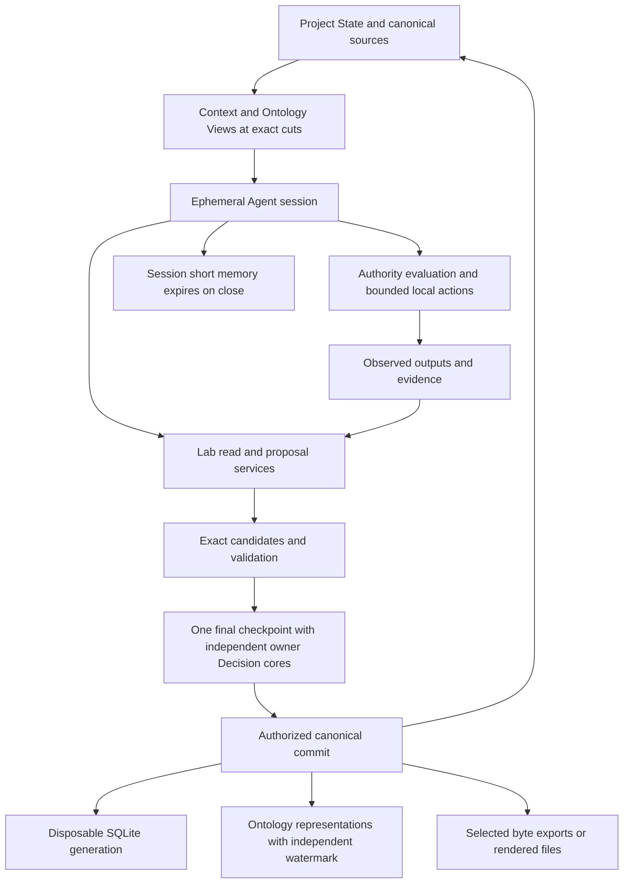

# Architecture and Agent interaction

Status: proposed integration design. The [API contract proposal](../0008-lab-api-contracts/PROPOSAL.md) binds the reviewed local call boundary. The new service names are responsibilities; transport and implementation remain to be selected.

## 1. Prepare an assignment

The governed Project, Goal, Work, Coordination Context and Intent Resolution identify the objective and method route. Agent Profile, capabilities and Implementation describe the available realization. Principal, role, responsibility, Authority Boundary and Delegation determine what the actual actor may do. Capability existence alone grants no permission.

A Coordination Context retains one Goal. Work can be partitioned into multiple bounded assignments without turning that context into a multi-goal object.

## 2. Deliver bounded context

`context.get` binds the assignment, Work and exact source cut. Delivery names Context View and Ontology View plus included sources, exclusions, lessons, freshness, expiration and gaps. `artifact.inspect` shows original body, contract and separate status facets. `artifact.query` returns references with projection generation and paging/depth/byte limits.

Admission status, domain lifecycle, implementation state, runtime observation and outcome assessment remain separate facets. Historical body labels are preserved; effective admission is explained through exact authority evidence.

## 3. Open an ephemeral session

`session.open` binds the assignment, capability/profile realization, delivered context, authority references and budget. Session memory is process-local, cannot be exported or written durably and expires with the session. A new session reconstructs continuity from Project State through views.

Eligible observed outputs may become separately governed observations, action evidence, lessons or other artifacts. Persisting one of those artifacts requires its contract, attribution and applicable authority. A session dump is not Project State. `session.close` requests termination; its separate receipt records whether termination and memory disposal actually occurred and names unresolved action residue.

## 4. Act and propose

A tool adapter pins input/output schemas, implementation, effect scope, retry semantics and recovery contract. `action.evaluate` checks actual authority. `action.dispatch` observes real results; indeterminate actions require reconciliation before retry. A valid request cannot substitute for this evaluation.

`change.prepare` and `change.validate` produce exact candidate effects. Existing domain schemas validate body shapes; runtime checks resolve identity, reference closure, current carrier posture, typed pair/qualifier semantics and evidence. Candidate new contracts use a separate binding and require owner review before becoming writable.

## 5. Review and apply

The review includes exact diffs, examples, declared consequences, validation, exclusions and private/public review. Stable Decision cores bind independently governed members. The reviewed package binds those cores, real materialized targets and the applicable Workflow Decision Profile. Actual owner conversation provenance, a verified signature or existing exact authority can supply authorization evidence; the chosen channel requires its own verified contract.

`admission.apply` checks the expected cut, exact authorization and immutable package closure. It stages content and records, serializes canonical writers and publishes a canonical head only after the selected transaction protocol is satisfied. Replay and recovery must verify the full chain and preserve committed history. The schema package describes these obligations; it does not implement them.

## 6. Derive and inspect

The commit receipt distinguishes canonical commit from projection and file status. SQLite receives a complete generation with source verification and watermarks. Queries never infer a new admission from cached rows. Ontology projection binds represented source revisions and its independent stream/cut; ontology representation does not confer Lab authority.

A byte-exact file export reproduces verified stored original bytes. A rendered view binds renderer/version and inputs. Both are managed generations with safe paths, scope/privacy review and no overwrite of unmanaged files. Portable packages include required dependencies and exclude credentials and session memory.

## Selected components

| Component | Responsibility | Binding |
|---|---|---|
| Existing domain contracts | Govern artifact bodies and their versioned semantics | [Domain bindings](domain-bindings.json) |
| Candidate protocol contracts | Type messages, configurations and receipts | [Schema catalog](schema-catalog.json) |
| Service adapter | Authenticate caller, resolve operation, evaluate bounds and policy | [Service contracts](service-contracts.json) |
| Workflow engine | Apply bound transitions and record assessed satisfaction | [Workflow models](WORKFLOWS.md) |
| Canonical publisher | Exact authority, immutable package, ordered records and head | [Commit obligations](RUNTIME-OBLIGATIONS.md) |
| SQLite projector | Disposable complete read generations | [SQL DDL](../0006-lab-artifact-storage/schemas/sqlite-read-model.sql) |
| Ontology adapter | Explicit representation mapping and separate authority/cut | [Ontology mapping schema](schemas/ontology-mapping.schema.json) |
| File/package adapter | Verified byte exports and pinned rendered generations | [File generation schema](../0006-lab-artifact-storage/schemas/file-generation.schema.json) |

No persistent database, runtime directory, transaction or installation is created by authoring this package.
