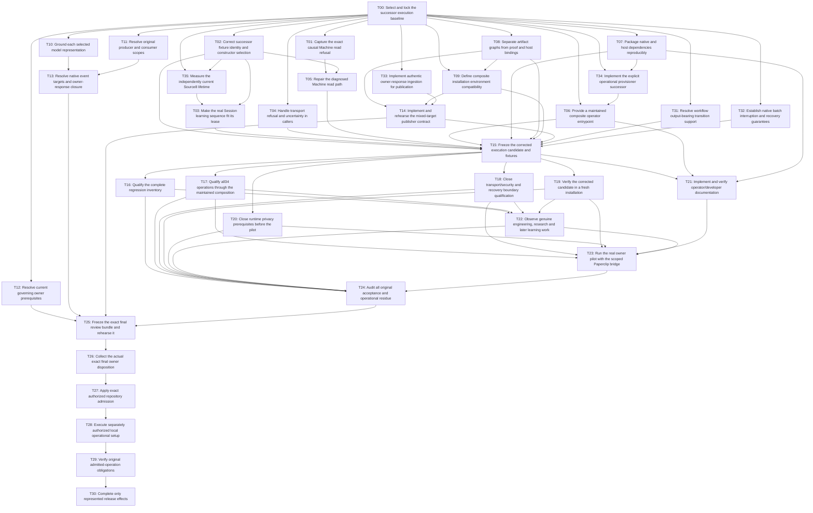

# Lab runtime completion dependency graph

Candidate plan; no execution or authority. Edges require accepted upstream evidence. [dag.json](dag.json) is the machine source. [Task contracts](WORK-PACK.md) define each node.

T00 starts the technical lanes. T12 can be resolved in parallel, but it gates final package readiness. T13 has an explicit design stop if unknown owner Decision bytes change semantic target digests. T26–T30 require actual owner authority and operational observations.
